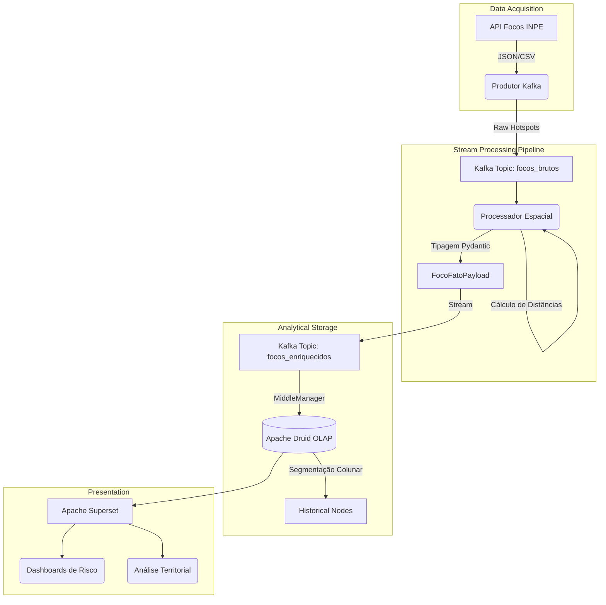
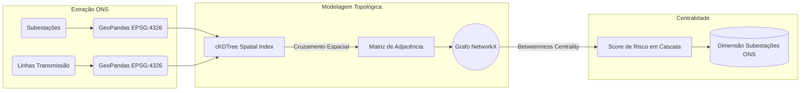
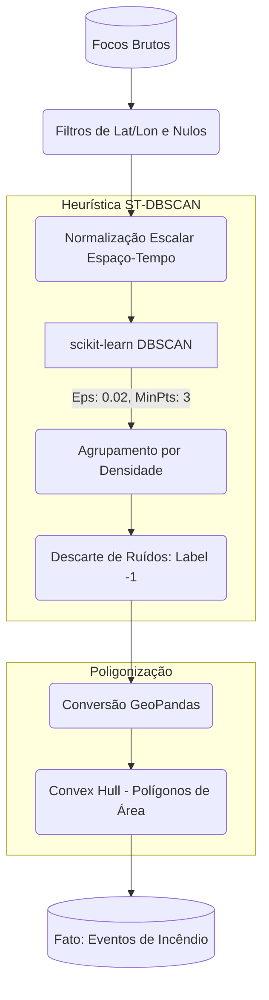
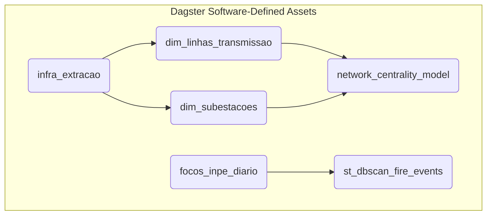

# Diagramas Arquiteturais e Científicos

Esta seção contém a representação visual dos pipelines de processamento geoespacial, fluxo de streaming e modelagem científica (ST-DBSCAN e Grafos).

## 1. Topologia de Streaming (Kafka, Druid e Superset)

## 2. Ciência de Redes no SIN (NetworkX)

## 3. Clusterização ST-DBSCAN (Fogo Dinâmico)

## 4. Orquestração DataOps (Dagster)

