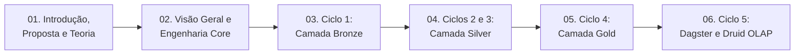

# Portal de Documentação e Governança Técnica — CCO DataOps (SIRDA)

Este diretório centraliza a arquitetura sistêmica, os registros de decisão de arquitetura (ADRs), os índices de dicionários de dados, as especificações de capacidade de infraestrutura e a produção científica do projeto **CCO DataOps (SIRDA — Sistema de Inteligência e Resposta a Desastres Ambientais)**.

A documentação adota uma topologia **Hub & Spoke Descentralizada** organizada em três níveis:
1. **Trilha de Arquitetura Geral (`docs/architecture/01..06`)**: parte da definição do problema, proposta do projeto e fundamentação teórica (`01`), passa pela visão geral e engenharia do núcleo (`02`) e percorre cada ciclo da arquitetura Medallion (`03` Bronze $\rightarrow$ `04` Silver $\rightarrow$ `05` Gold $\rightarrow$ `06` Orquestração/OLAP).
2. **Trilha de Especificações Modulares Numerada (Etapas `01` a `18`)**: documentação técnica profunda co-localizada nos próprios diretórios de código (`src/`, `infra/`, `scripts/`), contendo catálogos de funções de limpeza, parâmetros de APIs, equações matemáticas e dicionários de dados. Cada arquivo possui cabeçalho e rodapé de navegação sequencial (`Anterior / Próximo`).
3. **Módulos de Governança, Desempenho e Pesquisa (`docs/`)**: ADRs, estudo de caso territorial, especificações de hardware/Docker, benchmarks de concorrência do Apache Druid e publicações científicas.

---

## 1. Nível 1 — Trilha de Arquitetura Geral (`docs/architecture/`)

Recomendada como ponto de partida para compreender o propósito do sistema, o racional teórico e o fluxo ponta a ponta antes de inspecionar módulos específicos:

| Ordem | Capítulo Arquitetural | Conteúdo Principal |
| :-: | :--- | :--- |
| **01** | [**`01_introducao_e_proposta.md`**](architecture/01_introducao_e_proposta.md) | Problema técnico, proposta do sistema, os 4 eixos operacionais (ONS/SIN, FUNAI, DNIT, CNES) e fundamentação teórica (Endsley 1995, DataOps Ereth 2018, ST-DBSCAN e Teoria dos Grafos). |
| **02** | [**`02_visao_geral_e_engenharia_core.md`**](architecture/02_visao_geral_e_engenharia_core.md) | Fluxo de dados End-to-End, modelagem analítica Snowflake, padrão *Functional Core / Imperative Shell* (FCIS), princípios SOLID e contratos base (`src/core/`). |
| **03** | [**`03_camada_bronze_ingestao.md`**](architecture/03_camada_bronze_ingestao.md) | Zona de ingestão bruta imutável, síntese dos 6 provedores governamentais (INPE, ANEEL, FUNAI, IBGE, DNIT, CNES) e extratores automatizados. |
| **04** | [**`04_camada_silver_dimensoes_e_motor_espacial.md`**](architecture/04_camada_silver_dimensoes_e_motor_espacial.md) | Funções puras de sanitização, reprojeção métrica `EPSG:5880`, ETL das 7 dimensões, 23 Lookups URI, `MotorEspacial` (`STRtree`) e índices matemáticos. |
| **05** | [**`05_camada_gold_ciencia_e_streaming.md`**](architecture/05_camada_gold_ciencia_e_streaming.md) | Centralidade de intermediação na malha do SIN (`NetworkX`), agrupamento espaço-temporal 3D em janelas fechadas (`ST-DBSCAN`) e publicação Kafka Dual-Branch. |
| **06** | [**`06_orquestracao_olap_e_operacao.md`**](architecture/06_orquestracao_olap_e_operacao.md) | Grafo de 12 Software-Defined Assets no Apache Dagster, topologia de 5 nós do Apache Druid 34.0, dashboards Apache Superset e automação operacional. |

---

## 2. Nível 2 — Trilha Sequencial das Especificações Modulares (Etapas `01` a `18`)

Cada documento abaixo especifica em nível de implementação (assinaturas de funções, regexes, thresholds, parâmetros HTTP e tipos de colunas) os módulos do repositório, encadeados na ordem exata do fluxo de dados:

| Etapa | Ciclo | Documento Modular (Fora de `docs/`) | Escopo Técnico Detalhado |
| :-: | :--- | :--- | :--- |
| **01** | **Ciclo 0 (Core)** | [**`src/core/README.md`**](../src/core/README.md) | Constantes geodésicas (`EPSG:4326`, `EPSG:5880`), `PipelineSettings`, contratos abstratos (`ExecutablePipelineStep`, `SpatialEngineProtocol`, `StreamPublisherBase`) e schemas Pydantic (`FocoFatoPayload`, `EventoFatoPayload`). |
| **02** | **Ciclo 1 (Bronze)** | [**`src/bronze/README.md`**](../src/bronze/README.md) | Arquitetura da camada Bronze e catálogo de métodos de `AneelArcGisExtractor` e `InpeQueimadasExtractor`. |
| **03** | **Ciclo 1 (Bronze)** | [**`src/bronze/FONTES_E_APIS.md`**](../src/bronze/FONTES_E_APIS.md) | Endpoints HTTP, parâmetros de query, paginação `resultOffset` e anomalias de formato (`-999`, `13P8`, `PopupInfo` HTML) dos 6 provedores. |
| **04** | **Ciclo 1 (Bronze)** | [**`src/bronze/DICIONARIO_DADOS.md`**](../src/bronze/DICIONARIO_DADOS.md) | Esquemas físicos originais (colunas e tipos nativos) dos arquivos brutos em `src/bronze/data/`. |
| **05** | **Ciclo 2/3 (Silver)** | [**`src/silver/README.md`**](../src/silver/README.md) | Hub arquitetural da Camada Silver (integração entre o ciclo dimensional batch e o motor espacial runtime). |
| **06** | **Ciclo 2.1 (Silver)** | [**`src/silver/utils/README.md`**](../src/silver/utils/README.md) | Catálogo de funções puras de limpeza (`cleaners.py`, `string_helpers.py`, `keys.py`, `geo_helpers.py`, `df_helpers.py`), `PathJsonCodec` e `BaseETL`. |
| **07** | **Ciclo 2.2 (Silver)** | [**`src/silver/etl/README.md`**](../src/silver/etl/README.md) | Especificação dos 7 pipelines ETL (`ETLDim*`), geração de chaves `ROD_<md5>`, joins espaciais (`sjoin`, `sjoin_nearest`, `overlay`) e faixas de classificação. |
| **08** | **Ciclo 2.3 (Silver)** | [**`src/silver/DICIONARIO_DADOS.md`**](../src/silver/DICIONARIO_DADOS.md) | Dicionário de dados das 7 tabelas CSV em `src/silver/data/dimensions/` (colunas, tipos, PKs, FKs e volumetria real). |
| **09** | **Ciclo 2.4 (Silver)** | [**`src/silver/validators/README.md`**](../src/silver/validators/README.md) | Validadores `DimensionIntegrityValidator`, `HospitalMunicipioJoinValidator` e catálogo completo dos 23 Lookups URI registrados por `DruidLookupRegistrar`. |
| **10** | **Ciclo 3.1 (Silver)** | [**`src/silver/spatial/README.md`**](../src/silver/spatial/README.md) | Especificação de `MotorEspacial`, `SpatialLayer`, `SpatialLayerCatalog`, `SpatialLayerLoader`, `SpatialLayerSpec` e `DistanceClassifier`. |
| **11** | **Ciclo 3.2 (Silver)** | [**`src/silver/streaming_processing/README.md`**](../src/silver/streaming_processing/README.md) | Função pura `transformar_foco`, funções de extração (`extractor.py`) e equações matemáticas dos índices de condição ambiental, severidade e ameaça (`calculators.py`). |
| **12** | **Ciclo 4 (Gold)** | [**`src/gold/README.md`**](../src/gold/README.md) | Hub arquitetural e operacional da Camada Gold. |
| **13** | **Ciclo 4.1 (Gold)** | [**`src/gold/ARQUITETURA.md`**](../src/gold/ARQUITETURA.md) | Formulação matemática e catálogo de métodos de `EventizadorIncendios`, `EventGeometryBuilder`, `EventoConfig` (ST-DBSCAN) e `SINNetworkCentralityModel` (NetworkX). |
| **14** | **Ciclo 4.2 (Gold)** | [**`src/gold/streaming/README.md`**](../src/gold/streaming/README.md) | Parâmetros de rede do `KafkaStreamClient`, telemetria do `StreamingAuditLogger` e produtores `ProdutorFocosStreaming` e `ProdutorEventosStreaming`. |
| **15** | **Ciclo 4.3 (Gold)** | [**`src/gold/DICIONARIO_DADOS.md`**](../src/gold/DICIONARIO_DADOS.md) | Dicionário de dados das tabelas fato `FATO_FOCOS_INCENDIO` (`29` colunas) e `FATO_EVENTOS_INCENDIO` (`52` atributos). |
| **16** | **Ciclo 5.1 (Orq.)** | [**`src/orchestration/README.md`**](../src/orchestration/README.md) | Especificação dos 12 Software-Defined Assets no Apache Dagster (`dagster/repo.py`) e despacho em memória (`execute_pipeline_step`). |
| **17** | **Ciclo 5.2 (Infra)** | [**`infra/README.md`**](../infra/README.md) | Topologia do Apache Druid 34.0, especificações JSON de ingestão (`sample_bucket`, `SORTED_SET`), perfis de capacidade e Apache Superset. |
| **18** | **Ciclo 5.3 (CLI)** | [**`scripts/README.md`**](../scripts/README.md) | Pipeline operacional numerado (`01` a `05`), scripts de manutenção do cluster e suíte de benchmarking. |

---

## 3. Nível 3 — Governança, Dicionários, Desempenho e Produção Científica (`docs/`)

| Seção | Documento de Entrada | Escopo |
| :--- | :--- | :--- |
| **Dicionários de Dados Unificados** | [**`docs/data_dictionary/index.md`**](data_dictionary/index.md) | Índice consolidado dos dicionários de dados das camadas Bronze, Silver e Gold e catálogo de APIs. |
| **Registros de Decisão (ADRs 001–006)** | [**`docs/adr/README.md`**](adr/README.md) | Decisões arquiteturais formais: Layout Monorepo, Padrão FCIS/SOLID, Snowflake e Lookups, Dagster In-Memory, `STRtree`/`EPSG:5880` e Grafos do SIN. |
| **Domínio e Contexto Territorial** | [**`docs/domain/README.md`**](domain/README.md) | Estudo de caso territorial da Ilha do Bananal, Terra Indígena Parque do Araguaia e Aldeia Canoanã. |
| **Especificações de Hardware e Docker** | [**`docs/technical_specs/README.md`**](technical_specs/README.md) | Requisitos de hardware, quotas de cgroups Docker, parâmetros JVM do Druid e pilha de bibliotecas Python. |
| **Avaliação de Desempenho (Benchmarks)** | [**`docs/performance/README.md`**](performance/README.md) | Ensaios experimentais de vazão (QPS), latência P50/P95/P99, eficiência de cache e saturação de CPU no Apache Druid. |
| **Produção Científica e Acadêmica** | [**`docs/academic/README.md`**](academic/README.md) | Relatório final de Iniciação Científica, artigo no formato SBC, resumo expandido e pôster A0. |
