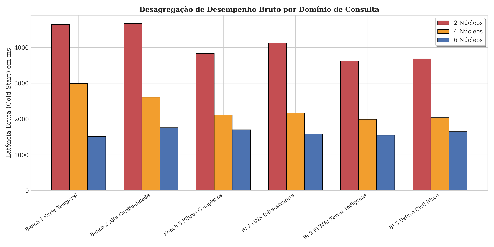
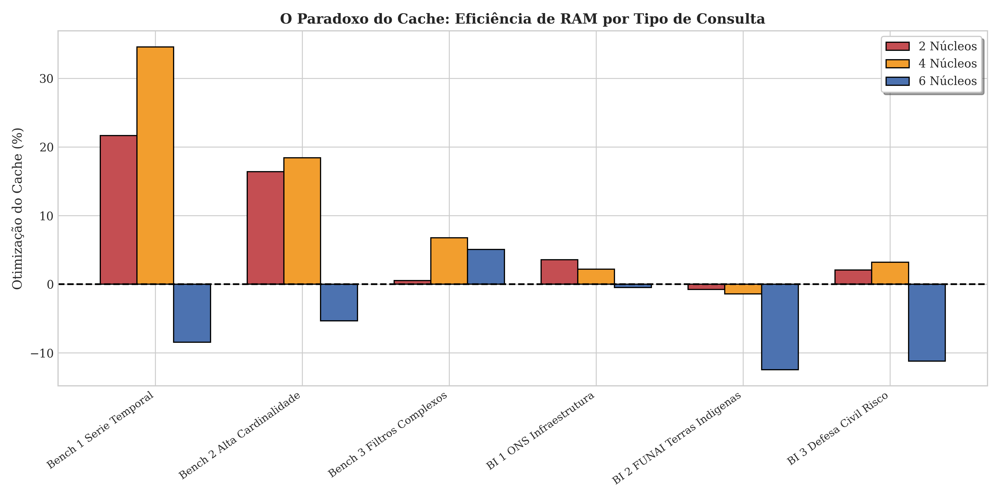
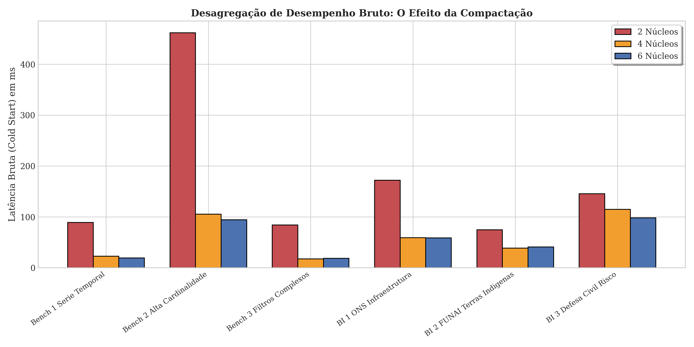
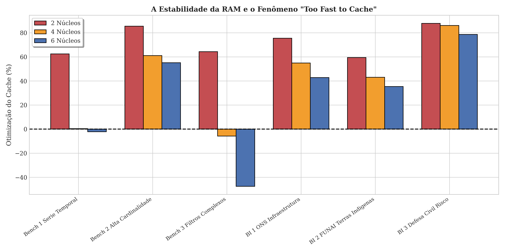
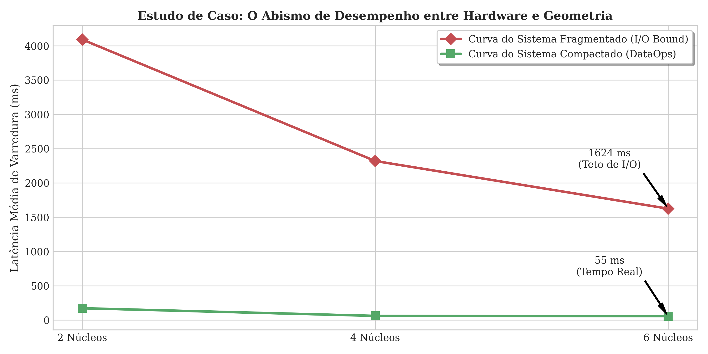
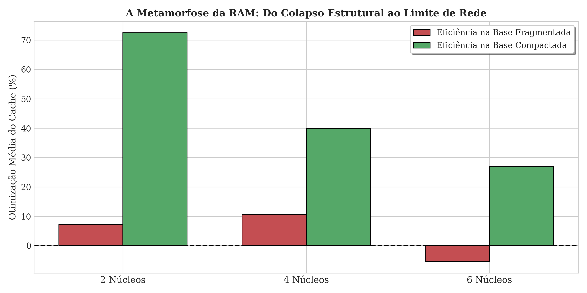

# Benchmark Preliminar do Apache Druid — Março de 2025

> **Data de Execução**: Março de 2025  
> **Contexto**: Estudo conduzido antes da construção da arquitetura Medallion completa do SIRDA.  
> **Objetivo**: Isolar e quantificar o comportamento puro do motor OLAP Apache Druid sob diferentes estados de organização de disco e alocações de CPU, sem a complexidade do cruzamento geoespacial com dimensões Silver.

---

## 1. Dados Utilizados

A massa de dados compreendeu **~3,1 milhões de registros transacionais** de focos de calor do INPE. Diferentemente do sistema final (que cruza com malhas da FUNAI, ONS, CNES e rodovias), este dataset foi ingerido como uma tabela fato isolada, sem dimensões Silver associadas.

No **Estado Fragmentado** (Relatório 1), a base encontrava-se intencionalmente mantida no seu estado bruto de ingestão: estilhaçada em **6.518 arquivos minúsculos** (*Tiny Segments*). Essa condição reproduz o cenário real de ingestão contínua via Kafka sem intervenção de manutenção de disco.

No **Estado Compactado** (Relatório 2), a mesma base foi submetida ao processo nativo de compactação do Druid (`REPLACE ... CLUSTERED BY`), agrupando os 6.518 retalhos em segmentos contíguos por granularidade `YEAR`.

---

## 2. Metodologia

### 2.1 Bateria de Queries

Foram definidas **6 queries benchmark** divididas em dois grupos:

| ID | Grupo | Descrição |
|----|-------|-----------|
| Bench 1 | Analítico | Série Temporal — agregação `COUNT` por mês/ano |
| Bench 2 | Analítico | Alta Cardinalidade — `GROUP BY` sobre municípios |
| Bench 3 | Analítico | Filtros Complexos — `WHERE` com múltiplas cláusulas |
| BI 1 | Dashboard | ONS Infraestrutura — join simulado com linhas de transmissão |
| BI 2 | Dashboard | FUNAI Terras Indígenas — cruzamento com demarcações |
| BI 3 | Dashboard | Defesa Civil Risco — painel de risco de incêndio |

### 2.2 Variações de Hardware

Cada query foi executada em **3 perfis de CPU** (vCPUs alocados ao contêiner Docker do nó *Historical*):

| Perfil | vCPUs |
|--------|-------|
| Mínimo | 2 núcleos |
| Intermediário | 4 núcleos |
| Máximo | 6 núcleos |

### 2.3 Protocolo de Medição

- **Cold Start**: Primeira execução após reinicialização do contêiner (sem cache).
- **Warm Start**: Execuções subsequentes (com cache do Broker ativo).
- Cada cenário foi repetido múltiplas vezes para garantir estabilidade estatística.

---

## 3. Resultados — Relatório 1: Estado Fragmentado (6.518 Tiny Segments)

### 3.1 Latência Bruta (Cold Start)

Com a base estilhaçada, o motor sofreu gargalo severo de I/O. O nó *Historical* precisava abrir, ler e fechar 6.518 arquivos individuais para cada query, gerando um *overhead* de sistema de arquivos que dominou o tempo de resposta.

**Observações-chave**:
- Com 2 núcleos, as latências variaram de **3.600ms a 4.600ms**.
- O aumento para 6 núcleos reduziu para **~1.500–1.800ms**, mas bateu no **teto de I/O** (Lei de Amdahl): adicionar mais CPUs não resolve o gargalo de disco.
- A curva de ganho marginal se achatou entre 4 e 6 núcleos, confirmando que a fração serial (abertura de 6.518 file handles) domina o tempo total.

### 3.2 Cache Hit Ratio

O cache do Broker apresentou **ganhos negativos** em algumas queries (até -12,47%). O fenômeno ocorre porque o nó precisava montar o quebra-cabeça de 6.518 retalhos na memória RAM, e o custo de serialização/desserialização do cache superou o custo de simplesmente reler o disco.

### 3.3 Agregação Global do Estado Fragmentado

| Alocação de CPU | Média Cold (ms) | Média Warm (ms) | Média do Cache |
|-----------------|-----------------|-----------------|----------------|
| 2 Núcleos       | 4091,73         | 3760,99         | 7,25%          |
| 4 Núcleos       | 2319,71         | 2029,03         | 10,63%         |
| 6 Núcleos       | 1624,37         | 1711,15         | -5,48%         |

---

## 4. Resultados — Relatório 2: Estado Compactado (Segmentos YEAR)

### 4.1 Latência Bruta (Cold Start)

Após a compactação nativa, o cenário mudou radicalmente:

**Observações-chave**:
- Com apenas **2 núcleos**, as latências caíram para **~90–460ms** (um ganho de **14 a 23 vezes** sobre o estado fragmentado).
- Com 6 núcleos, as latências atingiram **~20–95ms**, operando em **tempo real analítico**.
- O fenômeno **"Too Fast to Cache"** emergiu: a leitura contígua do disco se tornou tão rápida que o overhead do protocolo HTTP de cache (serializar JSON, alocar memória, verificar hash) passou a custar mais do que a própria query bruta.

### 4.2 Cache Hit Ratio

Com segmentos contíguos, o cache finalmente operou de forma eficiente, provendo ganhos consistentes. Porém, nas queries mais leves (sub-30ms), o cache demonstrou marginalidade: o disco já era suficientemente rápido.

### 4.3 Agregação Global do Estado Compactado (DataOps)

| Alocação de CPU | Média Cold (ms) | Média Warm (ms) | Média do Cache |
|-----------------|-----------------|-----------------|----------------|
| 2 Núcleos       | 171,28          | 36,85           | 72,48%         |
| 4 Núcleos       | 59,86           | 24,54           | 39,95%         |
| 6 Núcleos       | 55,16           | 28,58           | 27,02%         |

---

## 5. Resultados — Relatório 3: Conclusão Comparativa

### 5.1 O Abismo de Desempenho

O gráfico mais impactante do estudo compara as duas curvas de latência média:

- **Linha vermelha** (Sistema Fragmentado / I/O Bound): Parte de 4.100ms com 2 núcleos e assintota em ~1.624ms com 6 núcleos (teto de I/O).
- **Linha verde** (Sistema Compactado / DataOps): Parte de ~171ms com 2 núcleos e estabiliza em ~55ms com 6 núcleos (tempo real).
- O **abismo entre as curvas** demonstra que a engenharia de dados (DataOps) supera em ordens de magnitude o investimento em hardware bruto.

### 5.1.1 O Fator Multiplicador do DataOps por Escala de CPU

| Hardware  | Cold Start (Frag.) | Cold Start (Comp.) | Aceleração |
|-----------|--------------------|--------------------|------------|
| 2 Núcleos | 4092 ms            | 171 ms             | 23,9×      |
| 4 Núcleos | 2320 ms            | 60 ms              | 38,8×      |
| 6 Núcleos | 1624 ms            | 55 ms              | 29,4×      |

### 5.2 Eficiência de CPU por Cenário

---

## 6. Conclusões do Estudo Preliminar

1. **Hardware não resolve geometria de disco**: Triplicar os núcleos de CPU (2→6) reduziu a latência em apenas ~2.5x no cenário fragmentado, enquanto a compactação (sem alterar hardware) reduziu em ~23x.
2. **O teto de I/O é real**: A Lei de Amdahl se manifestou claramente — a fração serial (abertura de file handles) impõe um limite rígido que nenhuma quantidade de paralelismo supera.
3. **"Too Fast to Cache"**: Em cenários otimizados, o cache pode se tornar um overhead — uma conclusão contra-intuitiva que valida a importância da engenharia de storage sobre a engenharia de memória.
4. **DataOps > Hardware**: A principal lição para o SIRDA: investir na organização dos dados (compactação, particionamento, clustering) produz ganhos exponencialmente superiores ao investimento em capacidade computacional bruta.
