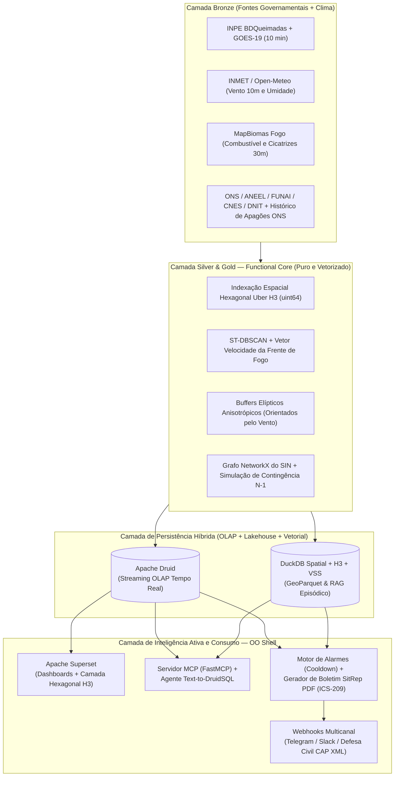

# 00 — Visão Geral e Roadmap: Da Iniciação Científica ao TCC (Engenharia de Computação)

> **Navegação**: [Portal do TCC (`../README.md`)](../README.md) | [Próximo: 01 — Webhooks e Relatórios SitRep com IA ->](01_webhooks_alarmes_e_relatorios_ia_sitrep.md)

---

## 1. O Salto Evolutivo: O que já temos (IC) vs. O que faremos (TCC)

Durante a **Iniciação Científica (IC)**, construímos e validamos com sucesso a infraestrutura base de Engenharia de Dados em *Streaming* e *OLAP*:
* Extração e padronização de **7 bases governamentais** (INPE, ONS/ANEEL, FUNAI, CNES/DATASUS, DNIT, IBGE) totalizando **4,05 milhões de registros**.
* Arquitetura **Medallion (Bronze, Silver, Gold)** orquestrada pelo **Dagster** sob o paradigma **FCIS (*Functional Core, Imperative/OO Shell*)**.
* Agrupamento espaço-temporal de perímetros de queima via **ST-DBSCAN** e modelagem de criticidade da rede elétrica em grafos via **NetworkX**.
* Ingestão contínua via **Apache Kafka**, armazenamento colunar no **Apache Druid** ($\sim 850\text{ MB}$ compactados, sustentando $\sim 2,0\text{ QPS}$ sob 16 operadores concorrentes) e visualização em dashboards no **Apache Superset**.

### Qual é a lacuna científica e tecnológica que justifica o TCC?
1. **Monitoramento Passivo vs. Resposta Ativa (*Push Intelligence*):** Atualmente, a plataforma depende de operadores humanos inspecionando visualmente os painéis do Superset e cruzando filtros manualmente. Em crises agudas de múltiplos focos simultâneos, ocorre **sobrecarga cognitiva** (Endsley, 1995) e atraso na emissão de relatórios operacionais para equipes de campo.
2. **Barreira Técnica de Consulta:** Operadores da Defesa Civil e analistas ambientais não dominam consultas SQL complexas no dialeto do Apache Druid (`LOOKUP`, `TIME_FLOOR`, agregações multidimensionais) nem algoritmos de grafos em Python.
3. **Geometria Isotrópica (Sem Vento e Combustível):** Os raios de proximidade atuais tratam o espaço ao redor do fogo de forma circular (isotrópica), ignorando a **direção e velocidade do vento** e o **tipo de vegetação/combustível** que determinam para qual lado a frente de fogo realmente avançará.
4. **Ausência de Validação Histórica com Apagões Reais:** O risco calculado sobre as linhas de transmissão ainda não foi confrontado estatisticamente com a base oficial de **Desligamentos Forçados por Queimadas do ONS**.

---

## 2. Arquitetura Alvo Completa do TCC (SIRDA 2.0 — *Actionable GeoAI DataOps*)

---

## 3. Como as 4 Propostas se Encaixam no Modelo Oficial de TCC01 da UNIFEI

Tomando como base o template [`ECO_plano_de_trabalho_TCC01`](../exemplos_e_templates/templates_latex/ECO_plano_de_trabalho_TCC01/) e o documento de referência aprovado da Profa. Dra. Barbara Pimenta Caetano ([`plano_de_trabalho_PL_revisado.pdf`](../exemplos_e_templates/referencias_aprovadas/plano_de_trabalho_PL_revisado.pdf)), o seu TCC pode ser estruturado com precisão cirúrgica:

| Seção do Modelo UNIFEI | O que Escrever no seu Plano de TCC01 |
| :--- | :--- |
| **Título Sugerido** | *Evolução de uma Plataforma DataOps Geoespacial para Monitoramento de Queimadas: Alertas Proativos, Geração Automatizada de Relatórios via Agentes de IA e Modelagem Anisotrópica de Risco* |
| **1. Introdução** | Contextualiza o problema das queimadas no Brasil, a arquitetura base já construída na IC (Kafka, Druid, Superset) e a necessidade de avançar da visualização passiva para a automação analítica e preditiva. |
| **2. Motivação** | Destaca os **931 desligamentos forçados de linhas de transmissão por queimadas no SIN em 2024** (dados ANEEL/ONS), a recorrência sazonal em Terras Indígenas (caso TI Parque do Araguaia / Aldeia Canoanã) e a urgência de relatórios instantâneos (SitRep) sem sobrecarga humana. |
| **3. Revisão Bibliográfica** | **3.1.** Consciência Situacional e Sistemas de Comando de Incidentes (ICS-209 / CAP); **3.2.** Indexação Espacial Discreta (Uber H3) e Modelagem Direcional de Propagação (Vento + Combustível); **3.3.** Agentes de IA Determinísticos, *Model Context Protocol* (MCP), *Text-to-SQL* e *Retrieval-Augmented Generation* (RAG) em Desastres; **3.4.** Engenharia de Software Pragmática (Padrão FCIS); **3.5.** Trabalhos Relacionados (comparando plataformas como Painel do Fogo CENSIPAM, BDQueimadas, AlertCalifornia e sistemas recentes de IA). |
| **4. Objetivos** | **Geral:** Expandir a plataforma analítica de queimadas incorporando enriquecimento meteorológico, indexação hexagonal H3, um servidor MCP para consultas assistidas por IA e um motor de webhooks para emissão automática de boletins situacionais (SitRep). **Específicos:** (1) Integrar dados de vento (INMET/Open-Meteo) e histórico de apagões (ONS); (2) Implementar indexação H3 e DuckDB Spatial; (3) Desenvolver motor de alarmes com *cooldown* e geração de relatórios PDF via LLM; (4) Construir servidor MCP e validar a precisão factual (zero alucinação) e a correlação histórica com desligamentos do SIN. |
| **5. Desenvolvimento / Metodologia** | **5.1.** Fontes de Dados (atuais + INMET, MapBiomas, ONS Perturbações); **5.2.** Stack Tecnológico (Python 3.12, Dagster, Kafka, Druid, DuckDB, H3, FastMCP, WeasyPrint/Typst, Telegram/Webhook API); **5.3.** Pipeline de Alertas e Arquitetura Agêntica; **5.4.** Metodologia de Validação (validação retrospectiva contra apagões reais do ONS + avaliação de latência e fidelidade factual dos relatórios gerados por IA). |
| **6. Resultados** | **6.1. Resultados Preliminares:** Toda a base sólida da IC (4,05M registros, benchmarks de QPS e P95 no Druid, dashboards no Superset e estudo de caso da TI Parque do Araguaia); **6.2. Resultados Esperados (TCC02):** Redução do tempo de triagem operacional de minutos/horas para $< 30\text{ segundos}$ via Webhooks + PDF automático, ganho de performance com joins H3 e validação estatística do risco elétrico. |
| **7. Cronograma (TCC02)** | Dividido em 5 fases claras (F.0: Revisão e Dados Meteorológicos/ONS; F.1: Motor H3 e Buffers de Vento; F.2: Motor de Webhooks e Gerador SitRep PDF; F.3: Servidor MCP e Agente Text-to-DruidSQL; F.4: Experimentos de Validação e Escrita do Artigo Final TCC02). |

---

## 4. Índice Detalhado dos Cadernos de Propostas

Explore os documentos específicos abaixo para revisar a arquitetura detalhada, esquemas de dados e exemplos de código de cada frente:

1. [**01 — Motor de Webhooks de Alarme e Relatórios Executivos Automáticos com IA (SitRep)**](01_webhooks_alarmes_e_relatorios_ia_sitrep.md)
2. [**02 — Agentes de IA, Model Context Protocol (MCP), Text-to-DruidSQL e Memória RAG**](02_agentes_ia_mcp_e_text_to_druidsql.md)
3. [**03 — Novas Bases de Dados (Vento INMET, MapBiomas Fogo, Apagões ONS) e Buffers Elípticos**](03_novas_bases_dados_e_modelagem_fisica.md)
4. [**04 — Novas Tecnologias Geoespaciais: Indexação Hexagonal Uber H3 e DuckDB Spatial**](04_novas_tecnologias_h3_e_duckdb_spatial.md)
5. [**05 — Catálogo de Dados, Especificação de APIs e Protocolos de Ingestão**](05_catalogo_apis_e_novos_dados.md)
6. [**06 — Evidências Quantitativas e Dados Empíricos para a Revisão Bibliográfica**](06_evidencias_e_dados_para_revisao_bibliografica.md)
