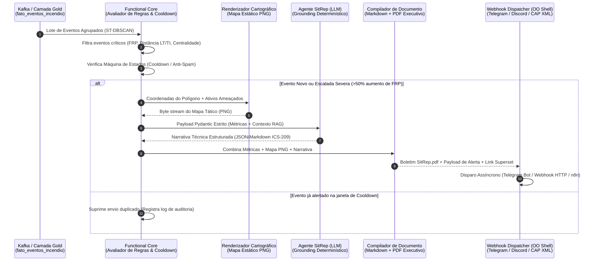

# 01 — Motor de Webhooks de Alarme e Geração Automática de Relatórios Executivos com IA (SitRep)

> **Navegação**: [<- 00 — Visão Geral do TCC](00_visao_geral_roadmap_tcc.md) | [Portal do TCC (`../README.md`)](../README.md) | [Próximo: 02 — Agentes de IA, MCP e Text-to-DruidSQL ->](02_agentes_ia_mcp_e_text_to_druidsql.md)

---

## 1. Motivação Operacional: Indo Além dos Dashboards Passivos

No estágio atual do projeto, o **Apache Superset** oferece excelente visualização tática quando há um analista operando a tela. Contudo, em centros de comando reais (como a **Defesa Civil Nacional/Estadual** e o **Centro Nacional de Operação do Sistema — CNOS/ONS**), existem duas limitações críticas do modelo puramente baseado em dashboards:

1. **Monitoramento Passivo (*Pull* vs. *Push*):** Incêndios florestais escalam rapidamente durante a madrugada ou em finais de semana. Se ninguém filtrar ativamente uma sub-bacia ou Terra Indígena específica no painel, a anomalia crítica pode demorar horas para ser notada.
2. **Tempo de Redação de Boletins de Crise:** Quando um evento grave é detectado, engenheiros e agentes da Defesa Civil gastam de 30 a 90 minutos coletando prints de mapas, consultando tabelas de municípios/hospitais/linhas elétricas próximas e redigindo um **Boletim de Situação (*Situation Report — SitRep*)** para enviar aos comandantes de brigada em campo.

### A Proposta para o TCC
Construir um **Pipeline Orientado a Eventos de Alerta Proativo e Geração Automatizada de Boletins Táticos (SitRep)**, capaz de detectar autonomamente aglomerados críticos de queimadas, renderizar o mapa do perímetro afetado, sintetizar um relatório técnico auditável via LLM (seguindo o padrão internacional **ICS-209 — Incident Command System**) e dispará-lo em **menos de 30 segundos** via **Webhooks Multicanal** (Telegram, Slack/Discord, n8n, e-mail e protocolo **CAP XML**).

---

## 2. Arquitetura do Pipeline de Alarmes e SitRep (Padrão FCIS)

Seguindo rigorosamente as diretrizes **FCIS (*Functional Core, Imperative/OO Shell*)** do projeto:



---

## 3. Componentes Técnicos Detalhados

### 3.1. Núcleo Funcional: Regras de Disparo e Máquina de Estados (*Cooldown*)
Para evitar a **fadiga de alertas (*alert fatigue*)** — problema clássico em que o mesmo incêndio dispara dezenas de notificações repetidas a cada nova passagem dos satélites AQUA, TERRA, NOAA-20, NOAA-21 ou GOES-19 —, implementamos funções puras de avaliação e transição de estado:

* **Níveis de Severidade do Alerta:**
  * **P1 — EMERGÊNCIA CRÍTICA (Disparo Imediato + PDF Completo):**
    * Cluster `ST-DBSCAN` intersectando fisicamente (`DENTRO`) uma Terra Indígena ou Unidade de Conservação com $\text{FRP total} \ge 100\text{ MW}$; **OU**
    * Cluster a $< 3,0\text{ km}$ de linha de transmissão $\ge 230\text{ kV}$ com alta centralidade de intermediação (*Betweenness Centrality* no `NetworkX`) e risco de fogo $\ge 0,8$.
  * **P2 — ALERTA DE ATENÇÃO (Resumo em Webhook):**
    * Cluster no `ENTORNO` ($< 10\text{ km}$) de subestação elétrica, hospital (CNES) ou rodovia federal (DNIT) com crescimento de área $> 20\%$ nas últimas 6 horas.
* **Lógica Determinística de Supressão (*Cooldown* e Escalada):**
  * Cada alerta gera uma chave composta determinística: `alert_key = f"{id_evento_fogo}_{tipo_ativo}_{fk_ativo}"`.
  * Um evento alertado entra em janela de supressão (ex: `6 horas`), **exceto** se ocorrer uma **Escalada de Severidade** (ex: a distância para a linha elétrica caiu pela metade ou o FRP acumulado subiu mais de $50\%$), situação em que um boletim de **ATUALIZAÇÃO DE ESCALADA** é emitido.

### 3.2. Prevenção de Alucinações da IA (*Strict Grounding & Provenance*)
Conforme apontado pela literatura de IA em gerenciamento de desastres (*European Commission SAM Report, 2025*), uma IA **jamais** pode inventar números de área queimada, distâncias ou nomes de subestações.
* **Solução de Engenharia:** O modelo de linguagem (LLM) **não gera os números da tabela**.
* Os dados quantitativos (Município, UF, Bioma, Área em $\text{km}^2$, FRP em MW, Distância exata em km até a Linha de Transmissão/Terra Indígena, Hospital mais próximo) são injetados diretamente no cabeçalho do template via contrato imutável `Pydantic`.
* O LLM recebe o JSON validado e utiliza **Structured Outputs (`response_format=SitRepNarrativeSchema`)** apenas para redigir:
  1. **Síntese Executiva da Situação** (3 a 4 frases conectando a intensidade térmica à vulnerabilidade do ativo);
  2. **Análise de Risco de Cascata / Impacto Setorial** (explicando em linguagem clara o que o índice de centralidade daquela linha significa para o SIN ou para a comunidade indígena);
  3. **Protocolo Recomendado de Ação Inicial** (triagem pela Defesa Civil, acionamento de brigada ou inspeção preventiva de faixa de servidão pela concessionária).

### 3.3. Geração Automática de Link Direto para o Apache Superset (*Deep Linking*)
Todo alerta disparado via Webhook e todo PDF gerado inclui um botão/QR Code **"Abrir no Painel Tático (Superset)"**.
* Uma função pura constrói a URL parametrizada do Apache Superset (`native_filters`) já pré-filtrada no **Estado (UF)**, **Município** e **Janela Temporal** do incidente, permitindo que o operador saia da notificação no celular/computador direto para a análise interativa em 1 clique.

### 3.4. Padrão Internacional CAP (*Common Alerting Protocol — ITU-T X.1303*)
Além de enviar mensagens ricas para **Telegram**, **Slack/Discord** ou fluxos de automação no **n8n**, o módulo pode exportar o alerta no esquema XML/JSON do **CAP v1.2 (Common Alerting Protocol)** — o padrão oficial adotado pela **Defesa Civil Brasileira (IDAP / Defesa Civil Alerta)** e pela Organização Meteorológica Mundial (OMM). Incluir a compatibilidade com o padrão CAP eleva enormemente o peso científico e institucional do seu TCC!

---

## 4. Exemplo de Contrato e Estrutura no Código (`src/gold/alerts/`)

Respeitando a separação entre **Functional Core** e **OO Shell**:

```python
# src/core/domain/alerts.py (Borda do Sistema - Contrato Imutável Pydantic)
from datetime import datetime
from typing import Literal
from pydantic import BaseModel, Field

class AlertaIncendioCritico(BaseModel, frozen=True):
    alert_id: str = Field(..., description="Hash determinístico do evento + ativo")
    timestamp_deteccao: datetime
    nivel_severidade: Literal["P1_CRITICO", "P2_ATENCAO"]
    fire_event_id: str
    municipio_nome: str
    uf_sigla: str
    bioma: str
    total_focos: int
    frp_acumulado_mw: float
    area_estimada_km2: float
    ativo_ameacado_tipo: Literal["TERRA_INDIGENA", "LINHA_TRANSMISSAO", "SUBESTACAO", "RODOVIA", "HOSPITAL"]
    ativo_ameacado_nome: str
    distancia_ativo_km: float
    indice_pressao_ou_risco: float
    superset_deep_link: str

class NarrativaSitRepIA(BaseModel, frozen=True):
    titulo_boletim: str
    resumo_executivo: str
    analise_impacto_infraestrutura: str
    recomendacoes_operacionais: list[str]
```

```python
# src/gold/alerts/evaluator.py (Functional Core - 100% Puro e Testável no Pytest)
import polars as pl

def filtrar_eventos_candidatos_alarme(
    df_eventos: pl.DataFrame,
    limiar_pressao_ti: float = 300.0,
    limiar_risco_eletrico: float = 150.0,
    dist_max_eletrica_km: float = 3.0,
) -> pl.DataFrame:
    """
    Filtra de forma vetorizada os eventos poligonais que atingiram critérios
    de emergência P1 ou P2 para geração de boletins SitRep.
    """
    condicao_ti_critica = pl.col("indice_pressao_terra_indigena") >= limiar_pressao_ti
    condicao_rede_eletrica = (
        (pl.col("dist_linha_transmissao_km") <= dist_max_eletrica_km)
        & (pl.col("indice_risco_eletrico") >= limiar_risco_eletrico)
    )
    return df_eventos.filter(condicao_ti_critica | condicao_rede_eletrica)
```

---

## 5. Como Avaliar e Validar Cientificamente no TCC?

Para a seção de **Resultados do TCC**, esta funcionalidade permite experimentos objetivos e inéditos:
1. **Latência *End-to-End* de Alerta (*Time-to-Notification*):** Medir o tempo em milissegundos/segundos desde a chegada do lote no Kafka até a geração do PDF e entrega do Webhook (meta: $< 15\text{ s}$).
2. **Taxa de Redução de Ruído (*Alert Compression Ratio*):** Demonstrar que, de $3,33\text{ milhões}$ de focos brutos $\rightarrow$ $147\text{ mil}$ eventos DBSCAN $\rightarrow$ o motor de regras + *cooldown* filtra apenas os incidentes genuinamente críticos (ex: $< 0,05\%$), evitando sobrecarga humana.
3. **Auditoria de Fidelidade Factual (*Faithfulness Score*):** Validar em uma amostra de 50 relatórios gerados que $100\%$ das métricas numéricas citadas no texto da IA batem exatamente com o payload de origem.

---

## 6. Referências Recentes (2024–2026) para Citar no TCC
* **XU, Z. et al.** *Community-oriented Wildfire Planning with Agentic AI: Automated Fire Spread Simulation and Interactive 3D Visualization*. ISPRS Annals of the Photogrammetry, Remote Sensing and Spatial Information Sciences, v. XI-4-2026, p. 251–258, 2026.
* **EUROPEAN COMMISSION.** *Artificial Intelligence in Emergency and Crisis Management*. Scientific Advice Mechanism (SAM), Brussels, Dec. 2025.
* **ITU-T.** *Recommendation X.1303 bis: Common Alerting Protocol (CAP 1.2)*. International Telecommunication Union.
