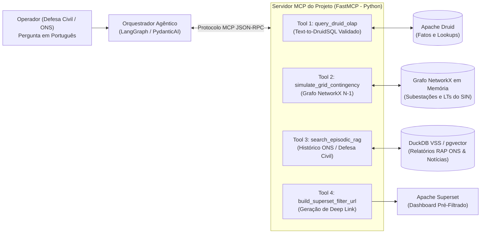

# 02 — Agentes de IA, Model Context Protocol (MCP), Text-to-DruidSQL e Memória RAG

> **Navegação**: [<- 01 — Webhooks e Relatórios SitRep](01_webhooks_alarmes_e_relatorios_ia_sitrep.md) | [Portal do TCC (`../README.md`)](../README.md) | [Próximo: 03 — Novas Bases de Dados e Modelagem Física ->](03_novas_bases_dados_e_modelagem_fisica.md)

---

## 1. O Problema: A Barreira entre o Operador de Crise e o Banco OLAP

O banco colunar **Apache Druid** e a modelagem topológica em **NetworkX** conferem alto desempenho computacional ao projeto, mas exigem conhecimento especializado:
* Consultar o Druid requer domínio de funções específicas (`TIME_FLOOR`, `MILLIS_TO_TIMESTAMP`, `LOOKUP(fk_municipio, 'mun_nome')`) e consciência da modelagem **Snowflake** (onde a tabela fato contém apenas chaves inteiras/identificadores e métricas numéricas).
* Consultar o impacto na malha elétrica exige executar algoritmos de grafos (como remoção de arestas e recálculo de componentes conectados ou fluxo de carga).
* Quando um coordenador da Defesa Civil pergunta: *"Se o incêndio atual em Formoso do Araguaia romper a Linha de Transmissão X, quais subestações ficam isoladas e qual o hospital de queimados mais próximo?"*, nenhum gráfico isolado responde a essa pergunta composta de imediato.

### A Proposta para o TCC
Desenvolver uma camada de **Inteligência Artificial Agêntica baseada no protocolo MCP (*Model Context Protocol*)** aliada a **Text-to-DruidSQL Assistido por Exemplos (*Few-Shot Golden Queries*)** e **Memória Operacional Episódica (RAG)**, permitindo que operadores interajam em linguagem natural com garantia determinística sobre os dados.

---

## 2. Arquitetura do Ecossistema de IA e Servidor MCP



---

## 3. Pilares Técnicos da Implementação

### 3.1. Servidor MCP Nativo (`FastMCP`)
Introduzido no final de 2024 e consolidado em 2025–2026 como o padrão universal de integração entre LLMs e sistemas de dados, o **Model Context Protocol (MCP)** desacopla as ferramentas de engenharia de dados do modelo de IA:

* **Ferramentas (*Tools*) Expostas pelo Servidor MCP do Projeto:**
  1. `obter_resumo_pressao_terras_indigenas(uf: str, ultimas_horas: int)` — executa query parametrizada segura no Apache Druid retornando o ranking de pressão acumulada.
  2. `simular_queda_linha_transmissao(id_linha: str)` — aciona o grafo `NetworkX` da camada Gold, remove temporariamente a aresta correspondente à linha ameaçada pelo fogo (ensaio de contingência $N-1$) e verifica se algum nó (subestação) sofre ilhamento elétrico ou sobrecarga de caminhos mínimos.
  3. `localizar_unidades_saude_apoio(latitude: float, longitude: float, raio_km: float)` — consulta na árvore espacial `cKDTree` / `R-Tree` da camada Silver os hospitais (CNES) mais próximos do perímetro do incêndio para evacuação e socorro.
  4. `executar_consulta_druidsql_segura(sql_query: str)` — executa consultas somente-leitura (`SELECT`) no endpoint HTTP do Broker do Apache Druid (`/druid/v2/sql`), impondo guardas automáticas (`LIMIT 100` e filtro obrigatório na coluna `__time`).

### 3.2. Text-to-DruidSQL com Dicionário Semântico e *Golden Queries*
Modelos de linguagem genéricos erram consultas no Apache Druid porque tentam fazer `JOIN` pesado com strings em vez de usar a função nativa `LOOKUP()` da nossa arquitetura Snowflake.
* **Como resolvemos isso no TCC:**
  * Criamos um **Catálogo de *Golden Queries* (Consultas Ouro)**: um conjunto de 25 a 30 pares `{pergunta_em_portugues, sql_druid_otimizado}` baseados nas consultas reais que já usamos nos datasets virtuais do Superset.
  * Quando o usuário faz uma pergunta aberta, o sistema recupera via similaridade de embeddings os 3 exemplos SQL mais próximos e injeta no prompt junto com o dicionário enxuto de colunas (`DICIONARIO_DADOS.md`).
  * **Loop de Autocorreção (*Self-Correction*):** Se o Broker do Druid retornar erro sintático, o agente captura a mensagem de erro da exceção HTTP, corrige a sintaxe da função (ex: trocando `DATE_TRUNC` por `TIME_FLOOR`) e reexecuta (máximo de 2 retentativas).

### 3.3. Memória Operacional Episódica via RAG (*Retrieval-Augmented Generation*)
Dados tabulares mostram *o que está acontecendo agora*, mas não contam *a história operacional daquele local*.
* **Base de Conhecimento Vetorial (`DuckDB VSS` ou `pgvector`):**
  * Indexamos documentos textuais reais:
    1. **Relatórios de Análise de Perturbação (RAP) do ONS** sobre blecautes e desligamentos históricos causados por queimadas;
    2. **Dossiês territoriais e notícias verificadas** (como o histórico da TI Parque do Araguaia / Ilha do Bananal e Aldeia Canoanã);
    3. **Procedimentos Operativos de Rede do ONS e Manuais da Defesa Civil**.
* **Resultado Prático:** Quando o operador pergunta sobre um foco próximo a uma linha de 500 kV no Tocantins, o agente combina a **métrica em tempo real do Druid** com a **memória histórica do RAG**, respondendo com contexto completo e citando a fonte documental.

---

## 4. Exemplo de Implementação do Servidor MCP (`src/gold/ai_mcp/`)

```python
# src/gold/ai_mcp/mcp_server.py
from mcp.server.fastmcp import FastMCP
import networkx as nx

mcp = FastMCP("SIRDA-GeoAI-Server")

@mcp.tool()
def simular_contingencia_eletrica_n_menos_1(
    id_linha_ameacada: str,
) -> dict:
    """
    Simula a perda (desligamento forçado por queimada) de uma Linha de Transmissão
    no grafo do Sistema Interligado Nacional (SIN) e retorna o impacto topológico.
    """
    # Carrega o grafo cacheado da malha elétrica (OO Shell)
    grafo_sin: nx.Graph = obter_grafo_sin_em_memoria()
    
    if not grafo_sin.has_edge(*extrair_nos_linha(id_linha_ameacada)):
        return {"status": "ERRO", "mensagem": "Linha não encontrada na topologia ativa."}
    
    # Função pura analisa o impacto da remoção da aresta (contingência N-1)
    impacto = calcular_impacto_remocao_aresta(grafo_sin, id_linha_ameacada)
    return {
        "linha_analisada": id_linha_ameacada,
        "gera_ilhamento_subestacao": impacto.ilhamento_detectado,
        "subestacoes_afetadas": impacto.subestacoes_isoladas,
        "aumento_medio_caminho_eletrico_pct": round(impacto.delta_camino_pct, 2),
        "classificacao_criticidade_ons": impacto.nivel_criticidade,
    }
```

---

## 5. Como Avaliar Cientificamente esta Frente no TCC?

Você pode criar um **Benchmark de Avaliação do Agente (30 Perguntas Operacionais)** dividido em 3 categorias (Básicas de Contagem, Espaciais Multissetoriais e Topológicas de Rede Elétrica) e medir:
1. **Execution Accuracy ($EX$):** Percentual de consultas geradas pelo *Text-to-DruidSQL* que executam com sucesso no Apache Druid e retornam exatamente o mesmo resultado do gabarito (*Ground Truth*). Comparar: *LLM Zero-Shot (sem contexto)* vs. *Nosso Agente com Dicionário Snowflake + Golden Queries* (tipicamente salta de $\sim 35\%$ para $> 92\%$!).
2. **Tempo de Resposta da Consulta Assistida:** Latência total entre a pergunta do operador, chamada das ferramentas MCP no Druid/NetworkX e síntese da resposta.

---

## 6. Referências Recentes (2024–2026) para Citar no TCC
* **ANTHROPIC.** *Model Context Protocol (MCP): Open Standard for Connecting AI Assistants to Data Systems*. Technical Specification, 2024–2025.
* **GAO, D. et al.** *Text-to-SQL Empowered by Large Language Models: A Benchmark Evaluation*. Proceedings of the VLDB Endowment, v. 17, 2024.
* **DIGITAL TWIN AND AGENTIC AI FOR WILD FIRE DISASTER MANAGEMENT.** *arXiv preprint arXiv:2602.08949*, Feb. 2026.
