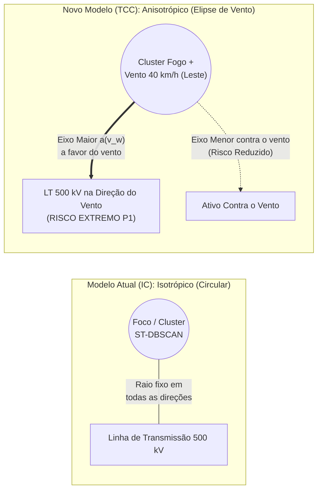

# 03 — Novas Bases de Dados (Vento, Combustível e Apagões Reais) e Modelagem Física Anisotrópica

> **Navegação**: [<- 02 — Agentes de IA, MCP e Text-to-DruidSQL](02_agentes_ia_mcp_e_text_to_druidsql.md) | [Portal do TCC (`../README.md`)](../README.md) | [Próximo: 04 — Indexação Hexagonal Uber H3 e DuckDB Spatial ->](04_novas_tecnologias_h3_e_duckdb_spatial.md)

---

## 1. Por que Enriquecer as Fontes de Dados no TCC?

Na Iniciação Científica, consolidamos 7 bases governamentais fundamentais (INPE, ONS/ANEEL, FUNAI, CNES, DNIT, IBGE). Entretanto, do ponto de vista da **física de propagação de incêndios florestais** e da **validação empírica de engenharia elétrica**, duas perguntas surgem imediatamente em uma banca de TCC:

1. *"Um foco de incêndio a $2\text{ km}$ de uma linha de transmissão tem o mesmo risco se o vento estiver soprando a $45\text{ km/h}$ na direção da linha ou na direção contrária?"* — Hoje nossa métrica usa distância euclidiana isotrópica (circular), que não considera o vetor do vento nem o tipo de vegetação.
2. *"Os corredores elétricos que o seu modelo aponta como de alto risco realmente sofreram desligamentos reais no Sistema Interligado Nacional (SIN)?"* — Cruzar nosso índice com os registros oficiais de **Desligamentos Forçados por Queimadas do ONS** fecha o ciclo científico com validação estatística real!

---

## 2. Catálogo das 5 Novas Fontes de Dados Recomendadas

| # | Fonte / Instituição | Dados Extraídos | Acesso Técnico (API / Formato) | Papel na Arquitetura Medallion |
| :---: | :--- | :--- | :--- | :--- |
| **1** | **INMET (BDMEP) + Open-Meteo API** | Velocidade do vento a $10\text{ m}$ ($v_w$), direção do vento ($\theta_w$), umidade relativa do ar ($UR\%$), temperatura e déficit de pressão de vapor ($VPD$). | REST API JSON (Open-Meteo é gratuita, sem chave de API e fornece histórico horário ERA5 + previsão de 7 dias para qualquer coordenada). | **Bronze/Silver:** Enriquecimento dinâmico dos clusters `ST-DBSCAN` com o vetor meteorológico do centroide. |
| **2** | **Dados Abertos ONS — Desligamentos Forçados e Perturbações** | Histórico oficial de desligamentos de Linhas de Transmissão no Brasil com timestamp, linha afetada e causa raiz (*Queimadas / Fogo sob a linha* — **931 ocorrências apenas em 2024**). | Portal de Dados Abertos do ONS (`dados.ons.org.br`) em CSV / Parquet via API CKAN. | **Gold (Validação Científica):** Base de *Ground Truth* para provar matematicamente a precisão do nosso índice de risco elétrico! |
| **3** | **MapBiomas Fogo (Coleção 4/5) & Uso e Cobertura da Terra (Col. 10/11)** | Cicatrizes históricas de queimadas (1985–2025) e classe de cobertura vegetal (pastagem seca, formação savânica, floresta densa, silvicultura) em resolução de $30\text{ m}$. | GeoTIFF / Cloud-Optimized GeoTIFF (COG) via S3 público ou Google Earth Engine / Resumos por hexágono H3. | **Silver (Dimensão Combustível):** Atribui um fator de inflamabilidade ($\beta_{\text{comb}}$) e recorrência histórica a cada porção do território. |
| **4** | **Satélite GOES-19 (NOAA/INPE) + NASA FIRMS VIIRS 375m** | Detecções térmicas geoestacionárias a cada **10 minutos** (GOES-16/19) combinadas com resolução espacial fina de **$375\text{ m}$** (VIIRS S-NPP/NOAA-20/21). | API REST NASA FIRMS / INPE Programa Queimadas. | **Bronze/Gold:** Permite estimar a taxa de expansão horária e o vetor velocidade da frente de fogo ($\vec{v}_{\text{fogo}}$). |
| **5** | **CEMADEN (Índice Integrado de Seca — IIS) & ANA (Hidrografia)** | Grau de seca severa/extrema municipal e distância até corpos hídricos permanentes. | GeoServer WFS / Shapefile / GeoPackage. | **Silver:** Mede o estresse hídrico acumulado da vegetação e a disponibilidade de água para combate aéreo/terrestre. |

---

## 3. Evolução Matemática: Do Buffer Circular para o Buffer Elíptico Orientado pelo Vento

Nos modelos clássicos de propagação de incêndios florestais (como o modelo elíptico de **Anderson, 1983** e **Rothermel, 1972**), sob a ação de um vento de velocidade $v_w$ e direção $\theta_w$, o fogo não se espalha em círculo, mas sim como uma **elipse alongada na direção para onde o vento sopra (*downwind*)**.



### Formulação Matemática para a Seção de Metodologia do TCC

Seja $\vec{u}_{\text{vento}} = (\sin\theta_w, \cos\theta_w)$ o vetor unitário na direção de propagação do vento (para onde o vento sopra) e $\vec{u}_{\text{ativo}}$ o vetor unitário que aponta do centroide do cluster de incêndio para o ativo de infraestrutura crítica (ex: Linha de Transmissão ou Terra Indígena) situado à distância $d_{\text{km}}$.

1. **Alinhamento Direcional ($\cos\phi$):**
   $$\cos\phi = \vec{u}_{\text{vento}} \cdot \vec{u}_{\text{ativo}}$$
   * Se $\cos\phi \approx +1$: O vento sopra **exatamente do incêndio em direção à linha de transmissão/aldeia** (propagação direta da chama e da pluma de fumaça ionizada).
   * Se $\cos\phi \approx -1$: O vento sopra na direção oposta, afastando o fogo do ativo.

2. **Fator deAmplificação Anisotrópica pelo Vento ($F_{\text{vento}}$):**
   $$F_{\text{vento}}(v_w, \phi) = 1 + \alpha \cdot \left(\frac{v_w}{v_{\text{ref}}}\right) \cdot \max(0, \cos\phi)$$
   onde $v_{\text{ref}} = 20\text{ km/h}$ é a velocidade de referência e $\alpha$ é o coeficiente aerodinâmico de arrasto da chama.

3. **Novo Índice de Risco Elétrico Anisotrópico e Topológico ($IRE_{\text{TCC}}$):**
   $$IRE_{\text{TCC}} = \frac{\text{FRP} \times (1 + \text{RiscoFogo}_{\text{INPE}}) \times \beta_{\text{comb}} \times F_{\text{vento}}(v_w, \phi) \times (1 + C_B(e))}{\max(d_{\text{km}}, 0.1)}$$
   onde:
   * $\beta_{\text{comb}} \in [0.5, 2.0]$ é o peso de combustível do **MapBiomas** (ex: pastagem seca/cerrado = $1.8$, formação florestal úmida = $0.8$);
   * $C_B(e)$ é a centralidade de intermediação (*Betweenness Centrality*) da linha de transmissão no grafo **NetworkX** do SIN.

> [!TIP]
> **Por que a banca de Engenharia de Computação vai adorar essa equação?**  
> Porque ela une **Física Vetorial ($\vec{u}_{\text{vento}} \cdot \vec{u}_{\text{ativo}}$)**, **Teoria dos Grafos ($C_B(e)$)** e **Sensoriamento Remoto ($\text{FRP}, \beta_{\text{comb}}$)** em uma função pura $100\%$ vetorizável em `NumPy`/`Polars` com custo computacional $O(1)$ por registro!

---

## 4. Exemplo de Função Pura Vetorizada (`Functional Core`)

```python
# src/gold/science/anisotropic_risk.py
import numpy as np
import polars as pl

def calcular_fator_direcional_vento(
    df: pl.DataFrame,
    v_ref_kmh: float = 20.0,
    alpha: float = 1.5,
) -> pl.DataFrame:
    """
    Calcula de forma 100% vetorizada o fator de amplificação anisotrópica
    baseado no alinhamento entre o vetor de direção do vento e o azimute
    do ativo de infraestrutura mais próximo.
    """
    # Diferença angular entre para onde o vento sopra e a posição do ativo
    delta_rad = (pl.col("vento_direcao_propagacao_graus") - pl.col("azimute_foco_para_ativo_graus")) * (np.pi / 180.0)
    alinhamento_positivo = pl.max_horizontal(0.0, delta_rad.cos())
    
    fator_vento = 1.0 + alpha * (pl.col("vento_velocidade_kmh") / v_ref_kmh) * alinhamento_positivo
    return df.with_columns(fator_vento.alias("fator_amplificacao_vento"))
```

---

## 5. Validação Científica com Dados Reais de Apagões do ONS

Com a base histórica de **Desligamentos Forçados do ONS**, você poderá incluir no TCC uma análise de validação retrospectiva (*Backtesting*):
* Selecionar os desligamentos reais por queimadas registrados pelo ONS em 2024/2025;
* Rodar o pipeline sobre os focos do INPE e ventos do INMET daquelas datas;
* Demonstrar via curva **ROC / AUC (ou Recall@K)** que o **Novo Índice Anisotrópico ($IRE_{\text{TCC}}$)** identifica com maior antecedência e precisão as linhas que efetivamente caíram do que a simples distância circular!

---

## 6. Referências para Citar no TCC
* **ANDERSON, H. E.** *Predicting wind-driven wild land fire size and shape*. USDA Forest Service Research Paper INT-305, 1983.
* **MAPBIOMAS.** *Projeto MapBiomas — Coleção de Mapas Anuais de Cicatrizes de Fogo do Brasil (MapBiomas Fogo)*. 2025.
* **OPERADOR NACIONAL DO SISTEMA ELÉTRICO (ONS).** *Portal de Dados Abertos: Histórico de Perturbações e Desligamentos Forçados do SIN*. 2025.
