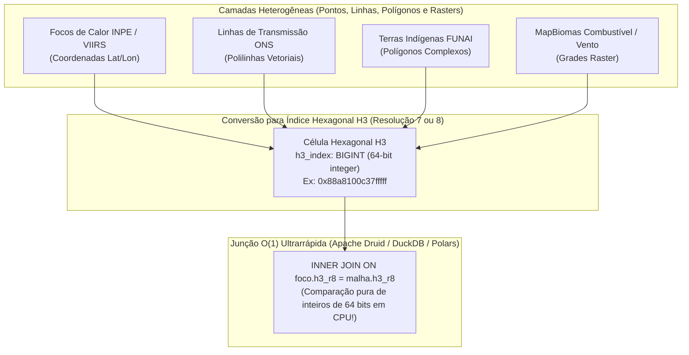

# 04 — Novas Tecnologias Geoespaciais: Indexação Hexagonal Uber H3 e DuckDB Spatial

> **Navegação**: [<- 03 — Novas Bases de Dados e Modelagem Física](03_novas_bases_dados_e_modelagem_fisica.md) | [Portal do TCC (`../README.md`)](../README.md) | [Voltar ao Início: 00 — Visão Geral ->](00_visao_geral_roadmap_tcc.md)

---

## 1. O Gargalo das Junções Geométricas Tradicionais

Na arquitetura atual da Iniciação Científica, conseguimos contornar a lentidão de bancos relacionais tradicionais (como PostGIS) antecipando os cruzamentos espaciais em memória na camada Silver/Gold com árvores espaciais **R-Tree / cKDTree** (`GeoPandas` / `Shapely` / `SciPy`).

Embora essa solução tenha funcionado muito bem para as 7 bases estáticas iniciais, adicionar novas camadas matriciais (*rasters*) e vetoriais massivas — como **cicatrizes de fogo do MapBiomas (resolução de 30m)**, **grades meteorológicas horárias (ERA5 / INMET)** e **milhões de pontos históricos** — traz dois desafios de Engenharia de Computação:

1. **Custo de *Point-in-Polygon* e *Raster-to-Vector*:** Cruzar polígonos irregulares complexos com grades meteorológicas e milhões de pontos tem complexidade $O(N \log M)$ com alto custo de geometria computacional em CPU.
2. **Distorção de Grades Quadradas (Lat/Lon):** Agrupar dados por quadrados de latitude/longitude gera distorções de área e possui vizinhos em diagonais que estão a distâncias diferentes ($\sqrt{2} \approx 1,41\times$ mais longe que os vizinhos ortogonais), prejudicando algoritmos de propagação espacial do fogo.

### A Proposta para o TCC
Introduzir duas das tecnologias mais modernas da Engenharia de Dados Geoespaciais (2024–2026):
1. **Uber H3 (*Discrete Global Grid System — DGGS*):** Indexação espacial hierárquica baseada em **hexágonos** representados por inteiros de 64 bits (`uint64` / `BIGINT`).
2. **DuckDB (`spatial` + `h3` + `vss`):** Motor analítico OLAP colunar *in-process* (embarcado em Python) trabalhando em arquitetura híbrida junto ao **Apache Druid**.

---

## 2. Tecnologia 1: Indexação Hexagonal Hierárquica com Uber H3

Criado pela Uber para otimizar o cruzamento espacial em tempo real de milhões de veículos e eventos, o **H3** divide a superfície terrestre em células hexagonais em 16 resoluções hierárquicas (da Resolução 0 até a Resolução 15).



### Por que o Uber H3 é perfeito para Monitoramento de Queimadas?

1. **Equidistância Uniforme de Vizinhança (6 Vizinhos):**
   * Ao contrário de um quadrado (que tem 4 vizinhos de aresta e 4 vizinhos de canto a distâncias diferentes) ou de um triângulo, **o centroide de um hexágono está exatamente à mesma distância dos centroides de todos os seus 6 hexágonos vizinhos**!
   * Isso torna o cálculo de espalhamento de frentes de fogo (`grid_ring` / `grid_disk` no H3) matematicamente simétrico e sem viés direcional.
2. **Transformação de *Spatial Join* Geométrico em *Hash Join* Inteiro $O(1)$:**
   * Na etapa Silver (pré-processamento), convertemos os polígonos das Terras Indígenas, as faixas de servidão das Linhas de Transmissão e o mapa de combustível do MapBiomas em tabelas de células H3 (ex: **Resolução 7** com área média de $5,16\text{ km}^2$ ou **Resolução 8** com área média de $0,74\text{ km}^2$).
   * Quando um foco de incêndio chega no streaming, converter sua `(latitude, longitude)` para `h3_index` leva **nanossegundos** em C/Rust (`h3-py`).
   * A partir daí, saber se o foco está em uma Terra Indígena, qual é o combustível vegetal do terreno e qual a velocidade do vento local reduz-se a um **`HASH JOIN` em coluna inteira (`BIGINT`)**, executando de **5x a 20x mais rápido** que interseções geométricas!
3. **Visualização Nativa 3D no Apache Superset (`Deck.gl H3HexagonLayer`):**
   * O **Apache Superset** possui suporte nativo de primeira classe para a camada **`deck.gl Hexagons (H3)`**!
   * Basta passar a coluna `h3_index` e a métrica `SUM(frp)` ou `indice_pressao_ti` diretamente do **Apache Druid**, e o Superset renderiza mapas 3D de calor hexagonais em tela cheia sem precisar trafegar arquivos GeoJSON pesados pela rede!

---

## 3. Tecnologia 2: Arquitetura Híbrida Apache Druid + DuckDB Spatial

Na Iniciação Científica, provamos que o **Apache Druid** é excelente para ingestão contínua via Kafka e consultas concorrentes de baixa latência no painel do Superset. Porém, realizar análises pesadas *offline/batch*, cruzar milhões de polígonos históricos em arquivos `GeoParquet` ou rodar buscas vetoriais para IA dentro da JVM do Druid consome muita memória RAM.

### Como o DuckDB complementa o Apache Druid no TCC?

| Característica | Apache Druid (Streaming OLAP) | DuckDB + Extensões `spatial`, `h3`, `vss` (Lakehouse Embarcado) |
| :--- | :--- | :--- |
| **Papel na Arquitetura** | Servir dashboards em tempo real sob alta concorrência (múltiplos operadores no Superset) e ingerir do Kafka. | Processar ETL pesado na camada Silver/Gold, cruzar `GeoParquet` históricos (MapBiomas / Apagões ONS) e armazenar vetores do RAG para o Agente de IA. |
| **Pegada de Memória (RAM)** | Requer cluster JVM dedicado (Broker, Historical, MiddleManager). | **Zero servidor (*In-Process*)**: roda como uma biblioteca dentro do processo Python/Dagster, lendo arquivos Parquet direto do disco com execução vetorizada SIMD. |
| **Operações Espaciais e H3** | Indexa `h3_index` como dimensão colunar ultrarrápida para `GROUP BY`. | Possui extensões oficiais `INSTALL spatial; INSTALL h3; INSTALL vss;`, permitindo fazer `ST_Intersects`, `h3_latlng_to_cell` e busca por cosseno na mesma query SQL! |

---

## 4. Exemplo Prático de Código com H3 e DuckDB (`Functional Core`)

```python
# src/silver/spatial/h3_indexer.py
import duckdb
import polars as pl

def enriquecer_focos_com_malha_h3(
    df_focos: pl.DataFrame,
    caminho_malha_h3_parquet: str,
    resolucao_h3: int = 8,
) -> pl.DataFrame:
    """
    Converte coordenadas (lat, lon) dos focos para índices hexagonais Uber H3 (uint64)
    e realiza Hash Join O(1) contra a malha pré-indexada de infraestruturas e biomas.
    """
    with duckdb.connect(":memory:") as con:
        con.execute("INSTALL h3 FROM community; LOAD h3;")
        
        query = f"""
        WITH focos_indexados AS (
            SELECT 
                *,
                h3_latlng_to_cell(latitude, longitude, {resolucao_h3}) AS h3_cell_r8
            FROM df_focos
        )
        SELECT 
            f.*,
            COALESCE(m.fk_terra_indigena, 0) AS fk_terra_indigena_h3,
            COALESCE(m.fk_linha_transmissao_buffer, 0) AS fk_linha_transmissao_h3,
            COALESCE(m.fator_combustivel_mapbiomas, 1.0) AS beta_combustivel
        FROM focos_indexados f
        LEFT JOIN read_parquet('{caminho_malha_h3_parquet}') m
            ON f.h3_cell_r8 = m.h3_cell_r8
        """
        return con.execute(query).pl()
```

---

## 5. Experimentos de Benchmark para o Capítulo de Resultados do TCC

Ao adicionar o **Uber H3** e o **DuckDB**, você ganha um experimento de Engenharia de Computação de altíssimo nível para o seu TCC (e para um futuro artigo IEEE no TCC02):

* **Experimento Comparativo de Throughput e Latência Espacial:**
  * Comparar o tempo de processamento e uso de memória RAM para cruzar $3,33\text{ milhões}$ de focos com as camadas territoriais usando:
    1. *Abordagem A (Baseline Relacional):* `PostGIS ST_Intersects`;
    2. *Abordagem B (Iniciação Científica):* `GeoPandas / Shapely R-Tree` em memória;
    3. *Abordagem C (Proposta TCC):* `Indexação Hexagonal Uber H3 (uint64) + DuckDB / Polars Hash Join`.
  * **Resultado Esperado:** Redução drástica no tempo de enriquecimento em lote e redução do payload trafegado para visualização de mapas densos no Apache Superset.

---

## 6. Referências para Citar no TCC
* **UBER TECHNOLOGIES.** *H3: Uber's Hexagonal Hierarchical Spatial Index*. Disponível em: `https://h3geo.org/`.
* **RAASVELDT, M.; MÜHLEISEN, H.** *DuckDB: an Embeddable Analytical Database*. In: Proceedings of the 2019 International Conference on Management of Data (ACM SIGMOD), p. 1981–1984, 2019.
* **BAHR, C. et al.** *Discrete Global Grid Systems (DGGS) for High-Performance Environmental and Wildfire Analytics*. OGC / ISPRS Geospatial Standards, 2024–2025.
