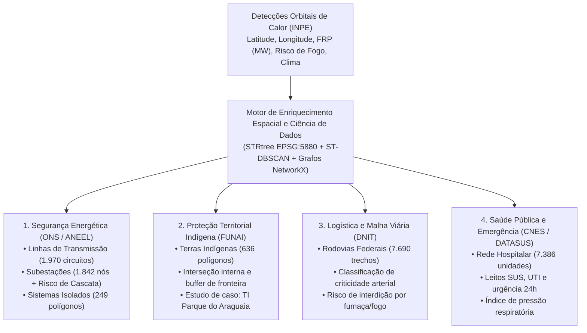

# 01. Introdução, Proposta do Projeto e Fundamentação Teórica

> **Trilha de Arquitetura — Capítulo 01 de 06**: [Índice de Arquitetura](index.md) | [Próximo: 02. Visão Geral da Arquitetura e Engenharia Core](02_visao_geral_e_engenharia_core.md)

Este documento estabelece a definição do problema, a proposta arquitetural, os eixos operacionais de monitoramento e o referencial teórico que fundamentam o **CCO DataOps (SIRDA — Sistema de Inteligência e Resposta a Desastres Ambientais)**.

---

## 1. Problema Técnico e Motivação

O monitoramento de queimadas em escala continental no território brasileiro apresenta dois desafios simultâneos de engenharia de dados:

1. **Assimetria e Volume de Detecções Orbitais**: Sensores a bordo de satélites de órbita polar e geoestacionária (AQUA, TERRA, NOAA-20, S-NPP, GOES-16) geram centenas de milhares de registros pontuais de anomalias térmicas durante a estação seca (agosto a outubro). Leituras brutas isoladas não informam diretamente qual infraestrutura crítica está ameaçada nem se um conjunto de pontos constitui uma frente contínua de incêndio.
2. **Limitações de Sistemas GIS Relacionais Tradicionais**: Em arquiteturas convencionais baseadas em bancos de dados orientados a linhas (ex: PostgreSQL/PostGIS), a execução simultânea de *spatial joins* complexos (`ST_Distance`, `ST_Intersects`) sobre milhões de registros históricos durante picos de ingestão provoca contenção de I/O e latências de consulta superiores a dezenas de segundos, inviabilizando o uso interativo em Centros de Controle e Operações (CCO).

---

## 2. Proposta do Sistema e Eixos Operacionais

O **CCO DataOps** propõe uma plataforma analítica em tempo real que antecipa o custo computacional do cruzamento geoespacial para a etapa de processamento em memória (via árvores espaciais `STRtree` em projeção métrica `EPSG:5880`) e separa o fluxo de dados em dois ramos analíticos (*Dual-Branch Streaming*): **Focos Atômicos** e **Eventos Espaço-Temporais Agrupados (ST-DBSCAN)**.

A plataforma estrutura indicadores de ameaça e painéis operacionais voltados a quatro domínios críticos de infraestrutura pública:

| Eixo Operacional | Órgão de Referência | Problema Mitigado pelo Sistema |
| :--- | :--- | :--- |
| **1. Segurança Energética (SIN e Sistemas Isolados)** | ONS / ANEEL | Queimadas sob linhas de alta tensão ($230\text{ kV}$ a $800\text{ kV}$) ionizam o ar por calor e fuligem, provocando desligamentos automáticos (*flashovers*). Quando o desligamento atinge subestações de alta centralidade de intermediação (*Betweenness Centrality*), a redistribuição abrupta de carga pode desencadear falhas em cascata (contingências $N-1$ / $N-2$). |
| **2. Proteção Territorial e Socioambiental** | FUNAI / IBAMA | Monitoramento de intrusão térmica no interior e na zona de amortecimento ($30\text{ km}$) de Terras Indígenas homologadas, com detalhamento específico para a Ilha do Bananal / TI Parque do Araguaia (consulte [`docs/domain/README.md`](../domain/README.md)). |
| **3. Logística e Infraestrutura Rodoviária** | DNIT / PRF | Identificação de frentes de fogo a menos de $20\text{ km}$ de eixos rodoviários federais longitudinais e transversais (`BR-0XX` a `BR-4XX`), prevenindo interdições de tráfego e acidentes por redução severa de visibilidade. |
| **4. Rede Hospitalar e Defesa Civil** | Ministério da Saúde (CNES) / Defesa Civil | Quantificação da pressão sobre estabelecimentos hospitalares dotados de emergência e leitos de UTI em regiões onde eventos intensos de queimada ocorrem a grandes distâncias de centros de referência médica. |

---

## 3. Fundamentação Teórica

As decisões arquiteturais do projeto apoiam-se em quatro referenciais teóricos da literatura de engenharia de sistemas e ciência da computação:

### 3.1 Consciência Situacional em Sistemas Dinâmicos (Endsley, 1995)
No artigo seminal *"Toward a theory of situation awareness in dynamic systems"*, Mica R. Endsley estrutura a tomada de decisão em ambientes críticos em três níveis hierárquicos, diretamente mapeados para as camadas da plataforma:

1. **Nível 1 — Percepção (*Perception*)**: Aquisição fiel dos elementos brutos do ambiente. Implementado na **Camada Bronze** (`src/bronze/`) pela coleta automatizada das coordenadas satelitais do INPE e das malhas oficiais da ANEEL, FUNAI, IBGE, DNIT e CNES.
2. **Nível 2 — Compreensão (*Comprehension*)**: Síntese e correlação dos elementos isolados para determinar seu significado operacional. Implementado na **Camada Silver** (`src/silver/`) através da reprojeção métrica para `EPSG:5880`, indexação em árvores `STRtree` (`MotorEspacial`) e cálculo dos índices sintéticos de condição ambiental (`ICA`) e severidade (`IQE`).
3. **Nível 3 — Projeção (*Projection*)**: Extrapolação do comportamento espaço-temporal do fenômeno e avaliação da vulnerabilidade sistêmica das infraestruturas. Implementado na **Camada Gold** (`src/gold/`) pelo agrupamento de frentes de fogo via **ST-DBSCAN** (`EventizadorIncendios`), pela modelagem de risco de cascata elétrica em grafos (`SINNetworkCentralityModel`) e pela exposição analítica em sub-segundo no **Apache Druid** e **Apache Superset**.

### 3.2 Metodologia DataOps em Monitoramento Crítico (Ereth, 2018)
Conforme formalizado por Julian Ereth (*"DataOps: Towards a Definition"*, 2018), a engenharia de dados orientada a operações de missão crítica sustenta-se em três requisitos:
- **Agilidade Operacional**: Redução da latência entre a leitura do sensor e a disponibilidade nos painéis OLAP por meio de ingestão contínua via Apache Kafka e indexação colunar em memória no Apache Druid.
- **Garantia Automatizada de Qualidade (QA)**: Validação determinística de contratos de dados nas bordas (`Pydantic` com `extra="forbid"` e rejeição de `NaN`/`Inf`) e validadores automatizados de integridade primária e referencial (`DimensionIntegrityValidator`).
- **Orquestração Declarativa**: Substituição de scripts imperativos desconexos por grafos de *Software-Defined Assets* (SDA) no Apache Dagster (`src/orchestration/`).

### 3.3 Agrupamento Espaço-Temporal Baseado em Densidade (ST-DBSCAN)
Diferentemente de algoritmos de partição esférica (como *K-Means*), o algoritmo **DBSCAN** e sua extensão espaço-temporal **ST-DBSCAN** identificam agrupamentos de geometria arbitrária baseados em densidade local ($\varepsilon_{\text{km}}$, $\varepsilon_{\text{dias}}$, $\text{min\_samples}$) e classificam pontos isolados como ruído (`cluster_id = -1`). Isso permite reconstruir o perímetro poligonal (`convex_hull`) de frentes orgânicas de incêndio sem exigir a definição prévia do número de clusters.

### 3.4 Teoria dos Grafos e Vulnerabilidade em Redes Elétricas
A resiliência de uma malha de transmissão elétrica depende não apenas da proximidade física do fogo a um ativo, mas da importância topológica desse ativo no escoamento de potência da rede. Ao representar subestações como vértices $V$ e linhas de transmissão como arestas ponderadas $E$, a métrica de **Centralidade de Intermediação (*Betweenness Centrality*)** quantifica a fração de caminhos mínimos entre todos os pares de subestações do país que dependem de um determinado nó, identificando gargalos estruturais sujeitos a blecautes em cascata.

---

## 4. Referências Bibliográficas Fundamentais

- ENDSLEY, Mica R. Toward a theory of situation awareness in dynamic systems. *Human Factors*, v. 37, n. 1, p. 32–64, 1995.
- ERETH, Julian. DataOps: towards a definition. In: *Proceedings of the 13th International Conference on Wirtschaftsinformatik (WI)*, St. Gallen, 2018.
- BIRANT, Derya; KUT, Alp. ST-DBSCAN: An algorithm for clustering spatial–temporal data. *Data & Knowledge Engineering*, v. 60, n. 1, p. 208–221, 2007.
- BRANDES, Ulrik. A faster algorithm for betweenness centrality. *Journal of Mathematical Sociology*, v. 25, n. 2, p. 163–177, 2001.

---

> **Próximo Capítulo**: [02. Visão Geral da Arquitetura, Fluxo End-to-End e Engenharia Core](02_visao_geral_e_engenharia_core.md)
