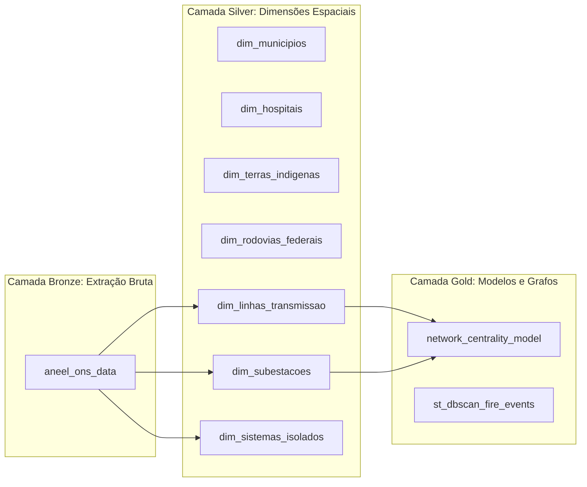

# Orquestração e a Jornada Medallion via Dagster

O **Apache Dagster** é o sistema nervoso da engenharia de dados deste projeto. Ao invés de *scripts soltos* ou agendadores estáticos via Cron, o Dagster orquestra o ecossistema através de **Software-Defined Assets (SDA)** declarativos, assegurando linhagem de dados clara, observabilidade de telemetria e tolerância a falhas.

---

## 1. A Arquitetura Medallion em Assets

As dependências declaradas no repositório ([`src/orchestration/dagster/repo.py`](../../src/orchestration/dagster/repo.py)) refletem estritamente a taxonomia da Arquitetura Medalhão:



1. **Bronze (Extração Bruta - Raw)**: Componentes responsáveis por requisições a serviços externos (APIs ArcGIS da ANEEL, FTP/APIs do INPE, portais do IBGE, CNES e FUNAI). O asset [`aneel_ons_data`](../../src/bronze/extractors/ingestao_aneel.py) materializa arquivos brutos GeoJSON/JSON sem mutações estruturais.
2. **Silver (Conformação e Geometrias)**: Assets que processam dimensões estáticas, executam reprojeções métricas para SIRGAS 2000 (`EPSG:5880`), calculam cruzamentos espaciais e geram geometrias simplificadas `path_json` para renderização web no Superset.
3. **Gold (Serving e Modelagem Científica)**: Assets analíticos avançados que alimentam as tabelas fato ou calculam métricas topológicas:
   - [`network_centrality_model`](../../src/gold/science/networkx/network_builder.py): Calcula Centralidade de Intermediação (*Betweenness Centrality*) e Risco em Cascata na malha do Sistema Interligado Nacional (SIN) via NetworkX.
   - [`st_dbscan_fire_events`](../../src/gold/science/dbscan/eventizador.py): Agrupa focos pontuais em clusters espaço-temporais delimitados por envoltória convexa (*Convex Hull*).

---

## 2. Execução POO em Memória (`ExecutablePipelineStep`)

Historicamente, orquestradores em pipelines de dados frequentemente executam chamadas de sistema procedural (`subprocess.run([python, script.py])`), gerando penalidades de inicialização do interpretador, perda de rastreabilidade de tipos e falta de captura fina de logs.

Neste projeto, o Dagster foi integrado diretamente com o design orientado a objetos:
- Todas as classes de extração, ETL e modelagem herdam de [`ExecutablePipelineStep`](../../src/core/contracts/contracts.py).
- A função despachante `execute_pipeline_step(context, step)` executa o componente diretamente no processo em memória do Dagster:

```python
def execute_pipeline_step(
    context: Optional[AssetExecutionContext],
    step: ExecutablePipelineStep,
) -> Any:
    """Executa uma etapa ExecutablePipelineStep em memória registrando progresso no Dagster."""
    if context is not None:
        context.log.info(f"Executando componente POO: {step.step_name}")
    resultado = step.execute()
    if context is not None:
        total = len(resultado) if hasattr(resultado, "__len__") and resultado is not None else "N/A"
        context.log.info(f"Componente {step.step_name} finalizado (registros/itens: {total}).")
    return resultado
```

### Vantagens Desta Abordagem:
1. **Telemetria Automática (Template Method)**: O método `step.execute()` cronometra a latência com precisão de milissegundos via `time.perf_counter()` e repassa os metadados ao `AssetExecutionContext`.
2. **Eliminação de Overhead de Subprocessos**: A memória de DataFrames e estruturas de grafos não sofre o custo de serialização interprocesso.
3. **Isolamento e Testabilidade (LSP / DIP)**: Mocks de etapas podem ser passados nos testes automatizados sem necessitar de arquivos no disco.

---

## 3. Idempotência e Particionamento Temporal

Em fluxos de dados climáticos e de queimadas, novas observações chegam de forma ininterrupta. Para assegurar confiabilidade:
- Os assets operam sob o conceito de **Idempotência**: reexecutar o asset para o mesmo período gera exatamente os mesmos resultados, sem duplicidade de linhas ou inconsistência em chaves primárias.
- A orquestração permite execução segmentada por partição temporal, isolando reprocessamentos pontuais em caso de contingência em fontes externas governamentais.
