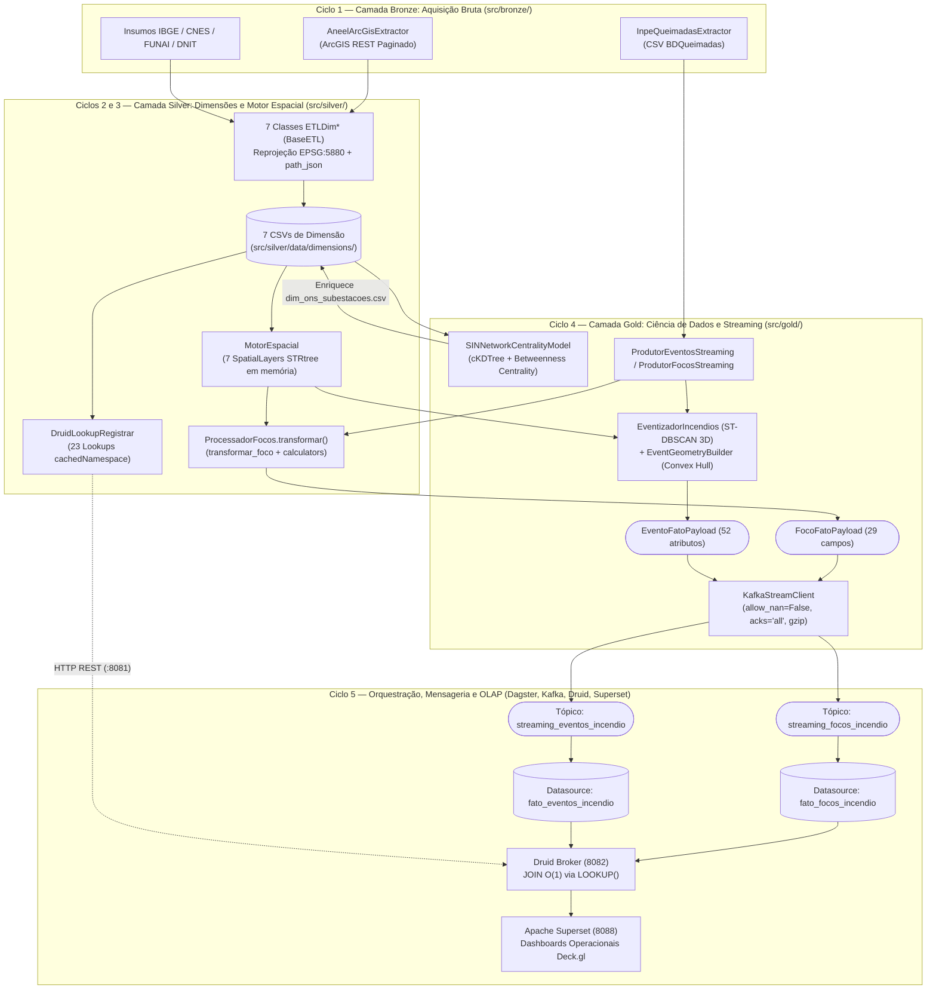
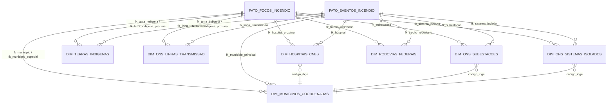

# 02. Visão Geral da Arquitetura, Fluxo End-to-End e Engenharia de Software (`src/core/`)

> **Trilha de Arquitetura — Capítulo 02 de 06**: [Anterior: 01. Introdução e Proposta](01_introducao_e_proposta.md) | [Índice de Arquitetura](index.md) | [Próximo: 03. Camada Bronze — Ingestão e APIs](03_camada_bronze_ingestao.md)

Este documento apresenta a arquitetura global do sistema **CCO DataOps**, o fluxo de dados ponta a ponta através das camadas **Medallion (Bronze, Silver, Gold)**, a modelagem dimensional **Snowflake** e os padrões de engenharia de software (**FCIS** e **SOLID**) definidos no núcleo compartilhado ([`src/core/`](../../src/core/)).

> [!IMPORTANT]
> **Documentação Modular do Núcleo**: Para o catálogo linha a linha de constantes geodésicas, variáveis de ambiente (`PipelineSettings`), métodos dos protocolos abstratos e atributos dos contratos Pydantic, consulte [**`src/core/README.md`**](../../src/core/README.md). Para os registros formais de decisão arquitetural (ADRs 001 a 006), consulte [**`docs/adr/README.md`**](../adr/README.md).

---

## 1. Fluxo de Dados End-to-End (Arquitetura Medallion)

O pipeline é dividido em **6 ciclos operacionais** (Ciclos 0 a 5), conectando a extração de dados governamentais à visualização OLAP em tempo real:

---

## 2. Modelagem Analítica Snowflake

Para otimizar a vazão de rede no Apache Kafka e a taxa de compressão colunar `LZ4` no Apache Druid, o sistema adota um esquema **Snowflake estrito**:

1. **Tabelas Fato Enxutas (`FATO_FOCOS_INCENDIO` e `FATO_EVENTOS_INCENDIO`)**:
   - Transportam exclusivamente timestamps (`ISO-8601`), chaves estrangeiras canônicas (`fk_*`), coordenadas geográficas, geometrias serializadas (`foco_point` WKT ou `path_json`) e métricas numéricas contínuas.
   - Strings descritivas (`municipios_nome`, `nome_hospital`, `nome_terra_indigena`, `nome_subestacao`) são bloqueadas nos contratos Pydantic (`extra="forbid"`).
2. **Tabelas de Dimensão Conformadas e Lookups em Memória**:
   - As 7 dimensões da camada Silver são carregadas na memória RAM do Apache Druid como **23 namespaces de Lookup** (`cachedNamespace`), permitindo que consultas SQL resolvam nomes e classes de risco em tempo constante $O(1)$ via `LOOKUP(fk_coluna, 'namespace')`.

---

## 3. Padrão FCIS (*Functional Core, Imperative Shell*) e SOLID

A base de código separa rigorosamente transformações funcionais puras do gerenciamento de estado e infraestrutura:

### 3.1 Núcleo Funcional (*Functional Core*)
- Funções de limpeza textual/numérica ([`cleaners.py`](../../src/silver/utils/cleaners.py), [`string_helpers.py`](../../src/silver/utils/string_helpers.py)), geração de chaves ([`keys.py`](../../src/silver/utils/keys.py)), extração de atributos ([`extractor.py`](../../src/silver/streaming_processing/processors/extractor.py)), equações matemáticas ([`calculators.py`](../../src/silver/streaming_processing/processors/calculators.py)) e transformação de focos ([`transformar_foco`](../../src/silver/streaming_processing/processador.py)) são implementadas como **funções puras e sem estado** (`Data In -> Data Out`).
- Não há instanciação de classes utilitárias artificiais para simples transformações de dados, preservando a vetorização sobre séries Pandas/GeoPandas.

### 3.2 Casca Orientada a Objetos (*OO Shell*) e Contratos (`src/core/contracts/`)
A Programação Orientada a Objetos e os princípios **SOLID** são aplicados onde há ciclo de vida de recursos, estado cacheado em memória ou polimorfismo de orquestração:

```mermaid
classDiagram
    direction TB

    class ExecutablePipelineStep~TResult~ {
        <<abstract>>
        +step_name: str
        +execute(*args, **kwargs) TResult
        #_run(*args, **kwargs)* TResult
    }

    class SpatialEngineProtocol {
        <<protocol>>
        +analisar_todas_ameacas(lat: float, lon: float) dict
        +intersecoes_camada(nome_camada: str, coords: list) list
    }

    class StreamPublisherBase {
        <<abstract>>
        +enviar(topico: str, payload: dict)* Any
        +flush()* None
        +flush_and_close()* None
        +__enter__() StreamPublisherBase
        +__exit__(exc_type, exc_val, exc_tb) bool
    }

    class DataValidatorBase {
        <<abstract>>
        +validator_name: str
        +validate()* ValidationReport
    }

    ExecutablePipelineStep <|-- BaseETL : Silver ETLs
    ExecutablePipelineStep <|-- AneelArcGisExtractor : Bronze
    ExecutablePipelineStep <|-- InpeQueimadasExtractor : Bronze
    ExecutablePipelineStep <|-- EventizadorIncendios : Gold ST-DBSCAN
    ExecutablePipelineStep <|-- SINNetworkCentralityModel : Gold NetworkX
    ExecutablePipelineStep <|-- ProdutorFocosStreaming : Gold Kafka
    ExecutablePipelineStep <|-- ProdutorEventosStreaming : Gold Kafka
    ExecutablePipelineStep <|-- DruidLookupRegistrar : Silver Lookups

    SpatialEngineProtocol <|.. MotorEspacial : Silver Spatial
    StreamPublisherBase <|-- KafkaStreamClient : Gold Kafka
    DataValidatorBase <|-- DimensionIntegrityValidator : Silver QA
    DataValidatorBase <|-- HospitalMunicipioJoinValidator : Silver QA
```

| Contrato / Classe Base ([`contracts.py`](../../src/core/contracts/contracts.py)) | Padrão de Projeto e Papel Arquitetural |
| :--- | :--- |
| **`ExecutablePipelineStep`** | Implementa o padrão *Template Method*: o método concreto `execute()` cronometra a execução via `time.perf_counter()` e delega a lógica de domínio para o método abstrato `_run()`. Permite que o Apache Dagster execute qualquer etapa em memória via polimorfismo (LSP). |
| **`SpatialEngineProtocol`** | `Protocol` verificado em tempo de execução (`@runtime_checkable`) que desacopla os consumidores da camada Gold (`EventizadorIncendios`, `ProcessadorFocos`) da implementação concreta do `MotorEspacial` (ISP / DIP). |
| **`StreamPublisherBase`** | Classe base abstrata com protocolo de *Context Manager* (`__enter__` / `__exit__`), garantindo que `flush_and_close()` seja invocado deterministicamente ao encerrar blocos `with` no `KafkaStreamClient`. |
| **`DataValidatorBase` & `ValidationReport`** | Contrato uniforme para auditores de qualidade de dados nas dimensões Silver. |

---

> **Próximo Capítulo**: [03. Ciclo 1 — Camada Bronze: Aquisição Bruta e APIs Governamentais](03_camada_bronze_ingestao.md)
