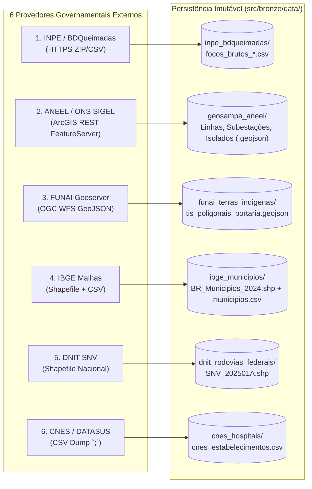

# 03. Ciclo 1 — Camada Bronze: Aquisição Bruta e APIs Governamentais (`src/bronze/`)

> **Trilha de Arquitetura — Capítulo 03 de 06**: [Anterior: 02. Visão Geral e Engenharia Core](02_visao_geral_e_engenharia_core.md) | [Índice de Arquitetura](index.md) | [Próximo: 04. Camada Silver — Dimensões e Motor Espacial](04_camada_silver_dimensoes_e_motor_espacial.md)

Este documento descreve a arquitetura do **Ciclo 1 (Camada Bronze)**, responsável pela extração e persistência imutável (*raw data*) dos dados de sensoriamento remoto e das malhas de infraestrutura crítica nacional em [`src/bronze/`](../../src/bronze/).

> [!IMPORTANT]
> **Documentações Modulares da Camada Bronze**:
> 1. [**`src/bronze/README.md`**](../../src/bronze/README.md): Arquitetura interna, diagramas de sequência e catálogo de métodos das classes extratoras (`AneelArcGisExtractor` e `InpeQueimadasExtractor`).
> 2. [**`src/bronze/FONTES_E_APIS.md`**](../../src/bronze/FONTES_E_APIS.md): Especificação completa dos 6 provedores governamentais, endpoints HTTP, parâmetros de query, paginação e anomalias de formato nos dados brutos.
> 3. [**`src/bronze/DICIONARIO_DADOS.md`**](../../src/bronze/DICIONARIO_DADOS.md): Esquema físico detalhado (colunas e tipos originais) de todos os arquivos persistidos em `src/bronze/data/`.

---

## 1. Papel Arquitetural e Princípio da Imutabilidade

A Camada Bronze atua como a fronteira de entrada do sistema (*Landing / Raw Zone*). Seus componentes seguem três regras operacionais:
1. **Fidelidade à Fonte Original**: Os arquivos baixados (GeoJSON, Shapefile ou CSV) são armazenados em `src/bronze/data/` exatamente como fornecidos pelas autarquias governamentais, preservando nomes de colunas, sistemas de coordenadas nativos (`EPSG:4326` ou `EPSG:4674`) e valores sentinela originais.
2. **Tolerância a Falhas de Rede e Paginação**: Extratores HTTP implementam controle de timeout, retentativas com *backoff* exponencial e paginação determinística para contornar limites de transferência de servidores públicos.
3. **Injeção de Dependência (`http_client`)**: Os extratores recebem sessões HTTP injetáveis no construtor, permitindo testes automatizados determinísticos em [`src/bronze/tests/`](../../src/bronze/tests/) sem requisições externas.

---

## 2. Síntese dos 6 Provedores de Dados e Particularidades Técnicas

| Provedor | Protocolo / Formato | Particularidades Críticas Tratadas na Transição Bronze $\rightarrow$ Silver |
| :--- | :--- | :--- |
| **1. INPE (BDQueimadas / COIDS)** | HTTPS Directory Listing (`.zip` contendo `.csv` UTF-8) | • Presença do valor sentinela **`-999`** (ou $\le -900$) para representar ausência de medição de satélite em `numero_dias_sem_chuva`, `risco_fogo` e `frp`. • Flutuação de nomenclatura de colunas entre dumps históricos e diários (`data_pas` vs `DataHora`, `frp` vs `FRP`). |
| **2. ANEEL / ONS (SIGEL)** | ArcGIS REST API (`query?where=1=1&outSR=4326&f=geojson`) | • Limite rígido de `1000` registros por página (`resultOffset` / `resultRecordCount`). • Na camada de Subestações (`Layer 0`), os metadados técnicos (tensão e concessionária) vêm encapsulados dentro de uma tabela **HTML bruta** no campo `PopupInfo`. • Na camada de Linhas (`Layer 2`), valores decimais utilizam a letra `'P'` como separador (ex: `"13P8"` para $13.8\text{ kV}$). |
| **3. FUNAI (Geoserver Acervo)** | OGC WFS 2.0 (`outputFormat=application/json`) | • Geometrias complexas `MultiPolygon` em `EPSG:4674` que interceptam múltiplos municípios simultaneamente (relação $N:M$). |
| **4. IBGE (Malha Territorial)** | Shapefile (`.shp`, `.dbf`, `.prj`) + CSV auxiliar | • O Shapefile oficial contém os polígonos e áreas (`AREA_KM2`), enquanto as coordenadas do ponto central da sede urbana e o prefixo DDD residem no CSV complementar `municipios.csv`. |
| **5. DNIT (Sistema Nacional de Viação)** | Shapefile Linear (`LineString` / `MultiLineString`) | • Fragmentação da malha rodoviária em $7.690$ subtrechos sem chave primária alfanumérica universal compatível com Lookups de texto do Druid. |
| **6. CNES / DATASUS** | CSV delimitado por ponto e vírgula (`;`) | • Cabeçalhos com nomenclatura legada Oracle (`NU_LATITUDE`, `CO_UNIDADE`, `QT_LEITO_EXISTENTE`), coordenadas com vírgula decimal ou fora do território nacional e ausência de código IBGE de 7 dígitos padronizado em parte dos registros. |

*(Para consultar todas as URLs, parâmetros de query e tabelas de atributos brutos, acesse [**`src/bronze/FONTES_E_APIS.md`**](../../src/bronze/FONTES_E_APIS.md) e [**`src/bronze/DICIONARIO_DADOS.md`**](../../src/bronze/DICIONARIO_DADOS.md).)*

---

> **Próximo Capítulo**: [04. Ciclos 2 e 3 — Camada Silver: Conformação Dimensional, Limpeza e Motor Espacial](04_camada_silver_dimensoes_e_motor_espacial.md)
