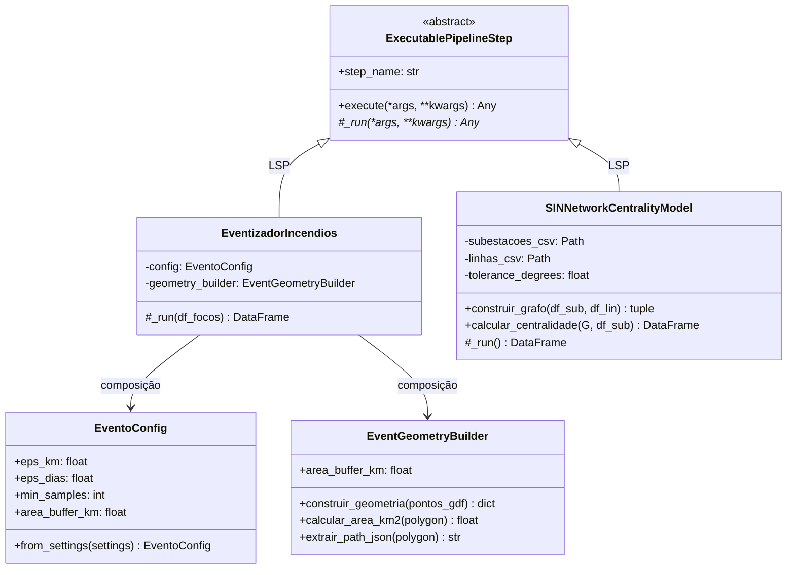

# Ciência de Dados e Inteligência Preditiva (A Camada Gold)

A ingestão bruta (Bronze/Silver) fornece coordenadas orbitais de anomalias térmicas e geometrias lineares de infraestruturas elétricas. No entanto, em um Centro de Controle e Operações (CCO) de missão crítica, milhares de coordenadas pontuais soltas geram sobrecarga cognitiva ("ruído visual").

A **Camada Gold** (`src/gold/science/`) transforma observações atômicas em **Inteligência Preditiva e Consciência Situacional**, aplicando algoritmos de Machine Learning espaço-temporal (ST-DBSCAN) e Ciência de Redes Complexas (NetworkX).

---

## 1. Arquitetura Orientada a Objetos (POO & SOLID)

Seguindo o princípio da responsabilidade única (SRP) e o padrão *Template Method*, os algoritmos científicos foram decompostos em componentes especializados:

---

## 2. Machine Learning Espaço-Temporal: O Algoritmo ST-DBSCAN

O *Spatio-Temporal Density-Based Spatial Clustering of Applications with Noise* (ST-DBSCAN) é uma extensão não supervisionada do DBSCAN projetada para identificar padrões de densidade com restrições simultâneas de proximidade espacial e contiguidade temporal.

### 2.1 Por que Agrupar em Eventos?
Um incêndio florestal não se comporta como um conjunto estático de pontos independentes, mas como uma frente de queima contínua que se desloca com o vento e o relevo ao longo de horas ou dias:
- **Redução de Cardinalidade**: Converte centenas de detecções redundantes em um único **Evento de Desastre**, calculando sua duração total, taxa de expansão e energia liberada acumulada.
- **Filtragem de Ruído**: Isola falsos positivos ou queimas agrícolas pontuais de curta duração.
- **Delimitação de Perímetro**: Constrói a envoltória convexa (*Convex Hull*) projetada em coordenadas métricas SIRGAS 2000 (`EPSG:5880`), quantificando a área real afetada em $km^2$.

### 2.2 Hiperparâmetros e Mecanismo de Agrupamento
Implementado em [`EventizadorIncendios`](../../src/gold/science/dbscan/eventizador.py) e parametrizado por [`EventoConfig`](../../src/gold/science/dbscan/evento_config.py):
* $\varepsilon_{espacial}$ (`eps_km = 8.0 km`): Raio máximo de vizinhança euclidiana entre focos.
* $\varepsilon_{temporal}$ (`eps_dias = 2.0 dias`): Janela temporal máxima de continuidade térmica entre detecções.
* $min\_samples = 4$: Mínimo de focos agregados para consolidar um cluster como evento ativo.

### 2.3 Métricas Sintetizadas por Evento
Para cada cluster consolidado, o componente calcula:
1. **FRP Total e Médio (MW)**: Soma da Potência Radiativa do Fogo (*Fire Radiative Power*), indicador direto da intensidade do calor e consumo de biomassa.
2. **Área da Mancha ($km^2$)**: Superfície do polígono delimitador expandido por buffer de segurança.
3. **Baricentro Ponderado**: Coordenadas médias $(\overline{lat}, \overline{lon})$ ponderadas pelo FRP de cada foco.
4. **`path_json`**: Serialização vetorial compacta para projeção imediata na camada Deck.gl do Apache Superset.

---

## 3. Teoria dos Grafos: Modelagem Topológica do SIN (NetworkX)

A infraestrutura elétrica brasileira, operada pelo Operador Nacional do Sistema Elétrico (ONS), é composta por milhares de quilômetros de Linhas de Transmissão (LTs) interligando Subestações (SEs) de extra-alta tensão (230 kV a 800 kV).

### 3.1 O Problema da Contingência N-2 e Efeito Cascata
Quando queimadas severas atingem o vão de segurança de uma Linha de Transmissão, a ionização do ar pelo calor e fuligem provoca descargas disruptivas (*flashovers*), forçando o desligamento automático da linha por relés de proteção. A carga excedente é instantaneamente redistribuída para as linhas remanescentes no subsistema. 

Se as linhas vizinhas operarem próximas ao limite térmico ou de estabilidade, ocorre um efeito dominó: o desligamento de uma linha sobrecarrega as adjacentes, culminando no colapso em cascata e no isolamento de subsistemas inteiros (como os blecautes históricos no Sudeste e Centro-Oeste). As linhas que alimentam a região de São Paulo, por concentrarem a maior demanda de carga do SIN, apresentam alta criticidade e severo impacto sistêmico quando submetidas a contingências múltiplas.

### 3.2 O Algoritmo de Inferência Topológica
Implementado em [`SINNetworkCentralityModel`](../../src/gold/science/networkx/network_builder.py):

1. **Cruzamento Espacial via KDTree**: As coordenadas das subestações são indexadas em uma árvore espacial `scipy.spatial.cKDTree`.
2. **Extração de Vértices Extremos (Endpoints)**: Para cada linha de transmissão (`LineString` ou `MultiLineString`), extrai-se as coordenadas inicial e final $(p_1, p_2)$ do traçado.
3. **Inferência de Arestas**: A KDTree busca as subestações mais próximas de $p_1$ e $p_2$ dentro de um limiar de tolerância de 0.05 graus (~5 km). Subestações coincidentes formam uma aresta ponderada pela extensão estimada da linha em quilômetros.
4. **Construção do Grafo Não Orientado $G(V, E)$**: Onde $V$ representa os nós (Subestações) e $E$ representa as linhas de transmissão que as interligam.

### 3.3 Cálculo da Centralidade de Intermediação (*Betweenness Centrality*)
A Centralidade de Intermediação quantifica a frequência com que um nó $v$ atua como ponte no caminho mais curto (*shortest path*) entre todos os pares possíveis de nós $(s, t)$ no grafo:

$$g(v) = \sum_{s \neq v \neq t} \frac{\sigma_{st}(v)}{\sigma_{st}}$$

Onde $\sigma_{st}$ é o número total de caminhos mais curtos entre $s$ e $t$, e $\sigma_{st}(v)$ é o número desses caminhos que passam pela subestação $v$.

### 3.4 Normalização e Faixas de Risco de Queda em Cascata
Para conferir interpretabilidade operacional às equipes de despacho do ONS e Defesa Civil, o score bruto é normalizado em escala percentual de 0 a 100:

$$betweenness\_score\_norm = \frac{g(v)}{\max(g)} \times 100$$

A classificação de **Risco de Cascata** é estratificada em 5 níveis rigorosos:

| Faixa de Score ($S$) | Nível de Risco | Exemplos de Subestações Notáveis | Perfil de Vulnerabilidade Sistêmica |
|:---:|:---:|:---|:---|
| **$S \ge 80$** | **EXTREMO** | Assis (SP), Rio Verde Norte (GO), Samambaia (DF), Trindade (GO), Xavantes (SP), Bandeirantes (SP) | **Gargalo Estrutural Crítico**: Nós de alta tensão com grande fluxo inter-regional. Falhas nestes nós desestabilizam troncos de transmissão que abastecem polos industriais em São Paulo e capitais. |
| **$50 \le S < 80$** | **ALTO** | Londrina ESU (PR) | **Interconexão Regional Relevante**: Ponto chave de transição entre subsistemas Sul e Sudeste/Centro-Oeste. |
| **$20 \le S < 50$** | **MÉDIO** | Bom Jesus da Lapa II (BA), Luziânia (GO), Miracema (TO) | **Conexão Sub-regional**: Conexão de escoamento de fontes renováveis ou atendimento a polos secundários. |
| **$0 < S < 20$** | **BAIXO** | Subestações locais e ramais de distribuição | Malha redundante ou nós periféricos sem papel de trânsito expressivo. |
| **$S = 0$** | **ISOLADO** | Subestações de ponta de linha | Vértices com grau de conectividade 1 ou sistemas locais sem rotas alternativas. |

---

## 4. Integração Analítica com Apache Druid e Superset

As métricas calculadas pelo `SINNetworkCentralityModel` são gravadas em `src/silver/data/dimensions/dim_ons_subestacoes.csv`. 

Através do serviço [`DruidLookupRegistrar`](../../src/silver/lookups/druid_lookup_registrar.py), as colunas `betweenness_score_norm` e `risco_cascata` são registradas como *Lookups* em memória RAM (`cachedNamespace`) no cluster do Apache Druid. 

Desta forma, consultas SQL analíticas e dashboards de alerta no Apache Superset resolvem a criticidade elétrica de qualquer foco em **tempo sub-segundo ($O(1)$)** através de chave estrangeira (`id_subestacao`), sem necessidade de reprocessar grafos em tempo de consulta ou carregar payloads textuais redundantes pelo Kafka.
