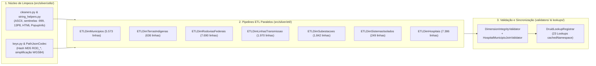
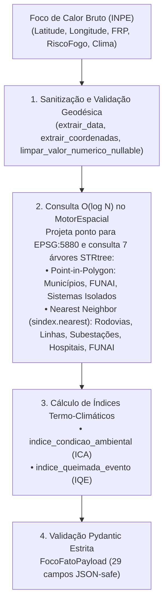

# 04. Ciclos 2 e 3 — Camada Silver: Dimensões, Limpeza e Motor Espacial (`src/silver/`)

> **Trilha de Arquitetura — Capítulo 04 de 06**: [Anterior: 03. Camada Bronze — Ingestão](03_camada_bronze_ingestao.md) | [Índice de Arquitetura](index.md) | [Próximo: 05. Camada Gold — Ciência de Dados e Streaming](05_camada_gold_ciencia_e_streaming.md)

Este documento sintetiza a arquitetura da **Camada Silver** ([`src/silver/`](../../src/silver/)), que compreende dois ciclos operacionais complementares:
- **Ciclo 2 (Conformação Dimensional Batch, QA e Lookups)**: sanitização dos dados brutos da camada Bronze, reprojeção cartográfica para SIRGAS 2000 Policônica (`EPSG:5880`), geração das 7 dimensões estáticas do modelo Snowflake, validação automatizada de integridade e registro dos 23 *Lookups* no Apache Druid.
- **Ciclo 3 (Motor Espacial em Memória e Enriquecimento de Focos)**: indexação das 7 dimensões em árvores espaciais `STRtree` (`MotorEspacial`) para consultas $O(\log N)$ e cálculo dos índices matemáticos de condição ambiental, severidade térmica e ameaça territorial.

> [!IMPORTANT]
> **Documentações Modulares da Camada Silver (na Ordem de Leitura do Fluxo)**:
> 1. [**`src/silver/README.md`**](../../src/silver/README.md): Hub geral da Camada Silver.
> 2. [**`src/silver/utils/README.md`**](../../src/silver/utils/README.md): Catálogo completo das funções puras de limpeza (`cleaners.py`, `string_helpers.py`, `keys.py`, `geo_helpers.py`, `df_helpers.py`) e do codec geométrico `PathJsonCodec`.
> 3. [**`src/silver/etl/README.md`**](../../src/silver/etl/README.md): Especificação dos 7 pipelines ETL (`ETLDim*`), regras de classificação, joins espaciais (`sjoin`, `sjoin_nearest`, `overlay`) e thresholds.
> 4. [**`src/silver/DICIONARIO_DADOS.md`**](../../src/silver/DICIONARIO_DADOS.md): Esquema físico (colunas, tipos, chaves primárias/estrangeiras e volumetria) dos 7 CSVs em `src/silver/data/dimensions/`.
> 5. [**`src/silver/validators/README.md`**](../../src/silver/validators/README.md): Validadores `DimensionIntegrityValidator`, `HospitalMunicipioJoinValidator` e catálogo dos 23 Lookups URI registrados por `DruidLookupRegistrar`.
> 6. [**`src/silver/spatial/README.md`**](../../src/silver/spatial/README.md): Arquitetura interna do `MotorEspacial`, `SpatialLayer`, `SpatialLayerCatalog` e `DistanceClassifier`.
> 7. [**`src/silver/streaming_processing/README.md`**](../../src/silver/streaming_processing/README.md): Pipeline funcional `transformar_foco`, funções de extração (`extractor.py`) e equações matemáticas dos índices (`calculators.py`).

---

## 1. Ciclo 2: Sanitização e Conformação das 7 Dimensões Estáticas

### Decisões Técnicas Principais do Ciclo 2
1. **Reprojeção Métrica Policônica (`EPSG:5880`)**: Cálculos de comprimento de linhas (`extensao_km`), áreas poligonais (`area_km2`), centroides e buscas de município mais próximo (`gpd.sjoin_nearest`) são executados exclusivamente em `EPSG:5880` (SIRGAS 2000 / Brazil Polyconic, unidade: metros), eliminando distorções angulares de latitude do `EPSG:4326`.
2. **Serialização Vetorial `path_json` (`PathJsonCodec`)**: Geometrias lineares e poligonais são simplificadas topologicamente (`simplify`) e convertidas para listas JSON de coordenadas `[lon, lat]` compatíveis com renderização direta via Deck.gl no Apache Superset, descartando a coluna bruta `geometry` dos CSVs finais.
3. **Integridade Referencial Nativa**: Durante o ETL, hospitais (`dim_hospitais_cnes`), subestações (`dim_ons_subestacoes`), sistemas isolados (`dim_ons_sistemas_isolados`) e Terras Indígenas (`dim_terras_indigenas`) são cruzados espacialmente contra a malha municipal oficial do IBGE (`dim_municipios_coordenadas`), garantindo que todas as chaves estrangeiras `codigo_ibge` existam na dimensão de municípios.

*(Consulte o detalhamento de cada função de limpeza em [**`src/silver/utils/README.md`**](../../src/silver/utils/README.md) e de cada pipeline dimensional em [**`src/silver/etl/README.md`**](../../src/silver/etl/README.md).)*

---

## 2. Ciclo 3: Motor Espacial (`STRtree`) e Enriquecimento de Focos

Durante a ingestão de focos de calor, o sistema precisa associar cada coordenada `(latitude, longitude)` às 7 dimensões de infraestrutura e calcular as respectivas distâncias euclidianas em quilômetros.

### Decisões Técnicas Principais do Ciclo 3
1. **Indexação `STRtree` Pré-Aquecida em Memória (`MotorEspacial`)**: Na inicialização do processo, o [`SpatialLayerLoader`](../../src/silver/spatial/spatial_layer_loader.py) carrega os 7 CSVs dimensionais uma única vez em RAM, reconstrói suas geometrias em `EPSG:4326` e `EPSG:5880` e força a construção imediata das árvores R-Tree (`_ = self.gdf_4326.sindex` e `_ = self.gdf_5880.sindex`). Isso reduz a complexidade de busca por foco de $O(N)$ para $O(\log N)$.
2. **Índices Matemáticos Sintéticos ([`calculators.py`](../../src/silver/streaming_processing/processors/calculators.py))**:
   - **Índice de Condição Ambiental ($\text{ICA} \in [0, 1]$)**: combina risco de fogo do INPE ($50\%$), dias sem chuva ($30\%$) e escassez de precipitação ($20\%$).
   - **Índice de Queimada do Evento ($\text{IQE}$)**: pondera a potência radiativa do fogo ($\text{FRP}$ normalizada em $150\text{ MW}$, peso $45\%$), o $\text{ICA}$ ($35\%$) e o risco de fogo ($20\%$).
   - **6 Índices Direcionais de Ameaça/Pressão (`calcular_indices_ameaca`)**: equações de decaimento espacial e amplificação estrutural (tensão em $\text{kV}$, capacidade em $\text{MW}$, distância hospitalar e interseção indígena) utilizadas na consolidação de eventos na Camada Gold.

*(Consulte as especificações completas e equações matemáticas em [**`src/silver/spatial/README.md`**](../../src/silver/spatial/README.md) e [**`src/silver/streaming_processing/README.md`**](../../src/silver/streaming_processing/README.md).)*

---

> **Próximo Capítulo**: [05. Ciclo 4 — Camada Gold: Ciência de Dados (ST-DBSCAN e Grafos SIN) e Publicação Kafka](05_camada_gold_ciencia_e_streaming.md)
