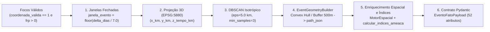

# 05. Ciclo 4 — Camada Gold: Ciência de Dados (ST-DBSCAN e Grafos SIN) e Publicação Kafka (`src/gold/`)

> **Trilha de Arquitetura — Capítulo 05 de 06**: [Anterior: 04. Camada Silver — Dimensões e Motor Espacial](04_camada_silver_dimensoes_e_motor_espacial.md) | [Índice de Arquitetura](index.md) | [Próximo: 06. Orquestração, Motor OLAP e Operação](06_orquestracao_olap_e_operacao.md)

Este documento sintetiza a arquitetura do **Ciclo 4 (Camada Gold)** em [`src/gold/`](../../src/gold/), responsável pela execução dos modelos científicos (**NetworkX** para topologia da rede elétrica e **ST-DBSCAN** para agrupamento espaço-temporal de incêndios) e pela publicação de baixa latência no **Apache Kafka**.

> [!IMPORTANT]
> **Documentações Modulares da Camada Gold (na Ordem de Leitura do Fluxo)**:
> 1. [**`src/gold/README.md`**](../../src/gold/README.md): Hub geral da Camada Gold e comandos operacionais.
> 2. [**`src/gold/ARQUITETURA.md`**](../../src/gold/ARQUITETURA.md): Especificação matemática e catálogo de métodos de `SINNetworkCentralityModel`, `EventoConfig`, `EventGeometryBuilder` e `EventizadorIncendios`.
> 3. [**`src/gold/streaming/README.md`**](../../src/gold/streaming/README.md): Especificação técnica de `KafkaStreamClient`, `StreamingAuditLogger`, `ProdutorFocosStreaming` e `ProdutorEventosStreaming`.
> 4. [**`src/gold/DICIONARIO_DADOS.md`**](../../src/gold/DICIONARIO_DADOS.md): Esquema físico das tabelas fato `FATO_FOCOS_INCENDIO` (`29` colunas) e `FATO_EVENTOS_INCENDIO` (`52` atributos).

---

## 1. Modelagem Topológica e Centralidade do SIN (`NetworkX`)

A classe [`SINNetworkCentralityModel`](../../src/gold/science/networkx/network_builder.py) avalia a criticidade sistêmica das subestações do Sistema Interligado Nacional (SIN) frente a contingências elétricas em cascata:

1. **Inferência de Arestas via `cKDTree`**: As coordenadas das $1.842$ subestações em [`dim_ons_subestacoes.csv`](../../src/silver/data/dimensions/dim_ons_subestacoes.csv) são indexadas em uma árvore espacial `scipy.spatial.cKDTree`. Para cada uma das $1.970$ linhas de transmissão em [`dim_ons_linhas_transmissao.csv`](../../src/silver/data/dimensions/dim_ons_linhas_transmissao.csv), reconstroem-se os pontos extremos do traçado linear (`path_json`) e buscam-se as subestações mais próximas $(u, v)$. Quando $u \neq v$, adiciona-se uma aresta ponderada pela extensão física da linha ($w = \text{extensao\_km}$).
2. **Centralidade de Intermediação (*Betweenness Centrality*)**: Calcula-se a centralidade de Brandes ponderada (`nx.betweenness_centrality(G, weight="weight", normalized=True)`), reescalonada linearmente para $[0.0, 100.0]$ na coluna `betweenness_score_norm`.
3. **Classificação `risco_cascata`**: As subestações são estratificadas em 5 faixas (`EXTREMO` $\ge 80$, `ALTO` $\ge 50$, `MEDIO` $\ge 20$, `BAIXO` $> 0$ e `ISOLADO` $= 0$) e gravadas de volta em `dim_ons_subestacoes.csv`, ficando disponíveis em memória RAM no Apache Druid via Lookups (`subestacao_centralidade` e `subestacao_risco_cascata`).

---

## 2. Agrupamento Espaço-Temporal 3D (`ST-DBSCAN`)

Para consolidar detecções orbitais pontuais em manchas contínuas de incêndio (`FATO_EVENTOS_INCENDIO`), o pacote [`src/gold/science/dbscan/`](../../src/gold/science/dbscan/) executa o agrupamento em três etapas:

1. **Particionamento em Janelas Temporais Fechadas (`max_duration_days = 7.0`)**: Impede o encadeamento indefinido de clusters ao longo de meses e permite despachar eventos consolidados assim que a janela temporal se encerra, eliminando a necessidade de operações de *upsert* no banco colunar.
2. **Escalonamento Espaço-Temporal Tridimensional**: As coordenadas são projetadas para `EPSG:5880` em quilômetros $(x_i, y_i)$ e o tempo decorrido na janela é escalonado por $z_i = \Delta t_{\text{dias}} \cdot (\varepsilon_{\text{km}} / \varepsilon_{\text{dias}})$, onde $\varepsilon_{\text{km}} = 5.0\text{ km}$ e $\varepsilon_{\text{dias}} = 2.0\text{ dias}$.
3. **Geometria Poligonal (`EventGeometryBuilder`)**: Calcula o envoltório convexo (`convex_hull`) em `EPSG:5880` (aplicando buffer métrico de $0.5\text{ km}$ para focos colineares com área $< 1.0\text{ m}^2$), extrai a área em $\text{km}^2$ e o centroide métrico, e serializa o anel exterior em `path_json` (`EPSG:4326`).

---

## 3. Publicação Dual-Branch no Apache Kafka (`src/gold/streaming/`)

O módulo [`src/gold/streaming/`](../../src/gold/streaming/) publica os dados enriquecidos no Apache Kafka utilizando gerenciamento determinístico de recursos (*Context Manager*):

- **[`KafkaStreamClient`](../../src/gold/streaming/kafka_client.py)**: Implementa [`StreamPublisherBase`](../../src/core/contracts/contracts.py) sobre `kafka.KafkaProducer` com `acks="all"`, `retries=5`, `max_in_flight_requests_per_connection=1`, compressão `gzip` e serializador JSON estrito (`allow_nan=False`).
- **[`StreamingAuditLogger`](../../src/gold/streaming/streaming_audit_logger.py)**: Context Manager dedicado à gravação incremental de auditoria de payloads (`--debug-jsonl`) e telemetria de vazão por chunk (`--progress-jsonl` e `--progress-csv`, com 9 métricas padronizadas em `PROGRESS_FIELDS`).
- **[`ProdutorFocosStreaming`](../../src/gold/streaming/produtor_focos.py) e [`ProdutorEventosStreaming`](../../src/gold/streaming/produtor_eventos.py)**: Operam sobre chunks do CSV bruto do INPE (`CHUNK_SIZE_FOCOS = 10000`), despachando os focos individuais para o tópico `streaming_focos_incendio` e os eventos de janelas fechadas para `streaming_eventos_incendio`.

*(Consulte os diagramas de sequência de rede e o catálogo de atributos em [**`src/gold/streaming/README.md`**](../../src/gold/streaming/README.md) e [**`src/gold/DICIONARIO_DADOS.md`**](../../src/gold/DICIONARIO_DADOS.md).)*

---

> **Próximo Capítulo**: [06. Ciclo 5 — Orquestração Dagster, Motor OLAP Apache Druid e Operação](06_orquestracao_olap_e_operacao.md)
