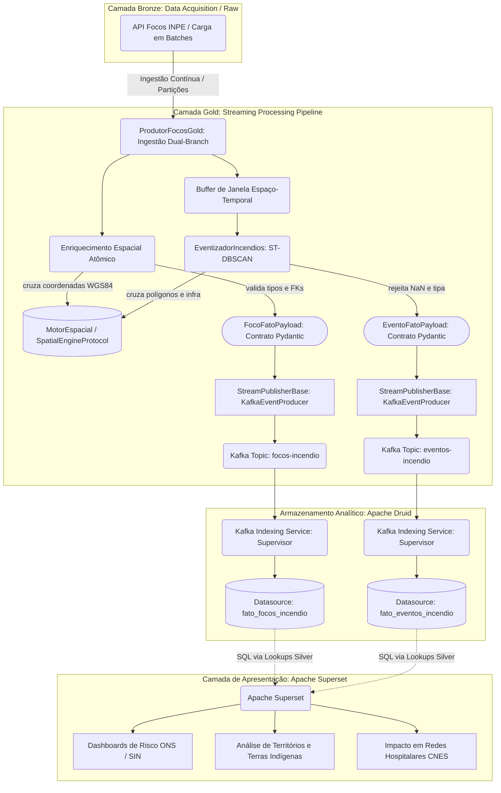

# Data Flow End-to-End da Aplicação (Streaming e OLAP)

Este documento detalha o fluxo completo de dados na arquitetura **Snowflake** e **Medallion**, evidenciando as decisões de bifurcação paralela no nível de mensageria (Kafka) e as estratégias analíticas de indexamento vetorial (Apache Druid) e visualização (Apache Superset).

A representação arquitetural separa os conceitos de **Focos Unitários (Detecções Orbitais Atômicas)** e **Eventos Complexos (Desastres Consolidados via IA)** no momento da ingestão e persistência.

---

## 1. O Diagrama End-to-End

O diagrama abaixo ilustra o trânsito da informação desde a extração bruta das coordenadas orbitais até a exposição em Dashboards Analíticos:

---

## 2. Pilares do Fluxo de Dados

A arquitetura não possui processamento intermediário ocioso ou persistência de tópicos brutos redundantes. A ingestão executa o *enriquecimento espacial* e a *eventização* no momento da leitura, publicando as Fatos prontas diretamente em tópicos consumíveis por sistemas OLAP.

### 2.1 Streaming Dual-Branch
Ao capturar dados, o [`ProdutorFocosGold`](../../src/gold/streaming/produtor_focos.py) bifurca as responsabilidades paralelamente:
- **Ramo dos Focos (Streaming Atômico)**: Processa cada coordenada individualmente, consultando o [`SpatialEngineProtocol`](../../src/core/contracts/contracts.py) para identificar distâncias mínimas até linhas de transmissão, subestações, rodovias federais, hospitais e terras indígenas. A latência é na ordem de milissegundos.
- **Ramo dos Eventos (Micro-batching Espaço-Temporal)**: Acumula pontos observacionais em buffer. Ao completar o ciclo de janela, invoca o [`EventizadorIncendios`](../../src/gold/science/dbscan/eventizador.py). Este componente agrupa anomalias térmicas correlacionadas no espaço e tempo via **ST-DBSCAN**, gera a envoltória convexa (*Convex Hull*) via [`EventGeometryBuilder`](../../src/gold/science/dbscan/event_geometry_builder.py), serializa o polígono em `path_json` e computa agregações matemáticas de área ($km^2$), FRP total e índices de ameaça.

### 2.2 Contratos Estritos (Pydantic) e Regra Snowflake
A preservação da arquitetura **Snowflake** é estritamente garantida por código:
- Os contratos [`FocoFatoPayload`](../../src/core/domain/foco_fato_payload.py) e [`EventoFatoPayload`](../../src/core/domain/evento_fato_payload.py) possuem configuração `extra="forbid"`.
- Nenhuma string textual decorativa (como nomes literais de municípios, estados ou concessionárias) transita pelo Kafka ou é persistida nas tabelas fato do Druid. Apenas identificadores inteiros/hashes (Foreign Keys) e métricas numéricas compõem os registros.
- O validador `rejeitar_nan_inf` impede que valores indefinidos de ponto flutuante corrompam o parser JSON dos Supervisors do Druid.

### 2.3 Resolução em Tempo de Consulta via Lookups
No Apache Druid, as dimensões estáticas geradas na camada Silver (`dim_municipios`, `dim_hospitais`, `dim_ons_linhas_transmissao`, etc.) são carregadas em memória RAM como **Lookups**. Quando uma consulta SQL é disparada pelo **Apache Superset**, o Druid resolve as Foreign Keys em nomes, concessionárias e regiões instantaneamente, poupando a rede do fardo de transmitir strings repetidas em milhões de mensagens de streaming.
