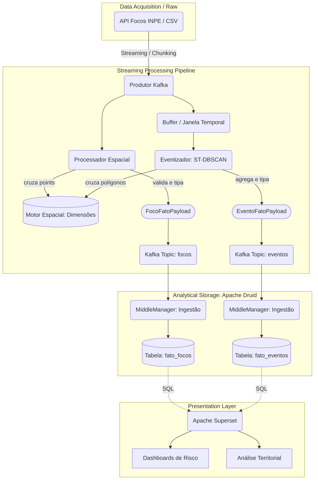

# Data Flow End-to-End da Aplicação (Streaming e OLAP)

Este documento detalha o fluxo completo de dados em nossa arquitetura Snowflake e Medallion, evidenciando as decisões de bifurcação paralela no nível de mensageria (Kafka) e as estratégias analíticas de indexamento vetorial (Apache Druid).

A representação arquitetural foi desenhada para superar fluxos lineares simples, separando os conceitos de **Focos Unitários (Anomalias)** e **Eventos Complexos (Desastres)** já no momento da ingestão.

## 1. O Diagrama End-to-End

O diagrama abaixo ilustra o trânsito da informação desde a extração bruta das coordenadas do INPE até a exposição em Dashboards Analíticos.

## 2. Pilares do Fluxo de Dados

A arquitetura não possui processamento intermediário flutuante (como um tópico de focos "brutos" que é consumido novamente). A ingestão realiza o *enriquecimento* e *eventização* no momento da leitura, publicando as Fatos terminadas diretamente em tópicos consumíveis por sistemas OLAP.

### 2.1 Streaming Dual-Branch
Ao capturar dados (CSV ou API), o `Produtor` separa as responsabilidades paralelamente:
- **Ramo dos Focos (Streaming Puro):** Processa coordenada por coordenada isoladamente, buscando os relacionamentos espaciais imediatos. A latência é na casa de milissegundos.
- **Ramo dos Eventos (Micro-batching com Janelas):** Acumula os pontos brutos em um buffer em memória. Ao encerramento de um ciclo temporal pré-definido, dispara a engine do **ST-DBSCAN**. Esta engine consolida milhares de anomalias térmicas em um único "Incêndio Florestal" (evento) utilizando Convex Hull para as delimitações espaciais, calculando agregações matemáticas robustas (duração do desastre, soma do FPR, área em $km^2$). 

### 2.2 Contratos Estritos (Pydantic)
Uma das "Regras de Ouro" desta infraestrutura é a preservação da arquitetura **Snowflake**. 
Os modelos de contrato `FocoFatoPayload` e `EventoFatoPayload` garantem que nenhum dado "textual decorativo" (como nomes literais de municípios ou biomas extensos) sujeite o cluster Kafka ou o Druid à inflação de metadados. Apenas identificadores inteiros/hashes (Foreign Keys) e métricas contínuas transitam no fluxo. Os relacionamentos (\textit{Joins}) são construídos via Motor Espacial em tempo de execução usando dimensões estáticas.

### 2.3 Consumo Analítico (Druid e Superset)
Os `MiddleManagers` do Apache Druid puxam de maneira ininterrupta os tópicos `focos` e `eventos` via Kafka Indexing Service. Eles armazenam temporariamente os dados num modelo HDFS ou em segmentos Deep Storage e transferem para os `Historical Nodes`. 
Por fim, o **Apache Superset** consome essas estruturas massivas através de chamadas SQL ultra-rápidas para gerar os relatórios de mitigação de risco e análise territorial.
