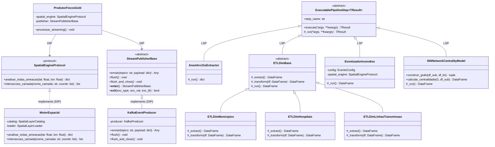
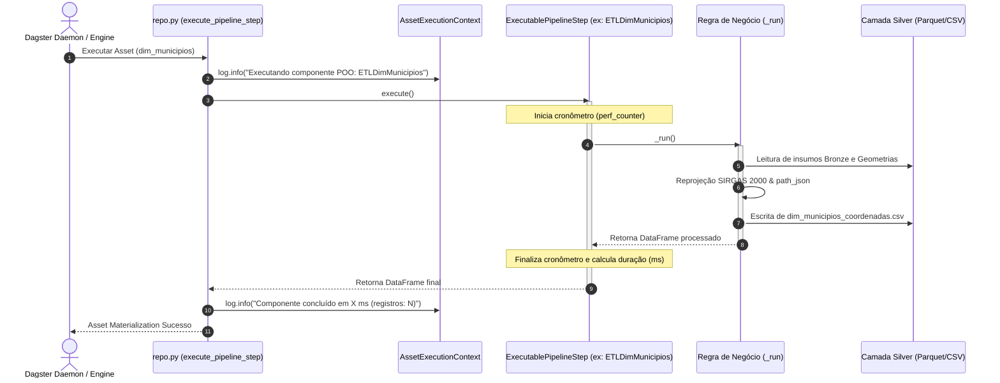
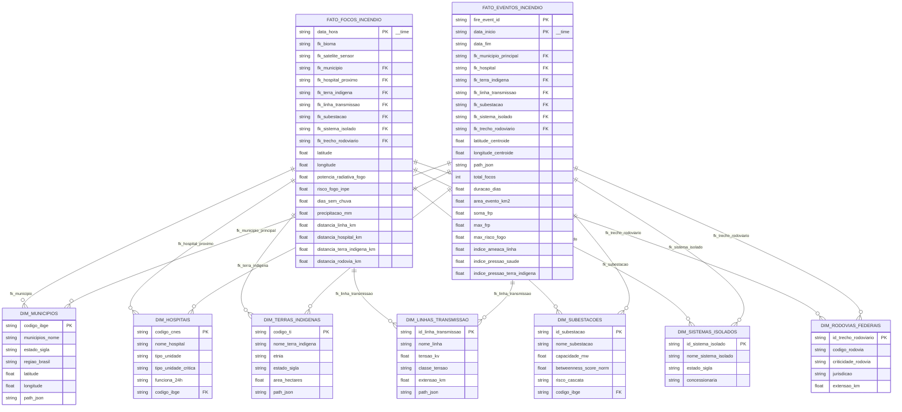

# Arquitetura Orientada a Objetos (POO) e Princípios SOLID

Este documento formaliza o design arquitetural de software do projeto, demonstrando a aplicação dos princípios **SOLID**, padrões de projeto (*Design Patterns*) e tipagem estrita na orquestração da **Arquitetura Medalhão** (Bronze, Silver, Gold).

A transição de scripts isolados e procedurais para uma base orientada a objetos (POO) estruturada garante manutenibilidade, testabilidade com mocks, rastreabilidade de telemetria e desacoplamento das camadas analíticas.

---

## 1. Mapeamento dos Princípios SOLID

### 1.1 S — Single Responsibility Principle (SRP)
Cada módulo, classe e arquivo possui uma única responsabilidade de domínio bem delineada, respeitando a regra de **1 Classe = 1 Arquivo** em nomenclatura `snake_case`:
- **Contratos de Dados**: `src/core/domain/foco_fato_payload.py` e `src/core/domain/evento_fato_payload.py` definem exclusivamente contratos Pydantic imutáveis para serialização Kafka/Druid.
- **Motor Espacial**: O antigo bloco monolítico foi decomposto em:
  - [`SpatialLayerSpec`](../../src/silver/spatial/spatial_layer_spec.py): Especificação pura e imutável de metadados de uma camada geoespacial (caminho, CRS, colunas, buffers).
  - [`SpatialLayerLoader`](../../src/silver/spatial/spatial_layer_loader.py): Leitura física de GeoDataFrames do disco e reprojeção métrica para SIRGAS 2000 (`EPSG:5880`).
  - [`SpatialLayerCatalog`](../../src/silver/spatial/spatial_layer_catalog.py): Catálogo e registro desacoplado de todas as camadas do sistema.
  - [`DistanceClassifier`](../../src/silver/spatial/distance_classifier.py): Cálculo puro de faixas e scores de proximidade a infraestruturas.
  - [`MotorEspacial`](../../src/silver/spatial/motor_espacial.py): Motor de consulta geoespacial otimizado com STRtree e buffers indexados.
- **Data Science (ST-DBSCAN)**: Segregado em:
  - [`EventoConfig`](../../src/gold/science/dbscan/evento_config.py): Dataclass imutável de hiperparâmetros espaciais e temporais ($\varepsilon_{km}$, $\varepsilon_{dias}$, $min\_samples$).
  - [`EventGeometryBuilder`](../../src/gold/science/dbscan/event_geometry_builder.py): Cálculo geométrico puro de Convex Hull, baricentro e serialização `path_json`.
  - [`EventizadorIncendios`](../../src/gold/science/dbscan/eventizador.py): Execução do algoritmo de clusterização e enriquecimento estatístico.
- **Utilitários e Auditoria**:
  - [`PathJsonCodec`](../../src/silver/utils/path_json_codec.py): Conversão determinística de geometrias Shapely para coordenadas GeoJSON / Deck.gl.
  - [`StreamingAuditLogger`](../../src/gold/streaming/streaming_audit_logger.py): Registro e estatísticas de auditoria de mensagens publicadas no Kafka, isolando logging da lógica de rede.

### 1.2 O — Open/Closed Principle (OCP)
O sistema é aberto para extensão e fechado para modificação:
- **Catálogo de Camadas Espaciais**: O [`SpatialLayerCatalog`](../../src/silver/spatial/spatial_layer_catalog.py) permite registrar novas infraestruturas críticas (ex: gasodutos ou ferrovias) através do método `register()`, sem alterar nenhuma linha do [`MotorEspacial`](../../src/silver/spatial/motor_espacial.py).
- **Extensões de Dimensões Silver**: Novas dimensões geográficas herdam de [`ETLDimBase`](../../src/silver/etl/base_etl_dim.py), implementando apenas os ganchos abstratos `_extract()` e `_transform()`. O fluxo de gravação, validação e integridade permanece inalterado.

### 1.3 L — Liskov Substitution Principle (LSP)
Subtipos podem substituir seus tipos base sem alterar a corretude do sistema:
- Todos os componentes operacionais das camadas Bronze, Silver e Gold herdam do contrato base [`ExecutablePipelineStep`](../../src/core/contracts/contracts.py).
- O orquestrador Dagster ([`repo.py`](../../src/orchestration/dagster/repo.py)) e os orquestradores CLI executam qualquer etapa chamando `step.execute()`, recebendo telemetria padronizada independente de ser uma extração ArcGIS da ANEEL, uma transformação espacial Silver ou o modelo de Centralidade de Grafos NetworkX da Gold.
- Implementações de mensageria baseadas em [`StreamPublisherBase`](../../src/core/contracts/contracts.py) podem ser substituídas por mocks em memória nos testes unitários sem impactar os produtores de eventos.

### 1.4 I — Interface Segregation Principle (ISP)
Interfaces enxutas e focadas substituem interfaces monolíticas:
- [`SpatialEngineProtocol`](../../src/core/contracts/contracts.py): Exponibiliza aos consumidores exclusivamente os métodos de consulta (`analisar_todas_ameacas` e `intersecoes_camada`). Consumidores da Gold não tomam conhecimento de geometrias internas, STRtrees ou métodos de carregamento de camadas.
- [`StreamPublisherBase`](../../src/core/contracts/contracts.py): Define unicamente operações essenciais de envio e drenagem de buffer (`enviar`, `flush`, `flush_and_close`).
- [`DataValidatorBase`](../../src/core/contracts/contracts.py): Exige apenas o método `validate()`, retornando o dataclass imutável `ValidationReport`.

### 1.5 D — Dependency Inversion Principle (DIP)
Módulos de alto nível dependem de abstrações, não de implementações concretas:
- O orquestrador Dagster ([`src/orchestration/dagster/repo.py`](../../src/orchestration/dagster/repo.py)) depende da abstração [`ExecutablePipelineStep`](../../src/core/contracts/contracts.py).
- O produtor streaming ([`ProdutorFocosGold`](../../src/gold/streaming/produtor_focos.py)) recebe por Injeção de Dependência (DI) instâncias de [`SpatialEngineProtocol`](../../src/core/contracts/contracts.py) e [`StreamPublisherBase`](../../src/core/contracts/contracts.py), desacoplando a lógica de enriquecimento analítico do driver concreto de Kafka e da instância de disco do motor espacial.

---

## 2. Padrões de Projeto (Design Patterns) Implementados

| Padrão | Onde é Aplicado | Benefício Técnico |
|---|---|---|
| **Template Method** | [`ExecutablePipelineStep`](../../src/core/contracts/contracts.py) | O método `execute()` controla medição de latência em milissegundos e logging padronizado, invocando o gancho protegido `_run()` implementado pelas subclasses. |
| **Context Manager** | [`StreamPublisherBase`](../../src/core/contracts/contracts.py) | Permite o uso do bloco `with` na publicação Kafka (`KafkaEventProducer`), garantindo flush obrigatório e encerramento determinístico de conexões de rede mesmo sob exceções. |
| **Protocol / Duck Typing** | [`SpatialEngineProtocol`](../../src/core/contracts/contracts.py) | Decorado com `@runtime_checkable`, permite desacoplamento total e teste com mocks rápidos sem herança forçada. |
| **Catalog / Specification** | [`SpatialLayerCatalog`](../../src/silver/spatial/spatial_layer_catalog.py) e [`SpatialLayerSpec`](../../src/silver/spatial/spatial_layer_spec.py) | Parametriza carregamento de arquivos vetoriais e regras de buffer sem acoplar o carregador à lógica de negócio. |
| **Façade** | [`src/core/domain/models.py`](../../src/core/domain/models.py) | Reexporta os contratos segregados `FocoFatoPayload` e `EventoFatoPayload`, preservando compatibilidade retroativa para imports externos legados. |

---

## 3. Diagramas Arquiteturais

### 3.1 Diagrama de Classes (Hierarquia POO & SOLID)



---

### 3.2 Diagrama de Sequência: Execução de Asset no Dagster via POO

O Dagster invoca as etapas de pipeline em memória, eliminando a inicialização lenta de subprocessos e capturando a medição de tempo fornecida pelo *Template Method*.



---

### 3.3 Diagrama Entidade-Relacionamento (Modelo Analítico Snowflake)

A modelagem de dados preserva integridade referencial rígida entre as Tabelas Fato da Camada Gold e as Tabelas de Dimensão da Camada Silver:



---

## 4. Testabilidade e Isolamento Arquitetural

Com o desacoplamento via contratos e protocolos em `src/core/contracts/contracts.py`:
1. **Testes Unitários Rápidos**: Testes em `src/silver/tests` e `src/gold/tests` utilizam implementações simuladas de `SpatialEngineProtocol` e `StreamPublisherBase`, dispensando dependência de conexões de rede ativas com Apache Kafka ou subida de serviços Docker durante testes de CI/CD.
2. **Validação de Invariantes em Tempo de Execução**: `ExecutablePipelineStep` impede a instanciação de etapas sem a implementação do método de negócio `_run()`, enquanto contratos Pydantic barram valores `NaN` ou `Inf` antes do despacho para as portas de mensageria.
3. **Compatibilidade com o Ecossistema `uv`**: Toda a suíte de testes é executada com alta velocidade através do comando padrão do repositório:
   ```bash
   uv run pytest src/silver/tests src/gold/tests
   ```
