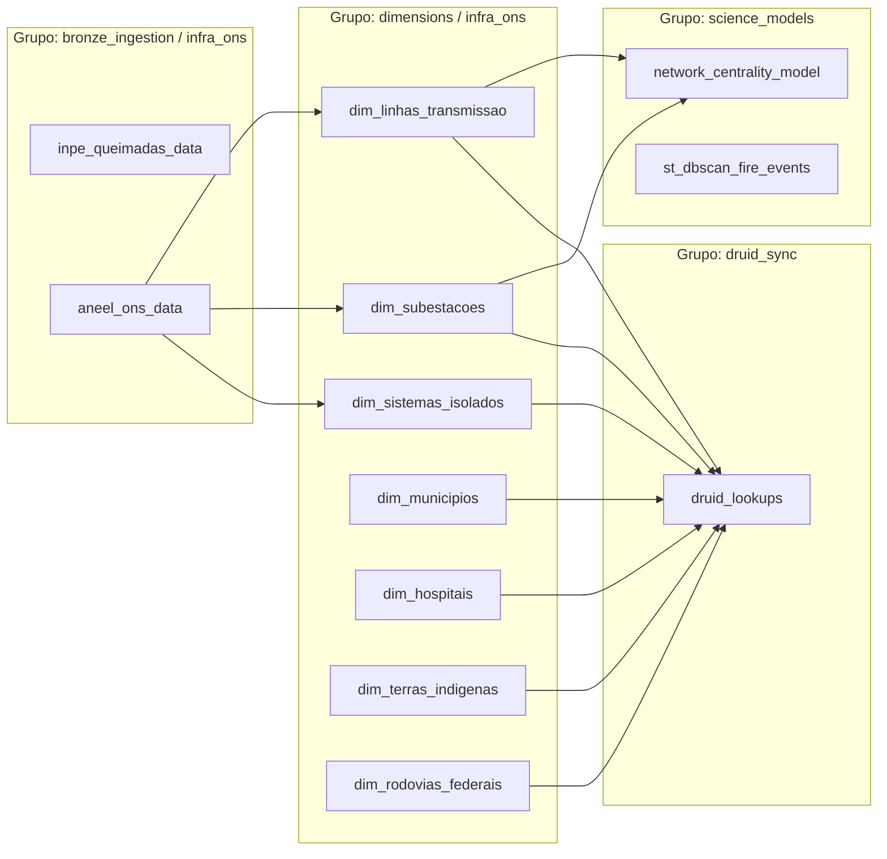
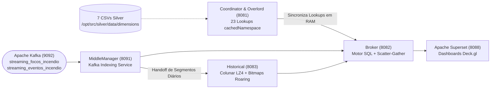

# 06. Ciclo 5 — Orquestração Dagster, Motor OLAP Apache Druid e Operação (`src/orchestration/`, `infra/`, `scripts/`)

> **Trilha de Arquitetura — Capítulo 06 de 06**: [Anterior: 05. Camada Gold — Ciência de Dados e Streaming](05_camada_gold_ciencia_e_streaming.md) | [Índice de Arquitetura](index.md) | [Próximo: Índice Geral de Dicionários de Dados](../data_dictionary/index.md)

Este documento descreve a arquitetura do **Ciclo 5**, que abrange a orquestração declarativa de *Software-Defined Assets* no **Apache Dagster** ([`src/orchestration/`](../../src/orchestration/)), a ingestão contínua e indexação colunar no **Apache Druid 34.0**, a visualização geoespacial no **Apache Superset** ([`infra/`](../../infra/)) e a automação operacional e de benchmarks ([`scripts/`](../../scripts/)).

> [!IMPORTANT]
> **Documentações Modulares do Ciclo 5**:
> 1. [**`src/orchestration/README.md`**](../../src/orchestration/README.md): Grafo de 12 *Software-Defined Assets* (`dagster/repo.py`), execução em memória via `execute_pipeline_step` e comandos CLI.
> 2. [**`infra/README.md`**](../../infra/README.md): Topologia dos 5 nós do Apache Druid 34.0, especificações JSON de ingestão (`sample_bucket`, `SORTED_SET`, `segmentGranularity: DAY`) e os 3 perfis de capacidade de hardware.
> 3. [**`scripts/README.md`**](../../scripts/README.md): Pipeline operacional numerado (`01` a `05`), scripts de manutenção do cluster e suíte de benchmarking de concorrência.

---

## 1. Orquestração Declarativa In-Memory (`Apache Dagster`)

O módulo [`src/orchestration/dagster/repo.py`](../../src/orchestration/dagster/repo.py) declara **12 Software-Defined Assets** que modelam a linhagem completa entre as camadas Bronze, Silver, Gold e o registro de Lookups no Apache Druid:

- **Execução Polimórfica em Memória**: A função [`execute_pipeline_step`](../../src/orchestration/dagster/repo.py#L33-L44) recebe qualquer subclasse de [`ExecutablePipelineStep`](../../src/core/contracts/contracts.py) e invoca `step.execute()` diretamente no espaço de memória do processo do Dagster, eliminando chamadas lentas de subprocessos e reportando a duração em milissegundos e a cardinalidade do resultado ao `AssetExecutionContext`.

---

## 2. Ingestão Streaming e Indexação Colunar (`Apache Druid 34.0`)

A infraestrutura definida em [`docker-compose.yaml`](../../docker-compose.yaml) e especificada em [`infra/README.md`](../../infra/README.md) desacopla a ingestão e a consulta analítica em cinco serviços coordenados:

1. **Supervisores Kafka Sem Rollup Destrutivo**: As especificações [`fato_focos_incendio.json`](../../infra/druid/specs/fato_focos_incendio.json) e [`fato_eventos_incendio.json`](../../infra/druid/specs/fato_eventos_incendio.json) consomem os tópicos Kafka em tempo real, particionando os segmentos por dia (`segmentGranularity: DAY`, `queryGranularity: NONE`, `rollup: false`).
2. **Amostragem Espacial Determinística (`sample_bucket`)**: Ambas as especificações calculam na entrada um bucket inteiro de $0$ a $99$ a partir de um hash aritmético sobre `(__time, latitude, longitude)`, permitindo que mapas densos no Superset apliquem filtros indexados (`WHERE sample_bucket < 20`) sem varredura completa.
3. **Dimensões Multivaloradas (`SORTED_SET`)**: Em `fato_eventos_incendio.json`, as listas `codigos_ibge_interceptados` e `codigos_ti_interceptadas` são indexadas com `multiValueHandling: SORTED_SET`, permitindo filtragem nativa de eventos que atingiram múltiplos municípios ou Terras Indígenas.
4. **Resolução de Chaves Estrangeiras em Memória ($O(1)$)**: Os 23 namespaces registrados pelo [`DruidLookupRegistrar`](../../src/silver/lookups/druid_lookup_registrar.py) traduzem as FKs das tabelas fato em atributos descritivos diretamente na memória RAM do Broker durante a execução SQL.

---

## 3. Automação Operacional e Avaliação de Capacidade (`scripts/`)

O diretório [`scripts/`](../../scripts/README.md) provê o ferramental procedural para operação da stack e reprodução dos experimentos científicos:
- **Pipeline Sequencial (`scripts/run/01..05` e `run_all.sh`)**: automatiza em 5 etapas a geração das dimensões Silver (`01_etl_batch.sh`), o cálculo de centralidade do SIN (`02_modelos_ciencia.sh`), a inicialização do Docker/Kafka (`03_docker_e_kafka.sh`), a carga de Lookups e dimensões no Druid (`04_druid_dimensoes.sh`) e o disparo do streaming de eventos (`05_streaming_eventos.sh`).
- **Suíte de Benchmarking (`scripts/benchmarks/`)**: avalia o comportamento do cluster Druid sob 3 perfis de hardware (`scenario_01_baseline`, `scenario_02_balanced`, `scenario_03_query_heavy`) e níveis crescentes de concorrência ($1$ a $16$ clientes simultâneos), cujos resultados estão documentados em [`docs/performance/README.md`](../performance/README.md).

---

> **Próxima Etapa da Trilha Geral**: [Índice Geral de Dicionários de Dados e APIs (`docs/data_dictionary/index.md`)](../data_dictionary/index.md)
