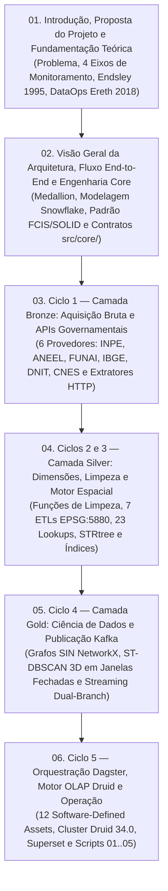

# Especificações de Arquitetura de Sistema (`docs/architecture/`)

> **Trilha Geral de Documentação**: [Portal Geral (`docs/README.md`)](../README.md) | [Iniciar Leitura: 01. Introdução e Proposta](01_introducao_e_proposta.md) | [Dicionários de Dados](../data_dictionary/index.md)

Este diretório apresenta a arquitetura completa do sistema **CCO DataOps (SIRDA)** estruturada na **ordem cronológica e cognitiva do ciclo de vida do dado** — partindo da definição do problema e fundamentação teórica, passando pela engenharia de software do núcleo (`src/core/`) e pelas camadas **Bronze**, **Silver** e **Gold**, até a orquestração no **Apache Dagster** e o servimento analítico no **Apache Druid** e **Apache Superset**.

Seguindo a topologia **Hub & Spoke**, cada capítulo sintetiza as decisões arquiteturais do ciclo e referencia diretamente as especificações técnicas modulares co-localizadas no código-fonte (`src/`, `infra/` e `scripts/`).

---

## Trilha Sequencial de Arquitetura (Capítulos 01 a 06)

| Capítulo | Documento Arquitetural | Escopo Técnico | Especificações Modulares Co-localizadas (Links Diretos) |
| :-: | :--- | :--- | :--- |
| **01** | [**`01_introducao_e_proposta.md`**](01_introducao_e_proposta.md) | Problema técnico, proposta do sistema, os 4 eixos operacionais (ONS, FUNAI, DNIT, CNES) e fundamentação teórica (Consciência Situacional, DataOps, ST-DBSCAN e Teoria dos Grafos). | • [`docs/domain/README.md`](../domain/README.md) • [`docs/domain/ti_parque_araguaia_canoana.md`](../domain/ti_parque_araguaia_canoana.md) |
| **02** | [**`02_visao_geral_e_engenharia_core.md`**](02_visao_geral_e_engenharia_core.md) | Fluxo de dados End-to-End, modelagem Snowflake com Lookups em RAM, padrão *Functional Core / Imperative Shell* (FCIS), princípios SOLID e contratos base do núcleo. | • [`src/core/README.md`](../../src/core/README.md) • [`docs/adr/README.md`](../adr/README.md) |
| **03** | [**`03_camada_bronze_ingestao.md`**](03_camada_bronze_ingestao.md) | Arquitetura da zona bruta imutável, particularidades e anomalias das 6 fontes governamentais (`-999`, `13P8`, `PopupInfo` HTML) e extratores paginados. | • [`src/bronze/README.md`](../../src/bronze/README.md) • [`src/bronze/FONTES_E_APIS.md`](../../src/bronze/FONTES_E_APIS.md) • [`src/bronze/DICIONARIO_DADOS.md`](../../src/bronze/DICIONARIO_DADOS.md) |
| **04** | [**`04_camada_silver_dimensoes_e_motor_espacial.md`**](04_camada_silver_dimensoes_e_motor_espacial.md) | Catálogo de funções puras de limpeza, reprojeção `EPSG:5880`, serialização `path_json`, ETL das 7 dimensões, validadores de QA, 23 Lookups URI, `MotorEspacial` (`STRtree`) e equações de índices sintéticos. | • [`src/silver/README.md`](../../src/silver/README.md) • [`src/silver/utils/README.md`](../../src/silver/utils/README.md) • [`src/silver/etl/README.md`](../../src/silver/etl/README.md) • [`src/silver/DICIONARIO_DADOS.md`](../../src/silver/DICIONARIO_DADOS.md) • [`src/silver/validators/README.md`](../../src/silver/validators/README.md) • [`src/silver/spatial/README.md`](../../src/silver/spatial/README.md) • [`src/silver/streaming_processing/README.md`](../../src/silver/streaming_processing/README.md) |
| **05** | [**`05_camada_gold_ciencia_e_streaming.md`**](05_camada_gold_ciencia_e_streaming.md) | Centralidade de intermediação na malha do SIN (`SINNetworkCentralityModel`), clusterização espaço-temporal 3D em janelas fechadas (`EventizadorIncendios`) e publicação Kafka Dual-Branch. | • [`src/gold/README.md`](../../src/gold/README.md) • [`src/gold/ARQUITETURA.md`](../../src/gold/ARQUITETURA.md) • [`src/gold/streaming/README.md`](../../src/gold/streaming/README.md) • [`src/gold/DICIONARIO_DADOS.md`](../../src/gold/DICIONARIO_DADOS.md) |
| **06** | [**`06_orquestracao_olap_e_operacao.md`**](06_orquestracao_olap_e_operacao.md) | Grafo de 12 Software-Defined Assets no Apache Dagster, topologia de 5 nós do Apache Druid 34.0 (`LZ4`, `Roaring`, `sample_bucket`), dashboards Superset e scripts operacionais e de benchmark. | • [`src/orchestration/README.md`](../../src/orchestration/README.md) • [`infra/README.md`](../../infra/README.md) • [`scripts/README.md`](../../scripts/README.md) |
