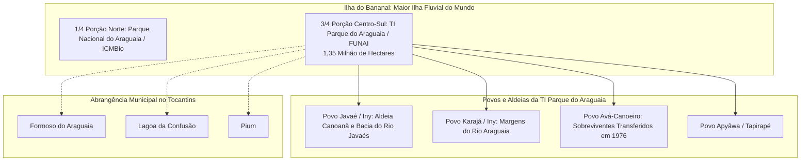

# Contexto Territorial e Socioambiental: Terra Indígena Parque do Araguaia e Aldeia Canoanã

Este documento contextualiza a relevância socioambiental, histórica e geográfica da **Terra Indígena (TI) Parque do Araguaia** e da **Aldeia Canoanã**, destacando sua importância para o monitoramento geoespacial de queimadas e preservação territorial no âmbito do **CCO-DataOps**.

---

## 🌎 1. Caracterização Geográfica e Territorial

A **Terra Indígena (TI) Parque do Araguaia** é um dos territórios socioambientais mais singulares e estratégicos do Brasil. 

* **Localização**: Estado do Tocantins (TO).
* **Superfície**: Aproximadamente **1,35 milhão de hectares** ($13.500\text{ km}^2$).
* **Inserção Geográfica**: Ocupa cerca de **3/4 da porção centro-sul da Ilha do Bananal**, a maior ilha fluvial do mundo, cercada pelos rios Araguaia e Javaés.
* **Bioma e Ecótono**: Zona de transição ecológica crítica entre o **Cerrado** e a **Floresta Amazônica**, caracterizada por planícies inundáveis, vegetação de várzea e alta sensibilidade hídrica e térmica no período de estiagem (junho a outubro).
* **Municípios Abrangidos**:
  1. **Formoso do Araguaia** (município onde está sediada a Aldeia Canoanã);
  2. **Lagoa da Confusão**;
  3. **Pium**.

---

## 📜 2. Histórico Territorial e Marcos Legais

A conformação territorial atual da Ilha do Bananal é fruto de complexos processos de mediação entre conservação ambiental e direitos originários:

1. **Criação do Parque Nacional (1959)**:
   - Originalmente, o Parque Nacional do Araguaia (criado em 1959) englobava a totalidade da Ilha do Bananal.
2. **A Divisão Territorial (1971)**:
   - Para equacionar conflitos fundiários e reconhecer formalmente a posse tradicional dos povos indígenas sobre a ilha, o Governo Federal reduziu o Parque Nacional a apenas 1/4 da porção norte da ilha (sob gestão ambiental do ICMBio). Os 3/4 restantes (porções centro e sul) foram destinados aos povos originários como **Parque Indígena do Araguaia**, sob tutela da FUNAI.
3. **Homologação Definitiva (1998)**:
   - Em **14 de abril de 1998**, a demarcação da reserva foi oficialmente homologada por decreto presidencial, passando a denominar-se formalmente **Terra Indígena Parque do Araguaia**.

---

## 👥 3. Demografia e Diversidade Étnica

Segundo dados oficiais do Censo Demográfico do IBGE, a TI Parque do Araguaia abriga uma população de aproximadamente **4.503 indígenas**, distribuídos por dezenas de aldeias. Quatro povos habitam e compartilham o território:

### 3.1 Povo Javaé (Iny)
* Grupo majoritário na porção oriental da ilha, ao longo das margens e canais do Rio Javaés.
* A **Aldeia Canoanã** (situada em Formoso do Araguaia) é uma das maiores, mais antigas e estruturadas aldeias Javaé, mantendo viva a língua Inyrybè, tradições rituais (como os rituais das máscaras Aruanã e a Casa dos Homens) e técnicas tradicionais de manejo do solo.

### 3.2 Povo Karajá (Iny)
* Historicamente aparentados e culturalmente integrados aos Javaé, ocupando predominantemente a calha principal do Rio Araguaia, na fronteira com os estados de Mato Grosso e Pará.
* Famosos por suas cerâmicas expressivas (*Ritxòkò*), reconhecidas como Patrimônio Cultural do Brasil pelo IPHAN.

### 3.3 Povo Avá-Canoeiro
* Etnia de língua Tupi-Guarani que vivenciou severa vulnerabilidade histórica após contatos traumáticos e perseguições durante a expansão agropecuária no Centro-Oeste no século XX.
* Em **1976**, um grupo de sobreviventes Avá-Canoeiro foi compulsoriamente transferido pela FUNAI para a **Aldeia Canoanã**, onde passaram a coabitar com os Javaé, mantendo até a atualidade sua identidade étnica singular em meio a um território compartilhado.

### 3.4 Povo Apyãwa (Tapirapé)
* Presença registrada na região noroeste da ilha e proximidades da foz do Rio Tapirapé com o Araguaia.

---

## 🚨 4. Relevância Operacional para o CCO-DataOps

No contexto do Centro de Controle e Operações:

1. **Pressão de Borda e Ameaça Agrícola**:
   - Os municípios de Formoso do Araguaia e Lagoa da Confusão abrigam vastos polos de agricultura irrigada (notadamente orizicultura). Durante a entressafra e a seca do Cerrado, queimas agrícolas não controladas avançam pelas margens do Rio Javaés, penetrando na Terra Indígena.
2. **Índice de Pressão Territorial Indígena**:
   - O cálculo automatizado implementado em [`src/silver/spatial/motor_espacial.py`](file:///c:/Users/SEPLAN/Documents/UNIFEI/UNIVERSIDADE/mapeamento-risco-queimadas-inpe/src/silver/spatial/motor_espacial.py) e [`src/gold/science/dbscan/eventizador.py`](file:///c:/Users/SEPLAN/Documents/UNIFEI/UNIVERSIDADE/mapeamento-risco-queimadas-inpe/src/gold/science/dbscan/eventizador.py) atribui pontuação máxima de severidade (`indice_pressao_indigena = 100.0`) a qualquer foco de calor identificado dentro do perímetro delimitado da TI Parque do Araguaia (`fk_terra_indigena = 3592`).
3. **Dashboards de Proteção Territorial no Superset**:
   - As consultas SQL e visualizações do Superset filtram anomalias térmicas e clusters ST-DBSCAN em tempo real, permitindo aos órgãos fiscalizadores (IBAMA, ICMBio, Defesa Civil e FUNAI) o despacho prioritário de brigadas comunitárias indígenas para contenção de focos antes que atinjam as aldeias, como a Aldeia Canoanã.
