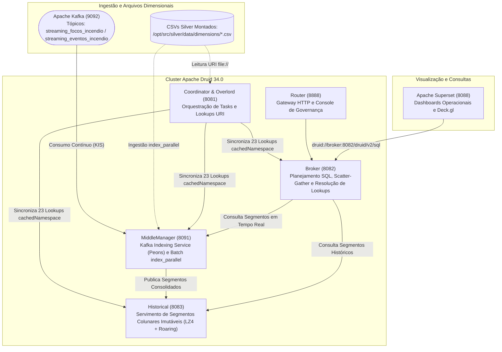

# Especificação Técnica: Infraestrutura Distribuída, Apache Druid e Apache Superset (`infra/`)

> **Trilha Modular — Etapa 17 de 18 (Ciclo 5.2 — Infraestrutura Apache Druid 34.0 e Superset (`infra/`))**: [Anterior: Ciclo 5.1 — Orquestração Apache Dagster (`src/orchestration/`)](../src/orchestration/README.md) | [Portal Geral (`docs/README.md`)](../docs/README.md) | [Próximo: Ciclo 5.3 — Scripts Operacionais, Manutenção e Benchmarks (`scripts/`)](../scripts/README.md)

Este documento especifica a arquitetura de infraestrutura conteinerizada ([`infra/`](.)), as especificações de ingestão batch e streaming do **Apache Druid 34.0**, os perfis de dimensionamento de capacidade de hardware e o catálogo de consultas e dashboards do **Apache Superset**.

---

## 1. Estrutura de Diretórios

```text
infra/
├── README.md                              # Especificação técnica de infraestrutura OLAP e Superset
├── druid/                                 # Configurações e especificações do Apache Druid
│   ├── specs/                             # Especificações JSON de ingestão (Kafka e Batch)
│   │   ├── dim_hospitais_cnes.json
│   │   ├── dim_municipios_coordenadas.json
│   │   ├── dim_ons_linhas_transmissao.json
│   │   ├── dim_ons_sistemas_isolados.json
│   │   ├── dim_ons_subestacoes.json
│   │   ├── dim_rodovias_federais.json
│   │   ├── dim_terras_indigenas_funai.json
│   │   ├── fato_focos_incendio.json       # Supervisor Kafka: streaming_focos_incendio
│   │   ├── fato_eventos_incendio.json     # Supervisor Kafka: streaming_eventos_incendio
│   │   └── fogo_eventos_stdbscan.json     # Ingestão batch alternativa de eventos
│   └── profiles/                          # Perfis de capacidade de hardware e JVM
│       ├── scenario_01_baseline.env       # 1.0 vCPU / 2.0 GB RAM total
│       ├── scenario_02_balanced.env       # 2.0 vCPUs / 4.0 GB RAM total
│       └── scenario_03_query_heavy.env    # 4.0 vCPUs / 8.0 GB RAM total
└── superset/                              # Customização e ativos do Apache Superset
    ├── Dockerfile                         # Imagem customizada com driver pydruid / sqlalchemy
    ├── assets/                            # Exportações JSON/YAML de dashboards e charts
    └── queries/                           # Catálogo de consultas SQL analíticas por domínio
```

---

## 2. Topologia do Cluster Apache Druid 34.0

A infraestrutura definida em [`docker-compose.yaml`](../docker-compose.yaml) separa o Apache Druid em 5 serviços especializados conectados ao **Apache Kafka** (porta `9092`), **PostgreSQL** (metadados) e **Apache Superset** (porta `8088`):



### Funções dos Nós no Cluster

| Serviço | Porta | Responsabilidade Técnica |
| :--- | :-: | :--- |
| **Coordinator / Overlord** | `8081` | Gerencia o balanceamento de segmentos entre nós `Historical`, recebe o registro dos 23 mapas de Lookup via REST (`/druid/coordinator/v1/lookups/config`) e agenda tasks de ingestão (`index_parallel` e supervisores `kafka`). |
| **MiddleManager** | `8091` | Executa processos trabalhadores (*Peons*) que consomem continuamente os tópicos Kafka (`streaming_focos_incendio` e `streaming_eventos_incendio`), mantendo buffers indexados em memória imediatamente consultáveis antes do *handoff* para o Deep Storage. |
| **Historical** | `8083` | Carrega segmentos imutáveis do volume compartilhado (`/opt/shared`), utilizando compressão colunar `LZ4` e índices de bitmap `Roaring` para filtragem booleana de baixa latência. |
| **Broker** | `8082` | Recebe consultas SQL nativas do Apache Superset (`/druid/v2/sql`), distribui subconsultas em paralelo para `MiddleManager` e `Historical` (*scatter-gather*) e resolve as funções `LOOKUP(fk, 'namespace')` em memória RAM. |
| **Router** | `8888` | Roteador de API e interface web unificada de monitoramento de supervisores, tasks, segmentos e lookups. |

---

## 3. Especificações de Ingestão (`infra/druid/specs/`)

### 3.1 Supervisores de Streaming Kafka (Tabelas Fato)

As especificações [`fato_focos_incendio.json`](druid/specs/fato_focos_incendio.json) e [`fato_eventos_incendio.json`](druid/specs/fato_eventos_incendio.json) configuram supervisores nativos do tipo `"kafka"` com as seguintes regras técnicas:

| Parâmetro da Spec | `fato_focos_incendio.json` | `fato_eventos_incendio.json` | Descrição e Regra de Engenharia |
| :--- | :--- | :--- | :--- |
| `ioConfig.topic` | `streaming_focos_incendio` | `streaming_eventos_incendio` | Tópico Kafka consumido pelo supervisor. |
| `ioConfig.useEarliestOffset` | `true` | `true` | Inicia leitura desde o offset inicial da partição caso não haja checkpoint prévio. |
| `ioConfig.taskDuration` | `"PT1H"` | `"PT15M"` | Duração máxima da task de indexação antes do *handoff* do segmento para o nó `Historical`. |
| `tuningConfig.maxRowsInMemory` | `30000` | `30000` | Limite de linhas em heap antes do *spill* intermediário para disco (`intermediatePersistPeriod = PT5M`). |
| `tuningConfig.maxRowsPerSegment` | `5000000` | `5000000` | Cardinalidade máxima por segmento colunar gerado. |
| `timestampSpec.column` | `data_hora` | `data_inicio` | Coluna mapeada para a partição temporal primária `__time`. |
| `granularitySpec` | `segmentGranularity: DAY`, `queryGranularity: NONE`, `rollup: false` | `segmentGranularity: DAY`, `queryGranularity: NONE`, `rollup: false` | Preserva cada foco/evento individual sem pré-agregação destrutiva (`rollup: false`), particionando segmentos por dia. |
| `multiValueHandling` | — | `SORTED_SET` em `codigos_ibge_interceptados` e `codigos_ti_interceptadas` | Armazena listas JSON de municípios e Terras Indígenas atingidas como dimensões multivaloradas ordenadas sem duplicatas. |

#### Amostragem Determinística em Tempo de Ingestão (`sample_bucket`)
Ambas as tabelas fato aplicam uma expressão nativa do Druid no bloco `transformSpec` para gerar a coluna inteira `sample_bucket` $\in [0, 99]$:
```text
abs(timestamp_extract(__time,'EPOCH') * 31 + cast(latitude * 1000, 'LONG') * 17 + cast(longitude * 1000, 'LONG') * 13) % 100
```
*(Em `fato_eventos_incendio.json`, utilizam-se `latitude_centroide` e `longitude_centroide`.)*
Essa transformação permite que os mapas Deck.gl no Apache Superset apliquem downsampling espacialmente uniforme (`WHERE sample_bucket < 20`) usando índices nativos sem recorrer a `RAND()` em tempo de leitura.

### 3.2 Ingestão Batch de Dimensões (`index_parallel`)

Os 7 arquivos `dim_*.json` em [`infra/druid/specs/`](druid/specs/) utilizam tasks do tipo `index_parallel` com `inputSource.type = "local"` apontando para `/opt/src/silver/data/dimensions/*.csv`. Como dimensões estáticas não possuem série temporal natural, aplicam um timestamp constante (`1970-01-01T00:00:00Z`) e `segmentGranularity: ALL`, consolidando cada dimensão em um único segmento compacto para consultas geoespaciais de polígonos `path_json` no Superset.

---

## 4. Perfis de Dimensionamento de Capacidade (`infra/druid/profiles/`)

Os arquivos `.env` em [`infra/druid/profiles/`](druid/profiles/) parametrizam os limites de cgroups do Docker (`CPUS`, `MEM_LIMIT`) e os argumentos da JVM (`JAVA_OPTS`) dos contêineres do Druid para os experimentos de avaliação de capacidade:

| Perfil | Arquivo | Alocação Total (vCPU / RAM) | Heap / Direct Memory do Broker | Aplicação |
| :--- | :--- | :-: | :--- | :--- |
| **Cenário 01 — Baseline** | [`scenario_01_baseline.env`](druid/profiles/scenario_01_baseline.env) | `1.0 vCPU` / `2.0 GB` | `-Xms128m -Xmx256m` | Ambiente mínimo para validação funcional e testes de saturação precoce. |
| **Cenário 02 — Balanced** | [`scenario_02_balanced.env`](druid/profiles/scenario_02_balanced.env) | `2.0 vCPUs` / `4.0 GB` | `-Xms256m -Xmx512m -XX:MaxDirectMemorySize=512m` | Perfil padrão de operação; sustenta até 16 clientes concorrentes sem erros HTTP. |
| **Cenário 03 — Query-Heavy** | [`scenario_03_query_heavy.env`](druid/profiles/scenario_03_query_heavy.env) | `4.0 vCPUs` / `8.0 GB` | `-Xms512m -Xmx1024m -XX:MaxDirectMemorySize=1024m` | Perfil dimensionado para alta concorrência de agregações e varreduras temporais extensas. |

---

## 5. Validação de Contratos de Infraestrutura

Os testes unitários em [`tests/unit/`](tests/unit/) validam estaticamente as especificações JSON do Druid e as consultas SQL do Apache Superset contra os dicionários de dados do projeto:

```bash
uv run pytest infra/tests/unit/test_druid_specs_contract.py infra/tests/unit/test_superset_sql_contract.py
```

---

> **Trilha Modular — Etapa 17 de 18 (Ciclo 5.2 — Infraestrutura Apache Druid 34.0 e Superset (`infra/`))**: [Anterior: Ciclo 5.1 — Orquestração Apache Dagster (`src/orchestration/`)](../src/orchestration/README.md) | [Portal Geral (`docs/README.md`)](../docs/README.md) | [Próximo: Ciclo 5.3 — Scripts Operacionais, Manutenção e Benchmarks (`scripts/`)](../scripts/README.md)
