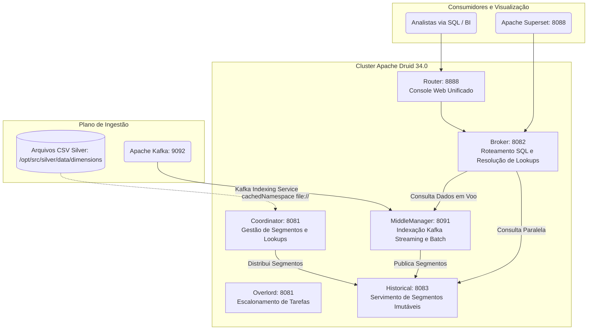

# Infraestrutura e Serviços Distribuídos (`infra/`) - CCO DataOps

Este diretório abriga as configurações, especificações de ingestão, perfis de dimensionamento de capacidade, scripts de testes e receitas de conteinerização do ecossistema distribuído **CCO-DataOps**.

A arquitetura combina **Apache Druid** (banco OLAP colunar de baixa latência), **Apache Kafka / ZooKeeper** (buffer de streaming resiliente), **Apache Superset** (interface de visualização e exploração analítica) e **PostgreSQL** (metastore transacional das ferramentas).

---

## 🏗️ 1. Estrutura de Diretórios da Infraestrutura

```text
infra/
├── README.md              # Este guia completo de infraestrutura
├── druid/                 # Arquivos de configuração e specs do Apache Druid
│   ├── specs/             # Especificações JSON de ingestão index_parallel e lookups
│   │   ├── dim_hospitais_cnes.json
│   │   ├── dim_municipios_coordenadas.json
│   │   ├── dim_ons_linhas_transmissao.json
│   │   ├── dim_ons_sistemas_isolados.json
│   │   ├── dim_ons_subestacoes.json
│   │   ├── dim_rodovias_federais.json
│   │   ├── dim_terras_indigenas_funai.json
│   │   ├── fato_focos_incendio.json
│   │   ├── fato_eventos_incendio.json
│   │   └── fogo_eventos_stdbscan.json
│   └── profiles/          # Perfis de capacidade e dimensionamento de hardware do Druid
│       ├── scenario_01_baseline.env     # Perfil 1.0 vCPU / 2GB RAM
│       ├── scenario_02_balanced.env     # Perfil 2.0 vCPUs / 4GB RAM (Recomendado)
│       └── scenario_03_query_heavy.env  # Perfil 4.0 vCPUs / 8GB RAM
├── superset/              # Configuração e personalização do Apache Superset
│   ├── Dockerfile         # Imagem personalizada com drivers sqlalchemy-druid
│   ├── assets/            # Exportações de dashboards e datasources pré-configurados
│   └── queries/           # Catálogo de consultas SQL especializadas por setor (ONS, FUNAI, Defesa Civil)
└── tests/                 # Testes de contrato de specs e consultas SQL
    ├── unit/
    │   ├── test_druid_specs_contract.py  # Garante paridade entre specs JSON e CSVs Silver
    │   └── test_superset_sql_contract.py # Valida sintaxe e conformidade das queries SQL do catálogo
    └── integration/
        └── test_data_integrity.py        # Testes end-to-end com contêineres Docker ativos
```

---

## 🗄️ 2. Topologia do Cluster Apache Druid 34.0

O Apache Druid foi escolhido como o coração analítico por sua capacidade de entregar agregações de streaming em **sub-segundos (~35ms)** utilizando formato colunar nativo e indexação compacta com **bitmaps Roaring**.

A stack distribuída no `docker-compose.yaml` organiza o Druid nos seguintes processos especializados:



### Processos e Funções dos Nós:
1. **Coordinator & Overlord (`port 8081`)**:
   - O *Coordinator* gerencia o ciclo de vida dos segmentos em disco e sincroniza os mapas de *Lookup* (`cachedNamespace`).
   - O *Overlord* orquestra os *Peons* (trabalhadores) de ingestão streaming do Kafka e indexação em lote.
2. **MiddleManager (`port 8091`)**:
   - Executa os trabalhadores que leem continuamente os tópicos `focos-incendio` e `eventos-incendio` do Kafka via *Kafka Indexing Service* (KIS).
   - Mantém os dados recentes em memória (*real-time index*) imediatamente consultáveis antes de persistir segmentos no Deep Storage.
3. **Historical (`port 8083`)**:
   - Carrega e serve os segmentos colunares imutáveis com compressão LZ4 a partir do disco compartilhado (`/opt/shared`).
4. **Broker (`port 8082`)**:
   - Ponto de entrada das consultas SQL do Superset. Converte SQL em consultas analíticas nativas do Druid, distribui para os nós Historical e MiddleManager e faz a resolução de campos dimensionais via *Lookups*.
5. **Router (`port 8888`)**:
   - Interface Web de governança e console de administração.

---

## ⚙️ 3. Perfis de Dimensionamento e Gestão de Memória (`infra/druid/profiles/`)

Para testes de estresse e avaliação de desempenho, a pasta `infra/druid/profiles/` fornece 3 cenários de configuração de hardware parametrizáveis:

| Perfil | Arquivo | Recursos vCPU / RAM | JVM Broker (`JAVA_OPTS`) | Uso Recomendado |
|:---|:---|:---:|:---|:---|
| **Baseline** | `scenario_01_baseline.env` | 1.0 vCPU / 2.0 GB | `-Xms128m -Xmx256m` | Ambiente de desenvolvimento leve com volume reduzido. |
| **Balanced** | `scenario_02_balanced.env` | 2.0 vCPUs / 4.0 GB | `-Xms256m -Xmx512m -XX:MaxDirectMemorySize=512m` | **Padrão de Produção**: Suporta 16 clientes concorrentes com 0% de erro e 2.0 QPS. |
| **Query-Heavy** | `scenario_03_query_heavy.env` | 4.0 vCPUs / 8.0 GB | `-Xms512m -Xmx1024m -XX:MaxDirectMemorySize=1024m` | Cargas densas de processamento com cache intensivo de consultas complexas. |

---

## 🗺️ 4. Mecanismo de Lookups URI em Memória

Em conformidade com a modelagem **Snowflake**, as tabelas fato (`FATO_FOCOS` e `FATO_EVENTOS`) contêm exclusivamente Foreign Keys numéricas. Para que o Apache Superset possa consultar nomes e atributos das infraestruturas em tempo real sem degradação de performance:

* Os arquivos CSV em `src/silver/data/dimensions` são montados no contêiner em `/opt/src/silver/data/dimensions`.
* O serviço [`DruidLookupRegistrar`](file:///c:/Users/SEPLAN/Documents/UNIFEI/UNIVERSIDADE/mapeamento-risco-queimadas-inpe/src/silver/lookups/druid_lookup_registrar.py) despacha uma requisição HTTP REST para a API do Coordinator (`/druid/coordinator/v1/lookups/config`).
* O Druid cria mapas `cachedNamespace` indexados por chave primária, mantidos em memória RAM.
* **Consulta SQL Otimizada**:
  ```sql
  SELECT 
    LOOKUP(fk_municipio_ibge, 'municipios_nome') AS municipio,
    LOOKUP(fk_subestacao, 'subestacao_nome') AS subestacao,
    LOOKUP(fk_subestacao, 'subestacao_risco_cascata') AS risco_cascata,
    SUM(frp) AS total_frp
  FROM fato_focos_incendio
  GROUP BY 1, 2, 3
  ```
  A resolução ocorre em tempo $O(1)$, evitando *JOINs* relacionais que comprometeriam a latência sub-segundo do OLAP.

---

## 📊 5. Apache Superset e Dashboards Táticos

O **Apache Superset** atua como camada de apresentação visual dos dados:
* Conexão nativa com o Druid via conector SQLAlchemy `druid://broker:8082/druid/v2/sql`.
* Os dashboards operacionais são inicializados automaticamente pelo script [`scripts/bootstrap_stack.sh`](file:///c:/Users/SEPLAN/Documents/UNIFEI/UNIVERSIDADE/mapeamento-risco-queimadas-inpe/scripts/bootstrap_stack.sh), que importa as definições de visualização de [`infra/superset/assets/`](file:///c:/Users/SEPLAN/Documents/UNIFEI/UNIVERSIDADE/mapeamento-risco-queimadas-inpe/infra/superset/assets/).
* Renderização de camadas vetoriais espaciais (Linhas de Transmissão, Áreas de Desastre ST-DBSCAN e Terras Indígenas) através dos campos `path_json` usando o plugin Deck.gl integrado.

---

## 🧪 6. Testes Automatizados da Infraestrutura

Para verificar a conformidade das configurações e contratos de infraestrutura sem subir os contêineres:
```bash
uv run pytest infra/tests/unit/ -v
```
* `test_druid_specs_contract.py`: Confirma que nenhum campo nas specs JSON está ausente nos CSVs Silver gerados.
* `test_superset_sql_contract.py`: Valida a integridade semântica de todas as consultas do catálogo SQL contra o esquema colunar do Druid.
