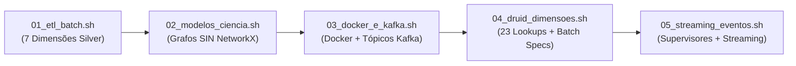

# Especificação Técnica: Scripts Operacionais, Manutenção e Benchmarks (`scripts/`)

> **Trilha Modular — Etapa 18 de 18 (Ciclo 5.3 — Scripts Operacionais, Manutenção e Benchmarks (`scripts/`))**: [Anterior: Ciclo 5.2 — Infraestrutura Apache Druid 34.0 e Superset (`infra/`)](../infra/README.md) | [Portal Geral (`docs/README.md`)](../docs/README.md)

O diretório [`scripts/`](.) reúne os utilitários procedurais de linha de comando (Bash e Python) responsáveis pela automação de inicialização da stack, execução sequencial das etapas do pipeline, manutenção de segmentos no Apache Druid e execução da bateria de experimentos de capacidade.

Em conformidade com as diretrizes arquiteturais do projeto:
1. Todos os utilitários em `scripts/` são estruturados como scripts procedurais diretos (`if __name__ == "__main__":` ou scripts Bash com `set -euo pipefail`).
2. Todas as invocações Python utilizam obrigatoriamente o gerenciador `uv` (`uv run python ...` ou `uv run pytest`).

---

## 1. Topologia do Diretório `scripts/`

```text
scripts/
├── README.md                              # Especificação técnica dos scripts operacionais
├── run_all.sh                             # Orquestrador sequencial ponta a ponta (etapas 01 a 05)
├── bootstrap_stack.sh                     # Provisionamento de diretórios, permissões e bootstrap do Superset
├── run_tests.sh                           # Executor padronizado da suíte pytest via uv
├── run/                                   # Pipeline operacional numerado (Etapas 01 a 05)
│   ├── 01_etl_batch.sh                    # Etapa 01: Execução paralela das 7 Dimensões Silver
│   ├── 02_modelos_ciencia.sh              # Etapa 02: Cálculo de centralidade de grafos do SIN (NetworkX)
│   ├── 03_docker_e_kafka.sh               # Etapa 03: Subida dos contêineres Docker e criação de tópicos Kafka
│   ├── 04_druid_dimensoes.sh              # Etapa 04: Submissão de Lookups URI e ingestão batch no Druid
│   ├── 04_druid_lookups.py                # CLI Python que aciona DruidLookupRegistrar
│   └── 05_streaming_eventos.sh            # Etapa 05: Registro de supervisores Kafka e disparo do streaming
├── benchmarks/                            # Suíte de avaliação de desempenho e capacidade do Druid
│   ├── capacity_metadata.py               # Definições de cenários, queries e metadados experimentais
│   ├── compare_capacity_results.py        # Consolidador estatístico entre perfis de hardware
│   ├── compile_capacity_reports.sh        # Geração automatizada de gráficos e tabelas LaTeX/Markdown
│   ├── run_capacity_matrix.sh             # Executor da matriz de concorrência (1, 2, 4, 8, 16 clientes)
│   ├── run_all_experiments.sh             # Automação completa dos 3 perfis de hardware do Druid
│   ├── benchmark_runner/                  # Motor de carga concorrente e coletor de telemetria Docker
│   └── report_generator/                  # Geradores de figuras e tabelas estatísticas
├── maintenance/                           # Utilitários de diagnóstico e recarga do cluster OLAP
│   ├── executar_validacoes_sql_druid.py   # Validador de latência e retorno das queries SQL no Broker
│   ├── run_superset_sector_queries.py     # Executor de consultas analíticas setoriais (ONS, FUNAI, Saúde)
│   ├── update_docs_and_configs.py         # Utilitário de inspeção e sincronização de configurações
│   ├── reindex_com_sample_bucket.sh       # Reindexação de segmentos adicionando a coluna sample_bucket
│   └── druid_reload/                      # Rotinas de recarga de supervisores e fatos no Druid
│       ├── reload_all.sh
│       ├── reload_event_fact.sh
│       └── reinicio_completo.sh
└── setup/                                 # Scripts auxiliares de configuração local
    └── register_datasets_superset.py      # Registro programático de datasets no Apache Superset
```

---

## 2. Pipeline Operacional Sequencial (`scripts/run/`)

O fluxo de implantação local é dividido em 5 etapas sequenciais independentes, que podem ser executadas individualmente ou encadeadas pelo script mestre [`run_all.sh`](run_all.sh):



| Etapa | Script | Módulos Python / Serviços Acionados | Artefatos e Efeitos Produzidos |
| :-: | :--- | :--- | :--- |
| **01** | [`run/01_etl_batch.sh`](run/01_etl_batch.sh) | `uv run python src/silver/etl/run_etl.py` | Gera os 7 arquivos CSV de dimensão em `src/silver/data/dimensions/` e valida integridade primária. |
| **02** | [`run/02_modelos_ciencia.sh`](run/02_modelos_ciencia.sh) | `uv run python src/gold/science/networkx/network_builder.py` | Constrói o grafo do SIN, calcula `betweenness_score_norm` e `risco_cascata` e atualiza `dim_ons_subestacoes.csv`. |
| **03** | [`run/03_docker_e_kafka.sh`](run/03_docker_e_kafka.sh) | `docker compose up -d` + `kafka-topics.sh` | Inicializa os contêineres e garante a existência dos tópicos `streaming_focos_incendio` e `streaming_eventos_incendio`. |
| **04** | [`run/04_druid_dimensoes.sh`](run/04_druid_dimensoes.sh) | [`run/04_druid_lookups.py`](run/04_druid_lookups.py) (`DruidLookupRegistrar`) + API Overlord (`:8081/druid/indexer/v1/task`) | Registra os 23 Lookups URI em memória e submete as 7 tasks `index_parallel` das dimensões estáticas. |
| **05** | [`run/05_streaming_eventos.sh`](run/05_streaming_eventos.sh) | API Overlord (`:8081/druid/indexer/v1/supervisor`) + `ProdutorEventosStreaming` | Registra os supervisores `fato_focos_incendio.json` e `fato_eventos_incendio.json` e inicia a publicação em streaming. |

### Parâmetros do Orquestrador Mestre ([`run_all.sh`](run_all.sh))
```bash
# Execução completa padrão
./scripts/run_all.sh

# Opções de controle parcial e seleção de perfil de hardware do Druid:
./scripts/run_all.sh --skip-etl --profile scenario_02_balanced
```
- `--skip-etl`: omite as etapas `01` e `02` caso os CSVs de dimensão já estejam gerados e enriquecidos.
- `--skip-docker`: omite a reinicialização de contêineres na etapa `03`.
- `--profile <scenario>`: aplica as variáveis de limite de CPU/RAM de `infra/druid/profiles/<scenario>.env`.

---

## 3. Bootstrap do Apache Superset ([`bootstrap_stack.sh`](bootstrap_stack.sh))

O script [`bootstrap_stack.sh`](bootstrap_stack.sh) automatiza a preparação do ambiente de visualização:
1. Cria os diretórios de volumes compartilhados e ajusta permissões de escrita para os UIDs dos contêineres do Druid e Superset.
2. Executa `superset db upgrade`, cria a conta administrativa padrão (`admin` / `admin`) e inicializa roles (`superset init`).
3. Importa os pacotes de dashboards e datasources versionados em [`infra/superset/assets/`](../infra/superset/assets/) e registra conexões SQLAlchemy (`druid://broker:8082/druid/v2/sql`) via [`setup/register_datasets_superset.py`](setup/register_datasets_superset.py).

---

## 4. Suíte de Benchmarking e Planejamento de Capacidade (`scripts/benchmarks/`)

O subpacote [`scripts/benchmarks/`](benchmarks/) implementa a infraestrutura experimental para medição de vazão (*Queries Per Second* — QPS), latência (P50, P95, P99), taxa de acerto de cache e consumo de CPU/RAM do cluster Apache Druid:

| Componente | Caminho | Responsabilidade Técnica |
| :--- | :--- | :--- |
| **Metadados de Capacidade** | [`benchmarks/capacity_metadata.py`](benchmarks/capacity_metadata.py) | Define os parâmetros de aquecimento (*warm-up*), níveis de concorrência ($1, 2, 4, 8, 16$ threads) e mapeamento dos 3 cenários de hardware. |
| **Executor de Carga e Telemetria** | [`benchmarks/benchmark_runner/`](benchmarks/benchmark_runner/) | Dispara consultas SQL concorrentes contra o endpoint `/druid/v2/sql` do Broker com e sem cache (`useCache: true/false`), enquanto amostra periodicamente `docker stats` (CPU % e memória RSS) de cada serviço do Druid. |
| **Matriz de Concorrência** | [`benchmarks/run_capacity_matrix.sh`](benchmarks/run_capacity_matrix.sh) | Orquestra a bateria de testes de um perfil específico e persiste os resultados brutos em `docs/performance/druid_capacity/<timestamp>/`. |
| **Comparador e Gerador de Relatórios** | [`benchmarks/compare_capacity_results.py`](benchmarks/compare_capacity_results.py) e [`benchmarks/report_generator/`](benchmarks/report_generator/) | Consolida as distribuições de latência e QPS entre os 3 cenários de hardware, gerando tabelas estatísticas e gráficos de desempenho. |

---

## 5. Manutenção e Diagnóstico (`scripts/maintenance/`)

| Utilitário | Comando de Execução | Função Operacional |
| :--- | :--- | :--- |
| [`executar_validacoes_sql_druid.py`](maintenance/executar_validacoes_sql_druid.py) | `uv run python scripts/maintenance/executar_validacoes_sql_druid.py` | Executa a bateria de consultas SQL de validação contra o Broker (`localhost:8082`), verificando integridade dos joins com os 23 Lookups e latência de resposta. |
| [`run_superset_sector_queries.py`](maintenance/run_superset_sector_queries.py) | `uv run python scripts/maintenance/run_superset_sector_queries.py` | Executa o catálogo completo de queries setoriais (`infra/superset/queries/`) para auditar tempos de resposta por painel (ONS, FUNAI, Saúde/CNES, Rodovias). |
| [`reindex_com_sample_bucket.sh`](maintenance/reindex_com_sample_bucket.sh) | `./scripts/maintenance/reindex_com_sample_bucket.sh` | Reindexa segmentos existentes no Druid aplicando a expressão de hash determinístico `sample_bucket` (`0..99`). |
| [`druid_reload/reload_all.sh`](maintenance/druid_reload/reload_all.sh) | `./scripts/maintenance/druid_reload/reload_all.sh` | Reinicia supervisores, recarrega os 23 mapas de lookup no Coordinator e reenvia especificações de tabelas fato após atualizações de schema. |

---

> **Trilha Modular — Etapa 18 de 18 (Ciclo 5.3 — Scripts Operacionais, Manutenção e Benchmarks (`scripts/`))**: [Anterior: Ciclo 5.2 — Infraestrutura Apache Druid 34.0 e Superset (`infra/`)](../infra/README.md) | [Portal Geral (`docs/README.md`)](../docs/README.md)
