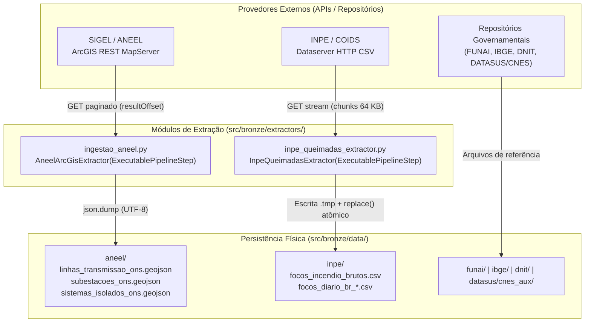
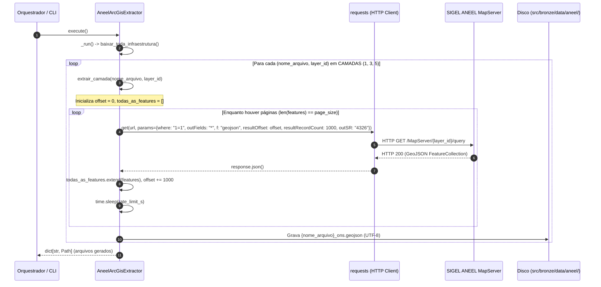
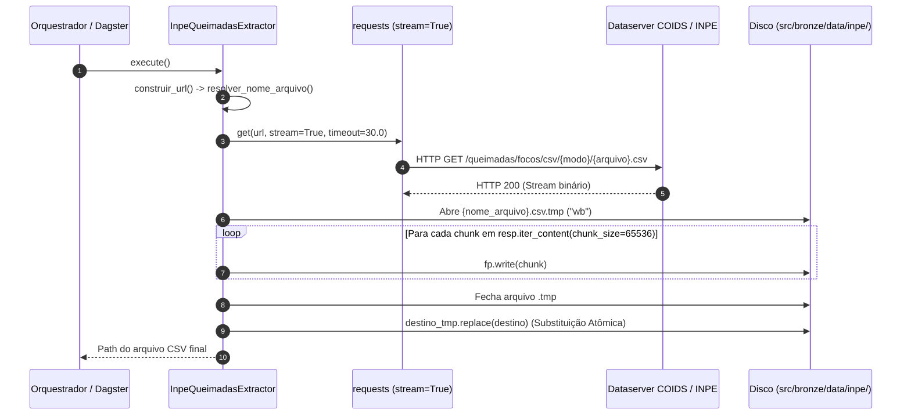

# Especificação Técnica: Camada Bronze — Ciclo de Ingestão Bruta (`src/bronze/`)

> **Trilha Modular — Etapa 02 de 18 (Ciclo 1.1 — Hub da Camada Bronze e Extratores (`src/bronze/`))**: [Anterior: Ciclo 0 — Núcleo e Contratos (`src/core/`)](../core/README.md) | [Portal Geral (`docs/README.md`)](../../docs/README.md) | [Próximo: Ciclo 1.2 — Fontes Governamentais e APIs (`src/bronze/`)](FONTES_E_APIS.md)

A Camada Bronze constitui o estágio inicial do pipeline de dados. Sua responsabilidade é realizar a coleta, paginação e persistência em disco dos dados brutos (*raw data*) provenientes de APIs e repositórios governamentais externos, preservando a estrutura nativa dos provedores sem aplicação de filtros destrutivos ou transformações de regra de negócio.

Para especificações de protocolo de rede e esquemas tabulares/vetoriais de cada provedor, consulte os documentos complementares:
- [**Especificação de APIs, Parâmetros e Particularidades (`FONTES_E_APIS.md`)**](FONTES_E_APIS.md)
- [**Dicionário de Dados Brutos e Esquemas de Retorno (`DICIONARIO_DADOS.md`)**](DICIONARIO_DADOS.md)

---

## 1. Arquitetura e Modulação do Ciclo de Ingestão



---

## 2. Extrator Geoespacial ANEEL/ONS ([`ingestao_aneel.py`](extractors/ingestao_aneel.py))

O módulo `ingestao_aneel.py` implementa a classe `AneelArcGisExtractor`, responsável por extrair as feições geográficas do Sistema Interligado Nacional (SIN) a partir do servidor Esri ArcGIS REST do SIGEL/ANEEL.

### 2.1 Fluxo de Paginação e Controle de Taxa

O servidor ArcGIS da ANEEL impõe um limite estrito de `1000` feições por resposta HTTP. O extrator utiliza um laço de paginação controlado por deslocamento (`resultOffset`) até que a quantidade de registros retornados na página corrente seja inferior a `page_size`:



### 2.2 Catálogo de Classes, Métodos e Funções de `ingestao_aneel.py`

| Símbolo | Assinatura | Especificação Técnica |
|:---|:---|:---|
| `URL_BASE` | `str` | `"https://sigel.aneel.gov.br/arcgis/rest/services/PORTAL/Transmiss%C3%A3o/MapServer/{id}/query"` |
| `CAMADAS` | `dict[str, int]` | Mapeamento entre o prefixo do arquivo de saída e o identificador numérico da camada no MapServer: `{"linhas_transmissao": 1, "subestacoes": 3, "sistemas_isolados": 5}`. |
| `AneelArcGisExtractor.__init__` | `(self, output_dir: str \| Path = ANEEL_DIR, camadas: Mapping[str, int] \| None = None, url_base: str = URL_BASE, page_size: int = 1000, rate_limit_s: float = 1.0, http_client: Any \| None = None) -> None` | Inicializa o extrator permitindo injeção do cliente HTTP (`http_client`) e do diretório de saída para testes unitários isolados de rede. |
| `AneelArcGisExtractor.extrair_camada` | `(self, nome_arquivo: str, layer_id: int) -> Path \| None` | Executa a paginação completa de uma camada ArcGIS, consolida a lista `features` em um único objeto `{"type": "FeatureCollection", "features": todas_as_features}` e persiste o arquivo `{nome_arquivo}_ons.geojson`. Retorna `None` se a resposta HTTP for diferente de `200` ou se a camada não retornar feições. |
| `AneelArcGisExtractor.baixar_toda_infraestrutura` | `(self) -> dict[str, Path]` | Itera sobre todas as entradas de `self.camadas`, invoca `extrair_camada` e retorna o dicionário com os caminhos absolutos dos arquivos GeoJSON gravados. |
| `extrair_camada` / `baixar_toda_infraestrutura` | Funções de módulo | Wrappers procedurais de compatibilidade para execução direta via linha de comando (`uv run python src/bronze/extractors/ingestao_aneel.py`). |

---

## 3. Extrator de Focos de Queimada do INPE ([`inpe_queimadas_extractor.py`](extractors/inpe_queimadas_extractor.py))

O módulo `inpe_queimadas_extractor.py` implementa a classe `InpeQueimadasExtractor`, projetada para realizar o download de arquivos CSV de detecções termais do servidor de dados abertos COIDS/INPE com consumo constante de memória RAM e garantia de atomicidade em disco.

### 3.1 Fluxo de Download em Streaming e Escrita Atômica

Arquivos consolidados de focos de calor podem atingir centenas de megabytes. Para evitar alocação integral do payload em memória e impedir que leitores concorrentes (como o produtor Kafka ou o Dagster) consumam um arquivo truncado em caso de falha de rede, o extrator grava os blocos recebidos em um arquivo temporário (`.tmp`) e executa a operação `Path.replace()` (renomeação atômica POSIX) somente após o término completo do fluxo:



### 3.2 Catálogo de Métodos e Parâmetros de `InpeQueimadasExtractor`

| Símbolo | Assinatura | Especificação Técnica |
|:---|:---|:---|
| `URL_BASE_INPE` | `str` | `"https://dataserver-coids.inpe.br/queimadas/queimadas/focos/csv"` |
| `InpeQueimadasExtractor.__init__` | `(self, output_dir: str \| Path = INPE_DIR, modo: str = "diario", data_ref: str \| None = None, satelite_filtro: str \| None = None, url_base: str = URL_BASE_INPE, timeout_s: float = 30.0, chunk_size: int = 65536, http_client: Any \| None = None) -> None` | Configura a periodicidade de coleta (`"diario"`, `"mensal"` ou `"10min"`), a data de referência opcional, o timeout de socket (`30.0` s) e o tamanho do buffer de leitura (`64 KB`). |
| `resolver_nome_arquivo` | `(self) -> str` | Determina o nome do arquivo remoto segundo a convenção do COIDS/INPE:<br>• `modo == "diario"`: `focos_diario_br_{YYYYMMDD}.csv`<br>• `modo == "mensal"`: `focos_mensal_br_{YYYYMM}.csv`<br>• `modo == "10min"`: `focos_10min_{YYYYMMDD_HHMM}.csv`<br>Lança `ValueError` caso `modo` não pertença ao conjunto válido. |
| `construir_url` | `(self) -> str` | Concatena `self.url_base`, o subdiretório correspondente ao modo (`/diario/Brasil/`, `/mensal/Brasil/` ou `/10min/`) e o nome do arquivo resolvido. |
| `_run` | `(self, *args: Any, **kwargs: Any) -> Path` | Executa a requisição HTTP com `stream=True`, lança `RuntimeError` se `status_code != 200`, descarrega o conteúdo em blocos de `65536` bytes para `{nome_arquivo}.tmp` e promove o arquivo para o caminho definitivo via `destino_tmp.replace(destino)`. |

---

## 4. Organização Física do Diretório de Dados (`src/bronze/data/`)

```text
src/bronze/data/
├── aneel/
│   ├── linhas_transmissao_ons.geojson   # 1.817 feições LineString (Layer 1)
│   ├── subestacoes_ons.geojson          # 627 feições Point (Layer 3)
│   └── sistemas_isolados_ons.geojson    # 120 feições Point (Layer 5)
├── inpe/
│   └── focos_incendio_brutos.csv        # Série consolidada de detecções satelitais
├── funai/
│   ├── mapa_terras_indigenas.geojson    # 650 polígonos de Terras Indígenas
│   └── tis_poligonais.csv               # Catálogo administrativo complementar (20 colunas)
├── ibge/
│   └── municipios_br.geojson            # 5.564 polígonos municipais (escala 1:250.000)
├── dnit/
│   ├── mapa_rodovias_federais.geojson   # 14.255 segmentos rodoviários LineString
│   └── rodovia-federal/                 # Shapefile original (.shp, .dbf, .prj, .shx)
└── datasus/
    └── cnes_aux/
        ├── tbEstabelecimento202603.csv  # Cadastro nacional de unidades de saúde (sep ';')
        ├── tbMunicipio202603.csv        # Tabela auxiliar de municípios gestores (sep ';')
        └── tbTipoUnidade202603.csv      # Domínio de códigos de tipo de unidade (sep ';')
```

---

> **Trilha Modular — Etapa 02 de 18 (Ciclo 1.1 — Hub da Camada Bronze e Extratores (`src/bronze/`))**: [Anterior: Ciclo 0 — Núcleo e Contratos (`src/core/`)](../core/README.md) | [Portal Geral (`docs/README.md`)](../../docs/README.md) | [Próximo: Ciclo 1.2 — Fontes Governamentais e APIs (`src/bronze/`)](FONTES_E_APIS.md)
