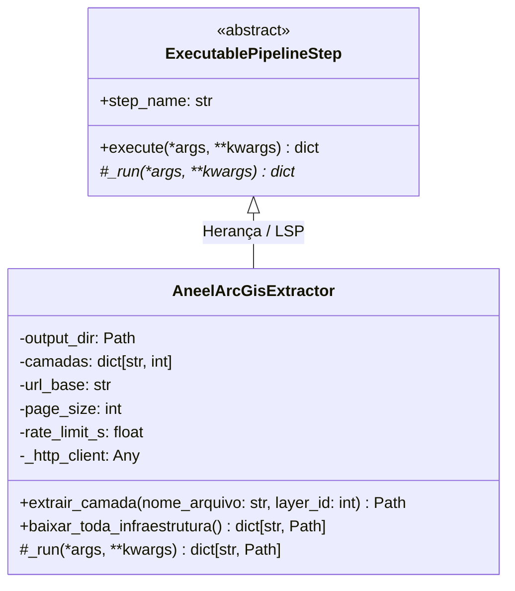
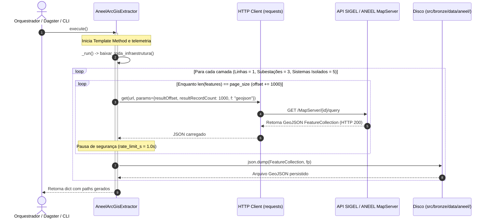

# Camada Bronze (Raw Ingestion) - CCO DataOps

A **Camada Bronze** constitui o estágio inicial de ingestão da arquitetura Medalhão do projeto. Sua responsabilidade fundamental é a extração e persistência **fiel e imutável** de dados provenientes de fontes governamentais externas, sem transformações de negócio, filtragens agressivas ou limpezas sintéticas que descaracterizem o dado bruto original.

---

## 1. Princípios e Governança da Camada Bronze

1. **Imutabilidade e Fidelidade na Origem (*Raw Representation*)**:
   - Os dados são armazenados exatamente como fornecidos pelos provedores (APIs REST, portais de dados abertos e FTPs governamentais).
   - Nenhuma geometria é simplificada ou reprojetada na Bronze. Sistemas de coordenadas nativos (como `EPSG:4326` WGS84 ou SIRGAS 2000 geográfico) e metadados de cabeçalho são preservados na íntegra.
2. **Tolerância a Falhas e Paginação Robusta**:
   - Serviços de terceiros impõem limites de consulta (ex: paginação máxima de 1.000 feições no ArcGIS Server da ANEEL). A ingestão automatizada controla cursores de deslocamento (`resultOffset`) e intervalos de espera (*rate limiting*) para mitigar bloqueios por *throttling* ou *HTTP 429/503*.
3. **Desacoplamento e Testabilidade (POO / SOLID)**:
   - A extração é encapsulada em classes com responsabilidade única ([`AneelArcGisExtractor`](extractors/ingestao_aneel.py)), implementando o contrato [`ExecutablePipelineStep`](../../src/core/contracts/contracts.py) (LSP).
   - Permite a injeção de clientes HTTP simulados (`http_client`) e diretórios temporários para validação determinística em suítes de testes unitários sem chamadas de rede externas.

---

## 2. Estrutura de Diretórios da Camada

```text
src/bronze/
├── README.md              # Este guia geral da Camada Bronze
├── FONTES_E_APIS.md       # Especificação técnica profunda de todas as APIs e fontes de dados
├── DICIONARIO_DADOS.md    # Dicionário e esquema estrutural dos dados brutos retornados
├── extractors/            # Extratores POO com responsabilidade única (SRP)
│   ├── __init__.py
│   └── ingestao_aneel.py  # Extrator POO da API ArcGIS REST da ANEEL/ONS
├── tests/                 # Testes unitários co-localizados da Camada Bronze
│   └── test_aneel_extractor.py
└── data/                  # Diretório de persistência dos arquivos brutos (Raw Data)
    ├── aneel/             # GeoJSONs brutos da malha do SIN (linhas, subestações, sistemas isolados)
    ├── inpe/              # CSVs brutos de focos de calor do BDQueimadas
    ├── funai/             # Arquivos vetoriais e tabulares de Terras Indígenas
    ├── ibge/              # Malha vetorial oficial dos 5.564 municípios
    ├── dnit/              # Malha de rodovias federais e estaduais do SNV
    └── datasus/           # Cadastros hospitalares brutos do CNES (leitos, UTI, tipos)
```

---

## 3. Arquitetura de Software e Classes

### 3.1 Diagrama de Classes (POO & Injeção de Dependência)



### 3.2 Diagrama de Sequência: Paginação e Rate Limiting no ArcGIS REST

O processo de ingestão automatizada da ANEEL/ONS varre as camadas do MapServer em blocos de 1.000 registros com pausa controlada:



---

## 4. Guia Operacional de Execução

Todos os comandos devem ser executados através do gerenciador ultrarrápido `uv`:

### 4.1 Ingestão Automatizada da ANEEL/ONS
Para baixar ou atualizar a malha vetorial do setor elétrico nacional diretamente da API oficial do SIGEL/ANEEL:
```bash
uv run python src/bronze/extractors/ingestao_aneel.py
```

### 4.2 Execução via Orquestrador Dagster
A etapa de ingestão está mapeada como o Software-Defined Asset `aneel_ons_data` no Dagster:
```bash
uv run dagster asset materialize --select aneel_ons_data -f src/orchestration/dagster/repo.py
```

---

## 5. Documentos Complementares da Camada Bronze

Para obter os detalhes técnicos de cada fonte de dados e os esquemas estruturais retornados, consulte:
- 🌐 [**FONTES_E_APIS.md**](FONTES_E_APIS.md): Endpoints das APIs, periodicidade de atualização, limitações de requisição e protocolos de coleta para ANEEL, INPE, FUNAI, IBGE, DNIT e DATASUS.
- 📋 [**DICIONARIO_DADOS.md**](DICIONARIO_DADOS.md): Especificação dos campos originais e tipos de dados de cada arquivo bruto ingerido na Bronze.
