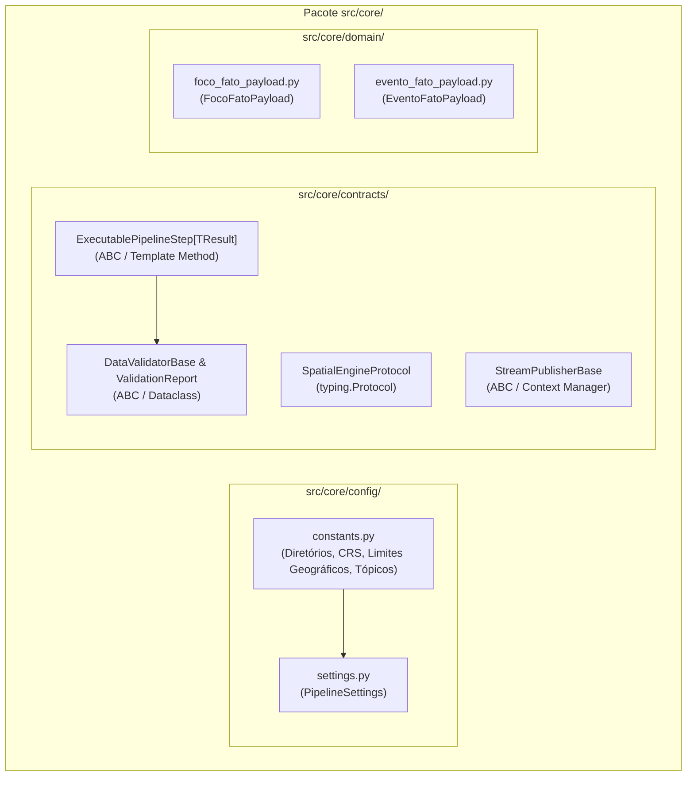
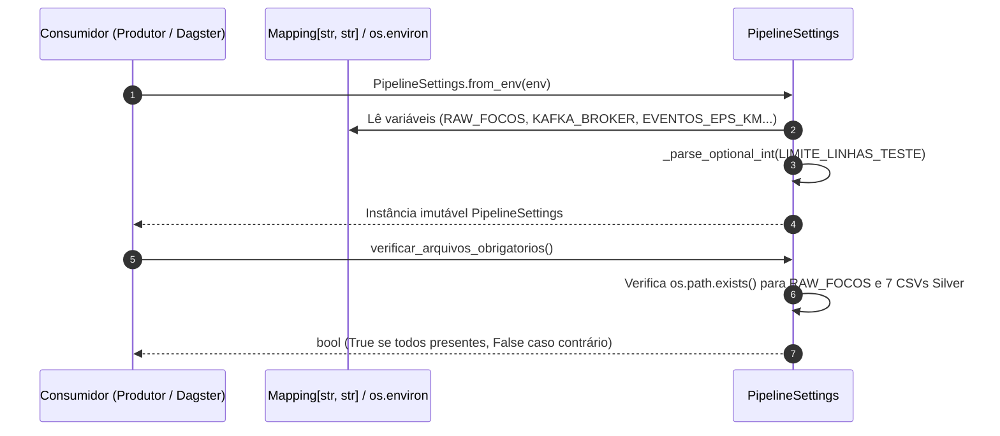
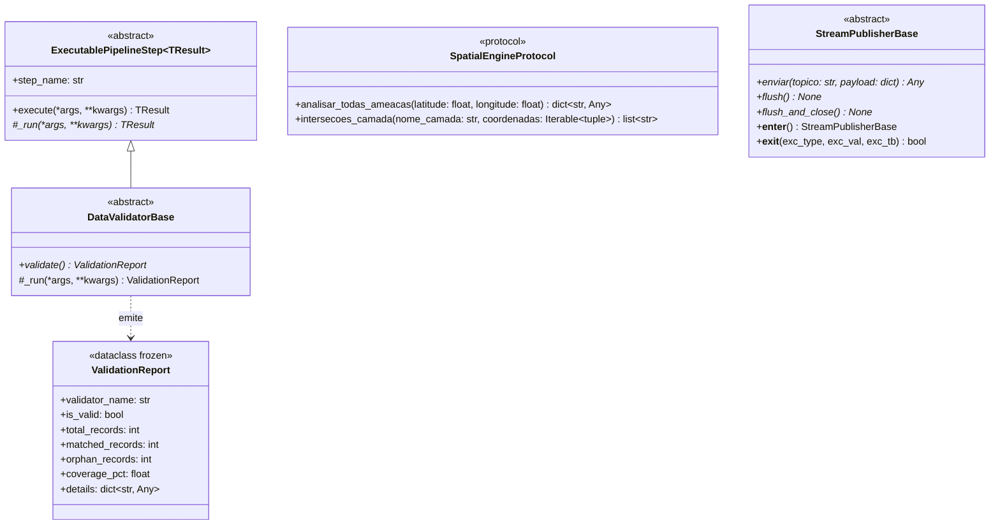

# Especificação Técnica: Núcleo Compartilhado (`src/core/`)

> **Trilha Modular — Etapa 01 de 18 (Ciclo 0 — Núcleo e Contratos (`src/core/`))**: [Portal Geral (`docs/README.md`)](../../docs/README.md) | [Próximo: Ciclo 1.1 — Hub da Camada Bronze e Extratores (`src/bronze/`)](../bronze/README.md)

O pacote `src/core/` define as fundações arquiteturais, os protocolos de inversão de dependência, os contratos de validação de esquema Pydantic (modelagem Snowflake) e o gerenciamento centralizado de configurações e constantes do sistema. Nenhuma regra de transformação específica de domínio reside neste pacote; seu propósito é estabelecer invariantes estruturais compartilhados pelas camadas Bronze, Silver, Gold e Orquestração.

---

## 1. Arquitetura e Modulação do Pacote

O pacote é subdividido em três submódulos independentes:
1. `src/core/config/`: Constantes imutáveis de sistema, limites geodésicos e carregamento de variáveis de ambiente.
2. `src/core/contracts/`: Classes base abstratas (`ABC`) e protocolos estruturais (`typing.Protocol`) para desacoplamento entre camadas.
3. `src/core/domain/`: Modelos Pydantic imutáveis (`frozen=True`, `extra="forbid"`) que validam os payloads enviados ao Apache Kafka e ingeridos pelo Apache Druid.

---

## 2. Submódulo de Configuração (`src/core/config/`)

### 2.1 Constantes Globais ([`constants.py`](config/constants.py))

Concentra referências de diretórios físicos, projeções cartográficas, valores sentinela e parâmetros padrão de mensageria para evitar divergências entre os processos de ETL em lote e os produtores de streaming.

| Constante | Tipo | Valor Padrão | Especificação Técnica e Uso |
|:---|:---|:---|:---|
| `PROJECT_ROOT` | `Path` | Raiz do repositório | Resolvido dinamicamente via `Path(__file__).resolve().parents[3]`. |
| `BRONZE_DIR` | `Path` | `src/bronze/data` | Diretório base das extrações brutas (`ANEEL_DIR`, `INPE_DIR`, `FUNAI_DIR`, `DNIT_DIR`, `IBGE_DIR`, `DATASUS_DIR`). |
| `DIMENSIONS_DIR` | `Path` | `src/silver/data/dimensions` | Diretório de persistência das 7 dimensões conformadas em CSV. |
| `GOLD_FACTS_DIR` | `Path` | `src/gold/data/fatos` | Diretório de persistência local das tabelas fato processadas. |
| `NOT_INFORMED` | `str` | `"NAO INFORMADO"` | Valor sentinela padrão para chaves estrangeiras ausentes ou atributos textuais nulos. |
| `UNKNOWN_UF` | `str` | `"NI"` | Valor sentinela para siglas de Unidades Federativas não identificadas. |
| `DEFAULT_EPOCH` | `str` | `"1970-01-01 00:00:00"` | Timestamp de fallback caso a data de detecção do satélite esteja corrompida. |
| `EPSG_GPS` | `int` | `4326` | Código EPSG do sistema geodésico WGS84 (graus decimais), exigido pelo Apache Superset / Deck.gl. |
| `EPSG_METRICO` | `int` | `5880` | Código EPSG da projeção SIRGAS 2000 / Brazil Polyconic (metros), utilizada em cálculos de área e distância euclidiana. |
| `DISTANCE_LIMITS_KM` | `tuple` | `(1, 3, 7, 15, 50)` | Limiares em quilômetros para classificação categórica de proximidade a infraestruturas críticas. |
| `BRAZIL_LAT_MIN` / `MAX` | `float` | `-35.0` a `6.0` | Limites meridionais e setentrionais do bounding box territorial brasileiro. |
| `BRAZIL_LON_MIN` / `MAX` | `float` | `-75.0` a `-30.0` | Limites ocidentais e orientais do bounding box territorial brasileiro. |
| `DEFAULT_KAFKA_TOPIC_FOCOS` | `str` | `"streaming_focos_incendio"` | Tópico Kafka destinado aos registros atômicos de focos de calor enriquecidos. |
| `DEFAULT_KAFKA_TOPIC_EVENTOS` | `str` | `"streaming_eventos_incendio"` | Tópico Kafka destinado aos clusters espaço-temporais consolidados via ST-DBSCAN. |

---

### 2.2 Gerenciamento de Configuração ([`settings.py`](config/settings.py))

Implementado pela dataclass imutável `PipelineSettings` (`@dataclass(frozen=True)`), que encapsula os parâmetros de execução e permite substituição via variáveis de ambiente sem mutação de estado global.

#### Funções e Métodos de `settings.py`

| Símbolo | Assinatura | Comportamento Técnico |
|:---|:---|:---|
| `_parse_optional_int` | `(raw_value: str) -> Optional[int]` | Remove espaços em branco de `raw_value`; retorna `None` se a string estiver vazia ou converte para `int`. |
| `PipelineSettings.from_env` | `(cls, env: Optional[Mapping[str, str]] = None) -> PipelineSettings` | Método de fábrica que constrói a configuração a partir de um dicionário injetado (testes) ou de `os.environ`. Resolve caminhos das 7 dimensões Silver, parâmetros de lote do Kafka (`linger_ms=20`, `batch_size=65536`, `compression="gzip"`) e hiperparâmetros do ST-DBSCAN (`eps_km=5.0`, `eps_dias=2.0`, `min_samples=3`, `max_duration_days=7.0`, `area_buffer_km=0.5`). |
| `PipelineSettings.arquivos_obrigatorios` | `(self) -> dict[str, str]` | Retorna dicionário mapeando as chaves lógicas (`RAW_FOCOS`, `DIM_FUNAI`, `DIM_MUNICIPIOS_COORD`, `DIM_RODOVIAS`, `DIM_LINHAS_ONS`, `DIM_SUBESTACOES`, `DIM_SISTEMAS_ISO`, `DIM_HOSPITAIS`) aos seus respectivos caminhos absolutos em disco. |
| `PipelineSettings.verificar_arquivos_obrigatorios` | `(self) -> bool` | Valida a existência física de todos os arquivos listados em `arquivos_obrigatorios()`. Registra em `stdout` os arquivos ausentes e retorna `False` caso algum não seja encontrado. |

---

## 3. Submódulo de Contratos e Protocolos (`src/core/contracts/`)

Definido em [`contracts.py`](contracts/contracts.py), estabelece as interfaces que isolam a lógica funcional da infraestrutura externa.

### Especificação das Interfaces

1. **`ExecutablePipelineStep[TResult]`**:
   - **Padrão de Projeto**: *Template Method*.
   - **Método Público `execute(*args, **kwargs) -> TResult`**: Registra o início da execução via `logging`, captura o instante inicial com `time.perf_counter()`, invoca o método abstrato `_run(*args, **kwargs)`, calcula a duração em milissegundos e registra a conclusão no log antes de retornar o resultado.
   - **Propriedade `step_name -> str`**: Retorna `self.__class__.__name__` para identificação padronizada no Apache Dagster.
2. **`SpatialEngineProtocol`**:
   - **Padrão de Projeto**: *Interface Segregation / Dependency Inversion* (`@runtime_checkable Protocol`).
   - Desacopla o `ProcessadorFocos` e o `EventizadorIncendios` da implementação concreta do `MotorEspacial` (permitindo testes unitários sem carregar shapefiles/GeoJSONs reais).
3. **`StreamPublisherBase`**:
   - **Padrão de Projeto**: *Resource Acquisition Is Initialization (RAII) / Context Manager*.
   - Obriga subclasses de mensageria (como `KafkaEventProducer`) a implementar `enviar`, `flush` e `flush_and_close`. O método `__exit__` invoca `self.flush_and_close()` incondicionalmente, prevenindo perda de mensagens em buffers de rede caso ocorram exceções durante o streaming.
4. **`DataValidatorBase` e `ValidationReport`**:
   - Especialização de `ExecutablePipelineStep` voltada a rotinas de auditoria de integridade referencial entre dimensões e tabelas fato.

---

## 4. Submódulo de Contratos de Domínio (`src/core/domain/`)

Os contratos Pydantic implementam a governança do esquema **Snowflake** na borda de saída para o Apache Kafka e Apache Druid. Ambos os modelos utilizam `ConfigDict(frozen=True, extra="forbid")`, impedindo mutação pós-instanciação e rejeitando campos não declarados (como strings descritivas de municípios ou nomes de hospitais).

### 4.1 Contrato `FocoFatoPayload` ([`foco_fato_payload.py`](domain/foco_fato_payload.py))

Representa um registro unitário da tabela fato `fato_focos_incendio` (29 atributos).

| Grupo Semântico | Atributos | Tipo Python | Restrições e Regras de Domínio |
|:---|:---|:---|:---|
| **Chave Temporal** | `data_hora` | `str` | Obrigatório (`Field(...)`). Formato ISO `YYYY-MM-DD HH:MM:SS`, mapeado para `__time` no Druid. |
| **Dimensões Degeneradas** | `pais_origem`, `fk_bioma`, `fk_satelite_sensor` | `str` | Strings higienizadas em caixa alta sem acentuação. |
| **Chaves Estrangeiras (Snowflake)** | `fk_municipio`, `fk_municipio_espacial`, `fk_terra_indigena`, `fk_terra_indigena_proxima`, `fk_trecho_rodoviario`, `fk_linha_transmissao`, `fk_subestacao`, `fk_sistema_isolado`, `fk_hospital_proximo` | `str` | Identificadores resolvidos em tempo de consulta via Lookups no Druid. Quando não há intersecção, recebem `"NAO INFORMADO"`. |
| **Georreferenciamento** | `latitude`, `longitude` `coordenada_valida` `foco_point` | `Optional[float]` `int` `str` | Coordenadas em WGS84 (`EPSG:4326`). `coordenada_valida` assume `1` ou `0`. `foco_point` armazena `"lat,lon"` ou `""`. |
| **Métricas Termo-Climáticas** | `dias_sem_chuva`, `precipitacao_mm`, `risco_fogo_inpe`, `potencia_radiativa_fogo`, `indice_condicao_ambiental`, `indice_queimada_evento` | `Optional[float]` | Valores sanitizados (sem sentinelas `<= -900`). |
| **Métricas de Distância Euclidiana** | `distancia_rodovia_km`, `distancia_linha_km`, `distancia_subestacao_km`, `distancia_sistema_isolado_km`, `distancia_hospital_km`, `distancia_terra_indigena_km` | `Optional[float]` | Distâncias exatas em quilômetros calculadas na projeção métrica `EPSG:5880` via `STRtree`. |

---

### 4.2 Contrato `EventoFatoPayload` ([`evento_fato_payload.py`](domain/evento_fato_payload.py))

Representa um evento de incêndio consolidado por clusterização espaço-temporal ST-DBSCAN para a tabela fato `fato_eventos_incendio` (45 atributos).

| Grupo Semântico | Atributos | Tipo Python | Validação e Regras de Domínio |
|:---|:---|:---|:---|
| **Identificação e Janela Temporal** | `fire_event_id`, `data_inicio`, `data_fim` | `str` | `data_inicio` é mapeado como `__time` no Druid. |
| **Chaves Estrangeiras e Intersecções** | `pais_origem`, `fk_bioma`, `fk_satelite_sensor`, `fk_municipio_principal`, `fk_terra_indigena`, `fk_terra_indigena_proxima`, `fk_trecho_rodoviario`, `fk_linha_transmissao`, `fk_subestacao`, `fk_sistema_isolado`, `fk_hospital` | `str` | Chaves primárias das dimensões associadas ao centroide ou polígono do evento. |
| **Listas Multivaloradas** | `codigos_ibge_interceptados`, `codigos_ti_interceptadas` `qtd_municipios_interceptados`, `qtd_terras_indigenas_interceptadas` | `List[str]` `int` | Lista de códigos de todos os municípios e terras indígenas interceptados pela envoltória do evento. |
| **Geometria do Evento** | `latitude_centroide`, `longitude_centroide` `path_json` | `float` `str` | Coordenadas do centroide e serialização JSON da envoltória convexa (`Convex Hull`) compatível com Deck.gl. |
| **Métricas de Volume e Extensão** | `total_focos` `duracao_horas`, `duracao_dias`, `area_evento_km2` | `int` `float` | Estatísticas dimensionais do cluster ST-DBSCAN. |
| **Métricas Termo-Climáticas Agregadas** | `soma_frp`, `media_frp`, `max_frp`, `media_risco_fogo`, `max_risco_fogo`, `media_dias_sem_chuva`, `media_precipitacao_mm`, `indice_condicao_ambiental_medio`, `indice_queimada_evento_medio`, `indice_queimada_evento_max` | `float` | Agregações estatísticas dos focos pertencentes ao cluster. |
| **Distâncias e Índices de Ameaça** | `distancia_*_km` (6 campos) `indice_ameaca_*` / `indice_pressao_*` (7 campos) | `Optional[float]` `float` | Distâncias mínimas em km e índices compostos de ameaça calculados sobre a infraestrutura mais próxima. |
| **Rastreabilidade de Hiperparâmetros** | `param_eps_km`, `param_eps_dias`, `param_max_duration_days` `param_min_samples` | `float` `int` | Parâmetros do algoritmo ST-DBSCAN utilizados na geração do registro. |

#### Validador Estrito `@field_validator`: `rejeitar_nan_inf`
- **Assinatura**: `rejeitar_nan_inf(cls, valor: float | None) -> float | None`
- **Escopo**: Aplicado aos 31 atributos de ponto flutuante de `EventoFatoPayload`.
- **Regra Técnica**: Verifica `math.isnan(valor_float) or math.isinf(valor_float)`. Caso verdadeiro, lança `ValueError("metricas da fato de eventos nao podem ser NaN ou Inf")`, garantindo conformidade com a especificação RFC 8259 (JSON estrito) exigida pelo parser de ingestão do Apache Druid.

---

> **Trilha Modular — Etapa 01 de 18 (Ciclo 0 — Núcleo e Contratos (`src/core/`))**: [Portal Geral (`docs/README.md`)](../../docs/README.md) | [Próximo: Ciclo 1.1 — Hub da Camada Bronze e Extratores (`src/bronze/`)](../bronze/README.md)
