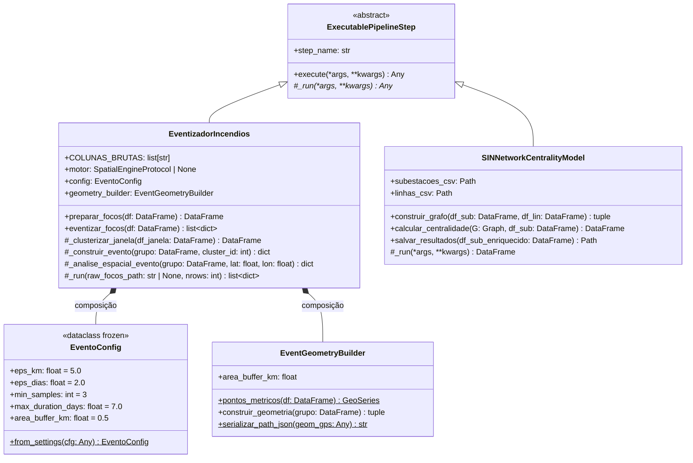
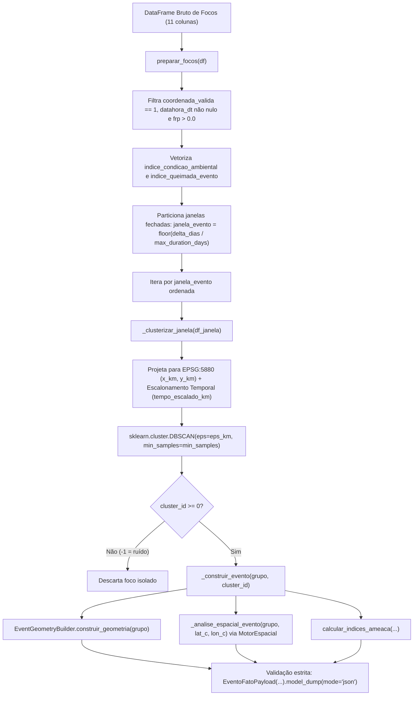
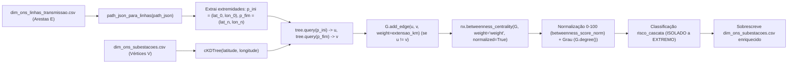

# Especificação Técnica: Modelagem Científica e Grafos (`src/gold/science/`)

> **Trilha Modular — Etapa 13 de 18 (Ciclo 4.1 — Modelos Científicos ST-DBSCAN e Grafos SIN (`src/gold/science/`))**: [Anterior: Ciclo 4 — Hub da Camada Gold (`src/gold/`)](README.md) | [Portal Geral (`docs/README.md`)](../../docs/README.md) | [Próximo: Ciclo 4.2 — Publicação Kafka e Streaming Dual-Branch (`src/gold/streaming/`)](streaming/README.md)

Este documento especifica a arquitetura, a formulação matemática e o catálogo de classes e métodos do subpacote [`src/gold/science/`](science/). O pacote implementa dois modelos analíticos independentes que operam sobre os dados enriquecidos da camada Silver:

1. **Agrupamento Espaço-Temporal de Incêndios (`ST-DBSCAN`)**: consolidado nos módulos [`evento_config.py`](science/dbscan/evento_config.py), [`event_geometry_builder.py`](science/dbscan/event_geometry_builder.py) e [`eventizador.py`](science/dbscan/eventizador.py), responsável por agregar detecções orbitais pontuais em polígonos de eventos contínuos de queimada (`FATO_EVENTOS_INCENDIO`).
2. **Modelagem Topológica e Centralidade do SIN (`NetworkX`)**: implementado em [`network_builder.py`](science/networkx/network_builder.py), responsável por construir o grafo não direcionado da malha de transmissão elétrica nacional, calcular a centralidade de intermediação (*Betweenness Centrality*) ponderada por extensão física e retroalimentar a dimensão [`dim_ons_subestacoes.csv`](../silver/data/dimensions/dim_ons_subestacoes.csv).

---

## 1. Arquitetura e Modularização (FCIS e SOLID)

O pacote separa objetos de configuração imutáveis, construtores geométricos puros e orquestradores de pipeline que implementam o contrato [`ExecutablePipelineStep`](../core/contracts/contracts.py).

---

## 2. Agrupamento Espaço-Temporal ST-DBSCAN (`src/gold/science/dbscan/`)

### 2.1 Fluxo de Processamento do `EventizadorIncendios`

### 2.2 Formulação Matemática do Escalonamento 3D (ST-DBSCAN)

Para agrupar detecções simultaneamente no espaço geográfico e no tempo usando uma métrica euclidiana isotrópica no algoritmo `sklearn.cluster.DBSCAN`, o método [`EventizadorIncendios._clusterizar_janela`](science/dbscan/eventizador.py#L148-L176) executa a transformação espaço-temporal em três etapas:

1. **Particionamento em Janelas Temporais Fechadas (`janela_evento`)**:
   Dado o menor timestamp do lote $t_{\min} = \min(\text{datahora\_dt})$ e a duração máxima configurada $D_{\max} = \max(\text{max\_duration\_days}, 0.1)$, cada foco $i$ recebe o índice inteiro de janela:
   $$\text{janela\_evento}_i = \left\lfloor \frac{(t_i - t_{\min})\text{ em segundos}}{86400 \cdot D_{\max}} \right\rfloor$$
   Esse particionamento impede o efeito de encadeamento infinito (*chaining effect*) em incêndios que perduram por semanas e garante que janelas anteriores a $\max(\text{janela\_evento})$ possam ser fechadas e emitidas em streaming sem necessidade de *upsert* no Apache Druid.

2. **Projeção Cartográfica Métrica e Escalonamento Temporal**:
   Dentro de cada `janela_evento`, as coordenadas $(\text{longitude}_i, \text{latitude}_i)$ em `EPSG:4326` são projetadas para `EPSG:5880` (SIRGAS 2000 / Brazil Polyconic) e convertidas para quilômetros:
   $$x_i = \frac{X_{\text{EPSG:5880}, i}}{1000.0}, \qquad y_i = \frac{Y_{\text{EPSG:5880}, i}}{1000.0}$$
   O deslocamento temporal em dias em relação ao início da janela ($t_{0, w} = \min_{j \in w} t_j$) é convertido para uma coordenada equivalente em quilômetros ($z_i$) usando a razão entre o raio espacial $\varepsilon_{\text{km}}$ (`eps_km`) e o raio temporal $\varepsilon_{\text{dias}}$ (`eps_dias`):
   $$z_i = \left(\frac{t_i - t_{0, w}}{86400}\right) \cdot \left(\frac{\varepsilon_{\text{km}}}{\max(\varepsilon_{\text{dias}}, 0.001)}\right)$$

3. **Distância Euclidiana 3D no DBSCAN**:
   O vetor tridimensional $\mathbf{p}_i = (x_i, y_i, z_i)$ é submetido ao `DBSCAN(eps=eps_km, min_samples=min_samples, n_jobs=1)`. Dois focos $i$ e $j$ estão na mesma $\varepsilon$-vizinhança se e somente se:
   $$\sqrt{(x_i - x_j)^2 + (y_i - y_j)^2 + (z_i - z_j)^2} \le \varepsilon_{\text{km}}$$
   Assim, uma diferença temporal exatamente igual a $\varepsilon_{\text{dias}}$ no mesmo ponto espacial equivale a uma distância de $\varepsilon_{\text{km}}$ no espaço 3D escalonado. Pontos rotulados com `cluster_id = -1` (anomalias térmicas isoladas que não atingem `min_samples`) são descartados da tabela fato de eventos.

---

### 2.3 Catálogo de Classes e Métodos (`src/gold/science/dbscan/`)

#### Classe [`EventoConfig`](science/dbscan/evento_config.py#L16-L52)
Dataclass imutável (`@dataclass(frozen=True)`) que encapsula os hiperparâmetros do ST-DBSCAN.

| Atributo / Método | Tipo / Assinatura | Default | Descrição Técnica |
| :--- | :--- | :--- | :--- |
| `eps_km` | `float` | `5.0` | Raio espacial máximo de vizinhança em quilômetros (`EPSG:5880`). Variável de ambiente: `EVENTOS_EPS_KM`. |
| `eps_dias` | `float` | `2.0` | Raio temporal máximo de vizinhança em dias. Variável de ambiente: `EVENTOS_EPS_DIAS`. |
| `min_samples` | `int` | `3` | Quantidade mínima de focos válidos para formar um núcleo denso (*core point*). Variável de ambiente: `EVENTOS_MIN_SAMPLES`. |
| `max_duration_days` | `float` | `7.0` | Duração máxima em dias de uma janela temporal fechada (`janela_evento`). Variável de ambiente: `EVENTOS_MAX_DURATION_DAYS`. |
| `area_buffer_km` | `float` | `0.5` | Raio de buffer métrico (em km) aplicado a clusters colineares ou degenerados. Variável de ambiente: `EVENTOS_AREA_BUFFER_KM`. |
| [`from_settings`](science/dbscan/evento_config.py#L26-L51) | `(cls, cfg: Any = settings) -> EventoConfig` | — | Constrói `EventoConfig` inspecionando atributos minúsculos (`PipelineSettings`) ou maiúsculos (`src.core.config.settings`). |

#### Classe [`EventGeometryBuilder`](science/dbscan/event_geometry_builder.py#L20-L72)
Construtor geométrico responsável por converter a nuvem de pontos de um cluster em polígono fechado e calcular sua área real em $\text{km}^2$.

| Método | Assinatura | Retorno | Regra de Transformação Geométrica |
| :--- | :--- | :--- | :--- |
| [`__init__`](science/dbscan/event_geometry_builder.py#L28-L29) | `(self, area_buffer_km: float = 0.5)` | `None` | Armazena o raio de buffer em quilômetros para tratamento de geometrias degeneradas. |
| [`pontos_metricos`](science/dbscan/event_geometry_builder.py#L31-L39) | `(df: pd.DataFrame)` | `gpd.GeoSeries` | Constrói pontos `EPSG:4326` a partir de `df["longitude"]` e `df["latitude"]` e reprojeta para `EPSG:5880` (metros). |
| [`construir_geometria`](science/dbscan/event_geometry_builder.py#L41-L66) | `(self, grupo: pd.DataFrame)` | `tuple[Any, float, float, float]` | Instancia um `MultiPoint` em `EPSG:5880` e extrai o envoltório convexo (`convex_hull`). Se o resultado for `Point`, `LineString` ou tiver área $< 1.0\text{ m}^2$ (focos colineares), aplica `multiponto.buffer(self.area_buffer_km * 1000.0)`. Extrai o centroide métrico, reprojeta o polígono e o centroide de volta para `EPSG:4326`, calcula `area_km2 = round(geom_metric.area / 1_000_000.0, 6)` e retorna `(geom_gps, centroide_lat, centroide_lon, area_km2)`. |
| [`serializar_path_json`](science/dbscan/event_geometry_builder.py#L68-L71) | `(geom_gps: Any)` | `str` | Delega a serialização do polígono `EPSG:4326` para [`PathJsonCodec.geometry_para_path_json`](../silver/utils/path_json_codec.py#L84-L103), produzindo JSON de anéis `[[[lon, lat], ...]]` compatível com o Deck.gl no Apache Superset. |

#### Classe [`EventizadorIncendios`](science/dbscan/eventizador.py#L48-L405)
Subclasse de [`ExecutablePipelineStep`](../core/contracts/contracts.py#L68-L90) que executa o pipeline ST-DBSCAN em lote ou em micro-batches de streaming.

| Método | Assinatura | Retorno | Descrição e Regras de Domínio |
| :--- | :--- | :--- | :--- |
| [`__init__`](science/dbscan/eventizador.py#L64-L74) | `(self, motor_espacial: SpatialEngineProtocol \| Any \| None = None, config: EventoConfig \| None = None, geometry_builder: EventGeometryBuilder \| None = None)` | `None` | Inicializa o eventizador com injeção de dependência do motor espacial, configuração ST-DBSCAN e construtor geométrico. |
| [`preparar_focos`](science/dbscan/eventizador.py#L76-L125) | `(self, df: pd.DataFrame)` | `pd.DataFrame` | Sanitiza as colunas brutas do INPE: valida coordenadas (`limpar_coordenadas`), converte `data_pas` para `datahora_dt` (`UTC`) e `data_hora` (`ISO-8601`), limpa `numero_dias_sem_chuva`, `precipitacao`, `risco_fogo` e `frp`. **Regra de filtragem**: mantém exclusivamente linhas onde `coordenada_valida == 1`, `datahora_dt.notna()` e `frp > 0.0` (descarta detecções sem potência radiativa mensurável). Calcula vetorizadamente `indice_condicao_ambiental`, `indice_queimada_evento` e `janela_evento`, ordenando por `datahora_dt`. |
| [`eventizar_focos`](science/dbscan/eventizador.py#L127-L146) | `(self, df: pd.DataFrame)` | `list[dict[str, Any]]` | Aceita um DataFrame bruto ou já preparado (detectado pela presença de `janela_evento`), executa `_clusterizar_janela` para cada janela fechada e constrói a lista de dicionários validados por `EventoFatoPayload`. |
| [`_clusterizar_janela`](science/dbscan/eventizador.py#L148-L176) | `(self, df_janela: pd.DataFrame)` | `pd.DataFrame` | Aplica a projeção métrica `EPSG:5880` e o escalonamento temporal 3D, executa `DBSCAN(eps=eps_km, min_samples=min_samples, n_jobs=1)` e anexa a coluna `cluster_id`. Se `len(df_janela) < min_samples`, atribui `cluster_id = -1` sem invocar o Scikit-Learn. |
| [`_construir_evento`](science/dbscan/eventizador.py#L181-L270) | `(self, grupo: pd.DataFrame, cluster_id: int)` | `dict[str, Any]` | Constrói a geometria do cluster, calcula a duração em horas e dias, consulta `_analise_espacial_evento`, computa os 6 índices de ameaça via [`calcular_indices_ameaca`](../silver/streaming_processing/processors/calculators.py) e `indice_pressao_maxima`, instancia [`EventoFatoPayload`](../core/domain/evento_fato_payload.py#L14-L129) e retorna `payload.model_dump(mode="json")`. |
| [`_analise_espacial_evento`](science/dbscan/eventizador.py#L272-L313) | `(self, grupo: pd.DataFrame, lat: float, lon: float)` | `dict[str, Any]` | Executa `self.motor.analisar_todas_ameacas(lat, lon)` no centroide do evento para obter as FKs e distâncias às infraestruturas próximas. Adicionalmente, verifica a interseção exata de todos os pontos únicos do cluster contra `camada_municipios` e `camada_funai` (`_intersecoes_por_ponto`), elegendo o código mais frequente (`_mais_frequente`) como `fk_municipio_principal` e `fk_terra_indigena` e listando todos os territórios atingidos em `codigos_ibge_interceptados` e `codigos_ti_interceptadas`. |
| [`_gerar_event_id`](science/dbscan/eventizador.py#L382-L388) | `(grupo: pd.DataFrame, cluster_id: int, lat: float, lon: float)` | `str` | Gera identificador determinístico e idempotente concatenando `f"{inicio}\|{fim}\|{cluster_id}\|{round(lat, 5)}\|{round(lon, 5)}\|{len(grupo)}"`, extraindo os 10 primeiros caracteres do hash `SHA-1` hexadecimal no formato `EVT_<YYYYMMDDHHMMSS>_<sha1_10>`. |
| [`_run`](science/dbscan/eventizador.py#L390-L404) | `(self, raw_focos_path: str \| None = None, nrows: int = 5000)` | `list[dict[str, Any]]` | Lê uma amostra de `nrows` registros de `settings.RAW_FOCOS` e executa `self.eventizar_focos(df_amostra)` quando acionado pelo Dagster (`st_dbscan_fire_events`) ou CLI (`executar()`). |

---

## 3. Ciência de Redes e Centralidade do SIN (`src/gold/science/networkx/`)

### 3.1 Fluxo Topológico do `SINNetworkCentralityModel`

### 3.2 Formulação Matemática da Centralidade de Intermediação e Risco de Cascata

O modelo [`SINNetworkCentralityModel`](science/networkx/network_builder.py#L33-L165) representa o Sistema Interligado Nacional (SIN) como um grafo não direcionado ponderado $G = (V, E, w)$:

1. **Associação Espacial Vértice-Aresta via `cKDTree`**:
   - Cada subestação $u \in V$ é indexada em uma árvore espacial `scipy.spatial.cKDTree` pelas coordenadas $(lat_u, lon_u)$.
   - Para cada linha de transmissão $e \in E$, a geometria `LineString`/`MultiLineString` é reconstruída a partir de `path_json` via [`path_json_para_linhas`](science/networkx/network_builder.py#L28-L30). Os pontos extremos inicial $p_{\text{ini}} = (lat_0, lon_0)$ e final $p_{\text{fim}} = (lat_{-1}, lon_{-1})$ são consultados na `cKDTree` (`tree.query`) para identificar as subestações mais próximas $u$ e $v$.
   - Se $u \neq v$ (descartando auto-loops), adiciona-se a aresta $(u, v)$ com peso igual à extensão física da linha em quilômetros ($w(u, v) = \text{extensao\_km}$, fallback `1.0`).

2. **Betweenness Centrality Ponderada**:
   A centralidade de intermediação normalizada de cada subestação $v \in V$ é calculada pelo algoritmo de Brandes (`nx.betweenness_centrality(G, weight="weight", normalized=True)`):
   $$C_B(v) = \frac{2}{(|V| - 1)(|V| - 2)} \sum_{\substack{s, t \in V \\ s \neq v \neq t}} \frac{\sigma_{st}(v)}{\sigma_{st}}$$
   onde $\sigma_{st}$ é o número de caminhos mínimos (ponderados por `extensao_km`) entre as subestações $s$ e $t$, e $\sigma_{st}(v)$ é o número desses caminhos mínimos que passam pela subestação $v$.

3. **Normalização Escalar (`betweenness_score_norm`) e Classificação (`risco_cascata`)**:
   O score é reescalonado linearmente para o intervalo $[0, 100]$ em relação ao maior valor observado na rede ($C_{B, \max} = \max_{u \in V} C_B(u)$):
   $$\text{betweenness\_score\_norm}(v) = \begin{cases} \dfrac{C_B(v)}{C_{B, \max}} \times 100.0, & \text{se } C_{B, \max} > 0 \\ 0.0, & \text{caso contrário} \end{cases}$$

   A coluna categórica `risco_cascata` classifica a criticidade sistêmica da subestação para contingências elétricas em cascata segundo as faixas abaixo:

   | Faixa de `betweenness_score_norm` | Classe `risco_cascata` | Significado Topológico na Malha do SIN |
   | :--- | :--- | :--- |
   | $\ge 80.0$ | `EXTREMO` | Nó arterial de interligação regional; desligamento fragmenta múltiplos corredores de transmissão. |
   | $[50.0, 80.0)$ | `ALTO` | Subestação concentradora de alta intermediação de fluxo de potência. |
   | $[20.0, 50.0)$ | `MEDIO` | Subestação de trânsito intermediário com rotas alternativas na malha. |
   | $(0.0, 20.0)$ | `BAIXO` | Subestação periférica com baixa participação em caminhos mínimos. |
   | $= 0.0$ | `ISOLADO` | Vértice folha (grau $\le 1$) ou desconectado sem intermediação de caminhos mínimos. |

---

### 3.3 Catálogo de Funções e Métodos (`src/gold/science/networkx/network_builder.py`)

| Símbolo | Assinatura | Retorno | Descrição Técnica |
| :--- | :--- | :--- | :--- |
| [`path_json_para_linhas`](science/networkx/network_builder.py#L28-L30) | `(valor: Any)` | `Any` | Reconstrói `LineString` ou `MultiLineString` a partir da string `path_json` delegando para `PathJsonCodec.path_json_para_geometry(valor, tipo_geometria="line")`. |
| [`SINNetworkCentralityModel.__init__`](science/networkx/network_builder.py#L41-L55) | `(self, subestacoes_csv=None, linhas_csv=None, subestacoes_path=None, linhas_path=None)` | `None` | Configura os caminhos para `dim_ons_subestacoes.csv` e `dim_ons_linhas_transmissao.csv` com suporte a injeção de caminhos de teste. |
| [`SINNetworkCentralityModel._carregar_tabelas`](science/networkx/network_builder.py#L57-L64) | `(self)` | `tuple[pd.DataFrame, pd.DataFrame]` | Valida a existência física dos CSVs de subestações e linhas (lançando `FileNotFoundError` se ausentes) e carrega ambos como texto (`dtype=str`). |
| [`SINNetworkCentralityModel.construir_grafo`](science/networkx/network_builder.py#L66-L113) | `(self, df_sub: pd.DataFrame, df_lin: pd.DataFrame)` | `tuple[nx.Graph, pd.DataFrame, pd.DataFrame]` | Indexa as subestações em uma `cKDTree`, adiciona todos os vértices ao grafo `nx.Graph()`, conecta as extremidades das linhas de transmissão aos vértices mais próximos ($u \neq v$) ponderados por `extensao_km` e retorna `(G, df_sub, df_lin_copia)`. |
| [`SINNetworkCentralityModel.calcular_centralidade`](science/networkx/network_builder.py#L115-L150) | `(self, G: nx.Graph, df_sub: pd.DataFrame)` | `pd.DataFrame` | Calcula `betweenness_centrality`, `betweenness_score`, `grau_conectividade` (`G.degree()`), `betweenness_score_norm` ($0$ a $100$) e `risco_cascata`, anexando as 5 colunas ao DataFrame de subestações. |
| [`SINNetworkCentralityModel.salvar_resultados`](science/networkx/network_builder.py#L152-L156) | `(self, df_sub_enriquecido: pd.DataFrame)` | `Path` | Persiste o DataFrame enriquecido de volta em `dim_ons_subestacoes.csv` (`index=False`). |
| [`construir_grafo_sin`](science/networkx/network_builder.py#L167-L169) | `()` | `pd.DataFrame` | Função fachada CLI e do asset Dagster `sin_network_topology` que executa `SINNetworkCentralityModel().execute()`. |

---

> **Trilha Modular — Etapa 13 de 18 (Ciclo 4.1 — Modelos Científicos ST-DBSCAN e Grafos SIN (`src/gold/science/`))**: [Anterior: Ciclo 4 — Hub da Camada Gold (`src/gold/`)](README.md) | [Portal Geral (`docs/README.md`)](../../docs/README.md) | [Próximo: Ciclo 4.2 — Publicação Kafka e Streaming Dual-Branch (`src/gold/streaming/`)](streaming/README.md)
