# Dicionário de Dados Técnico — Camada Gold (Tabelas Fato e Payloads de Streaming)

> **Trilha Modular — Etapa 15 de 18 (Ciclo 4.3 — Dicionário das Tabelas Fato (`src/gold/`))**: [Anterior: Ciclo 4.2 — Publicação Kafka e Streaming Dual-Branch (`src/gold/streaming/`)](streaming/README.md) | [Portal Geral (`docs/README.md`)](../../docs/README.md) | [Próximo: Ciclo 5.1 — Orquestração Apache Dagster (`src/orchestration/`)](../orchestration/README.md)

Este documento especifica o esquema físico e de mensageria das duas Tabelas Fato da camada Gold ([`src/gold/`](.)). Os esquemas são governados por contratos Pydantic imutáveis (`frozen=True`, `extra="forbid"`) definidos em [`src/core/domain/`](../core/domain/), serializados como JSON UTF-8 sem valores `NaN` ou `Inf` (`allow_nan=False`) no Apache Kafka e ingeridos nos datasources colunares do Apache Druid.

---

## 1. Governança Snowflake e Relacionamento Fato-Dimensão

Em conformidade com a modelagem Snowflake do projeto, as tabelas fato transportam exclusivamente:
1. **Chaves Temporais (`ISO-8601`)**: mapeadas para a coluna primária de tempo `__time` no Apache Druid.
2. **Dimensões Degeneradas e Chaves Estrangeiras (`fk_*`)**: códigos canônicos (`7 dígitos` IBGE, `7 dígitos` CNES, códigos ONS/FUNAI ou `ROD_<md5>`) que referenciam as 7 tabelas de dimensão da camada Silver ([`src/silver/DICIONARIO_DADOS.md`](../silver/DICIONARIO_DADOS.md)) via *Lookups* em memória ([`src/silver/validators/README.md`](../silver/validators/README.md)).
3. **Métricas Físicas, Climáticas e Índices Sintéticos**: variáveis contínuas em ponto flutuante (`float`) e contagens inteiras (`int`).
4. **Geometrias Serializadas**: pontos `WKT` (`foco_point`) e polígonos fechados `path_json` para renderização no Deck.gl / Apache Superset.

```mermaid
erDiagram
    FATO_FOCOS_INCENDIO ||--o| DIM_MUNICIPIOS_COORDENADAS : "fk_municipio / fk_municipio_espacial -> codigo_ibge"
    FATO_FOCOS_INCENDIO ||--o| DIM_TERRAS_INDIGENAS : "fk_terra_indigena / fk_terra_indigena_proxima -> codigo_ti"
    FATO_FOCOS_INCENDIO ||--o| DIM_RODOVIAS_FEDERAIS : "fk_trecho_rodoviario -> id_trecho_rodoviario"
    FATO_FOCOS_INCENDIO ||--o| DIM_ONS_LINHAS_TRANSMISSAO : "fk_linha_transmissao -> id_linha_transmissao"
    FATO_FOCOS_INCENDIO ||--o| DIM_ONS_SUBESTACOES : "fk_subestacao -> id_subestacao"
    FATO_FOCOS_INCENDIO ||--o| DIM_ONS_SISTEMAS_ISOLADOS : "fk_sistema_isolado -> id_sistema_isolado"
    FATO_FOCOS_INCENDIO ||--o| DIM_HOSPITAIS_CNES : "fk_hospital_proximo -> codigo_cnes"

    FATO_EVENTOS_INCENDIO ||--o| DIM_MUNICIPIOS_COORDENADAS : "fk_municipio_principal -> codigo_ibge"
    FATO_EVENTOS_INCENDIO ||--o| DIM_TERRAS_INDIGENAS : "fk_terra_indigena / fk_terra_indigena_proxima -> codigo_ti"
    FATO_EVENTOS_INCENDIO ||--o| DIM_RODOVIAS_FEDERAIS : "fk_trecho_rodoviario -> id_trecho_rodoviario"
    FATO_EVENTOS_INCENDIO ||--o| DIM_ONS_LINHAS_TRANSMISSAO : "fk_linha_transmissao -> id_linha_transmissao"
    FATO_EVENTOS_INCENDIO ||--o| DIM_ONS_SUBESTACOES : "fk_subestacao -> id_subestacao"
    FATO_EVENTOS_INCENDIO ||--o| DIM_ONS_SISTEMAS_ISOLADOS : "fk_sistema_isolado -> id_sistema_isolado"
    FATO_EVENTOS_INCENDIO ||--o| DIM_HOSPITAIS_CNES : "fk_hospital -> codigo_cnes"
```

---

## 2. Tabela Fato Observacional: `FATO_FOCOS_INCENDIO`

- **Contrato Pydantic**: [`FocoFatoPayload`](../core/domain/foco_fato_payload.py#L14-L65)
- **Produtor de Streaming**: [`ProdutorFocosStreaming`](streaming/produtor_focos.py#L41-L162) e ramo atômico do [`ProdutorEventosStreaming`](streaming/produtor_eventos.py#L159-L166)
- **Função de Transformação**: [`transformar_foco`](../silver/streaming_processing/processador.py#L36-L108)
- **Tópico Kafka Padrão**: `streaming_focos_incendio` (`DEFAULT_KAFKA_TOPIC_FOCOS`)
- **Datasource Apache Druid**: `fato_focos_incendio`
- **Granularidade**: 1 registro por detecção térmica orbital de satélite (`29` campos).

| # | Coluna | Tipo Python / Pydantic | Tipo Druid | Nullable | Função / Regra de Origem e Domínio |
| :-: | :--- | :--- | :--- | :-: | :--- |
| 1 | `data_hora` | `str` | `TIMESTAMP (__time)` | Não | `limpar_datahora(raw["data_pas"])` (`YYYY-MM-DDTHH:MM:SSZ`, fallback `1970-01-01T00:00:00Z`). |
| 2 | `pais_origem` | `str` | `STRING` | Não | `limpar_texto(raw["pais"])` (ex: `"Brasil"`). |
| 3 | `fk_bioma` | `str` | `STRING` | Não | `limpar_texto(raw["bioma"])` (ex: `"Cerrado"`, `"Amazônia"`). |
| 4 | `fk_satelite_sensor` | `str` | `STRING` | Não | `limpar_texto(raw["satelite"])` (ex: `"AQUA_M-T"`, `"NOAA-20"`). |
| 5 | `fk_municipio` | `str` | `STRING` | Não | `resolver_fk_municipio(raw, analise)` — Código IBGE 7 dígitos resolvido por fallback textual ou interseção espacial. |
| 6 | `fk_municipio_espacial` | `str` | `STRING` | Não | `analise["codigo_ibge_espacial"]` — Código IBGE obtido exclusivamente via `Point-in-Polygon` em `camada_municipios` (ou `"NAO_INFORMADO"`). |
| 7 | `fk_terra_indigena` | `str` | `STRING` | Não | `analise["codigo_ti"]` — Código FUNAI quando o foco intercepta o interior de uma Terra Indígena (`intersecao`), ou `"NAO_INFORMADO"`. |
| 8 | `fk_terra_indigena_proxima` | `str` | `STRING` | Não | `analise["codigo_ti_proxima"]` — Código FUNAI da Terra Indígena de menor distância euclidiana (`mais_proximo` em `EPSG:5880`). |
| 9 | `fk_trecho_rodoviario` | `str` | `STRING` | Não | `analise["id_trecho_rodoviario"]` — Chave `ROD_<md5>` da rodovia federal mais próxima em `camada_rodovias`. |
| 10 | `fk_linha_transmissao` | `str` | `STRING` | Não | `analise["id_linha_transmissao"]` — Código ONS da Linha de Transmissão mais próxima em `camada_linhas`. |
| 11 | `fk_subestacao` | `str` | `STRING` | Não | `analise["id_subestacao"]` — Código ONS da Subestação mais próxima em `camada_subestacoes`. |
| 12 | `fk_sistema_isolado` | `str` | `STRING` | Não | `analise["id_sistema_isolado"]` — Código ONS do Sistema Isolado que contém o ponto ou mais próximo em `camada_isolados`. |
| 13 | `fk_hospital_proximo` | `str` | `STRING` | Não | `analise["codigo_cnes_prox"]` — Código CNES (7 dígitos) da unidade hospitalar mais próxima em `camada_hospitais`. |
| 14 | `latitude` | `Optional[float]` | `DOUBLE` | Sim | `limpar_coordenadas` — Latitude `EPSG:4326` validada em $[-34.0, 6.0]$ (`None` se inválida). |
| 15 | `longitude` | `Optional[float]` | `DOUBLE` | Sim | `limpar_coordenadas` — Longitude `EPSG:4326` validada em $[-74.0, -34.0]$ (`None` se inválida). |
| 16 | `coordenada_valida` | `int` | `LONG` | Não | Flag binária: `1` se `latitude` e `longitude` pertencem ao bounding box do Brasil; `0` caso contrário. |
| 17 | `foco_point` | `str` | `STRING` | Não | `construir_wkt_ponto(lat, lon, valida)` — Geometria WKT `"POINT(lon lat)"` ou `"POINT EMPTY"`. |
| 18 | `dias_sem_chuva` | `Optional[float]` | `DOUBLE` | Sim | `limpar_dias_sem_chuva(raw["numero_dias_sem_chuva"])` — Converte `< 0` ou `-999` para `None`. |
| 19 | `precipitacao_mm` | `Optional[float]` | `DOUBLE` | Sim | `limpar_precipitacao(raw["precipitacao"])` — Converte `< 0` para `None`. |
| 20 | `risco_fogo_inpe` | `Optional[float]` | `DOUBLE` | Sim | `limpar_risco_fogo(raw["risco_fogo"])` — Validado no intervalo $[0.0, 1.0]$ (`None` se `-999` ou fora da faixa). |
| 21 | `potencia_radiativa_fogo` | `Optional[float]` | `DOUBLE` | Sim | `limpar_frp(raw["frp"])` — Potência Radiativa do Fogo em MW (`None` se `< 0`). |
| 22 | `indice_condicao_ambiental` | `Optional[float]` | `DOUBLE` | Sim | `calcular_indice_condicao_ambiental` — Média ponderada normalizada $[0.0, 1.0]$ de risco de fogo ($0.50$), estiagem ($0.30$) e seca ($0.20$). |
| 23 | `indice_queimada_evento` | `Optional[float]` | `DOUBLE` | Sim | `calcular_indice_queimada_evento` — Índice de severidade térmica do foco ($\text{FRP} \times (1 + \text{ICA})$). |
| 24 | `distancia_rodovia_km` | `Optional[float]` | `DOUBLE` | Sim | Menor distância euclidiana em `EPSG:5880` (km) até `camada_rodovias` (`None` se `coordenada_valida == 0`). |
| 25 | `distancia_linha_km` | `Optional[float]` | `DOUBLE` | Sim | Menor distância euclidiana em `EPSG:5880` (km) até `camada_linhas`. |
| 26 | `distancia_subestacao_km` | `Optional[float]` | `DOUBLE` | Sim | Menor distância euclidiana em `EPSG:5880` (km) até `camada_subestacoes`. |
| 27 | `distancia_sistema_isolado_km` | `Optional[float]` | `DOUBLE` | Sim | Menor distância euclidiana em `EPSG:5880` (km) até `camada_isolados` (`0.0` se contido no polígono). |
| 28 | `distancia_hospital_km` | `Optional[float]` | `DOUBLE` | Sim | Menor distância euclidiana em `EPSG:5880` (km) até `camada_hospitais`. |
| 29 | `distancia_terra_indigena_km` | `Optional[float]` | `DOUBLE` | Sim | Menor distância euclidiana em `EPSG:5880` (km) até `camada_funai` (`0.0` se contido na TI). |

---

## 3. Tabela Fato Agregada: `FATO_EVENTOS_INCENDIO`

- **Contrato Pydantic**: [`EventoFatoPayload`](../core/domain/evento_fato_payload.py#L14-L129)
- **Validador de Integridade Numérica**: [`EventoFatoPayload.rejeitar_nan_inf`](../core/domain/evento_fato_payload.py#L87-L128) (rejeita `NaN`, `+Inf` e `-Inf` nas 31 métricas float).
- **Motor Científico**: [`EventizadorIncendios`](science/dbscan/eventizador.py#L48-L405) + [`EventGeometryBuilder`](science/dbscan/event_geometry_builder.py#L20-L72)
- **Produtor de Streaming**: [`ProdutorEventosStreaming`](streaming/produtor_eventos.py#L72-L230)
- **Tópico Kafka Padrão**: `streaming_eventos_incendio` (`DEFAULT_KAFKA_TOPIC_EVENTOS`)
- **Datasource Apache Druid**: `fato_eventos_incendio`
- **Granularidade**: 1 registro por cluster espaço-temporal ST-DBSCAN consolidado (`49` campos).

| # | Coluna | Tipo Python / Pydantic | Tipo Druid | Nullable | Função / Regra de Origem e Domínio |
| :-: | :--- | :--- | :--- | :-: | :--- |
| 1 | `fire_event_id` | `str` | `STRING` | Não | `_gerar_event_id` — Chave primária determinística `EVT_<YYYYMMDDHHMMSS>_<sha1_10>` gerada sobre `(inicio, fim, cluster_id, lat_c, lon_c, total_focos)`. |
| 2 | `data_inicio` | `str` | `TIMESTAMP (__time)` | Não | `inicio.strftime("%Y-%m-%dT%H:%M:%SZ")` — Timestamp UTC do foco mais antigo do cluster. |
| 3 | `data_fim` | `str` | `STRING` | Não | `fim.strftime("%Y-%m-%dT%H:%M:%SZ")` — Timestamp UTC do foco mais recente do cluster. |
| 4 | `pais_origem` | `str` | `STRING` | Não | `_modo(grupo["pais_origem"])` — País modal entre os focos do cluster (`"Brasil"`). |
| 5 | `fk_bioma` | `str` | `STRING` | Não | `_modo(grupo["fk_bioma"])` — Bioma modal predominante nos focos do cluster. |
| 6 | `fk_satelite_sensor` | `str` | `STRING` | Não | `_modo(grupo["fk_satelite_sensor"])` — Sensor/satélite modal predominante no cluster. |
| 7 | `fk_municipio_principal` | `str` | `STRING` | Não | `_mais_frequente(municipios, analise_centroide["codigo_ibge_espacial"])` — Código IBGE com maior número de pontos interceptados no evento. |
| 8 | `codigos_ibge_interceptados` | `List[str]` | `ARRAY<STRING>` | Não | `_lista_ou_nao_informado` — Lista ordenada sem duplicatas de todos os códigos IBGE interceptados pelos pontos do evento (ou `["NAO_INFORMADO"]`). |
| 9 | `qtd_municipios_interceptados` | `int` | `LONG` | Não | `_qtd_codigos_validos(codigos_ibge)` — Contagem de municípios válidos ($\neq \text{"NAO\_INFORMADO"}$) atingidos pelo evento. |
| 10 | `fk_terra_indigena` | `str` | `STRING` | Não | `_mais_frequente(terras, analise_centroide["codigo_ti"])` — Código FUNAI predominante interceptado pelo evento (ou `"NAO_INFORMADO"`). |
| 11 | `codigos_ti_interceptadas` | `List[str]` | `ARRAY<STRING>` | Não | `_lista_ou_nao_informado` — Lista ordenada de todos os códigos FUNAI interceptados pelo evento (ou `["NAO_INFORMADO"]`). |
| 12 | `qtd_terras_indigenas_interceptadas` | `int` | `LONG` | Não | `_qtd_codigos_validos(codigos_ti)` — Contagem de Terras Indígenas válidas interceptadas pelo evento. |
| 13 | `fk_terra_indigena_proxima` | `str` | `STRING` | Não | `analise_centroide["codigo_ti_proxima"]` — Código FUNAI da Terra Indígena mais próxima ao centroide do evento. |
| 14 | `fk_trecho_rodoviario` | `str` | `STRING` | Não | `analise_centroide["id_trecho_rodoviario"]` — Chave `ROD_<md5>` da rodovia federal mais próxima ao centroide do evento. |
| 15 | `fk_linha_transmissao` | `str` | `STRING` | Não | `analise_centroide["id_linha_transmissao"]` — Código ONS da linha de transmissão mais próxima ao centroide. |
| 16 | `fk_subestacao` | `str` | `STRING` | Não | `analise_centroide["id_subestacao"]` — Código ONS da subestação mais próxima ao centroide. |
| 17 | `fk_sistema_isolado` | `str` | `STRING` | Não | `analise_centroide["id_sistema_isolado"]` — Código ONS do sistema isolado mais próximo ao centroide. |
| 18 | `fk_hospital` | `str` | `STRING` | Não | `analise_centroide["codigo_cnes_prox"]` — Código CNES do hospital mais próximo ao centroide. |
| 19 | `latitude_centroide` | `float` | `DOUBLE` | Não | Latitude `EPSG:4326` (`round(lat_c, 6)`) do centroide métrico (`EPSG:5880`) da geometria do cluster. |
| 20 | `longitude_centroide` | `float` | `DOUBLE` | Não | Longitude `EPSG:4326` (`round(lon_c, 6)`) do centroide métrico (`EPSG:5880`) da geometria do cluster. |
| 21 | `path_json` | `str` | `STRING` | Não | `EventGeometryBuilder.serializar_path_json(geom_gps)` — Anéis de coordenadas WGS84 `[[[lon, lat], ...]]` do polígono (`convex_hull` ou `buffer`). |
| 22 | `total_focos` | `int` | `LONG` | Não | `int(len(grupo))` — Número de focos válidos agrupados no evento ($\ge \text{min\_samples}$). |
| 23 | `duracao_horas` | `float` | `DOUBLE` | Não | `round(max((fim - inicio).total_seconds() / 3600.0, 0.0), 4)` — Duração temporal observada em horas. |
| 24 | `duracao_dias` | `float` | `DOUBLE` | Não | `round(duracao_horas / 24.0, 6)` — Duração temporal observada em dias fracionários. |
| 25 | `area_evento_km2` | `float` | `DOUBLE` | Não | `round(float(geom_metric.area) / 1_000_000.0, 6)` — Área da mancha do evento calculada em `EPSG:5880` ($\text{km}^2$). |
| 26 | `soma_frp` | `float` | `DOUBLE` | Não | `_soma(grupo["potencia_radiativa_fogo"])` — Energia radiativa acumulada de todos os focos do cluster (MW). |
| 27 | `media_frp` | `float` | `DOUBLE` | Não | `_media(grupo["potencia_radiativa_fogo"])` — Média aritmética da FRP no cluster (MW). |
| 28 | `max_frp` | `float` | `DOUBLE` | Não | `_max(grupo["potencia_radiativa_fogo"])` — Pico máximo de FRP no cluster (MW). |
| 29 | `media_risco_fogo` | `float` | `DOUBLE` | Não | `_media(grupo["risco_fogo_inpe"])` — Média do risco de fogo INPE dos focos do cluster. |
| 30 | `max_risco_fogo` | `float` | `DOUBLE` | Não | `_max(grupo["risco_fogo_inpe"])` — Valor máximo de risco de fogo INPE no cluster. |
| 31 | `media_dias_sem_chuva` | `float` | `DOUBLE` | Não | `_media(grupo["dias_sem_chuva"])` — Média de dias sem chuva nos focos do cluster (`0.0` se todos nulos). |
| 32 | `media_precipitacao_mm` | `float` | `DOUBLE` | Não | `_media(grupo["precipitacao_mm"])` — Média de precipitação acumulada nos focos do cluster (mm). |
| 33 | `indice_condicao_ambiental_medio` | `float` | `DOUBLE` | Não | `_media(grupo["indice_condicao_ambiental"])` — Média do ICA dos focos pertencentes ao cluster. |
| 34 | `indice_queimada_evento_medio` | `float` | `DOUBLE` | Não | `_media(grupo["indice_queimada_evento"])` — Média do IQE pontual dos focos do cluster. |
| 35 | `indice_queimada_evento_max` | `float` | `DOUBLE` | Não | `_max(grupo["indice_queimada_evento"])` — Pico de severidade térmica individual dentro do cluster. |
| 36 | `distancia_rodovia_km` | `Optional[float]` | `DOUBLE` | Sim | Distância euclidiana (`EPSG:5880`, km) do centroide do evento até a rodovia federal mais próxima. |
| 37 | `distancia_linha_km` | `Optional[float]` | `DOUBLE` | Sim | Distância euclidiana (`EPSG:5880`, km) do centroide do evento até a linha de transmissão mais próxima. |
| 38 | `distancia_subestacao_km` | `Optional[float]` | `DOUBLE` | Sim | Distância euclidiana (`EPSG:5880`, km) do centroide do evento até a subestação mais próxima. |
| 39 | `distancia_sistema_isolado_km` | `Optional[float]` | `DOUBLE` | Sim | Distância euclidiana (`EPSG:5880`, km) do centroide do evento até o sistema isolado mais próximo. |
| 40 | `distancia_hospital_km` | `Optional[float]` | `DOUBLE` | Sim | Distância euclidiana (`EPSG:5880`, km) do centroide do evento até o hospital CNES mais próximo. |
| 41 | `distancia_terra_indigena_km` | `Optional[float]` | `DOUBLE` | Sim | Distância euclidiana (`EPSG:5880`, km) do centroide do evento até a Terra Indígena mais próxima. |
| 42 | `indice_ameaca_rodovia` | `float` | `DOUBLE` | Não | `calcular_indices_ameaca` — $\text{round}(\mathcal{I}_{\text{evento}} \cdot P(d_{\text{rodovia}}, 20\text{ km}), 6)$. |
| 43 | `indice_ameaca_linha` | `float` | `DOUBLE` | Não | `calcular_indices_ameaca` — $\text{round}(\mathcal{I}_{\text{evento}} \cdot P(d_{\text{linha}}, 15\text{ km}) \cdot F_{\text{tensão}}, 6)$. |
| 44 | `indice_ameaca_subestacao` | `float` | `DOUBLE` | Não | `calcular_indices_ameaca` — $\text{round}(\mathcal{I}_{\text{evento}} \cdot P(d_{\text{sub}}, 15\text{ km}) \cdot F_{\text{potência}}, 6)$. |
| 45 | `indice_ameaca_sistema_isolado` | `float` | `DOUBLE` | Não | `calcular_indices_ameaca` — $\text{round}(\mathcal{I}_{\text{evento}} \cdot P(d_{\text{isolado}}, 50\text{ km}), 6)$. |
| 46 | `indice_pressao_saude` | `float` | `DOUBLE` | Não | `calcular_indices_ameaca` — $\text{round}(\mathcal{I}_{\text{evento}} \cdot (0.35 + 0.65 \cdot \min(d_{\text{hosp}}/150, 1)), 6)$. |
| 47 | `indice_pressao_terra_indigena` | `float` | `DOUBLE` | Não | `calcular_indices_ameaca` — $\text{round}(\mathcal{I}_{\text{evento}} \cdot (1 + 0.50 \cdot N_{\text{TI}}) \cdot \max(P(d_{\text{TI}}, 30), \mathbb{I}_{N_{\text{TI}}>0}), 6)$. |
| 48 | `indice_pressao_maxima` | `float` | `DOUBLE` | Não | `round(max(indices.values()), 6)` — Maior valor entre os 6 índices de ameaça/pressão do evento. |
| 49 | `param_eps_km` | `float` | `DOUBLE` | Não | `self.config.eps_km` — Raio espacial $\varepsilon_{\text{km}}$ utilizado na execução do ST-DBSCAN (`5.0`). |
| 50 | `param_eps_dias` | `float` | `DOUBLE` | Não | `self.config.eps_dias` — Raio temporal $\varepsilon_{\text{dias}}$ utilizado na execução do ST-DBSCAN (`2.0`). |
| 51 | `param_min_samples` | `int` | `LONG` | Não | `self.config.min_samples` — Densidade mínima `min_samples` utilizada no ST-DBSCAN (`3`). |
| 52 | `param_max_duration_days` | `float` | `DOUBLE` | Não | `self.config.max_duration_days` — Janela máxima em dias utilizada no ST-DBSCAN (`7.0`). |

> [!NOTE]
> A tabela `EventoFatoPayload` totaliza exatamente **52 atributos** declarados no modelo Pydantic (`fire_event_id` a `param_max_duration_days`), sendo 2 atributos do tipo `List[str]` (`codigos_ibge_interceptados` e `codigos_ti_interceptadas`), 4 inteiros (`qtd_municipios_interceptados`, `qtd_terras_indigenas_interceptadas`, `total_focos`, `param_min_samples`), 15 strings (`fire_event_id`, timestamps, FKs e `path_json`) e 31 métricas em ponto flutuante validadas por `rejeitar_nan_inf`.

---

> **Trilha Modular — Etapa 15 de 18 (Ciclo 4.3 — Dicionário das Tabelas Fato (`src/gold/`))**: [Anterior: Ciclo 4.2 — Publicação Kafka e Streaming Dual-Branch (`src/gold/streaming/`)](streaming/README.md) | [Portal Geral (`docs/README.md`)](../../docs/README.md) | [Próximo: Ciclo 5.1 — Orquestração Apache Dagster (`src/orchestration/`)](../orchestration/README.md)
