# Especificação Técnica: Camada Gold — Ciência de Dados e Publicação em Streaming (`src/gold/`)

> **Trilha Modular — Etapa 12 de 18 (Ciclo 4 — Hub da Camada Gold (`src/gold/`))**: [Anterior: Ciclo 3.2 — Enriquecimento e Índices Matemáticos (`src/silver/streaming_processing/`)](../silver/streaming_processing/README.md) | [Portal Geral (`docs/README.md`)](../../docs/README.md) | [Próximo: Ciclo 4.1 — Modelos Científicos ST-DBSCAN e Grafos SIN (`src/gold/science/`)](ARQUITETURA.md)

A camada Gold ([`src/gold/`](.)) consolida a modelagem analítica avançada e a publicação de mensagens em tempo real do pipeline **CCO DataOps**. Seus módulos transformam as detecções térmicas enriquecidas e as dimensões geoespaciais da camada Silver em dois produtos analíticos principais:

1. **Enriquecimento Topológico de Grafos (`SINNetworkCentralityModel`)**: constrói o grafo da malha de transmissão do Sistema Interligado Nacional (SIN) usando `cKDTree` e `NetworkX`, computa a centralidade de intermediação (*Betweenness Centrality*) ponderada por extensão de linha (`extensao_km`) e classifica o risco de queda em cascata (`risco_cascata`) em [`dim_ons_subestacoes.csv`](../silver/data/dimensions/dim_ons_subestacoes.csv).
2. **Clusterização Espaço-Temporal (`EventizadorIncendios`) e Streaming Dual-Branch (`ProdutorFocosStreaming` / `ProdutorEventosStreaming`)**: agrupa focos de calor via algoritmo `ST-DBSCAN` em janelas temporais fechadas, constrói polígonos `convex_hull` / `buffer` em projeção métrica `EPSG:5880` e publica os payloads validados por contratos Pydantic nos tópicos `streaming_focos_incendio` e `streaming_eventos_incendio` do Apache Kafka.

---

## 1. Topologia de Diretórios e Módulos

```text
src/gold/
├── README.md                              # Hub arquitetural e operacional da Camada Gold
├── ARQUITETURA.md                         # Especificação matemática e de classes de ST-DBSCAN e NetworkX
├── DICIONARIO_DADOS.md                    # Esquema físico das tabelas fato FATO_FOCOS e FATO_EVENTOS
├── data/                                  # Diretório de persistência de artefatos e telemetria Gold
├── science/                               # Modelos científicos e topológicos
│   ├── dbscan/                            # Agrupamento espaço-temporal ST-DBSCAN
│   │   ├── evento_config.py               # Dataclass imutável EventoConfig
│   │   ├── event_geometry_builder.py      # EventGeometryBuilder (Convex Hull, buffer EPSG:5880, path_json)
│   │   └── eventizador.py                 # EventizadorIncendios (ST-DBSCAN 3D + enriquecimento espacial)
│   └── networkx/                          # Teoria dos Grafos aplicada ao Setor Elétrico
│       └── network_builder.py             # SINNetworkCentralityModel (cKDTree + Betweenness Centrality)
└── streaming/                             # Clientes de rede e produtores Apache Kafka
    ├── README.md                          # Especificação de rede, confiabilidade e produtores Kafka
    ├── kafka_client.py                    # KafkaStreamClient (StreamPublisherBase + Context Manager)
    ├── streaming_audit_logger.py          # StreamingAuditLogger (telemetria JSONL/CSV por chunk)
    ├── produtor_focos.py                  # ProdutorFocosStreaming (publicador da FATO_FOCOS_INCENDIO)
    └── produtor_eventos.py                # ProdutorEventosStreaming (publicador Dual-Branch em janela fechada)
```

---

## 2. Diagrama de Fluxo Dual-Branch e Integração Medallion

```mermaid
flowchart TD
    subgraph SILVER ["Camada Silver (Dimensões e Motor Espacial)"]
        raw_focos[("focos_brutos_*.csv (Bronze)")]
        dim_sub[("dim_ons_subestacoes.csv")]
        dim_lin[("dim_ons_linhas_transmissao.csv")]
        motor["MotorEspacial (7 SpatialLayers STRtree)"]
        proc["ProcessadorFocos.transformar()"]
    end

    subgraph GOLD_SCIENCE ["Camada Gold — Ciência de Dados (src/gold/science/)"]
        nx_model["SINNetworkCentralityModel (network_builder.py)"]
        evt_cfg["EventoConfig (eps_km=5, eps_dias=2, min_samples=3)"]
        geom_builder["EventGeometryBuilder (EPSG:5880 Convex Hull + path_json)"]
        eventizador["EventizadorIncendios (eventizador.py)"]

        dim_sub --> nx_model
        dim_lin --> nx_model
        nx_model -->|"Atualiza betweenness_score_norm e risco_cascata"| dim_sub

        evt_cfg --> eventizador
        geom_builder --> eventizador
        motor --> eventizador
        motor --> proc
    end

    subgraph GOLD_STREAM ["Camada Gold — Streaming Kafka (src/gold/streaming/)"]
        prod_focos["ProdutorFocosStreaming (produtor_focos.py)"]
        prod_eventos["ProdutorEventosStreaming (produtor_eventos.py)"]
        audit["StreamingAuditLogger (streaming_audit_logger.py)"]
        kafka["KafkaStreamClient (kafka_client.py)"]

        raw_focos --> prod_focos
        raw_focos --> prod_eventos
        proc --> prod_focos
        proc --> prod_eventos
        eventizador --> prod_eventos
        prod_eventos --> audit
        prod_focos --> kafka
        prod_eventos --> kafka
    end

    subgraph KAFKA_DRUID ["Mensageria e OLAP (Kafka -> Apache Druid)"]
        top_focos(["Tópico: streaming_focos_incendio"])
        top_eventos(["Tópico: streaming_eventos_incendio"])
        ds_focos[("Datasource: fato_focos_incendio")]
        ds_eventos[("Datasource: fato_eventos_incendio")]

        kafka --> top_focos --> ds_focos
        kafka --> top_eventos --> ds_eventos
    end
```



---

## 3. Índice de Especificações Técnicas da Camada Gold

| Submódulo / Documento | Escopo Técnico | Classes e Contratos Documentados |
| :--- | :--- | :--- |
| [**`ARQUITETURA.md`**](ARQUITETURA.md) | Modelagem matemática e algorítmica de clusterização espaço-temporal ST-DBSCAN 3D e teoria dos grafos do SIN. | [`EventoConfig`](science/dbscan/evento_config.py), [`EventGeometryBuilder`](science/dbscan/event_geometry_builder.py), [`EventizadorIncendios`](science/dbscan/eventizador.py), [`SINNetworkCentralityModel`](science/networkx/network_builder.py) |
| [**`streaming/README.md`**](streaming/README.md) | Parâmetros de socket do `KafkaProducer`, garantia de entrega (`acks="all"`), telemetria de throughput e algoritmo de janela temporal fechada. | [`KafkaStreamClient`](streaming/kafka_client.py), [`StreamingAuditLogger`](streaming/streaming_audit_logger.py), [`ProdutorFocosStreaming`](streaming/produtor_focos.py), [`ProdutorEventosStreaming`](streaming/produtor_eventos.py) |
| [**`DICIONARIO_DADOS.md`**](DICIONARIO_DADOS.md) | Catálogo campo a campo das duas tabelas fato, tipos Python/Druid, chaves estrangeiras Snowflake e funções geradoras. | [`FocoFatoPayload`](../core/domain/foco_fato_payload.py) (`29` colunas) e [`EventoFatoPayload`](../core/domain/evento_fato_payload.py) (`52` colunas) |

---

## 4. Procedimentos Operacionais Padrão (CLI via `uv`)

### 4.1 Modelagem Topológica e Centralidade do SIN
Reconstrói o grafo entre subestações e linhas de transmissão da ONS e atualiza `dim_ons_subestacoes.csv`:
```bash
uv run python src/gold/science/networkx/network_builder.py
```

### 4.2 Clusterização ST-DBSCAN em Lote de Amostra
Executa a eventização sobre uma amostra de focos brutos (`nrows=5000` por padrão):
```bash
uv run python src/gold/science/dbscan/eventizador.py
```

### 4.3 Publicação em Streaming: Focos Atômicos (`streaming_focos_incendio`)
Despacha continuamente registros validados por `FocoFatoPayload` para o Apache Kafka:
```bash
uv run python src/gold/streaming/produtor_focos.py
```

### 4.4 Publicação Dual-Branch com Telemetria: Focos e Eventos (`streaming_eventos_incendio`)
Executa o micro-batching em janelas fechadas, despachando focos atômicos e eventos consolidados com geração opcional de arquivos de auditoria e progresso:
```bash
uv run python src/gold/streaming/produtor_eventos.py \
  --debug-jsonl src/gold/data/auditoria_eventos.jsonl \
  --progress-jsonl src/gold/data/progresso_eventos.jsonl \
  --progress-csv src/gold/data/progresso_eventos.csv
```

### 4.5 Execução da Suíte de Testes Unitários e de Contratos Gold
```bash
uv run pytest src/gold/tests/unit/
```

---

> **Trilha Modular — Etapa 12 de 18 (Ciclo 4 — Hub da Camada Gold (`src/gold/`))**: [Anterior: Ciclo 3.2 — Enriquecimento e Índices Matemáticos (`src/silver/streaming_processing/`)](../silver/streaming_processing/README.md) | [Portal Geral (`docs/README.md`)](../../docs/README.md) | [Próximo: Ciclo 4.1 — Modelos Científicos ST-DBSCAN e Grafos SIN (`src/gold/science/`)](ARQUITETURA.md)
