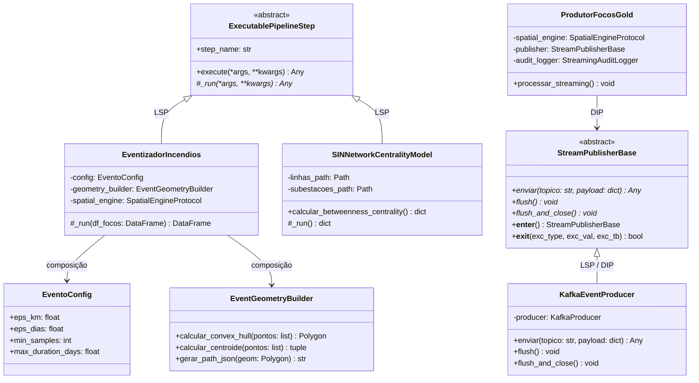
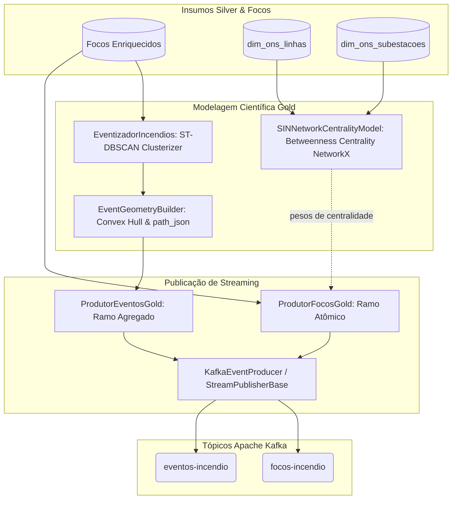

# Camada Gold (Data Science & Streaming Serving) - CCO DataOps

A **Camada Gold (Ouro)** representa o topo da arquitetura Medalhão. Sua finalidade é a geração de **Produtos de Dados Analíticos**, aplicação de **Modelos Científicos Avançados** (Machine Learning espaço-temporal e Teoria dos Grafos) e a entrega contínua de dados enriquecidos na **Última Milha de Streaming** (Kafka -> Apache Druid -> Apache Superset).

Diferente das camadas anteriores (Bronze focada em ingestão pura e Silver focada em dimensões e cruzamentos geométricos), a Camada Gold é orientada a **valor de negócio e mitigação de desastres**.

---

## 1. Responsabilidades e Pilares da Camada Gold

1. **Modelagem Científica e Inteligência Espaço-Temporal**:
   - **ST-DBSCAN (*Spatio-Temporal Density-Based Clustering*)**: Agrupa anomalias térmicas atômicas em eventos contíguos de incêndio florestal no espaço e no tempo, delimitando o perímetro orgânico do fogo via envoltória convexa (*Convex Hull*).
   - **Ciência de Redes (NetworkX)**: Constrói a topologia do Sistema Interligado Nacional (SIN) em grafos não orientados, computando métricas de *Betweenness Centrality* (Centralidade de Intermediação) e simulação de risco de contingência em cascata.
2. **Streaming Dual-Branch (Última Milha)**:
   - **Ramo Atômico (`focos-incendio`)**: Publicação contínua de detecções unitárias enriquecidas com Foreign Keys e distâncias euclidianas imediatas para monitoramento tático de sub-segundo.
   - **Ramo Agregado (`eventos-incendio`)**: Micro-batching temporal que despacha os clusters de desastres consolidados, acompanhados de métricas de área ($km^2$), soma de FRP (MW) e polígonos `path_json`.
3. **Preservação Rígida do Modelo Snowflake**:
   - Respeita os contratos Pydantic [`FocoFatoPayload`](../../src/core/domain/foco_fato_payload.py) e [`EventoFatoPayload`](../../src/core/domain/evento_fato_payload.py).
   - Não transita strings textuais decorativas no payload; todas as descrições são resolvidas via *Lookups* em tempo de consulta no Apache Druid.

---

## 2. Estrutura de Diretórios da Camada

```text
src/gold/
├── README.md              # Este guia geral da Camada Gold
├── ARQUITETURA.md         # Documento arquitetural detalhado dos modelos POO e streaming
├── DICIONARIO_DADOS.md    # Especificação das Tabelas Fato FATO_FOCOS e FATO_EVENTOS
├── data/
│   ├── fatos/             # Cache em disco das tabelas fato geradas
│   └── results/           # Relatórios e benchmarks de ingestão
├── src/
│   ├── science/           # Algoritmos avançados de Data Science
│   │   ├── dbscan/        # Clusterização ST-DBSCAN segregada (SRP)
│   │   │   ├── evento_config.py          # Dataclass imutável de hiperparâmetros
│   │   │   ├── event_geometry_builder.py # Cálculo de Convex Hull e centroides
│   │   │   └── eventizador.py            # Executável do algoritmo ST-DBSCAN
│   │   └── networkx/      # Teoria dos Grafos da Rede Elétrica
│   │       └── network_builder.py        # Modelo de Centralidade SIN (SINNetworkCentralityModel)
│   └── streaming/         # Produtores de mensageria para o Apache Kafka
│       ├── kafka_client.py               # Driver concreto KafkaEventProducer (StreamPublisherBase)
│       ├── streaming_audit_logger.py     # Registro e auditoria de envio de mensagens
│       ├── produtor_focos.py             # Publicador de streaming atômico
│       └── produtor_eventos.py           # Publicador de streaming agregado
└── tests/                 # Suíte de testes unitários e de contratos
```

---

## 3. Arquitetura de Software e Classes (POO & SOLID)



---

## 4. Diagrama de Fluxo: Processamento Científico e Publicação Kafka



---

## 5. Guia Operacional de Execução

### 5.1 Execução do Modelo de Teoria dos Grafos (NetworkX)
Para calcular a Centralidade de Intermediação e os índices de cascata da malha de transmissão:
```bash
uv run python src/gold/science/networkx/network_builder.py
```

### 5.2 Execução da Clusterização Espaço-Temporal (ST-DBSCAN)
Para agrupar anomalias térmicas em macroeventos poligonais de queimadas:
```bash
uv run python src/gold/science/dbscan/eventizador.py
```

### 5.3 Simulação de Ingestão em Streaming para o Apache Kafka
Para despachar os focos enriquecidos e eventos para os tópicos do Kafka:
```bash
uv run python src/gold/streaming/produtor_focos.py
```

### 5.4 Testes Automatizados da Camada Gold
Para validar contratos Pydantic, algoritmos de agrupamento e publicadores:
```bash
uv run pytest src/gold/tests
```

---

## 6. Documentos Complementares da Camada Gold

Para aprofundar na engenharia e modelagem da camada:
- 🏛️ [**ARQUITETURA.md**](ARQUITETURA.md): Detalhamento dos princípios de engenharia de dados, contratos Pydantic e governança de micro-batching.
- 📋 [**DICIONARIO_DADOS.md**](DICIONARIO_DADOS.md): Especificação completa dos campos das tabelas fato `FATO_FOCOS_INCENDIO` e `FATO_EVENTOS_INCENDIO`.
