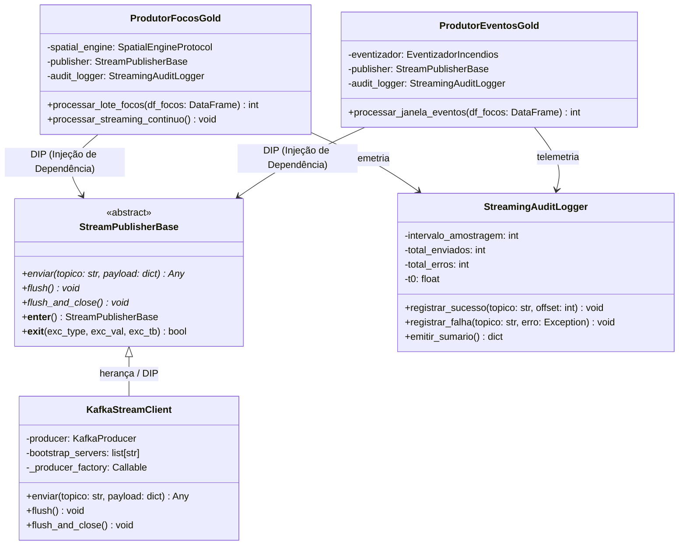
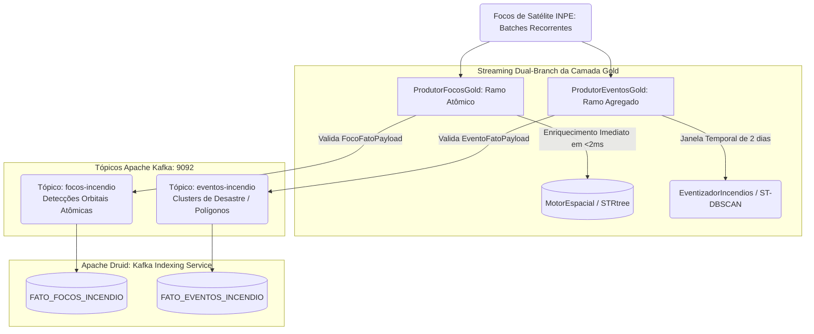

# Mensageria e Streaming da Camada Gold (`src/gold/streaming/`) - CCO DataOps

O subpacote `src/gold/streaming/` é responsável pela **Última Milha de Streaming** do projeto **CCO-DataOps**: publicação contínua de detecções e clusters espaciais no barramento de eventos **Apache Kafka**, alimentando em tempo real o serviço de ingestão colunar (*Kafka Indexing Service*) do **Apache Druid**.

Este módulo implementa a arquitetura de **Streaming Dual-Branch** (atômico vs micro-batch), rigor estrito de serialização JSON (veto a `NaN`/`Inf`) e resiliência com encerramento determinístico de conexões (*Context Manager*).

---

## 🏗️ 1. Arquitetura de Componentes e Classes



---

## ⚡ 2. Arquitetura Streaming Dual-Branch

Em operações de Centro de Controle e Operações (CCO), operadores táticos e analistas estratégicos demandam informações em escalas temporais distintas:



### 2.1 Ramo 1: Streaming Atômico (`focos-incendio`)
* **Componente**: [`ProdutorFocosGold`](file:///c:/Users/SEPLAN/Documents/UNIFEI/UNIVERSIDADE/mapeamento-risco-queimadas-inpe/src/gold/streaming/produtor_focos.py).
* **Finalidade**: Consciência situacional de sub-segundo. Cada coordenada orbital detectada é enriquecida individualmente com distâncias métricas e Foreign Keys para subestações, linhas, hospitais e TIs.
* **Volume**: Alta frequência (dezenas a centenas de mensagens por segundo).
* **Contrato**: [`FocoFatoPayload`](file:///c:/Users/SEPLAN/Documents/UNIFEI/UNIVERSIDADE/mapeamento-risco-queimadas-inpe/src/core/domain/foco_fato_payload.py).

### 2.2 Ramo 2: Micro-Batching de Eventos Complexos (`eventos-incendio`)
* **Componente**: [`ProdutorEventosGold`](file:///c:/Users/SEPLAN/Documents/UNIFEI/UNIVERSIDADE/mapeamento-risco-queimadas-inpe/src/gold/streaming/produtor_eventos.py).
* **Finalidade**: Avaliação tática e previsão de avanço de desastres. Agrupa as detecções em janela deslizante via **ST-DBSCAN**, gerando perímetros vetoriais (*Convex Hull*), área afetada em $km^2$ e soma de FRP em Megawatts.
* **Volume**: Baixa frequência e alta densidade de informação (um cluster consolida centenas de focos em uma única mensagem rica).
* **Contrato**: [`EventoFatoPayload`](file:///c:/Users/SEPLAN/Documents/UNIFEI/UNIVERSIDADE/mapeamento-risco-queimadas-inpe/src/core/domain/evento_fato_payload.py).

---

## 🛡️ 3. Resiliência e Confiabilidade: `KafkaStreamClient`

Implementado em [`kafka_client.py`](file:///c:/Users/SEPLAN/Documents/UNIFEI/UNIVERSIDADE/mapeamento-risco-queimadas-inpe/src/gold/streaming/kafka_client.py), o driver introduz três salvaguardas essenciais:

### 3.1 Garantia de Flush via *Context Manager*
Conexões de rede assíncronas acumulam mensagens em buffers de memória no produtor Kafka antes de despachar pacotes TCP para o broker. Se o script sofrer interrupção não tratada, dados em trânsito são irremediavelmente perdidos.
O `KafkaStreamClient` implementa `__enter__` e `__exit__`:
```python
with KafkaStreamClient() as client:
    produtor = ProdutorFocosGold(publisher=client)
    produtor.processar_streaming_continuo()
# Ao sair do bloco 'with' (com sucesso ou por exceção),
# client.flush_and_close() é invocado deterministicamente.
```

### 3.2 Veto a Valores `NaN` e `Inf` (`allow_nan=False`)
No Apache Druid, os supervisors de ingestão colunar rejeitam em lote qualquer mensagem JSON com valores matemáticos não conformes (`NaN`, `Infinity`, `-Infinity`). O serializador do cliente barra rigorosamente esses valores na origem:
```python
value_serializer = lambda v: json.dumps(
    v, ensure_ascii=False, allow_nan=False
).encode("utf-8")
```

### 3.3 Tolerância a Falhas e Configuração de Produtor
* `acks="all"`: Garantia de durabilidade de mensagens nos nós do cluster Kafka.
* `retries=5`: Retentativas automáticas transparentes diante de instabilidades transitórias de rede.
* `linger_ms=20` e `batch_size=32768`: Otimização de vazão TCP agrupando micro-lotes para evitar saturação de I/O de rede.

---

## 📊 4. Telemetria e Auditoria com `StreamingAuditLogger`

Implementado em [`streaming_audit_logger.py`](file:///c:/Users/SEPLAN/Documents/UNIFEI/UNIVERSIDADE/mapeamento-risco-queimadas-inpe/src/gold/streaming/streaming_audit_logger.py):
* Isola a telemetria da lógica de rede (Single Responsibility Principle - SRP).
* Amostra a vazão a cada bloco de $N$ mensagens (ex: a cada 1.000 focos), calculando throughput real em mensagens por segundo (msg/s), latência média de confirmação (*ack latency*) e taxa de erros.
* Emite relatórios estruturados de auditoria ao final da execução.

---

## 🧪 5. Testes Unitários com Injeção de Dependências (DIP)

O design desacoplado permite simular o fluxo completo de streaming nos testes unitários sem levantar brokers Kafka reais:

```python
class MockPublisher(StreamPublisherBase):
    def __init__(self):
        self.mensagens = []

    def enviar(self, topico: str, payload: dict) -> Any:
        self.mensagens.append((topico, payload))

    def flush(self) -> None: pass
    def flush_and_close(self) -> None: pass

def test_produtor_focos_streaming():
    mock_pub = MockPublisher()
    mock_engine = MockSpatialEngine()
    produtor = ProdutorFocosGold(spatial_engine=mock_engine, publisher=mock_pub)
    
    total = produtor.processar_lote_focos(df_sintetico)
    assert total == len(mock_pub.mensagens)
```
Teste executado em **$< 20\text{ ms}$** no pytest.
