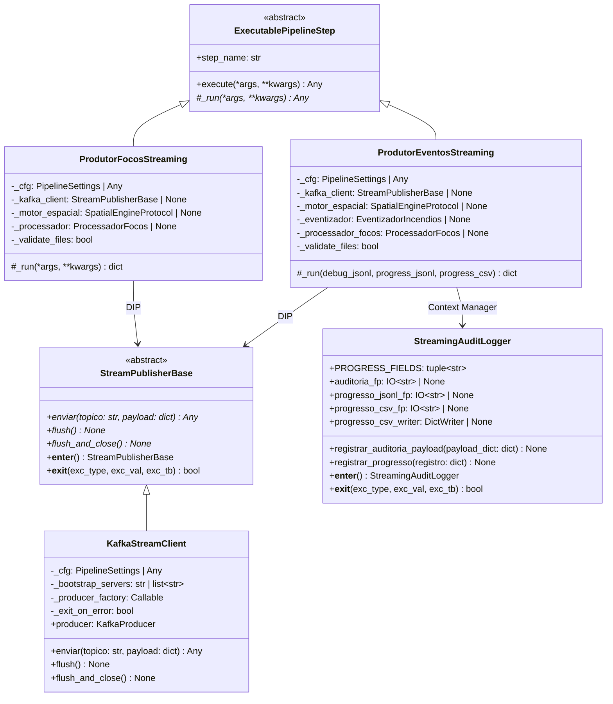
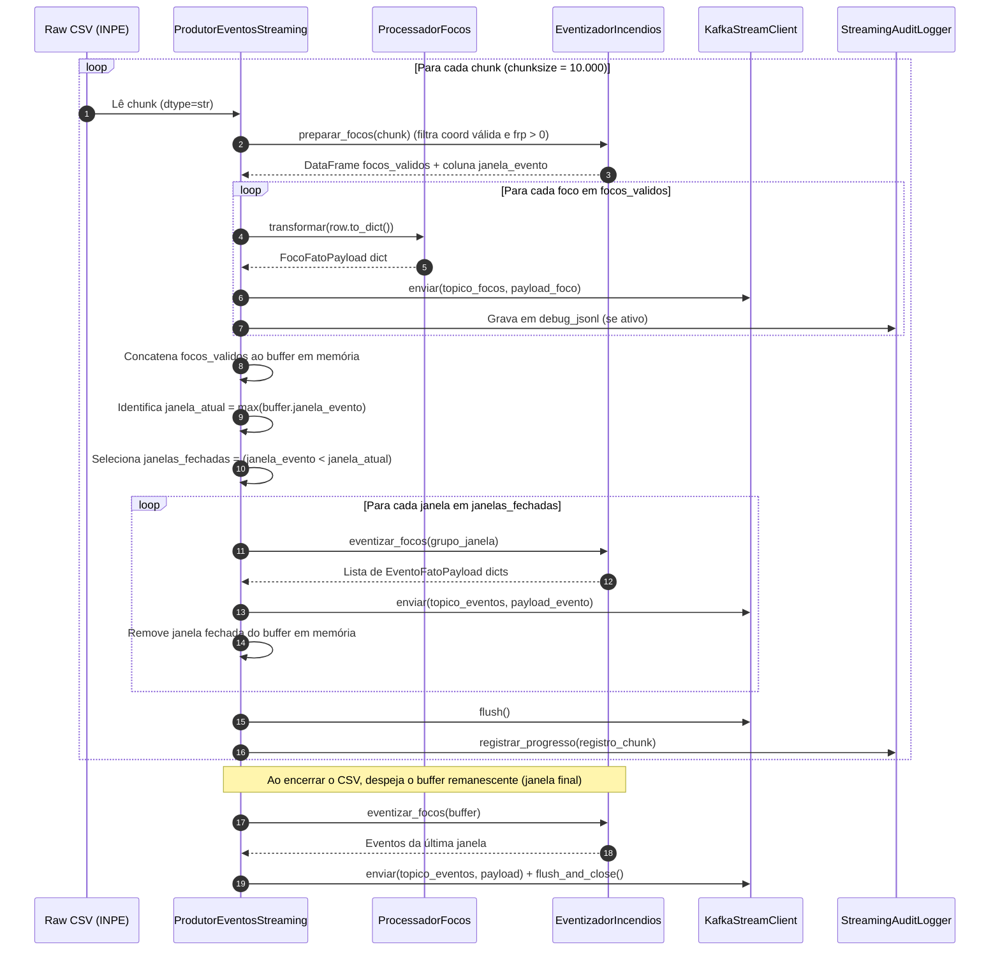

# Especificação Técnica: Publicação Kafka e Streaming Dual-Branch (`src/gold/streaming/`)

> **Trilha Modular — Etapa 14 de 18 (Ciclo 4.2 — Publicação Kafka e Streaming Dual-Branch (`src/gold/streaming/`))**: [Anterior: Ciclo 4.1 — Modelos Científicos ST-DBSCAN e Grafos SIN (`src/gold/science/`)](../ARQUITETURA.md) | [Portal Geral (`docs/README.md`)](../../../docs/README.md) | [Próximo: Ciclo 4.3 — Dicionário das Tabelas Fato (`src/gold/`)](../DICIONARIO_DADOS.md)

Este documento especifica a arquitetura de publicação em streaming da camada Gold ([`src/gold/streaming/`](.)). O pacote implementa os clientes de rede, gerenciadores de auditoria e produtores que despacham os payloads validados das tabelas fato para o cluster Apache Kafka, alimentando a ingestão contínua (*Supervisor Kafka*) do Apache Druid.

---

## 1. Arquitetura e Modularização (OO Shell e DIP)

Todos os componentes de I/O de rede e escrita de telemetria em disco são isolados em classes gerenciadas por protocolo de Context Manager (`__enter__` / `__exit__`) e aceitam injeção de dependência no construtor para execução de testes unitários sem broker Kafka ativo.

---

## 2. Cliente de Mensageria Kafka (`kafka_client.py`)

A classe [`KafkaStreamClient`](kafka_client.py#L24-L110) herda de [`StreamPublisherBase`](../../core/contracts/contracts.py#L40-L65) e encapsula o `kafka.KafkaProducer`.

### 2.1 Parâmetros de Rede, Confiabilidade e Serialização

Durante a inicialização em [`_criar_produtor`](kafka_client.py#L47-L83), o `KafkaStreamClient` configura o produtor com garantias estritas de entrega e ordenação:

| Parâmetro do `KafkaProducer` | Valor Configurado | Origem / Variável | Justificativa de Engenharia |
| :--- | :--- | :--- | :--- |
| `bootstrap_servers` | `["localhost:9092"]` (default) | `KAFKA_BROKER` | Lista de brokers de bootstrap do cluster Kafka. |
| `value_serializer` | `json.dumps(v, ensure_ascii=False, allow_nan=False).encode("utf-8")` | Fixo | Serializa dicionários em UTF-8 e **bloqueia explicitamente `NaN`, `Infinity` e `-Infinity`** (`allow_nan=False`), impedindo falhas de parsing JSON nos supervisores do Apache Druid. |
| `acks` | `"all"` | Fixo | Exige confirmação do líder e de todas as réplicas sincronizadas (*ISR*) antes de considerar a mensagem gravada. |
| `retries` | `5` | Fixo | Número máximo de retentativas automáticas em falhas transientes de rede ou eleição de líder. |
| `max_in_flight_requests_per_connection` | `1` | Fixo | Garante ordenação estrita das mensagens por partição mesmo na ocorrência de retentativas (`retries > 0`). |
| `linger_ms` | `20` | `KAFKA_LINGER_MS` | Janela de espera em milissegundos para agrupar múltiplas mensagens em um único batch TCP. |
| `batch_size` | `65536` (64 KB) | `KAFKA_BATCH_SIZE` | Tamanho máximo em bytes do buffer de lote por partição antes do despacho. |
| `compression_type` | `"gzip"` | `KAFKA_COMPRESSION` | Compressão de lote (suporta `gzip`, `snappy`, `lz4`, `zstd` ou `none`) para reduzir tráfego de rede de polígonos `path_json`. |
| `request_timeout_ms` | `30000` (30 s) | Fixo | Timeout máximo de requisição ao broker. |
| `retry_backoff_ms` | `500` | Fixo | Intervalo de espera entre retentativas de envio. |
| `reconnect_backoff_ms` / `max_ms` | `500` / `5000` | Fixo | Backoff exponencial de reconexão de socket TCP. |
| `max_block_ms` | `60000` (60 s) | Fixo | Tempo máximo de bloqueio de `send()` quando o buffer de memória local está cheio ou os metadados do tópico não estão disponíveis. |

### 2.2 Catálogo de Métodos de `KafkaStreamClient`

| Método | Assinatura | Retorno | Descrição Técnica |
| :--- | :--- | :--- | :--- |
| [`__init__`](kafka_client.py#L32-L45) | `(self, bootstrap_servers=None, producer_factory=KafkaProducer, settings_obj=None, exit_on_error=True)` | `None` | Inicializa o cliente injetando `producer_factory` e `settings_obj`. Se `exit_on_error=True`, encerra o processo com `sys.exit(1)` caso a conexão inicial falhe; em testes unitários (`exit_on_error=False`), propaga a exceção. |
| [`enviar`](kafka_client.py#L90-L97) | `(self, topico: str, payload: dict[str, Any])` | `Any` | Enfileira o dicionário assincronamente via `self.producer.send(topico, value=payload)` e anexa os callbacks `_callback_sucesso` e `_callback_erro`. |
| [`flush`](kafka_client.py#L99-L101) | `(self)` | `None` | Bloqueia até que todas as mensagens enfileiradas no buffer local sejam entregues ao broker (`self.producer.flush()`). |
| [`flush_and_close`](kafka_client.py#L103-L109) | `(self)` | `None` | Invocado automaticamente por `__exit__`: executa `flush()` seguido de `close()` no socket do `KafkaProducer`. |

---

## 3. Auditoria e Telemetria de Streaming (`streaming_audit_logger.py`)

A classe [`StreamingAuditLogger`](streaming_audit_logger.py#L16-L93) gerencia o ciclo de vida determinístico de até três arquivos locais opcionais de auditoria e telemetria durante a execução do streaming.

### 3.1 Esquema de Telemetria (`PROGRESS_FIELDS`)

Quando `--progress-jsonl` ou `--progress-csv` são fornecidos, cada chunk processado grava um registro contendo exatamente as 9 colunas definidas em [`StreamingAuditLogger.PROGRESS_FIELDS`](streaming_audit_logger.py#L22-L32):

| Campo | Tipo | Descrição Técnica |
| :--- | :--- | :--- |
| `timestamp` | `str` (ISO-8601 UTC) | Timestamp UTC do fechamento do chunk (`YYYY-MM-DDTHH:MM:SSZ`). |
| `chunk` | `int` | Índice sequencial (1-based) do chunk lido do arquivo CSV bruto. |
| `raw_lidas` | `int` | Total acumulado de linhas brutas lidas até o chunk atual. |
| `focos_validos` | `int` | Total acumulado de focos que passaram nos filtros de coordenada válida, data válida e `frp > 0.0`. |
| `eventos_enviados` | `int` | Total acumulado de macroeventos ST-DBSCAN publicados no tópico de eventos. |
| `buffer_focos` | `int` | Quantidade de focos retidos no buffer em memória pertencentes à janela temporal aberta atual (`janela_atual`). |
| `erros_janela` | `int` | Total acumulado de janelas que apresentaram exceção durante a clusterização. |
| `taxa_eventos_s` | `float` | Throughput médio acumulado de eventos publicados por segundo (`round(total_eventos / tempo_decorrido, 6)`). |
| `janela_atual` | `int` | Índice inteiro da janela temporal ativa (`max(buffer["janela_evento"])`). |

---

## 4. Produtores de Streaming (`produtor_focos.py` e `produtor_eventos.py`)

### 4.1 Fluxo Operacional de Janelas Fechadas Dual-Branch

O sistema dispõe de dois modos de publicação:
- **Modo Atômico Isolado ([`ProdutorFocosStreaming`](produtor_focos.py#L41-L162))**: lê o CSV bruto em chunks (`CHUNK_SIZE_FOCOS = 10000`), enriquece cada linha individualmente via [`ProcessadorFocos.transformar`](../../silver/streaming_processing/processador.py#L31-L33) e publica no tópico `streaming_focos_incendio`.
- **Modo Dual-Branch com Micro-Batching de Janela Fechada ([`ProdutorEventosStreaming`](produtor_eventos.py#L72-L230))**: publica simultaneamente os focos atômicos válidos em `streaming_focos_incendio` e os clusters ST-DBSCAN consolidados em `streaming_eventos_incendio`.

### 4.2 Catálogo de Funções e Classes dos Produtores

#### Módulo [`produtor_focos.py`](produtor_focos.py)

| Símbolo | Assinatura | Retorno | Descrição Técnica |
| :--- | :--- | :--- | :--- |
| [`linha_para_dict`](produtor_focos.py#L28-L32) | `(linha: Any)` | `dict[str, Any]` | Converte `namedtuple` produzida por `chunk.itertuples(index=False)` (`_asdict()`) ou `Mapping` em `dict` padrão. |
| [`validar_payload_json`](produtor_focos.py#L35-L38) | `(payload: dict[str, Any])` | `bool` | Executa `json.dumps(payload, ensure_ascii=False, allow_nan=False)` antes de enfileirar no Kafka para rejeitar registros com `NaN`/`Inf` na origem. |
| [`ProdutorFocosStreaming._run`](produtor_focos.py#L63-L162) | `(self, *args, **kwargs)` | `dict[str, Any]` | Verifica os 8 arquivos obrigatórios (`verificar_arquivos_obrigatorios()`), abre o `KafkaStreamClient` via bloco `with`, itera sobre `RAW_FOCOS` em chunks, executa `processador.transformar` e `kafka_client.enviar(topico, payload_final)` com `flush()` ao fim de cada chunk. Retorna dicionário de telemetria (`total_lido`, `total_enviado`, `total_erros`, `total_coord_invalidas`, `tempo_total_s`, `taxa_msg_s`). |
| [`iniciar_produtor`](produtor_focos.py#L165-L167) | `()` | `dict[str, Any]` | Entrypoint CLI que instancia e executa `ProdutorFocosStreaming().execute()`. |

#### Módulo [`produtor_eventos.py`](produtor_eventos.py)

| Símbolo | Assinatura | Retorno | Descrição Técnica |
| :--- | :--- | :--- | :--- |
| [`_config_eventos`](produtor_eventos.py#L33-L35) | `(cfg: Any = settings)` | `EventoConfig` | Constrói `EventoConfig` a partir do objeto de configuração ativo via `EventoConfig.from_settings(cfg)`. |
| [`_enviar_payload`](produtor_eventos.py#L60-L69) | `(kafka_client, topico: str, payload: Any, auditoria: IO[str] \| None = None)` | `None` | Converte `payload` (se possuir `.model_dump()`) em dicionário, envia ao tópico via `kafka_client.enviar(topico, payload_dict)` e, se `auditoria` estiver aberto, grava a linha JSONL correspondente. |
| [`ProdutorEventosStreaming._run`](produtor_eventos.py#L96-L230) | `(self, debug_jsonl=None, progress_jsonl=None, progress_csv=None)` | `dict[str, Any]` | Executa o replay em janelas temporais fechadas gerenciando `StreamingAuditLogger` e `KafkaStreamClient` em um bloco `with` duplo. Retorna dicionário consolidado contendo `raw_lidas`, `focos_validos`, `focos_enviados`, `eventos_enviados`, `erros_janela` e `tempo_total_s`. |
| [`iniciar_produtor`](produtor_eventos.py#L233-L243) | `(debug_jsonl=None, progress_jsonl=None, progress_csv=None)` | `dict[str, Any]` | Fachada funcional para execução programática ou via orquestrador. |
| [`main`](produtor_eventos.py#L246-L258) | `()` | `None` | Parser CLI (`argparse`) que aceita `--debug-jsonl`, `--progress-jsonl` e `--progress-csv`. |

---

> **Trilha Modular — Etapa 14 de 18 (Ciclo 4.2 — Publicação Kafka e Streaming Dual-Branch (`src/gold/streaming/`))**: [Anterior: Ciclo 4.1 — Modelos Científicos ST-DBSCAN e Grafos SIN (`src/gold/science/`)](../ARQUITETURA.md) | [Portal Geral (`docs/README.md`)](../../../docs/README.md) | [Próximo: Ciclo 4.3 — Dicionário das Tabelas Fato (`src/gold/`)](../DICIONARIO_DADOS.md)
