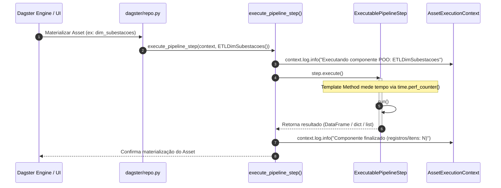
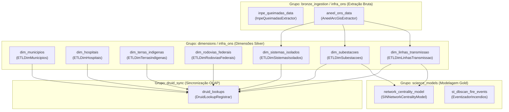

# Especificação Técnica: Camada de Orquestração (`src/orchestration/`)

> **Trilha Modular — Etapa 16 de 18 (Ciclo 5.1 — Orquestração Apache Dagster (`src/orchestration/`))**: [Anterior: Ciclo 4.3 — Dicionário das Tabelas Fato (`src/gold/`)](../gold/DICIONARIO_DADOS.md) | [Portal Geral (`docs/README.md`)](../../docs/README.md) | [Próximo: Ciclo 5.2 — Infraestrutura Apache Druid 34.0 e Superset (`infra/`)](../../infra/README.md)

O diretório [`src/orchestration/`](.) implementa a orquestração declarativa do pipeline **CCO DataOps** por meio do **Apache Dagster**. Todos os extratores da camada Bronze, pipelines de dimensões da camada Silver, sincronizadores de *Lookups* OLAP e modelos científicos da camada Gold são declarados como **Software-Defined Assets (SDA)** no módulo [`dagster/repo.py`](dagster/repo.py).

---

## 1. Arquitetura de Execução In-Memory (`ExecutablePipelineStep`)

Em vez de invocar processos externos via `subprocess.run`, o repositório [`dagster/repo.py`](dagster/repo.py) instancia diretamente as classes de domínio que implementam o contrato abstrato [`ExecutablePipelineStep`](../core/contracts/contracts.py#L68-L90).



### Função Despachante e Fábrica Auxiliar ([`dagster/repo.py`](dagster/repo.py))

| Função | Assinatura | Retorno | Descrição Técnica |
| :--- | :--- | :--- | :--- |
| [`execute_pipeline_step`](dagster/repo.py#L33-L44) | `(context: Optional[AssetExecutionContext], step: ExecutablePipelineStep)` | `Any` | Registra o início da execução no `AssetExecutionContext`, invoca `step.execute()` em memória compartilhada, calcula a cardinalidade do retorno (`len(resultado)` se disponível) e registra o término no log do Dagster. |
| [`build_druid_lookup_registrar`](dagster/repo.py#L131-L133) | `(**kwargs: Any)` | `DruidLookupRegistrar` | Fábrica auxiliar que instancia [`DruidLookupRegistrar`](../silver/lookups/druid_lookup_registrar.py) aceitando injeção de parâmetros para testes unitários de orquestração. |

---

## 2. Grafo de Dependências de Software-Defined Assets (DAG)

O objeto `defs = Definitions(assets=[...])` em [`dagster/repo.py`](dagster/repo.py#L136-L151) declara **12 Software-Defined Assets** distribuídos em 5 grupos funcionais (`bronze_ingestion`, `infra_ons`, `dimensions`, `science_models` e `druid_sync`):



---

## 3. Catálogo de Software-Defined Assets (`dagster/repo.py`)

| Asset Dagster | `group_name` | `compute_kind` | Dependências (`deps`) | Classe Executada (`ExecutablePipelineStep`) | Artefato / Efeito Produzido |
| :--- | :--- | :--- | :--- | :--- | :--- |
| [`inpe_queimadas_data`](dagster/repo.py#L71-L74) | `bronze_ingestion` | `python` | Nenhuma | [`InpeQueimadasExtractor`](../bronze/extractors/inpe_queimadas_extractor.py) | Baixa e descompacta CSVs anuais/diários do INPE em `src/bronze/data/inpe_bdqueimadas/`. |
| [`aneel_ons_data`](dagster/repo.py#L77-L80) | `infra_ons` | `python` | Nenhuma | [`AneelArcGisExtractor`](../bronze/extractors/ingestao_aneel.py) | Extrai GeoJSON paginado de linhas, subestações e sistemas isolados em `src/bronze/data/geosampa_aneel/`. |
| [`dim_municipios`](dagster/repo.py#L47-L50) | `dimensions` | `python` | Nenhuma | [`ETLDimMunicipios`](../silver/etl/etl_dim_municipios.py) | Gera `src/silver/data/dimensions/dim_municipios_coordenadas.csv`. |
| [`dim_hospitais`](dagster/repo.py#L53-L56) | `dimensions` | `python` | Nenhuma | [`ETLDimHospitais`](../silver/etl/etl_dim_hospitais.py) | Gera `src/silver/data/dimensions/dim_hospitais_cnes.csv`. |
| [`dim_terras_indigenas`](dagster/repo.py#L59-L62) | `dimensions` | `python` | Nenhuma | [`ETLDimTerrasIndigenas`](../silver/etl/etl_dim_terras_indigenas.py) | Gera `src/silver/data/dimensions/dim_terras_indigenas.csv`. |
| [`dim_rodovias_federais`](dagster/repo.py#L65-L68) | `dimensions` | `python` | Nenhuma | [`ETLDimRodoviasFederais`](../silver/etl/etl_dim_rodovias_federais.py) | Gera `src/silver/data/dimensions/dim_rodovias_federais.csv`. |
| [`dim_linhas_transmissao`](dagster/repo.py#L83-L86) | `infra_ons` | `python` | `aneel_ons_data` | [`ETLDimLinhasTransmissao`](../silver/etl/etl_dim_ons_linhas_transmissao.py) | Gera `src/silver/data/dimensions/dim_ons_linhas_transmissao.csv`. |
| [`dim_subestacoes`](dagster/repo.py#L89-L92) | `infra_ons` | `python` | `aneel_ons_data` | [`ETLDimSubestacoes`](../silver/etl/etl_dim_ons_subestacoes.py) | Gera `src/silver/data/dimensions/dim_ons_subestacoes.csv`. |
| [`dim_sistemas_isolados`](dagster/repo.py#L95-L98) | `infra_ons` | `python` | `aneel_ons_data` | [`ETLDimSistemasIsolados`](../silver/etl/etl_dim_ons_sistemas_isolados.py) | Gera `src/silver/data/dimensions/dim_ons_sistemas_isolados.csv`. |
| [`network_centrality_model`](dagster/repo.py#L101-L104) | `science_models` | `networkx` | `dim_linhas_transmissao`, `dim_subestacoes` | [`SINNetworkCentralityModel`](../gold/science/networkx/network_builder.py) | Calcula `betweenness_score_norm` e `risco_cascata` e atualiza `dim_ons_subestacoes.csv`. |
| [`st_dbscan_fire_events`](dagster/repo.py#L107-L110) | `science_models` | `scikit-learn` | Nenhuma | [`EventizadorIncendios`](../gold/science/dbscan/eventizador.py) | Executa clusterização ST-DBSCAN em lote de amostra (`nrows=5000`). |
| [`druid_lookups`](dagster/repo.py#L113-L128) | `druid_sync` | `apache_druid` | Todas as 7 `dim_*` | [`DruidLookupRegistrar`](../silver/lookups/druid_lookup_registrar.py) | Publica os 23 mapas de lookup `cachedNamespace` no Apache Druid Coordinator. |

---

## 4. Procedimentos Operacionais via `uv`

### 4.1 Inicialização do Servidor Web do Dagster
```bash
uv run dagster dev -f src/orchestration/dagster/repo.py
```
O painel web fica disponível em `http://localhost:3000`.

### 4.2 Materialização Seletiva de Assets via CLI
```bash
# Materializar extração ANEEL e dimensões dependentes do setor elétrico
uv run dagster asset materialize --select "aneel_ons_data*" -f src/orchestration/dagster/repo.py

# Materializar modelo de centralidade NetworkX
uv run dagster asset materialize --select network_centrality_model -f src/orchestration/dagster/repo.py

# Materializar registro de Lookups no Apache Druid
uv run dagster asset materialize --select druid_lookups -f src/orchestration/dagster/repo.py
```

### 4.3 Execução dos Testes da Orquestração
```bash
uv run pytest src/orchestration/tests/
```

---

> **Trilha Modular — Etapa 16 de 18 (Ciclo 5.1 — Orquestração Apache Dagster (`src/orchestration/`))**: [Anterior: Ciclo 4.3 — Dicionário das Tabelas Fato (`src/gold/`)](../gold/DICIONARIO_DADOS.md) | [Portal Geral (`docs/README.md`)](../../docs/README.md) | [Próximo: Ciclo 5.2 — Infraestrutura Apache Druid 34.0 e Superset (`infra/`)](../../infra/README.md)
