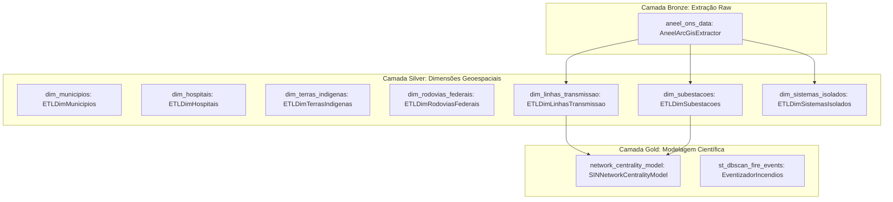

# Camada de Orquestração (Apache Dagster) - CCO DataOps

A pasta `src/orchestration/` centraliza a orquestração declarativa de dados do projeto através do **Apache Dagster**. Nenhum script roda solto ou órfão no sistema: todas as etapas de ingestão (Bronze), conformação dimensional (Silver) e modelagem de Data Science (Gold) são expressas como **Software-Defined Assets (SDA)** interconectados.

---

## 1. Princípios de Orquestração

1. **Software-Defined Assets (SDA)**:
   - Em vez de focar puramente em tarefas imperativas soltas (*Tasks*), o Dagster modela **o que deve existir no ecossistema** (tabelas de dimensão, modelos de grafos, arquivos brutos) e rastreia dependências e linhagem (*lineage*).
2. **Execução In-Memory Orientada a Objetos (`ExecutablePipelineStep`)**:
   - Elimina o *overhead* de chamadas lentas de subprocessos (`subprocess.run(["python", ...])`).
   - Os assets importam e instanciam diretamente as classes de domínio (`ETLDimMunicipios`, `AneelArcGisExtractor`, `SINNetworkCentralityModel`, `EventizadorIncendios`), executando o método `step.execute()` em memória compartilhada com telemetria nativa do `AssetExecutionContext`.
3. **Idempotência e Tolerância a Falhas**:
   - Reexecuções de qualquer asset para a mesma partição produzem rigorosamente o mesmo resultado, permitindo reprocessamento cirúrgico de contingência sem corrupção de dados.

---

## 2. Estrutura de Arquivos

```text
src/orchestration/
├── README.md              # Este guia de orquestração
├── repo.py                # Definição canônica de Assets, Definitions e despachante in-memory
└── tests/                 # Testes unitários do orquestrador e dependências de DAG
```

---

## 3. Grafo de Dependências de Software-Defined Assets (SDA)

O grafo abaixo reflete a linhagem exata declarada em [`src/orchestration/dagster/repo.py`](repo.py):



---

## 4. O Despachante In-Memory (`execute_pipeline_step`)

O arquivo [`repo.py`](repo.py) aplica Inversão de Dependência (DIP) e Substituição de Liskov (LSP) ao receber qualquer instância derivada de [`ExecutablePipelineStep`](../../src/core/contracts/contracts.py):

```python
def execute_pipeline_step(
    context: Optional[AssetExecutionContext],
    step: ExecutablePipelineStep,
) -> Any:
    """Executa uma etapa ExecutablePipelineStep em memória registrando progresso no Dagster."""
    if context is not None:
        context.log.info(f"Executando componente POO: {step.step_name}")
    resultado = step.execute()
    if context is not None:
        total = len(resultado) if hasattr(resultado, "__len__") and resultado is not None else "N/A"
        context.log.info(f"Componente {step.step_name} finalizado (registros/itens: {total}).")
    return resultado
```

---

## 5. Guia Operacional de Execução

Todas as operações de orquestração utilizam o gerenciador `uv`:

### 5.1 Iniciar a Interface Web do Dagster (Dagit UI)
Para abrir o painel visual de monitoramento e materialização de assets:
```bash
uv run dagster dev -f src/orchestration/dagster/repo.py
```
A interface estará acessível em `http://localhost:3000`.

### 5.2 Materializar um Asset Específico via Linha de Comando
Para reprocessar apenas uma dimensão ou modelo sem abrir o navegador:
```bash
# Materializar apenas a malha ANEEL (Bronze)
uv run dagster asset materialize --select aneel_ons_data -f src/orchestration/dagster/repo.py

# Materializar a dimensão de hospitais (Silver)
uv run dagster asset materialize --select dim_hospitais -f src/orchestration/dagster/repo.py

# Materializar o modelo de grafos do ONS (Gold)
uv run dagster asset materialize --select network_centrality_model -f src/orchestration/dagster/repo.py
```

### 5.3 Materializar Todo o Pipeline de Ponta a Ponta
```bash
uv run dagster asset materialize --select "*" -f src/orchestration/dagster/repo.py
```
