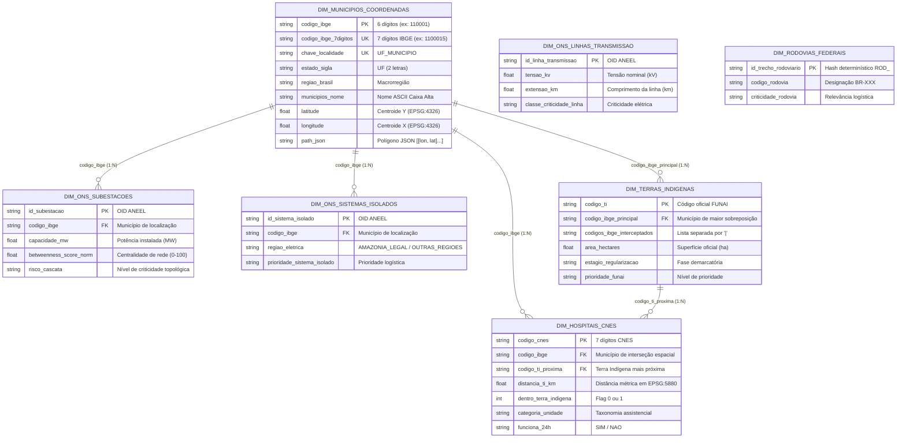

# Dicionário de Dados Estrutural: Camada Silver — Dimensões Conformadas (`src/silver/data/dimensions/`)

> **Trilha Modular — Etapa 08 de 18 (Ciclo 2.3 — Dicionário de Dados Dimensional (`src/silver/`))**: [Anterior: Ciclo 2.2 — Pipelines ETL das 7 Dimensões (`src/silver/etl/`)](etl/README.md) | [Portal Geral (`docs/README.md`)](../../docs/README.md) | [Próximo: Ciclo 2.4 — Validadores de Qualidade e 23 Lookups URI (`src/silver/validators/`)](validators/README.md)

Este documento especifica os esquemas físicos das 7 tabelas de dimensão geradas pelos pipelines de [`src/silver/etl/`](etl/README.md) e persistidas em `src/silver/data/dimensions/`. Todos os arquivos seguem a codificação `UTF-8`, delimitador vírgula (`,`), `csv.QUOTE_MINIMAL`, coordenadas em `EPSG:4326` e geometrias serializadas no contrato `path_json`.

---

## 1. Diagrama Entidade-Relacionamento Dimensional (Snowflake)

---

## 2. Especificação das Tabelas de Dimensão

### 2.1 `dim_municipios_coordenadas.csv` (5.564 linhas, 10 colunas)
Gerada por [`ETLDimMunicipios`](etl/etl_dim_municipios.py).

| Coluna | Tipo | Papel | Exemplo Real | Regra de Formação / Domínio |
|:---|:---:|:---:|:---|:---|
| `codigo_ibge` | `str` (`int64` no CSV) | **PK** | `'110001'` | 6 primeiros dígitos do código IBGE (sem dígito verificador), compatível com CNES. |
| `codigo_ibge_7digitos` | `str` (`int64` no CSV) | **UK** | `'1100015'` | Código IBGE completo de 7 dígitos com dígito verificador. |
| `chave_localidade` | `str` | **UK** | `"RONDONIA_ALTA FLORESTA D'OESTE"` | Concatenação `{estado_nome}_{municipios_nome}` para lookup de focos brutos do INPE. |
| `estado_nome` | `str` | Atributo | `'RONDONIA'` | Nome da Unidade Federativa por extenso sem acentos (`MAPA_ESTADOS_NOME`). |
| `estado_sigla` | `str` | Atributo | `'RO'` | Sigla oficial de 2 letras da UF (`MAPA_ESTADOS_SIGLA`). |
| `regiao_brasil` | `str` | Atributo | `'NORTE'` | Domínio: `NORTE`, `NORDESTE`, `SUDESTE`, `SUL`, `CENTRO-OESTE`. |
| `municipios_nome` | `str` | Atributo | `"ALTA FLORESTA D'OESTE"` | Nome oficial do município higienizado por `limpar_texto_druid()`. |
| `latitude` | `float64` | Espacial | `-12.470428` | Latitude do centroide calculado em `EPSG:5880` e reprojetado para `EPSG:4326`. |
| `longitude` | `float64` | Espacial | `-62.274188` | Longitude do centroide em `EPSG:4326`. |
| `path_json` | `str` (JSON) | Espacial | `'[[[-62.182089, -11.86686], ...]]'` | Coordenadas do polígono municipal serializadas por `geometry_para_path_json()`. |

---

### 2.2 `dim_hospitais_cnes.csv` (550.882 linhas, 15 colunas)
Gerada por [`ETLDimHospitais`](etl/etl_dim_hospitais.py).

| Coluna | Tipo | Papel | Exemplo Real | Regra de Formação / Domínio |
|:---|:---:|:---:|:---|:---|
| `codigo_cnes` | `str` (`int64` no CSV) | **PK** | `'2571943'` | Código Nacional de Estabelecimento de Saúde normalizado por `normalizar_codigo_cnes()`. |
| `nome_hospital` | `str` | Atributo | `'UNIDADE MOVEL'` | Nome fantasia (`NO_FANTASIA`) higienizado por `limpar_texto_druid()`. |
| `tipo_unidade` | `str` | Atributo | `'UNIDADE MOVEL TERRESTRE'` | Descrição original `DS_TIPO_UNIDADE` da tabela `tbTipoUnidade`. |
| `categoria_unidade` | `str` | Atributo | `'UNIDADE_MOVEL'` | Domínio (9 classes): `HOSPITAL_URGENCIA_EMERGENCIA`, `ATENCAO_BASICA`, `APOIO_DIAGNOSTICO_LABORATORIAL`, `REGULACAO_GESTAO`, `UNIDADE_MOVEL`, `VIGILANCIA_IMUNIZACAO`, `CONSULTORIO_ESPECIALIDADE`, `FARMACIA`, `SAUDE_INDIGENA`, `OUTROS`. |
| `tipo_unidade_critica` | `str` | Atributo | `'SIM'` | Domínio: `SIM` (hospitais de urgência, unidades móveis, saúde indígena ou operação 24h) / `NAO`. |
| `categoria_atendimento` | `str` | Atributo | `'MOBILIDADE_ASSISTENCIAL'` | Domínio: `CRITICO_24H`, `CRITICO`, `MOBILIDADE_ASSISTENCIAL`, `SAUDE_INDIGENA`, `ATENCAO_LOCAL`, `SUPORTE`. |
| `classe_capacidade_saude` | `str` | Atributo | `'RESPOSTA_MOVEL'` | Domínio: `ALTA_CAPACIDADE`, `MEDIA_CAPACIDADE`, `RESPOSTA_MOVEL`, `SAUDE_INDIGENA`, `ATENCAO_LOCAL`, `SUPORTE`. |
| `funciona_24h` | `str` | Atributo | `'NAO'` | Domínio: `SIM` (quando `TP_ESTAB_SEMPRE_ABERTO == 'S'`) / `NAO`. |
| `codigo_ibge` | `str` | **FK** | `'260960'` | Código IBGE de 6 dígitos obtido por interseção espacial (`gpd.sjoin` + fallback `sjoin_nearest` em `EPSG:5880`) contra `dim_municipios_coordenadas`. |
| `codigo_ti_proxima` | `str` | **FK** | `'37001'` | Código da Terra Indígena mais próxima obtido via `gpd.sjoin_nearest` em `EPSG:5880`. |
| `distancia_ti_km` | `float64` | Métrica | `141.838` | Distância euclidiana em quilômetros (`distancia_m / 1000.0`, 3 casas decimais) até a TI mais próxima. |
| `dentro_terra_indigena` | `int64` | Flag | `0` | `1` se a distância até o polígono da TI for `0.0 m`, `0` caso contrário. |
| `latitude` | `float64` | Espacial | `-8.0105168` | Latitude validada/recuperada por `normalizar_par_coordenadas()`. |
| `longitude` | `float64` | Espacial | `-34.8427588` | Longitude validada/recuperada por `normalizar_par_coordenadas()`. |
| `path_json` | `str` (JSON) | Espacial | `'[[-34.842759, -8.010517]]'` | Coordenada pontual serializada para Deck.gl. |

---

### 2.3 `dim_terras_indigenas.csv` (650 linhas, 18 colunas)
Gerada por [`ETLDimTerrasIndigenas`](etl/etl_dim_terras_indigenas.py).

| Coluna | Tipo | Papel | Exemplo Real | Regra de Formação / Domínio |
|:---|:---:|:---:|:---|:---|
| `codigo_ti` | `str` (`int64` no CSV) | **PK** | `'101'` | Código oficial numérico da Terra Indígena na FUNAI. |
| `nome_terra_indigena` | `str` | Atributo | `'ACAPURI DE CIMA'` | Nome oficial da reserva higienizado em caixa alta sem acentos. |
| `etnia` | `str` | Atributo | `'KOKAMA'` | Etnias registradas na reserva. |
| `estado_sigla` | `str` | Atributo | `'AM'` | Sigla da Unidade Federativa. |
| `area_hectares` | `float64` | Métrica | `18393.94` | Superfície demarcada em hectares (`ha`), arredondada em 2 casas decimais. |
| `classe_area_ti` | `str` | Atributo | `'MEDIA'` | Domínio: `MUITO_GRANDE` ($\ge 10^6\text{ ha}$), `GRANDE` ($\ge 10^5\text{ ha}$), `MEDIA` ($\ge 10^4\text{ ha}$), `PEQUENA` ($>0$). |
| `estagio_regularizacao` | `str` | Atributo | `'REGULARIZADA'` | Domínio: `REGULARIZADA`, `DECLARADA`, `DELIMITADA`, `EM_ESTUDO_IDENTIFICACAO`, `HOMOLOGADA`. |
| `modalidade` | `str` | Atributo | `'TRADICIONALMENTE OCUPADA'` | Classificação jurídica da FUNAI. |
| `coordenacao_regional` | `str` | Atributo | `'COORDENACAO REGIONAL DO ALTO SOLIMOES'` | Unidade administrativa regional da FUNAI. |
| `em_faixa_fronteira` | `str` | Atributo | `'NAO'` | Domínio: `SIM`, `NAO`, `NAO_INFORMADO`. |
| `prioridade_funai` | `str` | Atributo | `'MONITORAMENTO'` | Domínio: `ALTA_PRIORIDADE`, `MEDIA_PRIORIDADE`, `MONITORAMENTO`. |
| `codigos_ibge_interceptados` | `str` | Lista FK | `'130160'` | Códigos IBGE (6 dígitos) de todos os municípios interceptados pelo polígono da TI via `gpd.overlay` em `EPSG:5880`, separados por `'\|'` e ordenados por área decrescente. |
| `codigo_ibge_principal` | `str` | **FK** | `'130160'` | Primeiro código da lista `codigos_ibge_interceptados` (município que detém a maior fração de área da TI). |
| `qtd_municipios_interceptados` | `int64` | Métrica | `1` | Contagem total de municípios interceptados pela reserva. |
| `percentual_area_interceptada` | `float64` | Métrica | `100.0` | Soma percentual da área da TI coberta pela malha municipal do IBGE (limitada a `100.0`). |
| `latitude` | `float64` | Espacial | `-2.597136` | Latitude do centroide métrico da reserva (`EPSG:4326`). |
| `longitude` | `float64` | Espacial | `-66.827972` | Longitude do centroide métrico da reserva (`EPSG:4326`). |
| `path_json` | `str` (JSON) | Espacial | `'[[[-66.883591, -2.537521], ...]]'` | Polígono unificado (`unary_union`) serializado para Deck.gl. |

---

### 2.4 `dim_ons_linhas_transmissao.csv` (1.817 linhas, 11 colunas)
Gerada por [`ETLDimLinhasTransmissao`](etl/etl_dim_ons_linhas_transmissao.py).

| Coluna | Tipo | Papel | Exemplo Real | Regra de Formação / Domínio |
|:---|:---:|:---:|:---|:---|
| `id_linha_transmissao` | `str` (`int64` no CSV) | **PK** | `'1'` | Identificador `OID` da linha no servidor ArcGIS da ANEEL. |
| `nome_linha` | `str` | Atributo | `'LINHA LT 230 KV SCHARLAU 2 / CHARQUEADAS C 1 RS'` | Nome higienizado ou rótulo sintetizado por `_montar_nome_linha_visual()`. |
| `tensao_kv` | `float64` | Métrica | `230.0` | Tensão nominal em quilovolts extraída do HTML `PopupInfo` ou do nome da linha. |
| `classe_tensao` | `str` | Atributo | `'ALTA'` | Domínio: `EXTRA_ALTA` ($\ge 500\text{ kV}$), `ALTA` ($\ge 230\text{ kV}$), `MEDIA` ($\ge 69\text{ kV}$), `BAIXA` ($>0$). |
| `extensao_km` | `float64` | Métrica | `72.96` | Extensão linear em quilômetros extraída do rótulo `"Extensão"` em `PopupInfo`. |
| `classe_extensao` | `str` | Atributo | `'LONGA'` | Domínio: `MUITO_LONGA` ($\ge 200\text{ km}$), `LONGA` ($\ge 50\text{ km}$), `MEDIA` ($\ge 10\text{ km}$), `CURTA` ($>0$). |
| `estado_sigla_estimado` | `str` | Atributo | `'RS'` | UF extraída do sufixo do nome da linha via `extrair_uf_nome_linha()`. |
| `classe_criticidade_linha` | `str` | Atributo | `'ALTA'` | Domínio: `CRITICA`, `ALTA`, `MEDIA_ALTA`, `MEDIA`, `BAIXA`, `NAO_INFORMADA`. |
| `latitude` | `float64` | Espacial | `-29.81054` | Latitude do centroide linear (`EPSG:4326`). |
| `longitude` | `float64` | Espacial | `-51.403144` | Longitude do centroide linear (`EPSG:4326`). |
| `path_json` | `str` (JSON) | Espacial | `'[[-51.151667, -29.719722], ...]'` | Traçado linear higienizado por `limpar_linestring_geometry()`. |

---

### 2.5 `dim_ons_subestacoes.csv` (627 linhas, 13 colunas)
Gerada inicialmente por [`ETLDimSubestacoes`](etl/etl_dim_ons_subestacoes.py) (10 colunas) e enriquecida topologicamente por [`SINNetworkCentralityModel`](../gold/science/networkx/network_builder.py) (+3 colunas de grafos).

| Coluna | Tipo | Papel | Exemplo Real | Regra de Formação / Domínio |
|:---|:---:|:---:|:---|:---|
| `id_subestacao` | `str` (`int64` no CSV) | **PK** | `'1'` | Identificador `OID` da subestação na ANEEL. |
| `nome_subestacao` | `str` | Atributo | `'SUBESTACAO B. FLUMINENSE'` | Nome padronizado por `_normalizar_nome()`. |
| `capacidade_mw` | `float64` | Métrica | `0.0` | Potência instalada em Megawatts extraída do rótulo `"Capacidade"` em `PopupInfo`. |
| `classe_capacidade` | `str` | Atributo | `'NAO_INFORMADA'` | Domínio: `EXTREMA` ($\ge 2000$), `MUITO_ALTA` ($\ge 1000$), `ALTA` ($\ge 300$), `MEDIA` ($\ge 100$), `BAIXA`, `NAO_INFORMADA`. |
| `criticidade_subestacao` | `str` | Atributo | `'NAO_INFORMADA'` | Domínio: `CRITICA` ($\ge 1000$), `ALTA` ($\ge 300$), `MEDIA` ($\ge 100$), `BAIXA`, `NAO_INFORMADA`. |
| `agente_responsavel` | `str` | Atributo | `'FURNAS CENTRAIS ELETRICAS S.A.'` | Concessionária extraída do rótulo `"Agente"` em `PopupInfo`. |
| `codigo_ibge` | `str` | **FK** | `'330555'` | Código IBGE de 6 dígitos obtido via `gpd.sjoin(predicate="intersects")`. |
| `latitude` | `float64` | Espacial | `-22.720833` | Latitude do ponto da subestação (`EPSG:4326`). |
| `longitude` | `float64` | Espacial | `-43.642222` | Longitude do ponto da subestação (`EPSG:4326`). |
| `path_json` | `str` (JSON) | Espacial | `'[[-43.642222, -22.720833]]'` | Coordenada pontual serializada. |
| `betweenness_score` | `float64` | Métrica (Gold) | `0.0` | Centralidade de intermediação bruta $[0.0, 1.0]$ calculada via `nx.betweenness_centrality(G)`. |
| `betweenness_score_norm` | `float64` | Métrica (Gold) | `0.0` | Score de centralidade reescalonado no intervalo $[0.0, 100.0]$. |
| `risco_cascata` | `str` | Atributo (Gold) | `'ISOLADO'` | Domínio: `CRITICO_SISTEMICO` ($>50$), `ALTO_IMPACTO` ($>20$), `MODERADO` ($>5$), `BAIXO` ($>0$), `ISOLADO` ($0$). |

---

### 2.6 `dim_ons_sistemas_isolados.csv` (120 linhas, 9 colunas)
Gerada por [`ETLDimSistemasIsolados`](etl/etl_dim_ons_sistemas_isolados.py).

| Coluna | Tipo | Papel | Exemplo Real | Regra de Formação / Domínio |
|:---|:---:|:---:|:---|:---|
| `id_sistema_isolado` | `str` (`int64` no CSV) | **PK** | `'1'` | Identificador `OID` da ANEEL. |
| `nome_sistema_isolado` | `str` | Atributo | `'AFUA'` | Nome da localidade isolada higienizado. |
| `estado_sigla` | `str` | Atributo | `'PA'` | Sigla da UF extraída via `extrair_uf_popup()`. |
| `regiao_eletrica` | `str` | Atributo | `'AMAZONIA_LEGAL'` | Domínio: `AMAZONIA_LEGAL`, `OUTRAS_REGIOES`, `NAO_INFORMADA`. |
| `prioridade_sistema_isolado` | `str` | Atributo | `'ALTA_PRIORIDADE'` | Domínio: `ALTA_PRIORIDADE`, `MEDIA_PRIORIDADE`, `BAIXA_PRIORIDADE`, `NAO_INFORMADA`. |
| `codigo_ibge` | `str` | **FK** | `'150030'` | Código IBGE de 6 dígitos obtido por interseção espacial. |
| `latitude` | `float64` | Espacial | `-0.259189` | Latitude do ponto (`EPSG:4326`). |
| `longitude` | `float64` | Espacial | `-50.644495` | Longitude do ponto (`EPSG:4326`). |
| `path_json` | `str` (JSON) | Espacial | `'[[-50.644495, -0.259189]]'` | Coordenada pontual serializada. |

---

### 2.7 `dim_rodovias_federais.csv` (14.255 linhas, 11 colunas)
Gerada por [`ETLDimRodoviasFederais`](etl/etl_dim_rodovias_federais.py).

| Coluna | Tipo | Papel | Exemplo Real | Regra de Formação / Domínio |
|:---|:---:|:---:|:---|:---|
| `id_trecho_rodoviario` | `str` | **PK** | `'ROD_e8d69726ba'` | Chave primária sintética determinística (`ROD_` + 10 primeiros caracteres do hash MD5 do trecho). |
| `codigo_rodovia` | `str` | Atributo | `'BR-324'` | Sigla da rodovia federal normalizada por `_normalizar_codigo_rodovia()`. |
| `jurisdicao` | `str` | Atributo | `'FEDERAL'` | Esfera administrativa higienizada. |
| `classe_revestimento` | `str` | Atributo | `'PAVIMENTADO'` | Domínio: `PAVIMENTADO`, `NAO_PAVIMENTADO`, `IMPLANTADO`, `OUTROS`, `NAO_INFORMADO`. |
| `tipo_pavimento` | `str` | Atributo | `'DESCONHECIDO'` | Material do pavimento higienizado por `limpar_codigo()`. |
| `classe_situacao_fisica` | `str` | Atributo | `'CONSTRUIDA'` | Domínio: `CONSTRUIDA`, `PLANEJADA`, `EM_OBRAS`, `LEITO_NATURAL`, `NAO_INFORMADO`. |
| `classe_status_operacional` | `str` | Atributo | `'OPERACIONAL'` | Domínio: `OPERACIONAL`, `NAO_OPERACIONAL`, `NAO_INFORMADO`. |
| `criticidade_rodovia` | `str` | Atributo | `'ALTA_RELEVANCIA'` | Domínio: `ALTA_RELEVANCIA`, `MEDIA_RELEVANCIA`, `BAIXA_RELEVANCIA`, `NAO_INFORMADA`. |
| `latitude` | `float64` | Espacial | `-8.268389` | Latitude do centroide do segmento (`EPSG:4326`). |
| `longitude` | `float64` | Espacial | `-42.88804` | Longitude do centroide do segmento (`EPSG:4326`). |
| `path_json` | `str` (JSON) | Espacial | `'[[-42.892834, -8.258403], ...]'` | Traçado linear higienizado por `limpar_linestring_geometry()`. |

---

> **Trilha Modular — Etapa 08 de 18 (Ciclo 2.3 — Dicionário de Dados Dimensional (`src/silver/`))**: [Anterior: Ciclo 2.2 — Pipelines ETL das 7 Dimensões (`src/silver/etl/`)](etl/README.md) | [Portal Geral (`docs/README.md`)](../../docs/README.md) | [Próximo: Ciclo 2.4 — Validadores de Qualidade e 23 Lookups URI (`src/silver/validators/`)](validators/README.md)
