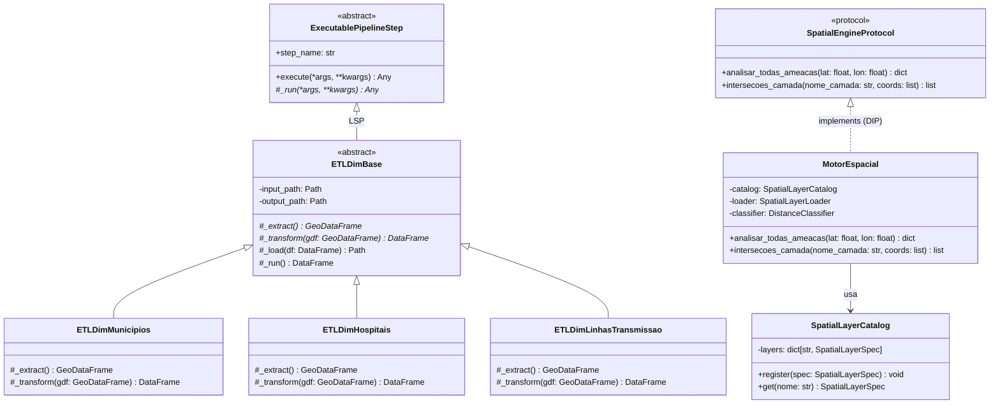

# Camada Silver (Conformed Dimensions & Spatial Engine) - CCO DataOps

A **Camada Silver** processa, higieniza e conforma os dados brutos da Camada Bronze em **Dimensões Espaciais Padronizadas** e fornece o **Motor Espacial de Alta Performance** (*Spatial Engine*) para enriquecimento analítico das Tabelas Fato na Camada Gold.

---

## 1. Responsabilidades da Camada Silver

1. **Conformação de Dimensões (Modelo Snowflake)**:
   - Converte os dados brutos heterogêneos da Bronze em 7 dimensões analíticas em formato CSV delimitado, indexadas por chaves primárias numéricas/mnemônicas limpas (sem nulos ou duplicatas).
   - Elimina redundâncias semânticas e prepara tabelas otimizadas para serem carregadas como *Lookups* em memória RAM no Apache Druid.
2. **Normalização Geodésica e Métrica**:
   - Reprojeção de coordenadas geográficas nativas (`EPSG:4326`) para o sistema de coordenadas métricas oficial brasileiro **SIRGAS 2000 Brasil Policônica (`EPSG:5880`)**.
   - Permite o cálculo exato de distâncias euclidianas em quilômetros (`km`) e áreas em quilômetros quadrados (`km²`), superando distorções de graus decimais.
3. **Indexação Espacial Vetorial (*R-Tree / STRtree*)**:
   - Constrói árvores de indexação espacial em memória sobre as geometrias das infraestruturas críticas, reduzindo a busca de vizinhos mais próximos e junções ponto-polígono (*Point-in-Polygon*) de custo linear $O(N)$ para ordem logarítmica $O(\log N)$.
4. **Serialização Web Deck.gl (`path_json`)**:
   - Converte polígonos e traçados complexos em cadeias JSON compactas (`path_json`), viabilizando a renderização imediata de geometrias nos gráficos vetoriais do Apache Superset sem custo de decodificação no navegador.

---

## 2. Estrutura de Diretórios da Camada

```text
src/silver/
├── README.md              # Este guia geral da Camada Silver
├── DICIONARIO_DADOS.md    # Especificação física detalhada das 7 tabelas de dimensão
├── data/
│   └── dimensions/        # Diretório de saída dos arquivos CSV de dimensão conformados
├── etl/                   # Módulos POO de ETL das 7 Dimensões
│   ├── base_etl_dim.py                   # Classe base abstrata ETLDimBase (Template Method)
│   ├── etl_dim_municipios.py             # Dimensão de Municípios
│   ├── etl_dim_hospitais.py              # Dimensão de Hospitais CNES
│   ├── etl_dim_terras_indigenas.py       # Dimensão de Terras Indígenas FUNAI
│   ├── etl_dim_ons_linhas_transmissao.py # Dimensão de Linhas de Transmissão ONS
│   ├── etl_dim_ons_subestacoes.py        # Dimensão de Subestações ONS
│   ├── etl_dim_ons_sistemas_isolados.py  # Dimensão de Sistemas Isolados ONS
│   ├── etl_dim_rodovias_federais.py      # Dimensão de Rodovias Federais DNIT
│   └── run_etl.py                        # Orquestrador sequencial CLI da Silver
├── spatial/               # Motor Espacial Segregado (Princípios SOLID)
│   ├── spatial_layer_spec.py             # Especificação imutável de camadas (SRP)
│   ├── spatial_layer_loader.py           # Carregamento e reprojeção métrica (SRP)
│   ├── spatial_layer_catalog.py          # Catálogo e registro de infraestruturas (OCP)
│   ├── distance_classifier.py            # Faixas de proximidade e scores de ameaça (SRP)
│   └── motor_espacial.py                 # Engine de consulta com STRtree (DIP/ISP)
├── lookups/               # Serviço de registro de Lookups URI no Apache Druid
│   └── druid_lookup_registrar.py         # DruidLookupRegistrar (file:// cachedNamespace)
├── validators/            # Validadores de integridade referencial (QA)
│   └── valida_joins_municipios_hospital.py
├── utils/                 # Utilitários puros de geometria, CRS e string
│   └── path_json_codec.py # Codificador de geometrias Shapely para formato JSON
└── tests/                 # Suíte de testes unitários e de integração
```

---

## 3. Arquitetura de Software e Classes (POO & SOLID)

### 3.1 Diagrama de Classes: ETL de Dimensões e Motor Espacial



---

## 4. Diagrama de Fluxo: Processamento Espacial e Geração de Dimensões

```mermaid
flowchart TD
    subgraph BRONZE [Insumos Brutos (Bronze)]
        raw_geojson[Arquivos GeoJSON / CSV Brutos]
    end

    subgraph SILVER_ETL [Processamento de Dimensões (Silver)]
        extract[Extração e Limpeza Primária]
        reproject[Reprojeção Métrica: EPSG 5880]
        sjoin[Junções Espaciais: Overlay / Nearest]
        path_gen[Serialização path_json]
        save_csv[Persistência em dim_*.csv]

        raw_geojson --> extract
        extract --> reproject
        reproject --> sjoin
        sjoin --> path_gen
        path_gen --> save_csv
    end

    subgraph SPATIAL_ENGINE [Motor Espacial em Tempo Real]
        strtree[(Indexação STRtree em Memória)]
        query[Consulta de Coordenada lat/lon]
        calc_dist[Cálculo de Distâncias Euclidianas km]
        threat[Classificação de Nível de Ameaça]

        save_csv --> strtree
        query --> strtree
        strtree --> calc_dist
        calc_dist --> threat
    end

    subgraph GOLD_STREAMING [Consumidores Camada Gold]
        fatos[FocoFatoPayload / EventoFatoPayload]
        threat --> fatos
    end
```

---

## 5. Guia Operacional de Execução

### 5.1 Execução de Toda a Carga Dimensional Silver
Para processar e regerar as 7 tabelas de dimensão de forma sequencial com validação automática:
```bash
uv run python src/silver/etl/run_etl.py
```

### 5.2 Validação de Integridade Referencial (QA)
Para executar os validadores de integridade referencial entre municípios e hospitais:
```bash
uv run python src/silver/validators/valida_joins_municipios_hospital.py
```

### 5.3 Execução de Testes Unitários da Camada Silver
Para verificar a conformidade dos contratos matemáticos e comportamentais do motor espacial:
```bash
uv run pytest src/silver/tests
```

---

## 6. Documento Complementar da Camada Silver

Para consultar as colunas exatas, tipos de dados, chaves primárias e relacionamentos das 7 tabelas conformadas, acesse:
- 📊 [**DICIONARIO_DADOS.md**](DICIONARIO_DADOS.md): Especificação completa dos esquemas dimensionais da Camada Silver.
