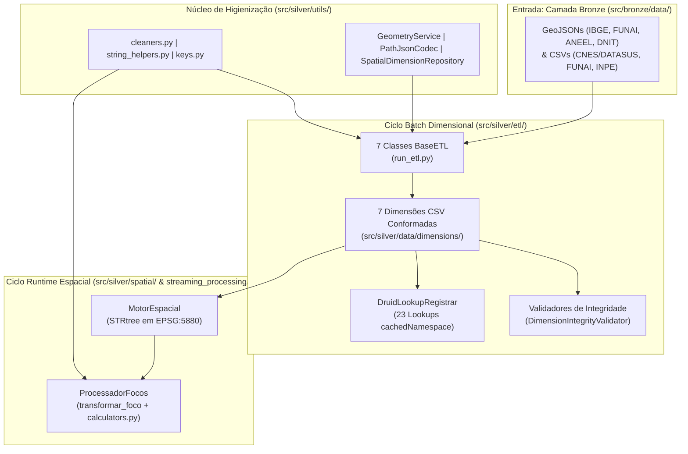

# Especificação Técnica: Camada Silver — Conformação Dimensional e Motor Espacial (`src/silver/`)

> **Trilha Modular — Etapa 05 de 18 (Ciclos 2 e 3 — Hub da Camada Silver (`src/silver/`))**: [Anterior: Ciclo 1.3 — Dicionário de Dados Brutos (`src/bronze/`)](../bronze/DICIONARIO_DADOS.md) | [Portal Geral (`docs/README.md`)](../../docs/README.md) | [Próximo: Ciclo 2.1 — Utilitários de Limpeza e Geometria (`src/silver/utils/`)](utils/README.md)

A Camada Silver executa a higienização sintática/topológica dos dados brutos da Camada Bronze, a conformação das 7 tabelas de dimensão do modelo **Snowflake**, a auditoria de integridade referencial, o registro de Lookups em memória no Apache Druid e o provimento do motor de indexação espacial (`STRtree` em projeção métrica `EPSG:5880`) para enriquecimento de eventos de queimada.

---

## 1. Documentação Específica por Submódulo da Camada Silver

Cada ciclo interno da Camada Silver possui um documento de especificação técnica dedicado:

| Submódulo | Escopo Técnico | Documento de Especificação |
|:---|:---|:---|
| **`src/silver/utils/`** | Funções puras de limpeza (`cleaners.py`, `keys.py`, `string_helpers.py`), geometria (`GeometryService`), codec `PathJsonCodec` e classe base `BaseETL`. | [**Especificação de Utilitários e Funções de Limpeza (`utils/README.md`)**](utils/README.md) |
| **`src/silver/etl/`** | Pipelines ETL das 7 dimensões (`ETLDimMunicipios`, `ETLDimHospitais`, `ETLDimTerrasIndigenas`, `ETLDimLinhasTransmissao`, `ETLDimSubestacoes`, `ETLDimSistemasIsolados`, `ETLDimRodoviasFederais`). | [**Especificação dos 7 Pipelines ETL (`etl/README.md`)**](etl/README.md) |
| **`src/silver/data/dimensions/`** | Esquemas físicos, tipos, contagens de linhas e relacionamentos das 7 tabelas CSV geradas. | [**Dicionário de Dados Dimensional (`DICIONARIO_DADOS.md`)**](DICIONARIO_DADOS.md) |
| **`src/silver/validators/` & `lookups/`** | Auditoria de unicidade de PK e integridade de FK (`DimensionIntegrityValidator`, `HospitalMunicipioJoinValidator`) e publicação dos 23 Lookups URI no Apache Druid (`DruidLookupRegistrar`). | [**Especificação de Validadores e Lookups Druid (`validators/README.md`)**](validators/README.md) |
| **`src/silver/spatial/`** | Indexação espacial R-Tree (`STRtree`), reprojeção métrica SIRGAS 2000 (`EPSG:5880`) e cálculo de distâncias euclidianas (`MotorEspacial`). | [**Especificação do Motor Espacial (`spatial/README.md`)**](spatial/README.md) |
| **`src/silver/streaming_processing/`** | Transformação unitária de focos (`transformar_foco`), extração de timestamps/coordenadas e equações matemáticas de índices de ameaça (`calculators.py`). | [**Especificação de Processamento e Índices (`streaming_processing/README.md`)**](streaming_processing/README.md) |

---

## 2. Arquitetura e Fluxo Integrado da Camada Silver



---

## 3. Estrutura Física de Diretórios (`src/silver/`)

```text
src/silver/
├── README.md                  # Especificação arquitetural geral da Camada Silver
├── DICIONARIO_DADOS.md        # Dicionário de dados das 7 tabelas de dimensão
├── data/
│   └── dimensions/            # Arquivos CSV conformados para Lookups Druid e MotorEspacial
├── utils/                     # Funções puras de limpeza, chaves, geometria e codec path_json
│   ├── README.md
│   ├── base.py                # Classe abstrata BaseETL(ExecutablePipelineStep)
│   ├── cleaners.py            # Limpeza numérica, sentinelas INPE (-999) e texto ASCII Druid
│   ├── df_helpers.py          # Validação WGS84 global e persistência CSV UTF-8
│   ├── geo_helpers.py         # GeometryService (CRS, simplificação LineString, coordenadas CNES)
│   ├── keys.py                # DimensionalKeyNormalizer (IBGE 6/7d, CNES, TI, UF)
│   ├── path_json_codec.py     # PathJsonCodec (Shapely <-> JSON Deck.gl)
│   ├── spatial_dimensions.py  # SpatialDimensionRepository (malhas IBGE e FUNAI)
│   └── string_helpers.py      # Extração regex de HTML PopupInfo da ANEEL/ONS
├── etl/                       # Pipelines de conformação das 7 dimensões
│   ├── README.md
│   ├── etl_dim_municipios.py
│   ├── etl_dim_hospitais.py
│   ├── etl_dim_terras_indigenas.py
│   ├── etl_dim_ons_linhas_transmissao.py
│   ├── etl_dim_ons_subestacoes.py
│   ├── etl_dim_ons_sistemas_isolados.py
│   ├── etl_dim_rodovias_federais.py
│   └── run_etl.py             # SilverETLOrchestrator
├── spatial/                   # Motor de indexação e consulta espacial em memória
│   ├── README.md
│   ├── spatial_layer_spec.py
│   ├── spatial_layer_catalog.py
│   ├── spatial_layer_loader.py
│   ├── distance_classifier.py
│   ├── layers.py
│   └── motor_espacial.py
├── streaming_processing/      # Enriquecimento linha a linha e cálculo de índices de ameaça
│   ├── processador.py
│   └── processors/
│       ├── extractor.py
│       └── calculators.py
├── lookups/                   # Registro de Lookups URI no Apache Druid Coordinator
│   └── druid_lookup_registrar.py
├── validators/                # Auditoria de QA de chaves primárias e estrangeiras
│   ├── README.md
│   ├── dimensao_integridade_validator.py
│   └── valida_joins_municipios_hospital.py
└── tests/                     # Suíte de testes unitários e de integração da Camada Silver
```

---

## 4. Execução Operacional da Camada Silver

Todos os comandos devem ser executados a partir da raiz do projeto via gerenciador `uv`:

```bash
# 1. Executar o ciclo completo das 7 dimensões em sequência determinística
uv run python src/silver/etl/run_etl.py

# 2. Executar o validador de integridade Hospital x Município
uv run python src/silver/validators/valida_joins_municipios_hospital.py

# 3. Registrar os 23 Lookups URI no Apache Druid Coordinator
uv run python src/silver/lookups/druid_lookup_registrar.py

# 4. Executar a suíte de testes unitários e de integração da Camada Silver
uv run pytest src/silver/tests -v
```

---

> **Trilha Modular — Etapa 05 de 18 (Ciclos 2 e 3 — Hub da Camada Silver (`src/silver/`))**: [Anterior: Ciclo 1.3 — Dicionário de Dados Brutos (`src/bronze/`)](../bronze/DICIONARIO_DADOS.md) | [Portal Geral (`docs/README.md`)](../../docs/README.md) | [Próximo: Ciclo 2.1 — Utilitários de Limpeza e Geometria (`src/silver/utils/`)](utils/README.md)
