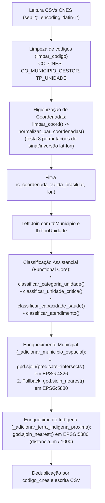
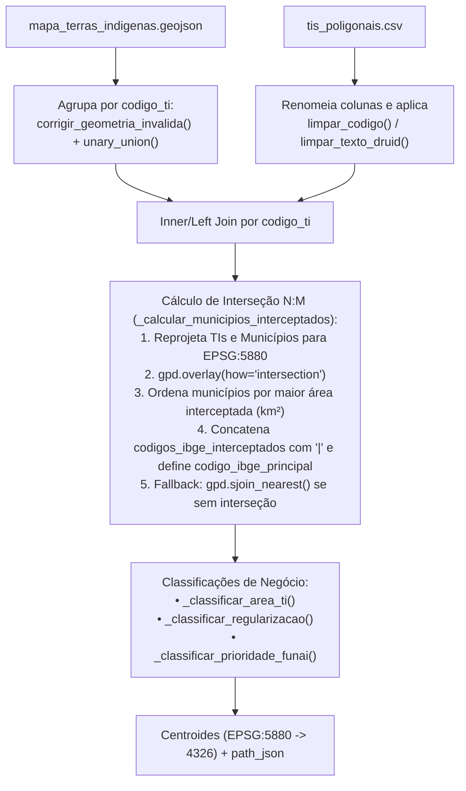

# Especificação Técnica: Ciclo de ETL das 7 Dimensões Conformadas (`src/silver/etl/`)

> **Trilha Modular — Etapa 07 de 18 (Ciclo 2.2 — Pipelines ETL das 7 Dimensões (`src/silver/etl/`))**: [Anterior: Ciclo 2.1 — Utilitários de Limpeza e Geometria (`src/silver/utils/`)](../utils/README.md) | [Portal Geral (`docs/README.md`)](../../../docs/README.md) | [Próximo: Ciclo 2.3 — Dicionário de Dados Dimensional (`src/silver/`)](../DICIONARIO_DADOS.md)

O pacote `src/silver/etl/` implementa os 7 pipelines de Extração, Transformação e Carga (ETL) responsáveis por converter os arquivos brutos da Camada Bronze nas tabelas de dimensão do modelo **Snowflake** (`src/silver/data/dimensions/*.csv`). Todas as classes herdam de [`BaseETL`](../utils/base.py) (`ExecutablePipelineStep`), operando sobre `GeoDataFrames` e aplicando as funções puras de limpeza de [`src/silver/utils/`](../utils/README.md).

---

## 1. Arquitetura e Modulação do Pacote ETL

```mermaid
flowchart TB
    subgraph Orchestrator ["Orquestrador Batch (src/silver/etl/run_etl.py)"]
        RUN["SilverETLOrchestrator<br>(Execução sequencial determinística)"]
    end

    subgraph Base ["Contrato Base (src/silver/utils/base.py)"]
        BASE_ETL["BaseETL(ExecutablePipelineStep)<br>extract() -> garantir_crs_4326() -> transform() -> salvar_csv()"]
    end

    subgraph Pipelines ["Pipelines de Dimensão (src/silver/etl/)"]
        P_MUN["1. etl_dim_municipios.py<br>ETLDimMunicipios"]
        P_TI["2. etl_dim_terras_indigenas.py<br>ETLDimTerrasIndigenas"]
        P_HOSP["3. etl_dim_hospitais.py<br>ETLDimHospitais"]
        P_LT["4. etl_dim_ons_linhas_transmissao.py<br>ETLDimLinhasTransmissao"]
        P_SUB["5. etl_dim_ons_subestacoes.py<br>ETLDimSubestacoes"]
        P_SIS["6. etl_dim_ons_sistemas_isolados.py<br>ETLDimSistemasIsolados"]
        P_ROD["7. etl_dim_rodovias_federais.py<br>ETLDimRodoviasFederais"]
    end

    RUN --> P_MUN
    RUN --> P_TI
    RUN --> P_HOSP
    RUN --> P_LT
    RUN --> P_SUB
    RUN --> P_SIS
    RUN --> P_ROD

    BASE_ETL <|-- P_MUN
    BASE_ETL <|-- P_TI
    BASE_ETL <|-- P_HOSP
    BASE_ETL <|-- P_LT
    BASE_ETL <|-- P_SUB
    BASE_ETL <|-- P_SIS
    BASE_ETL <|-- P_ROD

    P_MUN -. "Fornece malha IBGE para sjoin/overlay" .-> P_TI
    P_MUN -. "Fornece malha IBGE para sjoin" .-> P_HOSP
    P_MUN -. "Fornece malha IBGE para sjoin" .-> P_SUB
    P_MUN -. "Fornece malha IBGE para sjoin" .-> P_SIS
    P_TI -. "Fornece malha FUNAI para sjoin_nearest" .-> P_HOSP
```

---

## 2. Detalhamento Técnico por Pipeline de Dimensão

### 2.1 Dimensão de Municípios (`ETLDimMunicipios` — [`etl_dim_municipios.py`](etl_dim_municipios.py))
* **Entrada:** `src/bronze/data/ibge/municipios_br.geojson` (5.564 polígonos).
* **Saída:** `src/silver/data/dimensions/dim_municipios_coordenadas.csv` (10 colunas).

#### Fluxo de Transformação e Regras de Limpeza
1. **Extração de Códigos IBGE (`_validar_codigo_ibge`)**:
   - Extrai a propriedade `id` para `codigo_ibge_7digitos` (`str` de 7 dígitos).
   - Deriva `codigo_ibge` truncando os **6 primeiros caracteres** (`str[:6]`), omitindo o dígito verificador para permitir junção relacional 1:N direta com o campo `CO_MUNICIPIO_GESTOR` do DATASUS/CNES.
   - Deriva o prefixo estadual `cod_estado` a partir dos **2 primeiros dígitos** (`str[:2]`).
2. **Mapeamento Regional Estático**:
   - Resolve `estado_nome`, `estado_sigla` e `regiao_brasil` (`NORTE`, `NORDESTE`, `SUDESTE`, `SUL`, `CENTRO-OESTE`) aplicando `.map()` sobre os dicionários `MAPA_ESTADOS_NOME`, `MAPA_ESTADOS_SIGLA` e `MAPA_REGIAO`.
3. **Higienização Textual e Chave Composta**:
   - Aplica `limpar_texto_druid(gdf["name"])` para gerar `municipios_nome`.
   - Constrói a chave candidata `chave_localidade = estado_nome + "_" + municipios_nome` (ex.: `"TOCANTINS_FORMOSO DO ARAGUAIA"`), utilizada para vincular registros nominais do INPE.
4. **Correção Topológica e Serialização Geométrica**:
   - Aplica `gdf.geometry.buffer(0)` para eliminar auto-intersecções de anéis poligonais.
   - Calcula os centroides em projeção métrica `EPSG:5880` via `adicionar_centroides(gdf)` e converte os polígonos em arrays JSON `[lon, lat]` via `geometry_para_path_json`.
   - Filtra `codigo_ibge` com comprimento estrito de 6 caracteres e aplica `drop_duplicates(subset=["codigo_ibge"])`.

---

### 2.2 Dimensão de Hospitais e Unidades de Saúde (`ETLDimHospitais` — [`etl_dim_hospitais.py`](etl_dim_hospitais.py))
* **Entradas:**
  - `src/bronze/data/datasus/cnes_aux/tbEstabelecimento202603.csv`
  - `src/bronze/data/datasus/cnes_aux/tbMunicipio202603.csv`
  - `src/bronze/data/datasus/cnes_aux/tbTipoUnidade202603.csv`
  - Malhas de referência: `municipios_br.geojson` (IBGE) e `mapa_terras_indigenas.geojson` (FUNAI).
* **Saída:** `src/silver/data/dimensions/dim_hospitais_cnes.csv` (550.882 registros, 15 colunas).



#### Funções Puras de Classificação Assistencial (`etl_dim_hospitais.py`)

| Função | Assinatura | Regras e Domínio de Saída |
|:---|:---|:---|
| `limpar_coord` | `(valor: object) -> float \| None` | Substitui `,` por `.` e converte para `float`, retornando `None` se `pd.isna(valor)` ou inválido. |
| `classificar_categoria_unidade` | `(codigo_tipo: object, tipo_unidade: object) -> str` | Mapeia `TP_UNIDADE` do CNES em 9 categorias táticas:<br>• `{"05","07","15","20","21","61","62","73"}` ou `"HOSPITAL"`/`"PRONTO"` no nome $\rightarrow$ `"HOSPITAL_URGENCIA_EMERGENCIA"`<br>• `{"01","02","71","72"}` $\rightarrow$ `"ATENCAO_BASICA"`<br>• `{"39","67","80"}` $\rightarrow$ `"APOIO_DIAGNOSTICO_LABORATORIAL"`<br>• `{"64","68","76","81","82","84"}` $\rightarrow$ `"REGULACAO_GESTAO"`<br>• `{"32","40","42"}` $\rightarrow$ `"UNIDADE_MOVEL"`<br>• `{"50","85","83"}` $\rightarrow$ `"VIGILANCIA_IMUNIZACAO"`<br>• `{"04","22","36","77","78","79"}` $\rightarrow$ `"CONSULTORIO_ESPECIALIDADE"`<br>• `{"43"}` $\rightarrow$ `"FARMACIA"`<br>• `"SAUDE INDIGENA"` no texto $\rightarrow$ `"SAUDE_INDIGENA"` (demais: `"OUTROS"`). |
| `classificar_unidade_critica` | `(categoria: str, funciona_24h: str) -> str` | Retorna `"SIM"` se `categoria in {"HOSPITAL_URGENCIA_EMERGENCIA", "UNIDADE_MOVEL", "SAUDE_INDIGENA"}` ou `funciona_24h == "S"`; caso contrário `"NAO"`. |
| `classificar_capacidade_saude` | `(categoria: str, funciona_24h: str) -> str` | • Hospital + 24h $\rightarrow$ `"ALTA_CAPACIDADE"`<br>• Hospital sem 24h $\rightarrow$ `"MEDIA_CAPACIDADE"`<br>• Unidade Móvel $\rightarrow$ `"RESPOSTA_MOVEL"`<br>• Saúde Indígena $\rightarrow$ `"SAUDE_INDIGENA"`<br>• Atenção Básica $\rightarrow$ `"ATENCAO_LOCAL"` (demais: `"SUPORTE"`). |
| `classificar_atendimento` | `(categoria: str, funciona_24h: str) -> str` | Retornos: `"CRITICO_24H"`, `"CRITICO"`, `"MOBILIDADE_ASSISTENCIAL"`, `"SAUDE_INDIGENA"`, `"ATENCAO_LOCAL"` ou `"SUPORTE"`. |

---

### 2.3 Dimensão de Terras Indígenas (`ETLDimTerrasIndigenas` — [`etl_dim_terras_indigenas.py`](etl_dim_terras_indigenas.py))
* **Entradas:** `mapa_terras_indigenas.geojson`, `tis_poligonais.csv` e `municipios_br.geojson`.
* **Saída:** `src/silver/data/dimensions/dim_terras_indigenas.csv` (650 registros, 18 colunas).



#### Regras de Classificação de `ETLDimTerrasIndigenas`
- **`_classificar_area_ti(area_hectares)`**: $\ge 1.000.000\text{ ha}$ $\rightarrow$ `"MUITO_GRANDE"`; $\ge 100.000\text{ ha}$ $\rightarrow$ `"GRANDE"`; $\ge 10.000\text{ ha}$ $\rightarrow$ `"MEDIA"`; $> 0$ $\rightarrow$ `"PEQUENA"`.
- **`_classificar_prioridade_funai(estagio, fronteira, area_ha)`**:
  - `"ALTA_PRIORIDADE"` se (`em_faixa_fronteira == "SIM"` e `area_ha >= 100.000`) ou se `estagio_regularizacao != "REGULARIZADA"` (terras ainda em litígio/demarcação).
  - `"MEDIA_PRIORIDADE"` se `area_ha >= 100.000`.
  - `"MONITORAMENTO"` nos demais casos.

---

### 2.4 Dimensão de Linhas de Transmissão ONS (`ETLDimLinhasTransmissao` — [`etl_dim_ons_linhas_transmissao.py`](etl_dim_ons_linhas_transmissao.py))
* **Entrada:** `src/bronze/data/aneel/linhas_transmissao_ons.geojson` (1.817 feições).
* **Saída:** `src/silver/data/dimensions/dim_ons_linhas_transmissao.csv` (1.817 registros, 11 colunas).

#### Funções de Extração e Classificação de `ETLDimLinhasTransmissao`
- **`_extrair_numero_texto(texto)`**: Converte notação ANEEL `"13P8"` em `"13.8"` via `re.sub(r"(\d+)P(\d+)", r"\1.\2", t)` e extrai o primeiro float via regex `r"(\d+(?:\.\d+)?)"`.
- **`_extrair_tensao_popup_ou_nome(row)`**: Busca o rótulo `"Tensão"` em `PopupInfo` via `extrair_popup_valor()`. Se retornar `0.0`, faz fallback aplicando regex `r"LT\s+(\d+(?:\.\d+)?)\s*KV"` sobre o campo `Name`.
- **`_extrair_extensao_popup(row)`**: Extrai o valor numérico do rótulo `"Extensão"` em `PopupInfo`.
- **`_montar_nome_linha_visual(row)`**: Detecta se o campo `Name` contém apenas um código técnico opaco (`re.fullmatch(r"[A-Z]{3,8}-?[A-Z0-9]{4,12}", t)`) ou está vazio; nesses casos, sintetiza o rótulo legível `"LINHA LT {tensao} KV SEM_NOME OID {id}"`.
- **Tabelas de Limiares Elétricos**:
  - `_classificar_tensao(tensao_kv)`: $\ge 500\text{ kV} \rightarrow \text{"EXTRA\_ALTA"}$; $\ge 230\text{ kV} \rightarrow \text{"ALTA"}$; $\ge 69\text{ kV} \rightarrow \text{"MEDIA"}$; $> 0 \rightarrow \text{"BAIXA"}$.
  - `_classificar_extensao(extensao_km)`: $\ge 200\text{ km} \rightarrow \text{"MUITO\_LONGA"}$; $\ge 50\text{ km} \rightarrow \text{"LONGA"}$; $\ge 10\text{ km} \rightarrow \text{"MEDIA"}$; $> 0 \rightarrow \text{"CURTA"}$.
  - `_classificar_criticidade_linha(tensao_kv, extensao_km)`: $\ge 500\text{ kV} \rightarrow \text{"CRITICA"}$; ($\ge 230\text{ kV}$ e $\ge 50\text{ km}$) $\rightarrow \text{"ALTA"}$; $\ge 230\text{ kV} \rightarrow \text{"MEDIA\_ALTA"}$; $\ge 69\text{ kV} \rightarrow \text{"MEDIA"}$.
- **Higienização Topológica**: Aplica `limpar_linestring_geometry` para remover ciclos KML duplicados antes de gerar `path_json` e centroides.

---

### 2.5 Dimensão de Subestações ONS (`ETLDimSubestacoes` — [`etl_dim_ons_subestacoes.py`](etl_dim_ons_subestacoes.py))
* **Entrada:** `src/bronze/data/aneel/subestacoes_ons.geojson` (627 feições `Point`).
* **Saída:** `src/silver/data/dimensions/dim_ons_subestacoes.csv` (627 registros, 10 colunas base + 3 colunas enriquecidas pelo modelo de grafos NetworkX na Camada Gold).

#### Funções e Regras de Transformação
- **`_normalizar_nome(row)`**: Extrai `"Nome"` do `PopupInfo` e prefixa com `"SUBESTACAO "`, fazendo fallback para o campo `Name`.
- **`_normalizar_agente(row)`**: Extrai o rótulo `"Agente"` (concessionária) do `PopupInfo`.
- **Extração de Potência (`capacidade_mw`)**: Extrai o rótulo `"Capacidade"` do `PopupInfo` via `limpar_numero()`.
- **Classificação de Porte e Criticidade**:
  - `_classificar_capacidade(mw)`: $\ge 2000\text{ MW} \rightarrow \text{"EXTREMA"}$; $\ge 1000\text{ MW} \rightarrow \text{"MUITO\_ALTA"}$; $\ge 300\text{ MW} \rightarrow \text{"ALTA"}$; $\ge 100\text{ MW} \rightarrow \text{"MEDIA"}$; $> 0 \rightarrow \text{"BAIXA"}$.
  - `_classificar_criticidade(mw)`: $\ge 1000\text{ MW} \rightarrow \text{"CRITICA"}$; $\ge 300\text{ MW} \rightarrow \text{"ALTA"}$; $\ge 100\text{ MW} \rightarrow \text{"MEDIA"}$; $> 0 \rightarrow \text{"BAIXA"}$.
- **`_resolver_municipio(gdf)`**: Executa `gpd.sjoin(predicate="intersects")` contra `carregar_municipios_geo()` para atribuir `codigo_ibge` (6 dígitos).

---

### 2.6 Dimensão de Sistemas Isolados ONS (`ETLDimSistemasIsolados` — [`etl_dim_ons_sistemas_isolados.py`](etl_dim_ons_sistemas_isolados.py))
* **Entrada:** `src/bronze/data/aneel/sistemas_isolados_ons.geojson` (120 feições `Point`).
* **Saída:** `src/silver/data/dimensions/dim_ons_sistemas_isolados.csv` (120 registros, 9 colunas).

#### Funções e Regras de Transformação
- **`_extrair_nome_sistema(row)`**: Higieniza `Name` ou extrai o prefixo antes do hífen em `PopupInfo` (`"Afuá - PA"` $\rightarrow$ `"AFUA"`).
- **`_extrair_estado_sistema(row)`**: Extrai a sigla da UF via `extrair_uf_popup()` a partir de `PopupInfo` ou `Name`.
- **`_classificar_regiao_eletrica(uf)`**: Classifica estados pertencentes a `{"AC", "AM", "AP", "MA", "MT", "PA", "RO", "RR", "TO"}` como `"AMAZONIA_LEGAL"` e os demais como `"OUTRAS_REGIOES"`.
- **`_classificar_prioridade_sistema(uf)`**: Atribui `"ALTA_PRIORIDADE"` para estados do núcleo amazônico (`AM`, `PA`, `AC`, `AP`, `RO`, `RR`) dependentes de logística fluvial de combustível térmico, e `"MEDIA_PRIORIDADE"` para estados de transição (`MT`, `MA`, `TO`).
- **`_resolver_municipio(gdf)`**: Atribui `codigo_ibge` via `gpd.sjoin(predicate="intersects")`.

---

### 2.7 Dimensão de Rodovias Federais DNIT (`ETLDimRodoviasFederais` — [`etl_dim_rodovias_federais.py`](etl_dim_rodovias_federais.py))
* **Entrada:** `src/bronze/data/dnit/mapa_rodovias_federais.geojson` (14.255 feições `LineString`).
* **Saída:** `src/silver/data/dimensions/dim_rodovias_federais.csv` (14.255 registros, 11 colunas).

#### Funções e Regras de Transformação
- **Geração de Chave Primária Determinística (`_gerar_id_trecho_unico`)**:
  - Como segmentos distintos do SNV podem compartilhar o mesmo `id_trecho_rodoviario` bruto após cortes estaduais, o método constrói a string `{id_origem}_{codigo_rodovia}_{jurisdicao}_{path_json}_{indice}` e calcula o hash MD5 truncado em 10 caracteres hexadecimais: `f"ROD_{hashlib.md5(base.encode('utf-8')).hexdigest()[:10]}"`.
- **`_normalizar_codigo_rodovia(valor)`**: Padroniza designações sem hífen (`"BR116"` $\rightarrow$ `"BR-116"`).
- **Classificações Logísticas**:
  - `_classificar_revestimento`: `"PAVIMENTADO"`, `"NAO_PAVIMENTADO"`, `"IMPLANTADO"`, `"OUTROS"`.
  - `_classificar_situacao`: `"CONSTRUIDA"`, `"PLANEJADA"`, `"EM_OBRAS"`, `"LEITO_NATURAL"`.
  - `_classificar_operacao`: `"OPERACIONAL"`, `"NAO_OPERACIONAL"`.
  - `_classificar_criticidade_rodovia`: Atribui `"ALTA_RELEVANCIA"` para trechos simultaneamente `OPERACIONAL` e `PAVIMENTADO`; `"MEDIA_RELEVANCIA"` para `OPERACIONAL` não pavimentado; e `"BAIXA_RELEVANCIA"` para trechos planejados ou em obras.

---

> **Trilha Modular — Etapa 07 de 18 (Ciclo 2.2 — Pipelines ETL das 7 Dimensões (`src/silver/etl/`))**: [Anterior: Ciclo 2.1 — Utilitários de Limpeza e Geometria (`src/silver/utils/`)](../utils/README.md) | [Portal Geral (`docs/README.md`)](../../../docs/README.md) | [Próximo: Ciclo 2.3 — Dicionário de Dados Dimensional (`src/silver/`)](../DICIONARIO_DADOS.md)
