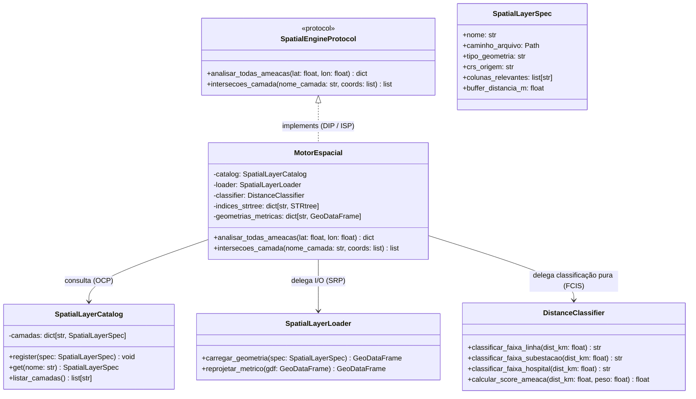

# Motor Espacial de Alta Performance (`src/silver/spatial/`) - CCO DataOps

O subpacote `src/silver/spatial/` abriga o **Motor Espacial Vetorial** (*Spatial Engine*) do projeto **CCO-DataOps**. Sua responsabilidade é fornecer cruzamentos geográficos de altíssima performance, consultas de proximidade a infraestruturas críticas e cálculo de índices de ameaça em **tempo sub-segundo ($< 2\text{ ms}$ por coordenada)** para alimentar o pipeline de streaming da Camada Gold.

O motor adota estritamente os princípios **SOLID** e a separação entre **Núcleo Funcional** (cálculo puro de distâncias e faixas de risco) e **Casca Orientada a Objetos** (gerenciamento em memória de índices R-Tree e buffers vetoriais).

---

## 🏗️ 1. Arquitetura de Classes e Componentes (SOLID)

O motor espacial foi decomposto em componentes com responsabilidade única (SRP):



### 1.1 Responsabilidades dos Componentes
1. **[`SpatialLayerSpec`](file:///c:/Users/SEPLAN/Documents/UNIFEI/UNIVERSIDADE/mapeamento-risco-queimadas-inpe/src/silver/spatial/spatial_layer_spec.py)**:
   - Dataclass imutável que especifica os metadados de uma camada (caminho em disco, tipo primitivo `Point`, `LineString` ou `Polygon`, CRS de origem e regras de buffer).
2. **[`SpatialLayerLoader`](file:///c:/Users/SEPLAN/Documents/UNIFEI/UNIVERSIDADE/mapeamento-risco-queimadas-inpe/src/silver/spatial/spatial_layer_loader.py)**:
   - Responsável exclusivo pela leitura física (usando `pyogrio` para máxima velocidade) e reprojeção de `EPSG:4326` para o sistema métrico oficial brasileiro `EPSG:5880`.
3. **[`SpatialLayerCatalog`](file:///c:/Users/SEPLAN/Documents/UNIFEI/UNIVERSIDADE/mapeamento-risco-queimadas-inpe/src/silver/spatial/spatial_layer_catalog.py)**:
   - Catálogo desacoplado de infraestruturas (Open/Closed Principle - OCP). Novas camadas (ex: gasodutos ou ferrovias) podem ser registradas via `register()` sem modificar o motor.
4. **[`DistanceClassifier`](file:///c:/Users/SEPLAN/Documents/UNIFEI/UNIVERSIDADE/mapeamento-risco-queimadas-inpe/src/silver/spatial/distance_classifier.py)**:
   - Núcleo funcional puro que converte distâncias euclidianas em faixas operacionais (`IMEDIATA`, `PROXIMA`, `ALERTA`, `SEGURA`) e normaliza scores de ameaça de 0 a 100.
5. **[`MotorEspacial`](file:///c:/Users/SEPLAN/Documents/UNIFEI/UNIVERSIDADE/mapeamento-risco-queimadas-inpe/src/silver/spatial/motor_espacial.py)**:
   - Orquestrador em memória que constrói árvores espaciais STRtree e resolve consultas atômicas para os produtores Kafka.

---

## 🗺️ 2. Sistemas de Coordenadas de Referência (CRS)

Para evitar erros clássicos de distorção de escala em análises geoespaciais, o motor adota uma regra rígida de dois níveis:

| Sistema de Coordenadas | Código EPSG | Finalidade no Ecossistema |
|:---|:---:|:---|
| **WGS84 Geográfico** | `EPSG:4326` | **Entrada e Saída**: Coordenadas brutas dos satélites orbitais (INPE), payloads JSON de mensageria Kafka e projeção de mapas táticos no Apache Superset (Deck.gl). |
| **SIRGAS 2000 Brasil Policônica** | `EPSG:5880` | **Processamento Interno**: Projeção cartográfica plana métrica oficial. Utilizada exclusivamente para cálculo exato de distâncias euclidianas em quilômetros (`km`), áreas em $km^2$ e geração de buffers sem distorção angular. |

> **Fluxo de Projeção**: O ponto $(lat, lon)$ chega em WGS84, é reprojetado pontualmente em memória para EPSG:5880, a distância em metros é extraída da árvore STRtree, convertida para quilômetros, e o resultado numérico é acoplado ao payload.

---

## ⚡ 3. Aceleração Vetorial: STRtree ($O(\log N)$)

Em pipelines de streaming com centenas de focos por segundo, calcular distâncias iterando linha a linha contra 5.564 municípios ou milhares de linhas elétricas teria custo linear $O(N)$, tornando o enriquecimento inviável.

O `MotorEspacial` utiliza o algoritmo **Sort-Tile-Recursive (STRtree)** da biblioteca Shapely (C/GEOS):
* **Indexação Hierárquica em Memória**: Na inicialização (*cold start* de ~5 segundos), todas as geometrias de infraestruturas são organizadas em uma árvore R-Tree multidimensional balanceada.
* **Busca do Vizinho Mais Próximo (*Nearest Neighbor*)**: A localização da subestação, hospital ou trecho rodoviário mais próximo de um foco é executada em **$O(\log N)$**.
* **Interseção Ponto-Polígono (*Point-in-Polygon*)**: A determinação do município gestor e da Terra Indígena sobreposta utiliza a árvore como filtro de envoltória (*bounding box filter*), testando a geometria exata apenas para candidatos pré-filtrados.
* **Performance Real**: Cada foco de incêndio tem suas 7 ameaças simultâneas calculadas em **$< 2\text{ milissegundos}$**.

---

## 🔒 4. Preservação do Modelo Snowflake

O método `MotorEspacial.analisar_todas_ameacas(lat, lon)` retorna **exclusivamente**:
1. **Chaves Estrangeiras (FKs)**: `fk_municipio`, `fk_subestacao`, `fk_linha_transmissao`, `fk_terra_indigena`, `fk_hospital_proximo`, `fk_trecho_rodoviario`.
2. **Métricas Físicas**: `distancia_linha_km`, `distancia_subestacao_km`, `distancia_hospital_km`, `distancia_ti_km`, `distancia_rodovia_km`.
3. **Índices de Ameaça**: `indice_ameaca_linha`, `indice_ameaca_subestacao`, etc.

Nenhum texto descritivo (nome do hospital, município ou etnia indígena) é gerado pelo motor, preservando a regra Snowflake do projeto.

---

## 🧪 5. Testabilidade com Mocks (DIP)

Por implementar [`SpatialEngineProtocol`](file:///c:/Users/SEPLAN/Documents/UNIFEI/UNIVERSIDADE/mapeamento-risco-queimadas-inpe/src/core/contracts/contracts.py), qualquer consumidor da Camada Gold pode ser testado unitariamente com um mock simples em memória sem instanciar árvores espaciais:

```python
class MockSpatialEngine(SpatialEngineProtocol):
    def analisar_todas_ameacas(self, lat: float, lon: float) -> dict[str, Any]:
        return {
            "fk_municipio": "355030",
            "distancia_linha_km": 1.5,
            "indice_ameaca_linha": 90.0,
            "fk_linha_transmissao": "LT_TESTE",
        }
```
Isso permite que testes da Camada Gold rodem em $< 50\text{ ms}$ no pytest.
