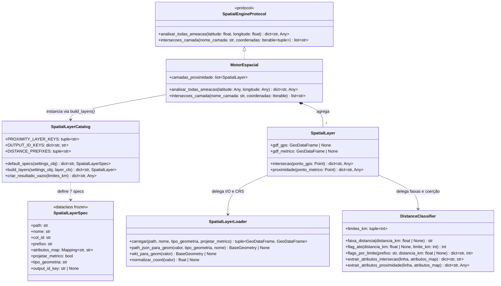
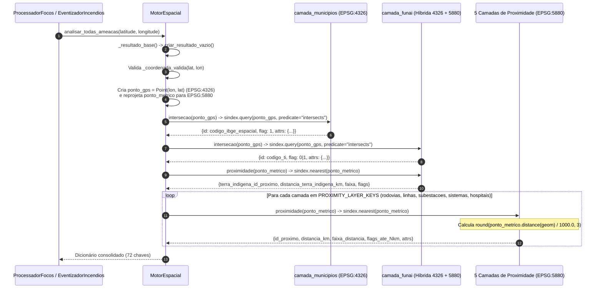

# Especificação Técnica: Motor de Indexação e Consulta Espacial (`src/silver/spatial/`)

> **Trilha Modular — Etapa 10 de 18 (Ciclo 3.1 — Motor Espacial STRtree em Memória (`src/silver/spatial/`))**: [Anterior: Ciclo 2.4 — Validadores de Qualidade e 23 Lookups URI (`src/silver/validators/`)](../validators/README.md) | [Portal Geral (`docs/README.md`)](../../../docs/README.md) | [Próximo: Ciclo 3.2 — Enriquecimento e Índices Matemáticos (`src/silver/streaming_processing/`)](../streaming_processing/README.md)

O pacote `src/silver/spatial/` implementa o motor geoespacial em memória (`MotorEspacial`), responsável por resolver junções topológicas ponto-em-polígono (`intersects`) e consultas de vizinho mais próximo (`nearest`) com cálculo de distância euclidiana exata na projeção métrica **SIRGAS 2000 / Brazil Polyconic (`EPSG:5880`)**.

---

## 1. Arquitetura e Modulação do Pacote Espacial

O design segrega o carregamento de arquivos, a definição declarativa das camadas, a discretização de distâncias e a execução das consultas sobre árvores espaciais R-Tree (`shapely.STRtree` via `GeoDataFrame.sindex`):

---

## 2. Ciclo de Vida: Inicialização de Índices R-Tree e Consulta Runtime

### 2.1 Pré-Aquecimento da Árvore Espacial (`SpatialLayerLoader.carregar`)
Para evitar que o custo de indexação ocorra durante o processamento de mensagens Kafka, o método `carregar()` reconstrói as geometrias a partir da coluna `path_json` (via `PathJsonCodec.path_json_para_geometry`), instancia o `GeoDataFrame` em `EPSG:4326` e acessa imediatamente a propriedade `_ = gdf_gps.sindex`, forçando a compilação em C (GEOS `STRtree`) da árvore espacial. Quando `projetar_metrico=True`, o `GeoDataFrame` é reprojetado para `EPSG:5880` (`gdf_gps.to_crs(epsg=5880)`) e sua árvore métrica `_ = gdf_metrico.sindex` também é pré-compilada em memória RAM.

### 2.2 Sequência de Consulta (`MotorEspacial.analisar_todas_ameacas`)

---

## 3. Especificação Declarativa das 7 Camadas (`SpatialLayerCatalog.default_specs`)

Definidas em [`spatial_layer_catalog.py`](spatial_layer_catalog.py), as 7 instâncias de [`SpatialLayerSpec`](spatial_layer_spec.py) configuram o comportamento de cada dimensão no motor:

| Chave da Camada | CSV Fonte (`settings`) | `col_id` (PK) | `prefixo` | `tipo_geometria` | `projetar_metrico` | `output_id_key` | Atributos Mapeados (`atributos_map`) |
|:---|:---|:---|:---|:---:|:---:|:---|:---|
| `camada_municipios` | `dim_municipios_coordenadas.csv` | `codigo_ibge` | `municipio_espacial` | `"polygon"` | `False` (apenas `intersects` em 4326) | `codigo_ibge_espacial` | `municipio_espacial_nome` $\leftarrow$ `municipios_nome` `municipio_espacial_estado` $\leftarrow$ `estado_sigla` `municipio_espacial_regiao` $\leftarrow$ `regiao_brasil` |
| `camada_funai` | `dim_terras_indigenas.csv` | `codigo_ti` | `terra_indigena` | `"polygon"` | `True` (`intersects` + `nearest`) | `codigo_ti_proxima` | `terra_indigena_nome` $\leftarrow$ `nome_terra_indigena` `terra_indigena_prioridade` $\leftarrow$ `prioridade_funai` `terra_indigena_classe_area` $\leftarrow$ `classe_area_ti` |
| `camada_rodovias` | `dim_rodovias_federais.csv` | `id_trecho_rodoviario` | `rodovia` | `"line"` | `True` (`nearest` em 5880) | `id_trecho_rodoviario` | `rodovia_codigo` $\leftarrow$ `codigo_rodovia` `rodovia_criticidade` $\leftarrow$ `criticidade_rodovia` `rodovia_classe_revestimento` $\leftarrow$ `classe_revestimento` |
| `camada_linhas` | `dim_ons_linhas_transmissao.csv` | `id_linha_transmissao` | `linha` | `"line"` | `True` (`nearest` em 5880) | `id_linha_transmissao` | `linha_nome` $\leftarrow$ `nome_linha` `linha_tensao_kv` $\leftarrow$ `tensao_kv` (`float`) `linha_classe_tensao` $\leftarrow$ `classe_tensao` `linha_criticidade` $\leftarrow$ `classe_criticidade_linha` |
| `camada_subestacoes` | `dim_ons_subestacoes.csv` | `id_subestacao` | `subestacao` | `"point"` | `True` (`nearest` em 5880) | `id_subestacao` | `subestacao_nome` $\leftarrow$ `nome_subestacao` `subestacao_capacidade_mw` $\leftarrow$ `capacidade_mw` (`float`) `subestacao_criticidade` $\leftarrow$ `criticidade_subestacao` |
| `camada_sistemas` | `dim_ons_sistemas_isolados.csv` | `id_sistema_isolado` | `sistema_isolado` | `"point"` | `True` (`nearest` em 5880) | `id_sistema_isolado` | `sistema_isolado_nome` $\leftarrow$ `nome_sistema_isolado` `sistema_isolado_prioridade` $\leftarrow$ `prioridade_sistema_isolado` |
| `camada_hospitais` | `dim_hospitais_cnes.csv` | `codigo_cnes` | `hospital` | `"point"` | `True` (`nearest` em 5880) | `codigo_cnes_prox` | `hospital_nome` $\leftarrow$ `nome_hospital` `hospital_categoria` $\leftarrow$ `categoria_unidade` `hospital_critico` $\leftarrow$ `tipo_unidade_critica` `hospital_funciona_24h` $\leftarrow$ `funciona_24h` `hospital_capacidade_classe` $\leftarrow$ `categoria_atendimento` |

---

## 4. Catálogo de Métodos e Funções do Pacote `src/silver/spatial/`

| Classe / Método | Assinatura | Especificação e Complexidade |
|:---|:---|:---|
| `SpatialLayerLoader.carregar` | `(self, path: str \| Path, nome: str, tipo_geometria: str = "point", projetar_metrico: bool = False) -> tuple[GeoDataFrame \| None, GeoDataFrame \| None]` | Lê o CSV dimensional com `dtype=str` e reconstrói a coluna `geometry` seguindo a ordem de precedência: 1º `path_json` via `PathJsonCodec`, 2º `geometria_wkt` via `shapely.wkt.loads`, 3º `points_from_xy(longitude, latitude)`. Compila `gdf_gps.sindex` (`EPSG:4326`) e opcionalmente `gdf_metrico.sindex` (`EPSG:5880`). |
| `DistanceClassifier.faixa_distancia` | `(distancia_km: float \| None) -> str` | Discretiza a distância métrica em 7 categorias: • `None` ou `< 0`: `"SEM_DISTANCIA"` • `<= 1`: `"ATE_1KM"` • `<= 3`: `"ATE_3KM"` • `<= 7`: `"ATE_7KM"` • `<= 15`: `"ATE_15KM"` • `<= 50`: `"ATE_50KM"` • `> 50`: `"ACIMA_50KM"` |
| `DistanceClassifier.flags_por_limite` | `(self, prefixo: str, distancia_km: float \| None) -> dict[str, int]` | Para cada limite $L \in (1, 3, 7, 15, 50)$, gera a chave `f"{prefixo}_ate_{L}km"` com valor `1` se $0 \le \text{distancia\_km} \le L$, ou `0` caso contrário. |
| `DistanceClassifier.extrair_atributos_proximidade` | `(cls, linha: Mapping, atributos_map: Mapping[str, str]) -> dict[str, Any]` | Extrai os atributos da feição mais próxima. Se o nome da chave de saída terminar em `"_kv"` (`linha_tensao_kv`) ou `"_mw"` (`subestacao_capacidade_mw`), converte o valor para `float | None` via `normalizar_float()`; para os demais campos, aplica `normalizar_texto()`. |
| `SpatialLayer.intersecao` | `(self, ponto_gps: Point) -> dict[str, Any]` | Executa `self.gdf_gps.sindex.query(ponto_gps, predicate="intersects")` em complexidade $O(\log N)$. Se houver colisão, retorna `{"id": PK, "flag": 1, "attrs": {...}}`; caso contrário, retorna `{"id": "NAO INFORMADO", "flag": 0, "attrs": {}}`. |
| `SpatialLayer.proximidade` | `(self, ponto_metrico: Point) -> dict[str, Any]` | Executa `gdf_alvo.sindex.nearest(ponto_metrico)[1][0]` em complexidade $O(\log N)$ sobre as geometrias em `EPSG:5880` e calcula a distância exata `round(ponto_metrico.distance(linha_alvo.geometry) / 1000.0, 3)`. |
| `MotorEspacial.intersecoes_camada` | `(self, nome_camada: str, coordenadas: Iterable[tuple[float, float]]) -> list[str]` | Itera sobre uma sequência de pares `(lat, lon)`, consulta `camada.intersecao(Point(lon, lat))` e retorna a lista de chaves primárias válidas interceptadas (utilizado pelo `EventizadorIncendios` para identificar todos os municípios e TIs cobertos por um cluster ST-DBSCAN). |
| `MotorEspacial.analisar_todas_ameacas` | `(self, latitude: Any, longitude: Any) -> dict[str, Any]` | Executa a varredura completa das 7 camadas para um ponto `(latitude, longitude)`, retornando um dicionário padronizado de 72 chaves (chaves estrangeiras, distâncias em km, faixas categóricas, 30 flags binárias `_ate_Nkm` e atributos técnicos como `linha_tensao_kv` e `subestacao_capacidade_mw`). |

---

> **Trilha Modular — Etapa 10 de 18 (Ciclo 3.1 — Motor Espacial STRtree em Memória (`src/silver/spatial/`))**: [Anterior: Ciclo 2.4 — Validadores de Qualidade e 23 Lookups URI (`src/silver/validators/`)](../validators/README.md) | [Portal Geral (`docs/README.md`)](../../../docs/README.md) | [Próximo: Ciclo 3.2 — Enriquecimento e Índices Matemáticos (`src/silver/streaming_processing/`)](../streaming_processing/README.md)
