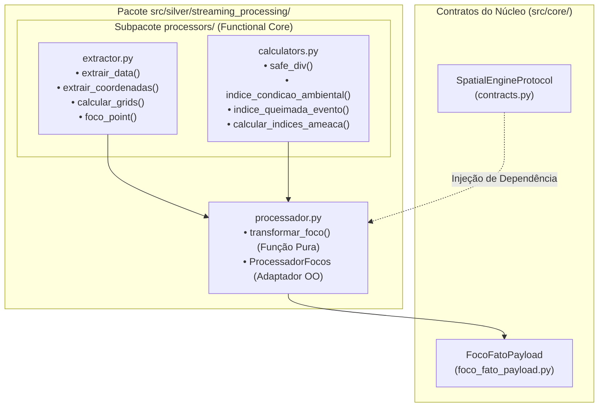
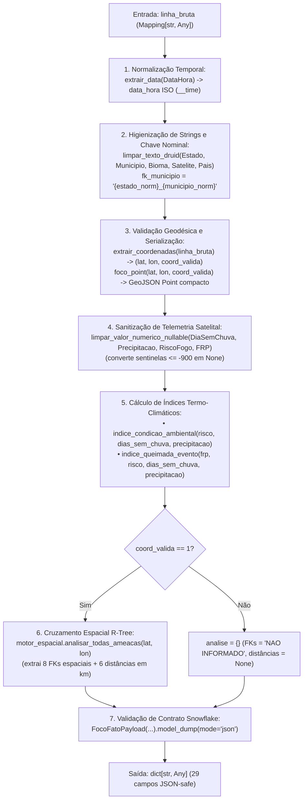

# Especificação Técnica: Ciclo de Processamento e Enriquecimento de Focos (`src/silver/streaming_processing/`)

> **Trilha Modular — Etapa 11 de 18 (Ciclo 3.2 — Enriquecimento e Índices Matemáticos (`src/silver/streaming_processing/`))**: [Anterior: Ciclo 3.1 — Motor Espacial STRtree em Memória (`src/silver/spatial/`)](../spatial/README.md) | [Portal Geral (`docs/README.md`)](../../../docs/README.md) | [Próximo: Ciclo 4 — Hub da Camada Gold (`src/gold/`)](../../gold/README.md)

O pacote `src/silver/streaming_processing/` implementa o núcleo de transformação e cálculo matemático de índices de severidade e ameaça territorial para leituras satelitais de focos de calor. Estruturado no padrão *Functional Core / Imperative Shell*, converte registros brutos do INPE em dicionários JSON estritamente validados pelo contrato [`FocoFatoPayload`](../../core/domain/foco_fato_payload.py) e fornece as equações de pressão utilizadas pelo agregador ST-DBSCAN na Camada Gold.

---

## 1. Arquitetura e Modulação do Pacote

---

## 2. Fluxo de Transformação de Registro Atômico (`transformar_foco`)

A função pura `transformar_foco(linha_bruta, motor_espacial, ...)` executa o pipeline completo de higienização, enriquecimento espacial e validação de schema para uma linha do CSV do INPE:

---

## 3. Catálogo de Funções de Extração e Formatação ([`processors/extractor.py`](processors/extractor.py))

| Função | Assinatura | Comportamento Técnico e Regras de Domínio |
|:---|:---|:---|
| `extrair_data` | `(valor_data: Any) -> dict[str, Any]` | Converte `valor_data` com `pd.to_datetime(valor_data, errors="coerce")`. Se válido (`pd.notna`), retorna dicionário contendo `data_hora` (`"%Y-%m-%d %H:%M:%S"`), `data_dia` (`"%Y-%m-%d"`), `data_mes` (`"%Y-%m-01"`), `ano`, `mes`, `dia`, `hora` e `minuto`. Se inválido ou nulo, retorna o fallback `DEFAULT_EPOCH` (`"1970-01-01 00:00:00"`). |
| `extrair_coordenadas` | `(linha_bruta: Mapping[str, Any]) -> tuple[float \| None, float \| None, int]` | Aplica `limpar_valor_numerico_nullable` aos campos `"Latitude"` e `"Longitude"`. Verifica se ambos são não-nulos, pertencem ao intervalo WGS84 (`-90.0 <= lat <= 90.0` e `-180.0 <= lon <= 180.0`) e **não** estão na origem nula `(0.0, 0.0)`. Retorna `(lat, lon, 1)` se válido ou `(None, None, 0)` caso contrário. |
| `calcular_grids` | `(lat: float \| None, lon: float \| None, coord_valida: int \| bool) -> dict[str, float \| None]` | Discretiza coordenadas válidas em células regulares de grade espacial via `math.floor`: • Grade `0.2°` (~22 km): `round(math.floor(x * 5) / 5, 2)` • Grade `0.1°` (~11 km): `round(math.floor(x * 10) / 10, 1)` • Grade `0.01°` (~1,1 km): `round(math.floor(x * 100) / 100, 2)` |
| `foco_point` | `(lat: float \| None, lon: float \| None, coord_valida: int \| bool) -> str` | Se `coord_valida` for verdadeiro, serializa o objeto GeoJSON `{"type":"Point","coordinates":[round(lon,6),round(lat,6)]}` sem espaços em branco (`separators=(",", ":")`); caso contrário, retorna `""`. |

---

## 4. Catálogo de Funções Matemáticas e Índices de Ameaça ([`processors/calculators.py`](processors/calculators.py))

As funções de `calculators.py` combinam variáveis meteorológicas, potência radiativa do fogo (`FRP`), distância métrica (`EPSG:5880`) e porte de ativos críticos (tensão em kV e potência em MW) usando transformações logarítmicas amortecidas e decaimento inverso à distância.

### 4.1 Tratamento de Singularidade na Distância (`safe_div`)
* **Assinatura:** `safe_div(numerador: float | None, denominador: float | None) -> float`
* **Regra Técnica:** Quando um foco ou evento de incêndio incide diretamente sobre o polígono ou linha de uma infraestrutura crítica, a distância euclidiana retornada pela árvore R-Tree é $d = 0.0\text{ km}$. Para impedir divisão por zero ($\infty$) e manter os índices em escala finita comparável, `safe_div` aplica um piso mínimo de $100\text{ metros}$ ($0.1\text{ km}$) para qualquer denominador nulo ou menor/igual a zero:

$$\text{safe\_div}(N, d) = \frac{\max(N, 0.0)}{\begin{cases} d & \text{se } d \neq \text{None e } d > 0 \\ 0.1 & \text{caso contrário} \end{cases}}$$

---

### 4.2 Equações dos Índices Termo-Climáticos e de Ameaça

Nas equações abaixo, considere as variáveis de base não-negativas ($x_{\text{base}} = \max(x, 0.0)$ quando presente, ou $0.0$ se `None`):
- $R$: Risco de Fogo INPE (`risco_fogo_inpe` $\in [0.0, 1.0]$)
- $D$: Dias consecutivos sem chuva (`dias_sem_chuva`)
- $P$: Precipitação acumulada em mm (`precipitacao_mm`)
- $\text{FRP}$: Potência Radiativa do Fogo em MW (`potencia_radiativa_fogo`)
- $V_{\text{kV}}$: Tensão nominal da linha de transmissão em kV (`tensao_kv`, fallback `1.0` se `None`)
- $C_{\text{MW}}$: Capacidade instalada da subestação em MW (`capac_mw`, fallback `1.0` se `None`)

| Função | Assinatura | Formulação Matemática Exata (arredondada em 6 casas decimais) |
|:---|:---|:---|
| `indice_condicao_ambiental` | `(risco: float \| None, dias_sem_chuva: float \| None, precipitacao: float \| None) -> float` | $$I_{\text{amb}} = \frac{R \cdot \ln(D + 1)}{1 + P}$$ |
| `indice_queimada_evento` | `(frp: float \| None, risco: float \| None, dias_sem_chuva: float \| None, precipitacao: float \| None) -> float` | $$I_{\text{queimada}} = \frac{\ln(\text{FRP} + 1) \cdot (1 + R) \cdot (1 + \ln(D + 1))}{1 + P}$$ |
| `calcular_indices_ameaca` | `(frp, risco, dist_rodovia, dist_linha, dist_sub, dist_sis, dist_hosp, dist_ti, tensao_kv, capac_mw) -> dict[str, float]` | Calcula os 6 indicadores direcionais de ameaça/pressão territorial listados na tabela abaixo. |

#### Decomposição dos 6 Indicadores Retornados por `calcular_indices_ameaca`

Definindo o termo de intensidade térmica ajustada pelo risco climático como $E = \text{FRP} \cdot (1 + R)$:

| Chave de Saída no Dicionário | Equação Implementada | Racional de Engenharia e Domínio |
|:---|:---|:---|
| `indice_ameaca_rodovia` | $$\text{safe\_div}(E,\; d_{\text{rodovia}})$$ | Mede o potencial de interdição viária por fumaça/chamas inversamente proporcional à distância até a rodovia federal mais próxima. |
| `indice_ameaca_linha` | $$\text{safe\_div}\!\left(E \cdot \ln(V_{\text{kV}} + 1),\; d_{\text{linha}}\right)$$ | Pondera a proximidade do fogo pelo logaritmo da tensão nominal da linha ($\text{kV}$), priorizando troncos de extra-alta tensão ($500\text{–}800\text{ kV}$) sujeitos a desligamento por ionização do ar (arco elétrico por fuligem). |
| `indice_ameaca_subestacao` | $$\text{safe\_div}\!\left(E \cdot \ln(C_{\text{MW}} + 1),\; d_{\text{sub}}\right)$$ | Pondera a proximidade do fogo pelo logaritmo da potência de transformação instalada ($\text{MW}$) da subestação. |
| `indice_ameaca_sistema_isolado` | $$\text{safe\_div}(E,\; d_{\text{sis}})$$ | Quantifica a ameaça a centrais geradoras isoladas (predominantes na Amazônia Legal). |
| `indice_pressao_saude` | $$\text{safe\_div}(E,\; d_{\text{hosp}})$$ | Quantifica a pressão de plumas de material particulado e calor sobre o estabelecimento de saúde CNES mais próximo. |
| `indice_pressao_terra_indigena` | $$\text{safe\_div}(E,\; d_{\text{ti}})$$ | Quantifica a pressão térmica sobre o território indígena demarcado mais próximo (assumindo denominador mínimo $0.1\text{ km}$ quando o fogo ocorre no interior da reserva, $d_{\text{ti}} = 0$). |

---

## 5. Adaptador Orientado a Objetos (`ProcessadorFocos` — [`processador.py`](processador.py))

A classe `ProcessadorFocos` encapsula a instância de `SpatialEngineProtocol` e permite a injeção de funções customizadas no construtor (`text_cleaner`, `fn_extrair_data`, `fn_extrair_coordenadas`, `fn_foco_point`, `fn_limpar_num_nullable`, `fn_condicao_ambiental`, `fn_queimada_evento`), expondo o método `processar_linha(linha_bruta: Mapping[str, Any]) -> dict[str, Any]` utilizado pelo produtor de streaming [`ProdutorFocosGold`](../../gold/streaming/produtor_focos.py).

---

> **Trilha Modular — Etapa 11 de 18 (Ciclo 3.2 — Enriquecimento e Índices Matemáticos (`src/silver/streaming_processing/`))**: [Anterior: Ciclo 3.1 — Motor Espacial STRtree em Memória (`src/silver/spatial/`)](../spatial/README.md) | [Portal Geral (`docs/README.md`)](../../../docs/README.md) | [Próximo: Ciclo 4 — Hub da Camada Gold (`src/gold/`)](../../gold/README.md)
