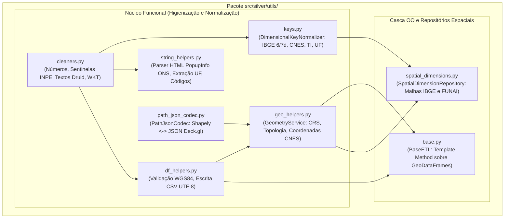
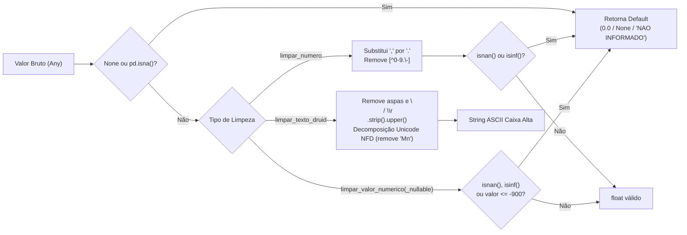
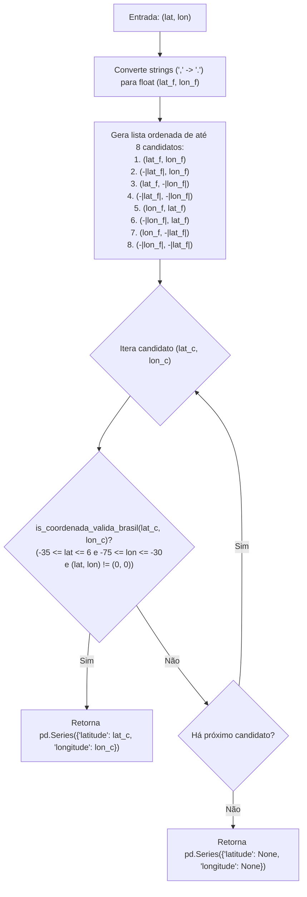
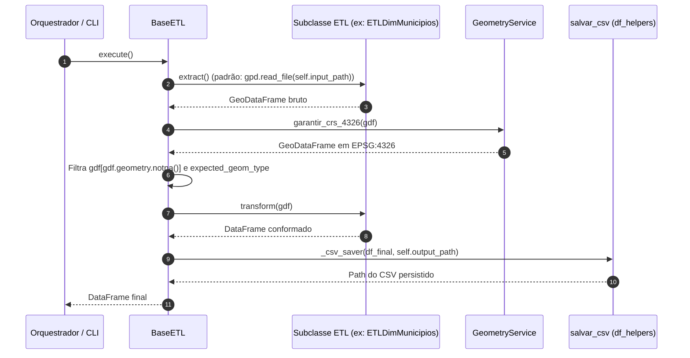

# Especificação Técnica: Pacote de Utilitários, Limpeza e Geometria (`src/silver/utils/`)

> **Trilha Modular — Etapa 06 de 18 (Ciclo 2.1 — Utilitários de Limpeza e Geometria (`src/silver/utils/`))**: [Anterior: Ciclos 2 e 3 — Hub da Camada Silver (`src/silver/`)](../README.md) | [Portal Geral (`docs/README.md`)](../../../docs/README.md) | [Próximo: Ciclo 2.2 — Pipelines ETL das 7 Dimensões (`src/silver/etl/`)](../etl/README.md)

O pacote `src/silver/utils/` implementa o núcleo de higienização de dados (*Functional Core*), normalização de chaves relacionais, correção topológica de geometrias, codificação vetorial `path_json` e a classe base de execução de ETL (`BaseETL`). Suas funções são determinísticas e livres de efeitos colaterais em variáveis globais, sendo compartilhadas tanto pelos pipelines em lote da Camada Silver quanto pelos processadores de streaming e modelos da Camada Gold.

---

## 1. Arquitetura e Modulação do Pacote

---

## 2. Catálogo de Funções de Limpeza Textual e Numérica ([`cleaners.py`](cleaners.py))

Módulo responsável por remover valores sentinela de sensores orbitais (como `-999` do INPE), converter formatos numéricos heterogêneos e padronizar strings para indexação colunar no Apache Druid.

### Especificação das Funções de `cleaners.py`

| Função | Assinatura | Regras de Transformação e Sanitização |
|:---|:---|:---|
| `limpar_numero` | `(valor: Any, default: float = 0.0) -> float` | 1. Retorna `default` se `valor is None` ou `pd.isna(valor)`. 2. Converte para `str`, aplica `.strip()`, substitui vírgula decimal (`,`) por ponto (`.`) e aplica a expressão regular `re.sub(r"[^0-9.\-]", "", texto)` para descartar unidades de medida (ex.: `"138.00 kV"` $\rightarrow$ `"138.00"`). 3. Converte para `float` e verifica `math.isnan()` e `math.isinf()`, retornando `default` caso inválido ou se ocorrer exceção de conversão. |
| `limpar_valor_numerico` | `(valor: Any) -> float` | Específica para telemetria satelital não-nula: converte `valor` para `float` trocando `,` por `.`. Se o resultado for `NaN`, `Inf` ou **menor ou igual a `-900`** (código sentinela `-999` do INPE para ausência de leitura), retorna `0.0`. |
| `limpar_valor_numerico_nullable` | `(valor: Any) -> float \| None` | Variante anulável da função anterior: aplica as mesmas regras de rejeição (`NaN`, `Inf`, `<= -900`), porém retorna `None` em vez de `0.0` para evitar distorção de médias estatísticas no Apache Druid quando o sensor não reportou medição. |
| `limpar_texto_druid` | `(texto: Any) -> str` | 1. Se `pd.isna(texto)` ou string vazia após `.strip()`, retorna a constante `NOT_INFORMED` (`"NAO INFORMADO"`). 2. Remove aspas duplas (`"`), substitui quebras de linha (`\n`, `\r`) por espaço simples e converte para letras maiúsculas (`.upper()`). 3. Aplica normalização Unicode `unicodedata.normalize("NFD", t)` e filtra caracteres da categoria `Mn` (*Mark, Nonspacing*), removendo acentos e cedilhas. |
| `gerar_chave_join` | `(texto: Any) -> str` | Normaliza nomes para junções tabulares (`pd.merge`): descarta qualquer sufixo entre parênteses via `.split("(")[0]`, remove acentos via NFD, converte para caixa alta e remove caracteres especiais via `re.sub(r"[^A-Z0-9 ]", "", t)`. Retorna `""` se nulo. |
| `limpar_wkt` | `(wkt_string: Any) -> str` | Remove quebras de linha (`\n`, `\r`) e espaços laterais de representações *Well-Known Text* (WKT) para impedir corrupção estrutural em arquivos CSV. |

---

## 3. Extração de Metadados Semiestruturados ([`string_helpers.py`](string_helpers.py))

Módulo projetado para extrair atributos técnicos embutidos em strings HTML (`PopupInfo`) e nomenclaturas compostas provenientes da exportação KML/GeoJSON do servidor ArcGIS da ANEEL/ONS.

| Função | Assinatura | Expressão Regular / Regra de Extração |
|:---|:---|:---|
| `limpar_codigo` | `(valor: Any) -> str` | Remove aspas, quebras de linha e o sufixo decimal `".0"` (gerado pelo Pandas ao ler inteiros com nulos como `float64`), delegando a string resultante para `limpar_texto_druid()`. Retorna `"NAO INFORMADO"` se vazio ou nulo. |
| `extrair_popup_valor` | `(html: Any, rotulo: str) -> str` | Aplica a regex case-insensitive `rf"<b>\s*{re.escape(rotulo)}\s*:\s*<\/b>\s*(.*?)(?:<br\/>\|$)"` sobre o campo `PopupInfo` dos GeoJSONs da ANEEL. Exemplo: extrai `"230 Kv"` de `"<b>Tensão: </b>230 Kv "`. Retorna `""` se o rótulo não existir. |
| `extrair_uf_popup` | `(texto: Any) -> str` | Extrai a sigla da Unidade Federativa posicionada após hífen no final da string via regex `r"-\s*([A-Z]{2})\s*$"`. Exemplo: `"Afuá - PA"` $\rightarrow$ `"PA"`. Retorna `"NI"` (`UNKNOWN_UF`) se não houver correspondência. |
| `extrair_uf_nome_linha` | `(nome: Any) -> str` | Extrai a UF principal do sufixo de linhas de transmissão via regex `r"\b([A-Z]{2})(?:\/[A-Z]{2})?\s*$"`. Exemplo: `"LT 500 KV XINGU / ESTREITO PA/TO"` $\rightarrow$ `"PA"`. Retorna `"NI"` caso ausente. |

---

## 4. Normalização de Chaves Dimensionais ([`keys.py`](keys.py))

Implementado pela classe `DimensionalKeyNormalizer` (com funções equivalentes re-exportadas no escopo do módulo), garante a integridade referencial das chaves primárias e estrangeiras no modelo Snowflake.

| Método / Função | Assinatura | Regra de Padronização |
|:---|:---|:---|
| `extrair_digitos` | `(valor: Any) -> str` | Converte para string, remove o sufixo `".0"` caso presente (`if texto.endswith(".0"): texto = texto[:-2]`) e remove todos os caracteres não numéricos com `re.sub(r"\D", "", texto)`. |
| `normalizar_codigo_ibge` | `(valor: Any) -> str` | Extrai dígitos via `extrair_digitos()`. Se o código possuir 7 ou mais dígitos (padrão IBGE com dígito verificador), trunca para os **6 primeiros dígitos** (`digitos[:6]`) para compatibilidade direta com `CO_MUNICIPIO_GESTOR` do DATASUS/CNES. Retorna `"NAO INFORMADO"` se o comprimento final for diferente de 6. |
| `normalizar_codigo_ibge_7digitos` | `(valor: Any) -> str` | Extrai dígitos e preserva o código completo de **7 dígitos** do IBGE. Retorna `"NAO INFORMADO"` se `len(digitos) != 7`. |
| `normalizar_codigo_cnes` | `(valor: Any) -> str` | Extrai dígitos numéricos preservando zeros à esquerda significativos do cadastro hospitalar. Retorna `"NAO INFORMADO"` se vazio. |
| `normalizar_codigo_ti` | `(valor: Any) -> str` | Extrai dígitos numéricos do identificador oficial da Terra Indígena (FUNAI). Retorna `"NAO INFORMADO"` se vazio. |
| `normalizar_uf` | `(valor: Any) -> str` | Aplica `limpar_texto_druid()`. Se o valor constar no dicionário `UF_POR_NOME` (27 unidades federativas por extenso, ex.: `"TOCANTINS": "TO"`), retorna a sigla correspondente; caso contrário, filtra letras `[^A-Z]` e retorna os 2 primeiros caracteres ou `"NI"`. |
| `normalizar_localidade` | `(valor: Any) -> str` | Higieniza o nome do município/localidade via `limpar_texto_druid()`, colapsando espaços múltiplos contíguos (`" ".join(texto.split())`). |

---

## 5. Higienização Topológica, CRS e Coordenadas ([`geo_helpers.py`](geo_helpers.py) e [`df_helpers.py`](df_helpers.py))

Centralizado em `GeometryService` (`geo_helpers.py`) e `df_helpers.py`, trata inconsistências geométricas, projeções cartográficas e erros cadastrais de coordenadas.

### 5.1 Fluxo de Recuperação de Coordenadas Cadastrais (`normalizar_par_coordenadas`)

Cadastros manuais (especialmente no CNES/DATASUS) apresentam frequentemente inversão entre latitude e longitude ou omissão do sinal negativo de hemisfério. O método `GeometryService.normalizar_par_coordenadas(lat, lon)` testa até 8 permutações candidatas contra o bounding box brasileiro (`BRAZIL_LAT_MIN=-35.0` a `6.0`, `BRAZIL_LON_MIN=-75.0` a `-30.0`):

### 5.2 Catálogo de Funções de `geo_helpers.py` e `df_helpers.py`

| Função / Método | Assinatura | Comportamento Técnico |
|:---|:---|:---|
| `coordenada_valida` | `(lat: Any, lon: Any) -> bool` | Valida se `lat` e `lon` são conversíveis para `float` finitos (não `NaN`/`Inf`), pertencem ao intervalo global WGS84 (`-90 <= lat <= 90`, `-180 <= lon <= 180`) e **não** correspondem à origem nula `(0.0, 0.0)`. |
| `is_coordenada_valida_brasil` | `(lat: Any, lon: Any) -> bool` | Verifica `coordenada_valida(lat, lon)` e restringe o domínio ao retângulo envolvente do território brasileiro (`-35.0 <= lat <= 6.0` e `-75.0 <= lon <= -30.0`). |
| `garantir_crs_4326` | `(gdf: GeoDataFrame) -> GeoDataFrame` | Se `gdf.crs is None`, define `EPSG:4326`; em seguida, executa `gdf.to_crs(epsg=4326)` para padronizar os vértices em WGS84. |
| `remover_repeticoes_periodicas` | `(coords: Sequence[Sequence[float]]) -> list[list[float]]` | Arredonda coordenadas para 6 casas decimais e detecta se a sequência de vértices de comprimento $N$ é formada pela repetição periódica exata de uma subsequência de tamanho $k \in [2, N/2]$ (artefato comum em exportações KML para GeoJSON). Caso positivo, retorna apenas o ciclo base. |
| `remover_consecutivos_duplicados` | `(coords: list[list[float]]) -> list[list[float]]` | Remove vértices adjacentes idênticos (`coord == limpos[-1]`) para reduzir o tamanho do payload JSON sem alterar a geometria. |
| `limpar_linestring_geometry` | `(geom: BaseGeometry \| None) -> BaseGeometry \| None` | Aplica `remover_repeticoes_periodicas` e `remover_consecutivos_duplicados` sobre objetos `LineString` ou `MultiLineString`. Descarta segmentos degenerados com menos de 2 vértices distintos; se um `MultiLineString` restar com apenas 1 segmento válido, converte-o em `LineString` simples. |
| `corrigir_geometria_invalida` | `(geom: BaseGeometry \| None) -> BaseGeometry \| None` | Verifica `geom.is_valid`; se `False` (ex.: polígonos com auto-intersecção em malhas do IBGE/FUNAI), aplica a operação topológica `geom.buffer(0)` para reconstruir o anel exterior válido. |
| `adicionar_centroides` | `(gdf: GeoDataFrame) -> GeoDataFrame` | Reprojeta o `GeoDataFrame` para a projeção métrica `EPSG:5880` (`gdf.to_crs(epsg=5880)`), calcula o centroide geométrico planar sem distorção esférica, reprojeta o centroide de volta para `EPSG:4326` e grava as colunas `latitude` e `longitude` arredondadas em 6 casas decimais. |
| `salvar_csv` | `(df: DataFrame, caminho: str \| Path) -> Path` | Cria diretórios pais se inexistentes e grava o DataFrame em `utf-8`, sem índice (`index=False`), com `csv.QUOTE_MINIMAL` e terminador de linha Unix (`lineterminator="\n"`). |

---

## 6. Codificação e Decodificação Vetorial (`PathJsonCodec` — [`path_json_codec.py`](path_json_codec.py))

O Apache Superset (camadas Deck.gl `PathLayer` e `PolygonLayer`) exige que trajetórias e polígonos estejam serializados como arrays JSON de pares `[longitude, latitude]`. Ao mesmo tempo, o `SpatialLayerLoader` e o `SINNetworkCentralityModel` reconstroem objetos Shapely a partir dessa coluna, eliminando a necessidade de armazenar colunas WKT duplicadas nos arquivos CSV da camada Silver.

| Método | Assinatura | Estrutura JSON / Regra de Conversão |
|:---|:---|:---|
| `arredondar_coord` | `(coord: Sequence[float], casas: int = 6) -> list[float]` | Retorna `[round(float(coord[0]), 6), round(float(coord[1]), 6)]` (precisão submétrica de ~11 cm no equador). |
| `geometry_para_path_json` | `(geom: BaseGeometry \| None) -> str` | Serializa objetos Shapely para string JSON: • `None` ou vazio $\rightarrow$ `"[]"` • `Point` $\rightarrow$ `[[lon, lat]]` • `LineString` $\rightarrow$ `[[lon1, lat1], [lon2, lat2], ...]` • `MultiLineString` $\rightarrow$ `[[[lon1, lat1], ...], [[lonA, latA], ...]]` • `Polygon` $\rightarrow$ `[[[lon1, lat1], ...]]` (anel exterior) • `MultiPolygon` $\rightarrow$ `[[[[lon1, lat1], ...]], ...]` |
| `path_json_para_geometry` | `(valor: Any, tipo_geometria: str = "line") -> BaseGeometry \| None` | Operação inversa (`json.loads` $\rightarrow$ Shapely): • `tipo_geometria="point"`: reconstrói `Point(lon, lat)`. • `tipo_geometria="line"`: reconstrói `LineString` ou `MultiLineString` (descartando segmentos com `< 2` pontos). • `tipo_geometria="polygon"`: reconstrói `Polygon` ou `MultiPolygon` (exigindo $\ge 4$ pontos no anel fechado e aplicando `buffer(0)` se inválido). |

---

## 7. Template Base de ETL e Repositório Espacial (`base.py` e `spatial_dimensions.py`)

### 7.1 Ciclo de Execução de `BaseETL` ([`base.py`](base.py))

`BaseETL` herda de `ExecutablePipelineStep` e padroniza o ciclo de vida das 7 dimensões da Camada Silver:

### 7.2 Repositório `SpatialDimensionRepository` ([`spatial_dimensions.py`](spatial_dimensions.py))

Fornece malhas de referência pré-higienizadas para resolução de chaves estrangeiras espaciais (`codigo_ibge` e `codigo_ti`) durante a construção das dimensões de Hospitais, Subestações e Sistemas Isolados:
- **`carregar_municipios_geo(geo_dir)`**: Lê `municipios_br.geojson`, converte CRS para `EPSG:4326`, normaliza `id` para `codigo_ibge` de 6 dígitos via `DimensionalKeyNormalizer.normalizar_codigo_ibge`, corrige topologias inválidas com `buffer(0)` e remove duplicatas.
- **`carregar_terras_indigenas_geo(geo_dir)`**: Lê `mapa_terras_indigenas.geojson`, agrupa feições de mesma reserva por `codigo_ti` e unifica multipolígonos via `shapely.ops.unary_union`.
- **`associar_municipio_por_intersecao(gdf, municipios_gdf)`**: Executa `gpd.sjoin(pontos, municipios, how="left", predicate="intersects")` para atribuir `codigo_ibge` a geometrias pontuais, preenchendo registros sem intersecção com `"NAO INFORMADO"`.

---

> **Trilha Modular — Etapa 06 de 18 (Ciclo 2.1 — Utilitários de Limpeza e Geometria (`src/silver/utils/`))**: [Anterior: Ciclos 2 e 3 — Hub da Camada Silver (`src/silver/`)](../README.md) | [Portal Geral (`docs/README.md`)](../../../docs/README.md) | [Próximo: Ciclo 2.2 — Pipelines ETL das 7 Dimensões (`src/silver/etl/`)](../etl/README.md)
