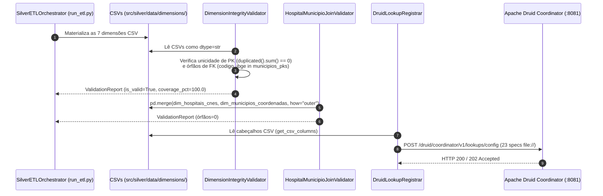

# Especificação Técnica: Validadores de Qualidade (QA) e Registro de Lookups no Apache Druid (`src/silver/validators/` e `src/silver/lookups/`)

> **Trilha Modular — Etapa 09 de 18 (Ciclo 2.4 — Validadores de Qualidade e 23 Lookups URI (`src/silver/validators/`))**: [Anterior: Ciclo 2.3 — Dicionário de Dados Dimensional (`src/silver/`)](../DICIONARIO_DADOS.md) | [Portal Geral (`docs/README.md`)](../../../docs/README.md) | [Próximo: Ciclo 3.1 — Motor Espacial STRtree em Memória (`src/silver/spatial/`)](../spatial/README.md)

Este documento especifica os mecanismos de auditoria de integridade referencial das dimensões Snowflake (`src/silver/validators/`) e o protocolo de publicação dos mapas de chave-valor em memória (`cachedNamespace` via `file://`) no Apache Druid (`src/silver/lookups/`).

---

## 1. Arquitetura e Fluxo de Sincronização Dimensional

No Apache Druid, a resolução de chaves estrangeiras em tempo de consulta (`LOOKUP(fk, 'namespace')`) exige que a coluna chave (`keyColumn`) do arquivo CSV não possua valores duplicados; caso contrário, ocorre sobrescrita silenciosa de registros no cache em memória do Broker e dos Historicals. Por esse motivo, os validadores de QA precedem o registro de Lookups:



---

## 2. Validadores de Integridade (`src/silver/validators/`)

Ambos os validadores herdam de [`DataValidatorBase`](../../core/contracts/contracts.py) (`ExecutablePipelineStep`) e retornam uma instância imutável de `ValidationReport`.

### 2.1 `DimensionIntegrityValidator` ([`dimensao_integridade_validator.py`](dimensao_integridade_validator.py))

Audita simultaneamente as 7 tabelas de dimensão definidas no atributo de classe `DIMENSION_SPECS`:

| Arquivo CSV Auditado | Chave Primária (`pk`) | Chaves Estrangeiras Auditadas (`fks`) |
|:---|:---:|:---|
| `dim_municipios_coordenadas.csv` | `codigo_ibge` | — |
| `dim_hospitais_cnes.csv` | `codigo_cnes` | `codigo_ibge` $\rightarrow$ `dim_municipios_coordenadas.csv` |
| `dim_terras_indigenas.csv` | `codigo_ti` | — |
| `dim_ons_linhas_transmissao.csv` | `id_linha_transmissao` | — |
| `dim_ons_subestacoes.csv` | `id_subestacao` | `codigo_ibge` $\rightarrow$ `dim_municipios_coordenadas.csv` |
| `dim_ons_sistemas_isolados.csv` | `id_sistema_isolado` | — |
| `dim_rodovias_federais.csv` | `id_trecho_rodoviario` | — |

#### Regras de Validação em `validate() -> ValidationReport`
1. **Leitura sem Coerção Numérica**: Carrega cada CSV com `pd.read_csv(filepath, dtype=str)` para preservar zeros à esquerda.
2. **Conjunto de Referência IBGE (`municipios_pks`)**: Constrói um `set[str]` unindo os valores únicos de `codigo_ibge` (6 dígitos) e `codigo_ibge_7digitos` (7 dígitos).
3. **Verificação de Unicidade de PK**: Contabiliza `int(df[pk_col].dropna().duplicated().sum())`.
4. **Verificação de Integridade Referencial de FK**: Descarta sentinelas explícitos (`{"NAO INFORMADO", "NI", "", "0"}`) e contabiliza quantos valores de `codigo_ibge` não pertencem a `municipios_pks` (`(~fks_reais.isin(municipios_pks)).sum()`).
5. **Critério de Aprovação**: `is_valid = (total_duplicates + total_orphans) == 0`.

---

### 2.2 `HospitalMunicipioJoinValidator` ([`valida_joins_municipios_hospital.py`](valida_joins_municipios_hospital.py))

Validador especializado na auditoria do relacionamento 1:N entre `dim_hospitais_cnes.csv` (550.882 estabelecimentos) e `dim_municipios_coordenadas.csv` (5.564 municípios):
- Executa `pd.merge(..., on="codigo_ibge", how="outer", indicator=True)`.
- Classifica registros com `_merge == "both"` como conectados (`matched_records`) e registros com `_merge == "left_only"` como órfãos (`orphan_records`).
- Extrai o ranking dos 5 municípios com maior concentração hospitalar e uma amostra de até 5 estabelecimentos órfãos (caso existam) no dicionário `details` do `ValidationReport`.

---

## 3. Registrador de Lookups URI no Apache Druid ([`druid_lookup_registrar.py`](../lookups/druid_lookup_registrar.py))

Implementado pela classe `DruidLookupRegistrar(ExecutablePipelineStep[bool])`, automatiza a configuração do tier `__default` no serviço **Druid Coordinator** (`POST http://localhost:8081/druid/coordinator/v1/lookups/config`).

### 3.1 Estrutura Técnica do Payload `cachedNamespace`

Para cada entrada `(filename, key_col, val_col)`, o método `make_uri_lookup` lê a primeira linha do CSV (`get_csv_columns`) e gera o objeto JSON abaixo:

```json
{
  "version": "1762288000",
  "lookupExtractorFactory": {
    "type": "cachedNamespace",
    "extractionNamespace": {
      "type": "uri",
      "uri": "file:///opt/src/silver/data/dimensions/dim_municipios_coordenadas.csv",
      "namespaceParseSpec": {
        "format": "csv",
        "columns": ["codigo_ibge", "codigo_ibge_7digitos", "chave_localidade", "..."],
        "skipHeaderRows": 1,
        "keyColumn": "codigo_ibge",
        "valueColumn": "municipios_nome"
      }
    },
    "firstCacheTimeout": 0
  }
}
```

Caso o Druid Coordinator retorne erro contendo `"Not initialized"` na primeira requisição (comportamento padrão em clusters recém-provisionados), o método `_run()` envia primeiramente um objeto vazio `{}` para inicializar o tier de configuração e reexecuta o envio do payload completo.

### 3.2 Catálogo dos 23 Lookups Registrados (`DEFAULT_LOOKUP_SPECS`)

| Nome do Lookup no Druid | Arquivo CSV Fonte | Coluna Chave (`keyColumn`) | Coluna Valor (`valueColumn`) |
|:---|:---|:---|:---|
| `municipios_nome` | `dim_municipios_coordenadas.csv` | `codigo_ibge` | `municipios_nome` |
| `municipios_uf` | `dim_municipios_coordenadas.csv` | `codigo_ibge` | `estado_sigla` |
| `municipios_regiao` | `dim_municipios_coordenadas.csv` | `codigo_ibge` | `regiao_brasil` |
| `hospitais_nome` | `dim_hospitais_cnes.csv` | `codigo_cnes` | `nome_hospital` |
| `hospitais_tipo` | `dim_hospitais_cnes.csv` | `codigo_cnes` | `tipo_unidade` |
| `hospitais_critico` | `dim_hospitais_cnes.csv` | `codigo_cnes` | `tipo_unidade_critica` |
| `hospitais_24h` | `dim_hospitais_cnes.csv` | `codigo_cnes` | `funciona_24h` |
| `ti_nome` | `dim_terras_indigenas.csv` | `codigo_ti` | `nome_terra_indigena` |
| `ti_etnia` | `dim_terras_indigenas.csv` | `codigo_ti` | `etnia` |
| `ti_uf` | `dim_terras_indigenas.csv` | `codigo_ti` | `estado_sigla` |
| `ti_path_json` | `dim_terras_indigenas.csv` | `codigo_ti` | `path_json` |
| `linha_nome` | `dim_ons_linhas_transmissao.csv` | `id_linha_transmissao` | `nome_linha` |
| `linha_tensao` | `dim_ons_linhas_transmissao.csv` | `id_linha_transmissao` | `tensao_kv` |
| `linha_uf` | `dim_ons_linhas_transmissao.csv` | `id_linha_transmissao` | `estado_sigla_estimado` |
| `linha_path_json` | `dim_ons_linhas_transmissao.csv` | `id_linha_transmissao` | `path_json` |
| `subestacao_nome` | `dim_ons_subestacoes.csv` | `id_subestacao` | `nome_subestacao` |
| `subestacao_capacidade` | `dim_ons_subestacoes.csv` | `id_subestacao` | `capacidade_mw` |
| `subestacao_risco_cascata` | `dim_ons_subestacoes.csv` | `id_subestacao` | `risco_cascata` |
| `subestacao_betweenness` | `dim_ons_subestacoes.csv` | `id_subestacao` | `betweenness_score_norm` |
| `sistema_isolado_nome` | `dim_ons_sistemas_isolados.csv` | `id_sistema_isolado` | `nome_sistema_isolado` |
| `sistema_isolado_uf` | `dim_ons_sistemas_isolados.csv` | `id_sistema_isolado` | `estado_sigla` |
| `rodovia_codigo` | `dim_rodovias_federais.csv` | `id_trecho_rodoviario` | `codigo_rodovia` |
| `rodovia_criticidade` | `dim_rodovias_federais.csv` | `id_trecho_rodoviario` | `criticidade_rodovia` |

---

> **Trilha Modular — Etapa 09 de 18 (Ciclo 2.4 — Validadores de Qualidade e 23 Lookups URI (`src/silver/validators/`))**: [Anterior: Ciclo 2.3 — Dicionário de Dados Dimensional (`src/silver/`)](../DICIONARIO_DADOS.md) | [Portal Geral (`docs/README.md`)](../../../docs/README.md) | [Próximo: Ciclo 3.1 — Motor Espacial STRtree em Memória (`src/silver/spatial/`)](../spatial/README.md)
